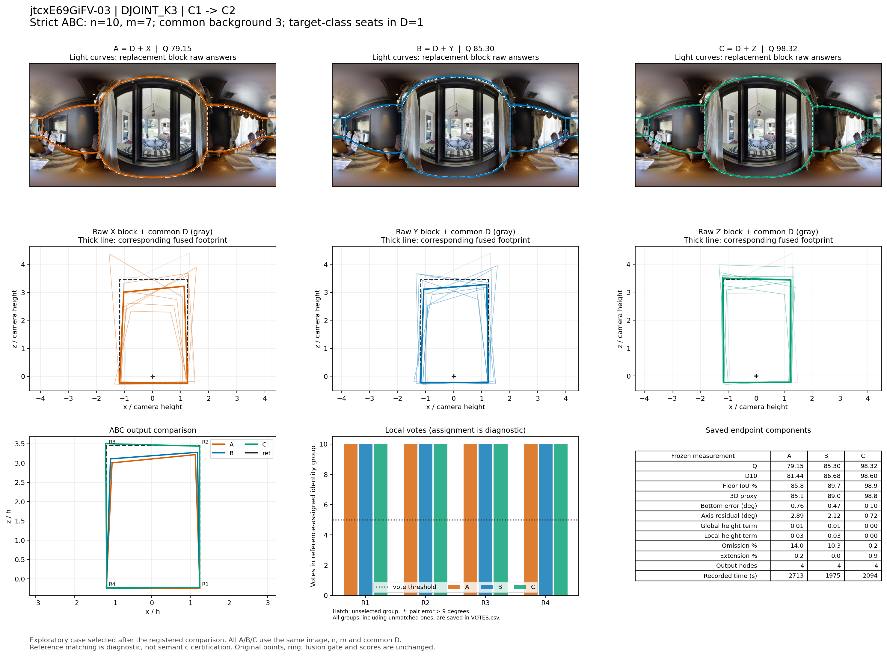
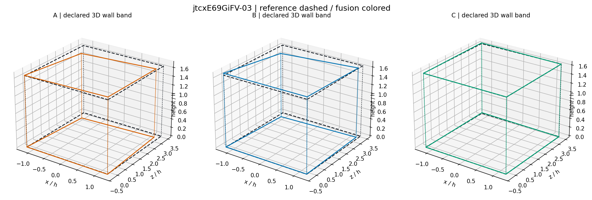

# jtcxE69GiFV-03：DJOINT_K3 严格同图大块替换

事件 `1f1055f13748d0a3f1f9a3cc`；楼外分类折为 `jtcxE69GiFV`。此例是在完整比较之后选取的机制展示，不是独立估计总体效果。

总人数 n=10，实际换人数 m=7，比例 70.0%；共同背景 D 为 3 人，含目标类 1 人。X/Y 同属源类 C1，Z 属目标类 C2，四块彼此不重叠。

## 端点与比较

|指标|A 原队|B 同类替换|C 跨类替换|
|---|---:|---:|---:|
|Q|79.153|85.302|98.325|
|D10|81.443|86.684|98.595|
|底面 IoU（0–1）|0.858|0.897|0.989|
|三维代理（0–100）|85.133|89.043|98.776|
|底界角误差（度）|0.760|0.466|0.100|
|方向残差（度）|2.895|2.116|0.724|
|整体高度项|0.007|0.007|0.001|
|局部高度项|0.026|0.032|0.001|
|遗漏比例|0.140|0.103|0.002|
|外扩比例|0.002|0.000|0.009|
|输出节点|4.000|4.000|4.000|
|来源记录总秒数|2712.932|1975.458|2093.501|

B−A = +6.149；C−A = +19.172；C−B = +13.023。同类绝对变化 6.149，对称跨类绝对变化 16.097。此单事件幅度不能替代逐图、逐楼支持率。

## 局部票数与表达变化

下列 R 编号是冻结参考的角点序号。每队对应组均在融合完成后做角度一一分配；有票数不自动表示语义正确，匹配偏差大时必须结合原图。

|参考角点|A票/选留|B票/选留|C票/选留|A/B/C最大点对误差（度）|
|---|---|---|---|---|
|R1|10/选|10/选|10/选|2.088/1.944/0.250|
|R2|10/选|10/选|10/选|1.201/0.766/0.064|
|R3|10/选|10/选|10/选|2.143/1.599/0.225|
|R4|10/选|10/选|10/选|0.312/1.504/0.429|

三队门槛均为 5 票。`RAW_BLOCK_SUPPORT.csv` 分别给 D/X/Y/Z 原答在参考角点的 5°/9°后验支持，`VOTES.csv` 给真实融合组的票数，两者不可混为同一票账。

- A→B：共有 12 个原观察；共同观察对分组发生 0 次拆分、0 次合并。统计单位为观察对，不能称为换掉的人员数。

- A→C：共有 12 个原观察；共同观察对分组发生 0 次拆分、0 次合并。统计单位为观察对，不能称为换掉的人员数。

- B→C：共有 12 个原观察；共同观察对分组发生 0 次拆分、0 次合并。统计单位为观察对，不能称为换掉的人员数。

## 图像解释记录

已实际查看原图及三队叠图。图片是深灰墙、长桌餐厅；窗侧玻璃之外另有露台，当前参考和三队都沿餐厅主体的四边围合，没有把玻璃外的空间加进来。厚窗帘、椅子遮挡了部分竖直交线及底点，这与当前“中等难度、无自遮挡、需要定位推断”的记录相符。

这例的作用主要是**同一结构下的定位改善**。四个对应组在 A/B/C 中全为 10 票，远高于共同的 5 票门槛；输出均为 4 点。共同 D 的 12 个观察在三队之间无拆分、合并。因此升质不能归因于多画转折或越过结构门槛，直接变化在组内坐标中位数与边界位置。

原答叠图中 X、Y 块对远侧底边更常出现收缩或倾斜；Z 块的远侧两角较集中，C 更贴近冻结参考。B→C 的底界角误差由 0.466° 降到 0.100°，方向残差由 2.116° 降到 0.724°；底面 IoU 从 89.72% 到 98.86%，三维代理从 89.04 到 98.78，遗漏由 10.27% 降到 0.21%。这里多项几何与 Q 同向改善。

C−B 的 Q 为 +13.023；来源记录时间 1,975.458→2,093.501 秒，增加 118.043 秒（约 5.98%）。相对原队 A 则节时约 22.83%。两个比较对象应分别报告：此例不能写成“相对同类替换升质且节时”。

## 可定位证据

精确成员见 `BLOCK_MEMBERS.csv`；完整事件和冻结点坐标见 `CASE_GEOMETRY.json.gz`；三队重放与已存端点核对见 `REPLAY_RECEIPT.json`。来源记录时间不是新测的生产耗时。
