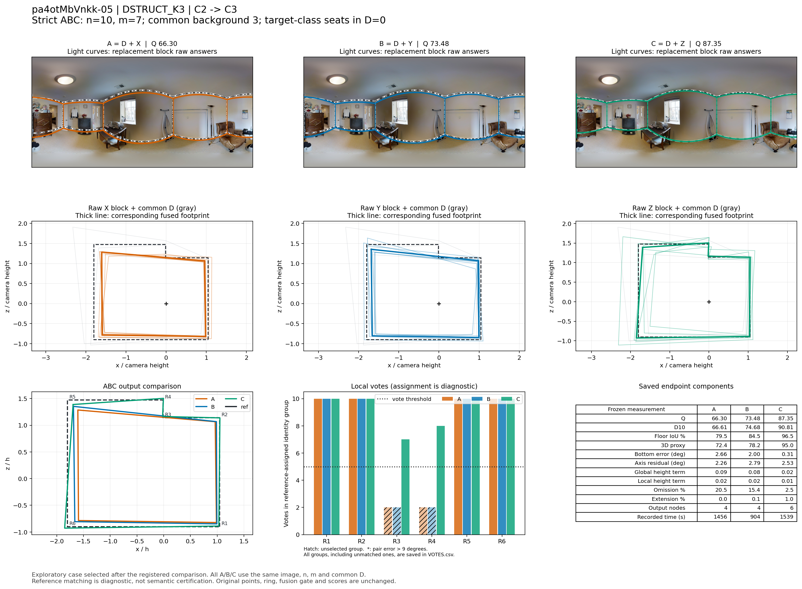
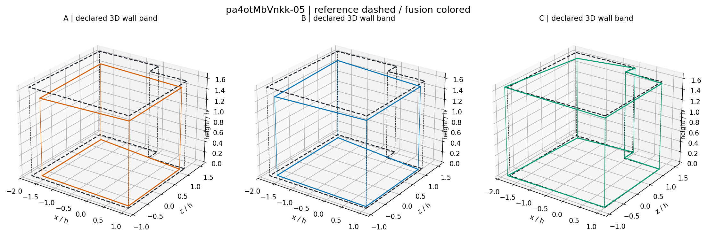

# pa4otMbVnkk-05：DSTRUCT_K3 严格同图大块替换

事件 `657ca45c363d898187246206`；楼外分类折为 `pa4otMbVnkk`。此例是在完整比较之后选取的机制展示，不是独立估计总体效果。

总人数 n=10，实际换人数 m=7，比例 70.0%；共同背景 D 为 3 人，含目标类 0 人。X/Y 同属源类 C2，Z 属目标类 C3，四块彼此不重叠。

## 端点与比较

|指标|A 原队|B 同类替换|C 跨类替换|
|---|---:|---:|---:|
|Q|66.296|73.481|87.351|
|D10|66.611|74.684|90.813|
|底面 IoU（0–1）|0.795|0.845|0.965|
|三维代理（0–100）|72.401|78.232|94.954|
|底界角误差（度）|2.659|1.998|0.309|
|方向残差（度）|2.259|2.794|2.532|
|整体高度项|0.090|0.075|0.018|
|局部高度项|0.017|0.016|0.012|
|遗漏比例|0.205|0.154|0.025|
|外扩比例|0.000|0.001|0.010|
|输出节点|4.000|4.000|6.000|
|来源记录总秒数|1455.819|903.631|1538.918|

B−A = +7.185；C−A = +21.055；C−B = +13.870。同类绝对变化 7.185，对称跨类绝对变化 17.463。此单事件幅度不能替代逐图、逐楼支持率。

## 局部票数与表达变化

下列 R 编号是冻结参考的角点序号。每队对应组均在融合完成后做角度一一分配；有票数不自动表示语义正确，匹配偏差大时必须结合原图。

|参考角点|A票/选留|B票/选留|C票/选留|A/B/C最大点对误差（度）|
|---|---|---|---|---|
|R1|10/选|10/选|10/选|3.077/2.548/1.288|
|R2|10/选|10/选|10/选|2.181/1.682/0.987|
|R3|2/未选|2/未选|7/选|1.809/1.401/0.647|
|R4|2/未选|2/未选|8/选|0.814/0.814/1.228|
|R5|10/选|10/选|10/选|2.728/2.065/1.275|
|R6|10/选|10/选|10/选|3.634/3.528/0.640|

三队门槛均为 5 票。`RAW_BLOCK_SUPPORT.csv` 分别给 D/X/Y/Z 原答在参考角点的 5°/9°后验支持，`VOTES.csv` 给真实融合组的票数，两者不可混为同一票账。

- A→B：共有 15 个原观察；共同观察对分组发生 0 次拆分、0 次合并。统计单位为观察对，不能称为换掉的人员数。

- A→C：共有 15 个原观察；共同观察对分组发生 0 次拆分、0 次合并。统计单位为观察对，不能称为换掉的人员数。

- B→C：共有 15 个原观察；共同观察对分组发生 0 次拆分、0 次合并。统计单位为观察对，不能称为换掉的人员数。

## 图像解释记录

已实际查看原图、原答和三队叠图。这是缝纫休息室，**当前采用的难度为中等，不归入困难图**。画面接缝附近的高柜挡住 R3/R4 下部和竖直交线，上方墙顶仍提供窄转折线索；当前采用记录也明确写出“高柜遮住接缝附近点3、4的下部和竖角，窄转折需结合上端补足”。本例支持遮挡条件下对既定房间短结构的不同表达，不是把打开的房门外另一个房间扩大纳入。

这是 DSTRUCT_K3 中非常直接的类间结构差别：X、Y 两个互不重叠的源类七人块，分别只有一人进入 R3 组，均没有人进入 R4 组；目标类 Z 中则有 **6/7 人同时进入 R3、R4 组**。这六人是 W102、W109、W112、W122、W126、W130。共同 D 为 W100、W103、W117，对 R3/R4 分别贡献 1/2 票。

因此三队真实组票数为：

| 位置 | A：D+X | B：D+Y | C：D+Z | 共同门槛 |
|---|---:|---:|---:|---:|
| R3 | 2 | 2 | 7 | 5 |
| R4 | 2 | 2 | 8 | 5 |

A/B 均失去两处转折，形成四点围合；C 两处均进入融合，恢复六点形状。这里不是某一个特殊人员提供恰好一票：Z 内六人的重复支持形成了较大票数余量。三队共同 D 的 15 个观察没有拆分或合并，新增结构也不是重分组偶然把相同背景票重新凑出来。

R3/R4 在 ERP 的横向投影仅相隔约 0.13°，但顶部／底部纵向坐标和 BEV 深度不同；它们构成实际的短退台，而不是同一条边上的两个冗余点。冻结几何诊断中 C 有 6 个转折、1 条小于 0.5 相机高度的短边、0 个近共线冗余点，A/B 均为 4 转折。该处下部仍有遮挡，采用的是既有参考及已审阅结构机会，不声称从原图清晰看到了每一个底点。

结构补充之外，原有四个主要角点的中位数底点也改善：例如 R1 底点对参考误差 A/B/C 为 2.118°/1.528°/0.384°，R5 为 2.728°/1.631°/1.275°。因此 C 的变化包括短结构恢复和位置改善。

C−B：Q +13.870，底面 IoU 84.54%→96.53%，三维代理 78.23→94.95，遗漏 15.39%→2.53%，整体高度比 0.925→0.982。方向残差 C 为 2.532°，甚至略差于 A 的 2.259°；本例的明显改善不能只归因于方向项得分。

按不依赖参考的融合形状距离（1−BEV IoU），同类 A/B 为 **0.0612**，对称跨类为 **0.1662**，差 **+0.1049**；同类 Q 绝对变化 7.185，对称跨类 17.463。它是分类在原答结构、融合形状及质量上都能形成差别的一例，整体支持率仍由完整楼外比较给出。

来源记录时间 C 为 1,538.918 秒，B 为 903.631 秒、A 为 1,455.819 秒：相对 B 增加约 70.3%，相对 A 增加约 5.7%。这是明确的结构／质量收益伴随时间成本，不能表述为效率类的省时成果。

## 可定位证据

精确成员见 `BLOCK_MEMBERS.csv`；完整事件和冻结点坐标见 `CASE_GEOMETRY.json.gz`；三队重放与已存端点核对见 `REPLAY_RECEIPT.json`。来源记录时间不是新测的生产耗时。
