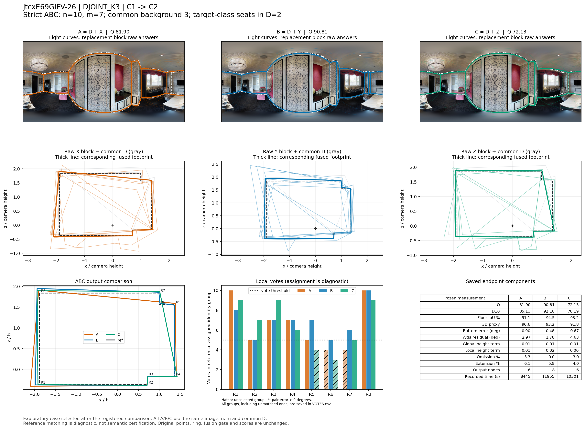
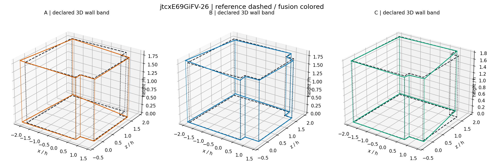

# jtcxE69GiFV-26：DJOINT_K3 严格同图大块替换

事件 `7131b3e0aa7ea1cacd8687c2`；楼外分类折为 `jtcxE69GiFV`。此例是在完整比较之后选取的机制展示，不是独立估计总体效果。

总人数 n=10，实际换人数 m=7，比例 70.0%；共同背景 D 为 3 人，含目标类 2 人。X/Y 同属源类 C1，Z 属目标类 C2，四块彼此不重叠。

## 端点与比较

|指标|A 原队|B 同类替换|C 跨类替换|
|---|---:|---:|---:|
|Q|81.903|90.807|72.129|
|D10|85.130|92.181|78.186|
|底面 IoU（0–1）|0.911|0.945|0.932|
|三维代理（0–100）|90.609|93.182|91.808|
|底界角误差（度）|0.905|0.479|0.674|
|方向残差（度）|2.967|1.782|4.625|
|整体高度项|0.005|0.014|0.013|
|局部高度项|0.010|0.017|0.005|
|遗漏比例|0.033|0.000|0.030|
|外扩比例|0.061|0.058|0.040|
|输出节点|6.000|8.000|6.000|
|来源记录总秒数|8445.000|11954.965|10300.988|

B−A = +8.904；C−A = -9.774；C−B = -18.678。同类绝对变化 8.904，对称跨类绝对变化 14.226。此单事件幅度不能替代逐图、逐楼支持率。

## 局部票数与表达变化

下列 R 编号是冻结参考的角点序号。每队对应组均在融合完成后做角度一一分配；有票数不自动表示语义正确，匹配偏差大时必须结合原图。

|参考角点|A票/选留|B票/选留|C票/选留|A/B/C最大点对误差（度）|
|---|---|---|---|---|
|R1|10/选|8/选|9/选|2.475/1.219/0.668|
|R2|5/选|5/选|7/选|0.916/2.400/1.401|
|R3|7/选|7/选|9/选|0.714/1.558/2.283|
|R4|7/选|7/选|6/选|1.273/0.712/1.887|
|R5|5/选|7/选|4/未选|0.507/1.292/1.199|
|R6|4/未选|5/选|3/未选|1.134/0.760/0.920|
|R7|4/未选|6/选|5/选|1.350/0.530/0.617|
|R8|10/选|10/选|9/选|1.393/2.358/1.232|

三队门槛均为 5 票。`RAW_BLOCK_SUPPORT.csv` 分别给 D/X/Y/Z 原答在参考角点的 5°/9°后验支持，`VOTES.csv` 给真实融合组的票数，两者不可混为同一票账。

- A→B：共有 18 个原观察；共同观察对分组发生 0 次拆分、0 次合并。统计单位为观察对，不能称为换掉的人员数。

- A→C：共有 18 个原观察；共同观察对分组发生 0 次拆分、0 次合并。统计单位为观察对，不能称为换掉的人员数。

- B→C：共有 18 个原观察；共同观察对分组发生 0 次拆分、0 次合并。统计单位为观察对，不能称为换掉的人员数。

## 图像解释记录

已实际查看原图及三队叠图。黑白壁纸房间存在多处浅凹入与短转折；当前用户采用的难度记录为“八处浅凹入和转折大多可辨，窗帘局部挡上端附近，主体连接清楚”，结构机会为 `short_edge_H0`，参考共 8 个转折、3 条短边。本例与 jtc-03 使用同一建筑外折、同一 DJOINT_K3 类别方向，目标类具有较高历史 Q 和较多困难图转折，但具体位置支持仍不同。

B 的 Y 块对 R5/R6/R7 贡献 5/4/4 票，配合 D 的 2/1/2 票，三个组均入选（7/5/6）。C 的 Z 块对相同位置只贡献 2/2/3 票，合计 4/3/5；R5、R6 因此失选。B 为 8 节点，C 为 6 节点，右侧局部转折被直接跨接，形成更明显的斜边。

关键成员可以定位：Y 中 W105、W106、W117、W118共同进入 R6 组，加上 D 的 W102 正好 5 票；Z 中此组只有 W124、W134，加 D 后仅 3 票。共同 D 的 18 个观察没有重分组，不能把这次下降笼统归为旧观察对应不稳定。

B→C 的 Q 90.807→72.129（−18.678），D10 92.181→78.186；方向残差 1.782°→4.625°。底面 IoU 94.50%→93.19%，三维代理 93.18→91.81，变化小得多。因此应同时报告结构丢失、方向变差和总分下降的不同幅度，不能把 −18.68 Q 描述成几何重合度也下降了 18.68 个百分点。

这也是“变化大”不等于“变好”的明确反例。C 的来源记录时间相对 B 减少约 13.83%，相对 A 增加约 21.98%；与 B 比较是一项节时但损失结构和质量的替换。它说明以困难图总体转折数和 Q/T 形成的类能划分平均角色，但某个成员块在特定短边的补充能力仍应由群体统计与真实局部支持一起解释。

## 可定位证据

精确成员见 `BLOCK_MEMBERS.csv`；完整事件和冻结点坐标见 `CASE_GEOMETRY.json.gz`；三队重放与已存端点核对见 `REPLAY_RECEIPT.json`。来源记录时间不是新测的生产耗时。
