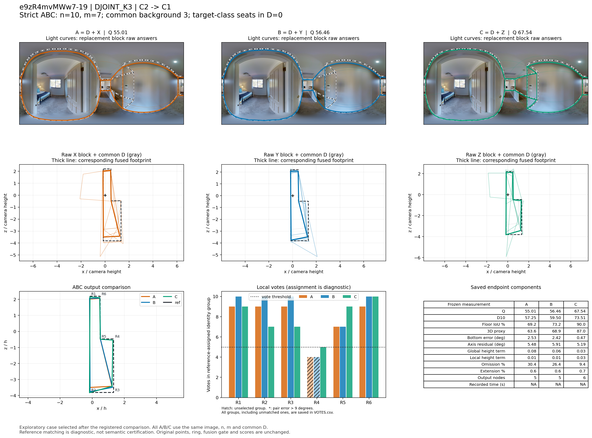
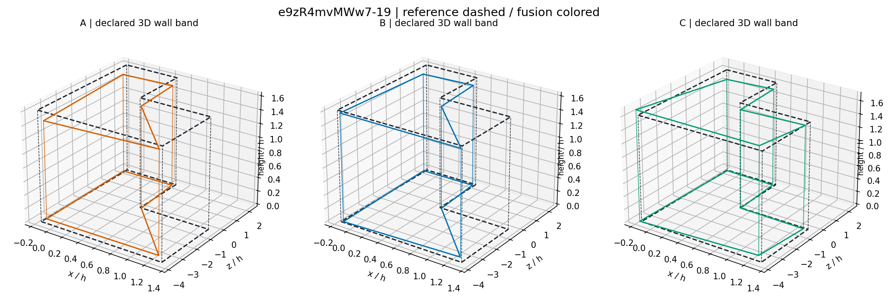

# e9zR4mvMWw7-19：DJOINT_K3 严格同图大块替换

事件 `d736b65c895fa37104d8f307`；楼外分类折为 `e9zR4mvMWw7`。此例是在完整比较之后选取的机制展示，不是独立估计总体效果。

总人数 n=10，实际换人数 m=7，比例 70.0%；共同背景 D 为 3 人，含目标类 0 人。X/Y 同属源类 C2，Z 属目标类 C1，四块彼此不重叠。

## 端点与比较

|指标|A 原队|B 同类替换|C 跨类替换|
|---|---:|---:|---:|
|Q|55.007|56.459|67.537|
|D10|57.248|59.497|73.513|
|底面 IoU（0–1）|0.692|0.732|0.900|
|三维代理（0–100）|63.611|68.907|87.014|
|底界角误差（度）|2.532|2.421|0.472|
|方向残差（度）|5.476|5.913|5.193|
|整体高度项|0.084|0.057|0.027|
|局部高度项|0.015|0.014|0.035|
|遗漏比例|0.304|0.264|0.094|
|外扩比例|0.006|0.006|0.007|
|输出节点|5.000|5.000|6.000|
|来源记录总秒数|不可评|不可评|不可评|

B−A = +1.452；C−A = +12.530；C−B = +11.078。同类绝对变化 1.452，对称跨类绝对变化 11.804。此单事件幅度不能替代逐图、逐楼支持率。

## 局部票数与表达变化

下列 R 编号是冻结参考的角点序号。每队对应组均在融合完成后做角度一一分配；有票数不自动表示语义正确，匹配偏差大时必须结合原图。

|参考角点|A票/选留|B票/选留|C票/选留|A/B/C最大点对误差（度）|
|---|---|---|---|---|
|R1|9/选|10/选|9/选|2.277/2.414/3.256|
|R2|9/选|10/选|7/选|2.129/0.537/1.074|
|R3|9/选|10/选|7/选|1.528/1.314/1.541|
|R4|4/未选|4/未选|5/选|3.178/8.126/3.631|
|R5|7/选|7/选|9/选|6.510/6.884/5.748|
|R6|9/选|10/选|10/选|1.809/1.794/1.792|

三队门槛均为 5 票。`RAW_BLOCK_SUPPORT.csv` 分别给 D/X/Y/Z 原答在参考角点的 5°/9°后验支持，`VOTES.csv` 给真实融合组的票数，两者不可混为同一票账。

- A→B：共有 17 个原观察；共同观察对分组发生 0 次拆分、0 次合并。统计单位为观察对，不能称为换掉的人员数。

- A→C：共有 17 个原观察；共同观察对分组发生 0 次拆分、0 次合并。统计单位为观察对，不能称为换掉的人员数。

- B→C：共有 17 个原观察；共同观察对分组发生 0 次拆分、0 次合并。统计单位为观察对，不能称为换掉的人员数。

## 图像解释记录

已实际查看原图及三队叠图。图片在蓝床房门外的过厅／走廊旁，前景高墙与楼梯栏杆相邻。R5 的前景边界可见；R4 的冻结参考投影落在墙面内部，**不是直接可见的竖直墙角**。当前难度表明确记录 `geometric_self_occlusion`、`opaque_hidden_evidence`，并说明“GT点4投影近墙中部”。因此本例应表述为“补回冻结参考定义的自遮挡转折”，不额外宣称已经由这张图独立确认隐藏几何唯一，也不因案例研究改动原有评分资格。

实际票账非常清楚。R4 对应组的共同 D 有 W015、W017 两票：

- A 的 X 块再提供 W101、W116 两票，总计 4，未过 5 票门槛。
- B 的 Y 块再提供 W008、W011 两票，总计仍为 4。
- C 的 Z 块提供 W006、W124、W133 三票，总计达到 5，R4 进入融合。

共同 D 的 17 个观察没有重分组；这一次额外选入结构可以定位到换入块补足的第三票。C 的输出由 A/B 的 5 点变为 6 点，恢复 L 形边界；B→C 的遗漏 26.37%→9.35%，底界误差 2.421°→0.472°，底面 IoU 73.22%→90.03%，三维代理 68.91→87.01。C−B Q +11.078，但整体仍不是高质量无误输出，方向残差仍约 5.19°。

此折类别中心中，目标类的历史 Q 比源类略低，困难图转折表达更多；它展示的是局部结构支持如何产生有效补充，而不是“换入平均 Q 更高的人”这一简单排序。所有三队来源总时间均有缺失，本例不估算节时。

## 可定位证据

精确成员见 `BLOCK_MEMBERS.csv`；完整事件和冻结点坐标见 `CASE_GEOMETRY.json.gz`；三队重放与已存端点核对见 `REPLAY_RECEIPT.json`。来源记录时间不是新测的生产耗时。
