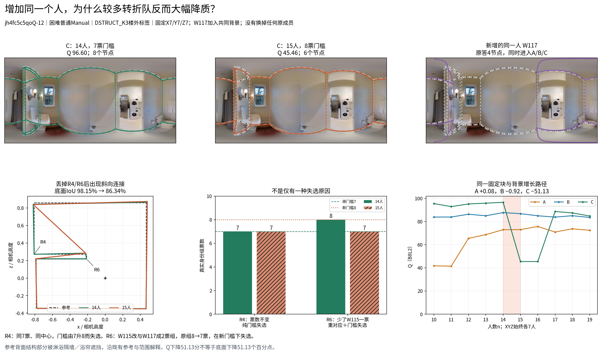

# 固定七人块，14→15人时发生的真实门槛／对应反转

**图像 jh4fc5c5qoQ-12；普通Manual、困难、留出建筑检查；DSTRUCT_K3，源C2→目标C3。** 本例由已完成规模研究中的大幅下降条件选出，属于机制展示；不以这一例估计发生率，也不因它撤销其它规模多数正向发现。

## 1. 精确改变了什么

n14事件 `3b15e1f073610cfe79b11d8a`，n15事件 `d8c03de1c870a22a3d448441`。X/Y/Z各7人和原有7人背景固定，**同一W117进入A、B、C**，没有移除任何原人员。三队间实际替换m仍为7；它不是换人数从14变15，也不是换入目标类人数增加。

- X：W100、W107、W108、W116、W123、W124、W128。
- Y：W105、W110、W114、W127、W129、W131、W133。
- Z：W102、W109、W112、W115、W122、W126、W130。
- n14的D：W101、W103、W106、W113、W118、W119、W132。
- n15的D：上述7人加W117；目标类背景人数仍为0。

W117属于该楼外折的源类C2。其本图原答只有4个节点，个体Q为28.398；该数值描述这份原答，不用来推断其心理或一般能力。其一份角点观察与已有W115相近，改变了重分组结果；其它原观察完全不改。

## 2. 六个端点与结果反转

|指标|A14|A15|B14|B15|C14|C15|
|---|---:|---:|---:|---:|---:|---:|
|Q|72.970|73.048|87.728|86.810|96.596|45.462|
|D10|74.836|74.925|87.777|86.895|97.319|48.169|
|底面IoU（%）|89.333|89.346|95.333|94.837|98.146|86.345|
|三维棱柱代理|88.706|88.299|95.220|94.739|97.371|85.807|
|方向残差（°）|3.218|3.221|0.863|1.022|1.113|15.514|
|底界角误差（°）|2.406|2.404|1.685|1.733|0.171|0.888|
|遗漏比例（%）|0.372|0.373|0.060|0.051|0.947|11.792|
|外扩比例（%）|11.525|11.506|4.832|5.390|0.924|2.157|
|输出节点|5.000|5.000|4.000|4.000|8.000|6.000|
|记录总秒数|2609.024|2816.558|3735.898|3943.432|3763.024|3970.558|

A的Q **+0.078**，B **−0.918**，C **−51.134**。C−B从 **+8.868** 变为 **−41.347**，净优势变化约 **−50.216**；这与C自身下降51.134分是两个不同量。三队六端点均成功、可评分，不能把本例称为融合失败。

同类Q幅度14.758→13.761，对称跨类幅度16.247→34.467，gap从1.489增至20.705：**区分度扩大来自跨类队退步，不能当成收益扩大。** C底面IoU从98.146%降至86.345%，即−11.801个百分点；三维代理−11.564分。Q大幅下降同时受到方向残差1.113→15.514°的放大，不能把−51.134写成同幅度的几何损失。

每队记录总秒数均恰增加W117的207.534秒，来源是既有用户处理记录；没有新测生产耗时。

## 3. R4：真实的纯门槛失选

C的参考R4身份组在n14、n15均为同一7名人员：**W102/W103/W109/W112/W122/W126/W130**。组中心也完全相同：ERP x=203.160，顶y=122.480，底y=396.977。

n14门槛为7，7票选留；n15门槛升为8，7票失选。W117没有加入这个组，也没有使这个组改位置。这里可以明确归因为门槛改变，证据不依赖“人数增加通常怎样”的先验。

## 4. R6：对应变化与门槛共同作用

n14的R6有8票：W102/W106/W109/W112/**W115**/W122/W126/W130。n15时，W115原观察没有改坐标，却和新W117的邻近观察组成一个2票小组；原R6剩下7票，达不到新门槛8，两个组均未选留。

W115这份观察为x=127.948、顶y=71.142、底y=445.747；W117为x=132.392、顶y=69.068、底y=452.087。它们形成的新组中心为x=130.170、顶y=70.105、底y=448.917。原R6其余七票的中心由125.440/55.114/463.605变为125.327/55.029/464.150。位置变化很小，但失去一票再叠加更高门槛使其不再输出。

因此不能把第二处也称为“完全相同票账下纯门槛丢角”，也不能说W117仅仅没有支持必要结构：其进入还改变了已有W115观察的对应。固定n14组只提高到8票会让R4丢失而R6保留；实际n15又改变了R6的组员。这是组状态的逻辑对照，**没有运行或采用替代门槛的新正式分数**。

跨n对所有原观察的实际关联为：A：共有71观察，拆开0对、合并0对；B：共有72观察，拆开0对、合并0对；C：共有90观察，拆开7对、合并0对。人数、阈值、对应和中位定位分别保存。

## 5. 结构与图像解释

已有范围是同一盆厕淋浴小室；机会记录为“浴室淋浴隔墙背面转折与浴帘共同挡住关键角线，点3至7密集，不能凭主体四角代替”，参考为8转折。本图画面虽出现通往相邻区域的门，其冻结评价池仍为普通Manual，不能按看到门自行改成门洞交界或扩大目标范围。

n14的C保存8个参考对应节点。n15丢掉R4/R6后，保留节点按既定环序连接，出现斜向捷径，C只有6点；这同时损害局部结构、底面和方向。参考中的密集背面转折不全部直接可见，应沿既有参考和遮挡机会解释，不把本轮看图当作新GT裁定。当前参考、环序和评分均未改变。

## 6. 同图第二锚点的重复支持

已有另一路径在n14→15加入 **W128**：事件 `b43e5c4da3c36df1cbda5afb`→`4e506fea6926b64c9c7d7b67`。其C的Q为96.125→45.471（−50.654），节点8→7，底面IoU97.452%→87.742%，三维代理97.324→87.656，方向1.109→15.552°；A、B分别约+0.509、+0.948。该路径C的两个端点及ABC标量直接引用已存结果，不再次重放，也不在没有组票账重放时断言它具有完全相同的内部原因。

两锚点支持“本图某些固定七人块在门槛跨档处可强烈反转”，不证明每名新背景人员都造成相同结果。两条完整n10…19路径、所有相邻步及失败状态均保存，未仅保存14→15的低点。

## 7. 交付与复现身份

本目录保存主路径两组ABC的6个原生重放，B8L2/D10/底面/三维与缓存标量最大差均为0。两个事件各有原答—ERP—BEV—票账图及三维图；共同输入、原始W117、LOBO标签、跨n同观察关联、所有组及中位位置另存。这里只新增少量机制重放，没有扩展全库案例、重新建类或改融合方法。
