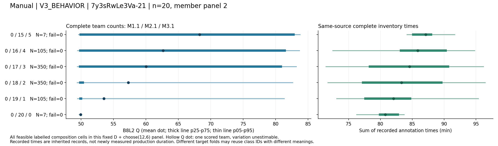
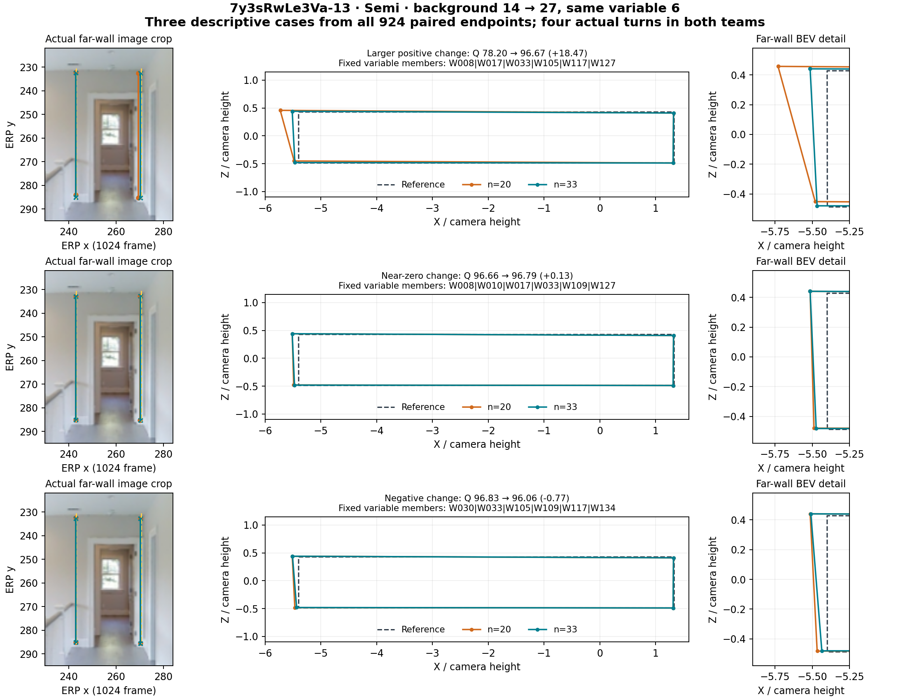
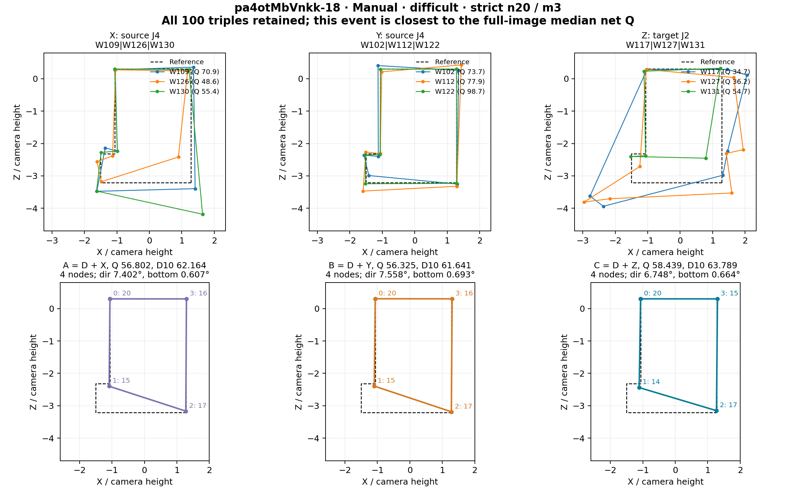

# 人员研究主报告：分类、混合构成与不确定性

**2026-10-26构成衔接已完成：** [实际重聚合](../../research/workers/dstruct_composition_bridge_20261026/README.md)复用231个Manual面板、40图22楼、213,444条团队关联，DSTRUCT K2/K3楼外标签全覆盖。K3的Q构成间占比14.36%、构成内85.64%；旧结构粗／细层12.96%／14.02%。同一面板的方差与全部配比分布已[并列展示](../../research/statistics/research_explorer_v1_r2_20261017/composition-variance.html)。没有新增融合或重新建类，旧进入策略、同房及RFUSE保持原实验身份。[主文与补充材料的同步安排](构成方差与DSTRUCT衔接_提纲同步_20261026.md)。

**2026-10-25更新：** 自然人数精度补充已独立验收，策略共同人数支持已修正。采用合48自然曲线/精确有限边际和合16旧角色策略；DSTRUCT/RFUSE的分类与换类证据保持自己的实验身份。本轮无需重新建类。 [本轮采用与复算](../../research/workers/personnel_population_curves_v2_20261023/sampling_precision_20261025/LOCAL_ACCEPTANCE.md)。

更新：2026-10-25。**当前真人v2范围内，人员分类、混合构成、换人/换类、人数过程及同房定向补充已完成核心研究。** 保留多套有依据、用途不同的工作分类；不要求唯一、永久的人员类型。每轮比较内部固定分类与名单，再观察质量、时间、结构、失败和波动的差别。升质、省时与降质、费时、近零响应均已纳入。

**先按这条解释链阅读：** 分类依据与名单（第1节、F1）→ 同图实际标法（第4.8、4.10节及原答实例）→ 混合配比及同配比内成员分布（第2、4.5节、F2）→ 同规模换人/换类（第4.6、4.8、6.3节、F3）→ 难度条件（第4.7节、F4）→ 人数与进入顺序（第6.1节、F5）→ 几何和票账机制（第4.10节、F6）。第8节连接现有图表；第5节记录完成范围，第7节给出采用判断。实际标法应在名单之后直接查看，不能等到最后的机制章节才解释类别含义。

[人员专项复核](../../research/statistics/research_closeout_20261022/PERSONNEL_REASSESSMENT_20261024.md)集中记录多数支持、平均幅度及反向条件；[全研究结论](../../research/statistics/research_closeout_20261022/CONCLUSIONS_ZH.md)将人员、同房、难度、共识及质量算法与3D IoU对比连接起来。

**2026-10-24补充验收：** [固定池随机参照与上游复现](../../research/workers/personnel_supplement_20261024/README.md)支持Manual分类的构成组织价值，Semi联合类的时间区分也有支持；各套分类不要求同一用途。四套ALL与所选楼外折的特征、粗细分区已定向独立重算。[多指标补充](../../research/quality/personnel_metric_dependence_20261024/README.md)确认Manual同房跨类变化和两条优先进入策略在底面/三维代理上仍有响应，但原困难换类方向的Q增益很依赖方向评分项。[门槛重放](../../research/fusion/doorway_vote_sensitivity_20261024/README.md)保留门洞救回后仍低质量、仍失败和zs-16的强突变。精确支持与核验深度见[独立验收](../../research/workers/personnel_supplement_20261024/INDEPENDENT_ACCEPTANCE.md)；这些补充加强用途解释，不重新寻找唯一永久人员类型。

**D10形成链已验收（2026-10-24）：** [补充结果](../../research/workers/personnel_d10_formation_sensitivity_20261024/README.md)从原答重拟合联合类并重选成员；Manual全历史分区不变，但楼外分区并非完全不变，Semi联合类更敏感。高Q类选队改变Manual11/179、Semi粗21/32及细19/32；同D10计分均差约−0.006、−0.308、−1.153分，Semi后两项各有28个共同可评面板，失败另列。292个可用面板的固定结构类高Q角色和团队不变。保留现有四套分类及B8L2主结果，将D10作为形成依据敏感性；不把分数上移或固定端点差为零称作改进。常数面板η²已修，见[验收](../../research/statistics/research_closeout_20261022/METHOD_SUPPLEMENT_ACCEPTANCE_20261024.md)。

**融合方法条件：** 同队共同面板中，普通Manual墙线相对无GT代表原答在4人时+7.11分（16/22图提高），16人时−5.54分（8/23图提高）。因此本报告人员效应解释为冻结融合方法下的规律；分类组织价值不要求墙线普遍优于全部基线。

阶段基线、结果来源与核验身份（保留追溯）

**2026-10-24解释再审查：** [人员专项复核](../../research/statistics/research_closeout_20261022/PERSONNEL_REASSESSMENT_20261024.md)重新核对四套名单、关键换类多数/均值、快慢条件、选队及画像；分类与研究结论继续采用。下文各层同时保留多数支持、平均量级和反向条件；整个研究的原始预期与新增发现统一见[全研究结论](../../research/statistics/research_closeout_20261022/CONCLUSIONS_ZH.md)。

更新：2026-10-23。第4—5节混合构成研究基于 main **`ef148c82df18582228b2d23837faa2659e79eba7`**，本地独立核验及旧n20失败修正已完成；第6.3节新增同房大块研究基于 main **`e92abe8631d7f01dc192ee796b46f295ece37a6d`**，设计、端点、逐事件、几何、主要敏感性及路径结果已独立复核；第6.1节人数路径/建筑重抽与同源时间也已接齐。底层始终是真人 **v2**；v3 是历史研究轮次。本文落实用户最新澄清：**保留多种有依据、各有用途的分类；固定分类后，研究类别人数构成与具体成员组合怎样影响质量、时间、结构及波动，并连接图片难度和随机人数过程。目标是找出可解释、有支持的差异：升质、降质、省时、费时及结构/几何变化均可成为发现；没有明显差异的条件也保留。升质、省时是可能的用途，不是分类有效的唯一标准。**

前轮[整合核验](../../research/workers/personnel_mixture_audit_20261022/README.md)继续作为已核基础。第4—5节从实际保存的设计、端点与原答补出 **13,406 个有限配比格的完整分布、已登记全部方向的换法比较、较大纯块直接 A/C、难度与同类快慢解释**；证据集中在[混合构成结果目录](../../research/workers/personnel_mixture_comparison_20261022/README.md)。该阶段是条件实验的完整重组与分析，**没有重复运行原生融合**，也没有修改标签、GT、资格或评分规则。逐项采用判断见第4.5节以后；本地核验深度和修复见第4.11节。第6节另记随后的人数过程与新同房实验。

## 阅读入口与想法演变

**人员研究当前只从本文进入。** 分类和名单读第1节；怎样组合读第2节；结果读第4节（4.1—4.4保留前轮来源，4.5—4.10为本轮完整比较、采用与案例）；第5节是实际完成账，第6节接人数与同房新结果，第7节给出收尾判断，第8节负责论文图表和展示推进。原始结果保留在研究包，本文负责解释和连接，不复制所有实验过程。

|要找什么|唯一职责与入口|
|---|---|
|整个论文研究什么|[统一研究模型](研究模型_人员图片与融合不确定性_20261006.md)：人员、图片、质量测量与融合方法的关系|
|当前人员结论和下一步|本文：固定分类后的混合配比、成员变化、条件解释|
|过去为何这样研究、哪些意见改变过|[人员阶段记录](人员标法分类与换类研究_总体进度_20261020.md)：完整历史保留；旧待办不覆盖本文|
|计算证据和核验深度|[混合构成核验](../../research/workers/personnel_mixture_audit_20261022/README.md)、[换类完整验收](../../research/workers/personnel_exchange_closure_20261022/LOCAL_ACCEPTANCE.md)：代码、表和来源|
|已执行的同房补充任务|[任务正文](Pro下一轮_有效换类续研与已有产物整合_20261022.md)：大块结果已返回，第6.3节接续；不重新发送旧任务|
|全部专题状态和源包位置|[整体进度](四线程成果与论文主线核对_20261015.md)、[研究目录](../../research/catalog/INDEX.md)|

### 保留哪些研究想法，怎样演变

|原意/阶段|当前采用方式|
|---|---|
|用Q、T、难度、scope、Semi任取2—5域解释或寻找类别|保留为发现路线；结构特征和反向关系发现并列。四套当前分类不覆盖全部旧方法。|
|模拟混合类型人群|保留为主问题：先看类别人数配比，再看同配比内具体成员，最后用替换对照解释变化。导师旧标签与子类必须收敛的设想不沿用。|
|同类换人变化较小、换类变化较大|作为需要检验的假设；多数条件成立即可形成有限规律，也保留不成立的分类/条件。|
|寻找“好看”的换法|用户现已明确为可解释差异，包括降质、费时、结构变化；已有升质/省时选队用途仍保留。|
|整块、半类、大比例替换及排列组合|按每图真实容量研究；构成配置、具体成员、进入顺序是三个不同空间。已有大块不重做，不固定只换4人。|
|简单图较快接近GT，困难/门洞较慢或难以接近|已由第6.1节v2人数过程检验；困难前段可改善、后段主要缩波，门洞难题未被加人普遍消除；不按曲线反改难度。|
|同房平均/个人质量相似性与预测|保留现有成果，推进优先级后置；楼外分类验证不因此停止。|
|盲信、被排除标注、scope、可靠性|保留各自机会、资格和解释用途，不强行装进单一类别；诊断样本不自动恢复正式质量资格。|

后续维护：新结果更新本文对应小节和原证据包；阶段记录只记研究转折与来源，不再重复追加整套“最新结论”。整体入口只链接人员主报告，避免多个地方各自维护结论版本。未删除历史文件或作者原文。

## 1. 怎样组织多种分类

### 1.0 当前主方法、核心对照与新一轮同图大块结果（2026-10-25）

**主要解释采用DSTRUCT_K3困难结构三类；融合几何响应二类与几何＋质量响应三类作为核心效果对照；Manual＋Semi＋scope联合类、边界类及Q/T角色按用途保留。** 主方法从实际表达与主线难度出发，便于串联人员、图片及构成；反推类直接解释当前融合输出的人员响应，并非因难解释而降级。选择依据是问题匹配、原答含义和效果链，不是只挑最高升质均值。

|方法与当前采用条件|同类/跨类Q变化幅度|跨类更大图片/建筑|回答的问题|
|---|---:|---|---|
|DSTRUCT_K3，n18/m7|3.438/6.386|31/40图；10/10楼|困难结构表达能否组织同图大块差异|
|RFUSE_GEOM_K2，n12/m4|3.642/6.492|23/29图；9/10楼|哪些人员块改变当前融合几何|
|RFUSE_GEOMQ_K3，n20/m6|1.828/5.642|16/21图；8/9楼|哪些响应类的类内较稳定、跨类更不同|
|MSDGEOM_SCOPE_K4，n20/m6|4.611/7.246|40/49图；9/10楼|两条件终稿与scope联合画像的用途|

表为普通Manual、具体方向、选型保留建筑内检查；平均先按设计分层再图片等权。scope跨类幅度较大，但类内也较大；GEOMQ较低的类内波动同样有意义。各行不同支持不能直接排冠军；方向、D10、几何、时间及失败在[用途与展示口径](../../research/workers/personnel_classification_guide_20261025/README.md)和71条件表分列。DBOUNDARY还保留总Q区分弱但顶界几何区分存在的发现；负向和近零结果不删除。

新DSTRUCT ALL为8/39/12人，未知3人；旧Manual结构为6/34/19人。新C3是旧M3的十二人子集，但整套分区并非纯细分。旧四套是Manual/Semi各自结构和联合类；本轮四重点全部评价普通Manual，不与旧四套混称。下文完整混合配比、同房与进入策略仍保留原分类身份，不能把旧结果直接冠上DSTRUCT名称。

**K2/K3与楼外名单的读法：** 在每一个相同训练折内，DSTRUCT K3的高转折C3与K2对应高转折类成员一致；跨折成员和人数会变化。因此当前重点高转折替换方向是两层分类共享的证据，K3另外两个角色的描述价值由原答特征解释。楼外名单指不使用目标建筑历史来形成的人员标签，服务于各类人员实验，并非专用于同房预测。分类、方向和规模经比较后采用，当前保留建筑检查属于v2内部研究，不称新的盲验证。

**呈现与写作采用方式（2026-10-25）：** V4修订提纲的既定安排（[最新衔接同步](构成方差与DSTRUCT衔接_提纲同步_20261026.md)）以DSTRUCT组织原答—难度解释，以RFUSE组织团队响应机制，其他分类按用途保留。每套方法依次提供所用历史特征、各类中文含义与人数、ALL及楼外名单、同图实际标法、同配比波动和匹配替换结果。先呈现变化量及支持图片/建筑，再展开对应、票数、位置与连接。质量方向、变化幅度、几何、时间和失败分别报告；结果有升有降不影响其研究价值。RFUSE小目标类的完整核心换入不能代替目标类内成员互换检验。已完成的D10重新建类/选人对应此前四套分类，不扩大为最新DSTRUCT/RFUSE全链验证。

研究台保留全部有价值的历史和当前结果，包括连续画像、速度×难度、scope、Semi错误初始化未纠正及排除记录；正文取舍不删研究台证据。本文与源包维护研究事实，展示线程负责名单、原答和结果之间的页面连接；页面修改完成前不把交接要求写成已验收功能。

**大人员池与严格对照并不矛盾。** ABC共需n+2m不同人员，另受源类2m、目标类m容量约束；35人池换7人时每队最多21人。严格固定块路径已到10—21人；直接AC可到28人但没有同类B。自然曲线已到30/35及实际满员。18/7是全面比较后选择的条件，既不等于人员只有18人，也不是唯一可行配置。

类别形成与全部指标独立核验范围见[13包审查](../../analysis_results/personnel_exchange_discrimination_audit_20261025/README.md)。本轮接入可查看7套方法×ALL/22楼外范围名单、四重点与71条件，并保留全部历史研究。当前已核大块结论可采用；DSTRUCT K2/K3 的 Manual 完整混合配比已于2026-10-26按保存团队重聚合；其它分类、进入策略与同房仍保留原标签，不称六步所有结果都已改用新标签。

### 1.1 总问题与三层内容

总问题是：**人员可以按哪些可解释的差异分类；这些分类分别能描述多少原答差异、类内换人波动与构成改变；哪些条件会强化或削弱这些关系？**

1. **分类发现与解释。** 说明每套分类使用哪些历史特征、为什么分成这些组、实际成员是谁、标法怎样不同。几何、质量、时间、多域和关系发现可以得到不同但合理的人员分区。
2. **共同实验框架。** 在同一评价条件内，固定分类、图片、人员域、团队人数及融合方法，分别改变具体成员、类别构成和替换规模。共同支持上才能比较不同分类的解释能力；各自覆盖更广的结果另列。
3. **各套分类的实际用途。** 分别判断表达解释、变化幅度区分、方向性变化、效率、失败与局部机制。保留多数图片/建筑成立的规律，也保留无明显区分或相反结果。

**采用目标是用途明确的工作分类，不要求唯一、永久的人员类型。** 一个人可以在结构表达、质量—时间角色以及Manual/Semi条件下拥有不同标签；这描述当前历史中的相对行为，不是固定人格或永久能力。分类是把人员差异组织为可研究的群体构成：检验其原答含义、同构成内波动、跨构成差异及条件响应。

具体实验仍须固定分类规则、历史来源和实际名单：同一图片/目标楼的组合比较不随融合结果重分；换研究目的、数据版本或楼外训练范围时，可以形成另一套有记录的分区。因此，ALL三类的描述名单与跨楼选择出的结构分类流程是两个证据层，跨楼总体结果不自动等于原封不动验证了ALL三类名单。

同一人员在两套方案中分到不同组，可以因为两套方案衡量的特征不同。多套分类值得保留的依据是各自含义和实证用途，而不是分类数量多。对高度重合的分区保留来源及对应关系，不重复计作独立发现；不同方案不能只拿各自最有利的图片或n/m作高低排名。

建议成果按“分类依据与人员名单 → 类内/类间原答关系 → 构成与成员替换 → 背景和规模 → 质量/时间用途与机制”展开。主文选有独立解释价值的代表方案，其余结果放方法覆盖表；选队继续作为用途之一。

### 1.2 比较后选择方法与重点结果

**用户补充：允许选择能得到较好预期结果的方法，但选择要建立在全面比较上。** 本研究可以探索分类策略、类别方向、配比、n/m及背景，再挑选有解释价值的一部分作为主文结果。“固定分类”是每轮具体比较的内部约定，不是永久禁止修改分类或搜索方法。

全面比较指覆盖有依据的候选家族及主要研究问题：四套当前分类，加上有独立用途的旧M、QTD、A2、SP、F01和跨条件方案；先整理各自已完成的全结果，再在共同可用支持上比较。枚举可行构成，小空间覆盖全部成员组合；大空间使用清楚的均衡覆盖。它不要求穷尽所有数学上可能的分类、所有成员和所有进入顺序。

选择时并列看：同构成内与跨构成的差异幅度、质量及分项的变化方向、时间、结构解释、失败、图/楼支持及难度条件。主文可以选择最有代表性且证据清楚的分类/方向/规模；其余保留在完整结果表，注明未选原因（信息重复、支持较少、区分弱或不符合该用途）。方向相反但可解释的结果同样可以入选。不要先凭直觉认定一种方法，再只计算最有利的情况。

探索得到的选择直接作为当前数据中的发现报告；已有楼外检验说明可迁移支持，不把事后选出的最优配置冒称预先独立验证。无需为每一项描述性发现再启动一轮验证研究。

### 1.3 此前四套方案的准确身份（既有完整配比与人数研究仍采用）

|方案|实际形成分类的主要输入|ALL描述分组|与其它方案的关系|
|---|---|---|---|
|Manual结构，V3_BEHAVIOR / TURN|同图中心化后的有效转折、短转折历史|3类：复杂结构明显简化6人、常规34人、较多转折19人；3人未知|不直接以Q/T聚类；复杂结构表现是解释证据，不把结构条件C当作人工难度D|
|Manual联合，V3_JOINT_QT / CQT|简单/复杂机会的表达、历史Q及低尾、T|5类，人数10/23/6/9/9；5人未知|不是上述3类的细分；联合的是本条件结构与Q/T|
|Semi结构，V3_BEHAVIOR / STRUCTURE|有效/短转折及近共线分段历史|3粗4细：偏简化6、常规32同属第一粗类，近共线分段6、较多转折15；3人未知|区分多画真实转折与同墙分段；仅此方案有独立细层|
|Semi自身联合，V3_JOINT_QT / EQT|Semi自身的表达、历史Q及低尾、T|5类，人数6/12/9/8/19；8人未知|不把Manual标签直接搬来；不是Manual＋Semi共同建类|

每套都可以研究类内换人、跨类替换和配比，不与某个唯一实验绑定。人数是跨图人员总数，不能直接当作每张图可用容量。形成依据见[字段说明](../../research/workers/personnel_exchange_closure_20261022/classification/FIELD_GUIDE_ZH.md)，实际名单见[完整ALL成员](../../research/workers/personnel_exchange_adoption_followup_20261022/integration/分类定义与完整ALL成员.csv)。

其它既有方案继续保留：旧M父内细类、Semi位置/尺度SP、A2几何关系、QTD效率分类、F01快慢构成及Q/T/难度/scope/Semi多域探索。Manual＋Semi共同建类也已存在XCOND_GEOM、XCOND_GEOM_QT、XCOND_PAIRED三套；效果仍在Manual/Semi内分别评价。当前四套是本轮重点方案，不是所有历史方法的总数，也不代表其余方法被否定。身份和采用层次见[11个方法家族](../../research/workers/personnel_exchange_adoption_followup_20261022/integration/分类方案_采用总表.csv)及[人员研究记录](人员标法分类与换类研究_总体进度_20261020.md)。

### 各套分类的当前采用层级

|方案|主要研究用途|普通图片上的主要效果证据|采用层级与限度|
|---|---|---|---|
|Manual结构|解释复杂结构下怎样画；模拟不同结构人群的混合|固定实际共同背景和换人数，n20/m4同配比与改配比Q幅度4.858/5.014，23/38图、14/22楼后者更大；m6为7.223/7.623，17/23图、14/17楼支持。定向常规→较多转折n20/m4净Q+1.789，96/120图升质；反向净Q−1.363，46/72图降质。|主要结构解释和构成结果。多数支持与平均分离较小同时成立；保留显著的类内成员波动，不把全部效果归为独立于历史Q的纯结构作用。m4/m6支持不同，不直接相减作剂量效应。|
|Manual结构＋Q/T|区分质量、时间与表达角色；研究混合取舍|n20/m4同/改配比绝对log记录时间比0.0657/0.0908，24/27图、18/19楼后者更大；Q幅度4.847/4.669，均值反向但21/32图后者更大。定向“较高Q且较快”与“最高Q但较慢”分别净Q+3.142/+4.707，共同Q/T劳动−1.565%/+7.165%。|主要角色与取舍结果。时间幅度不是节时百分比。定向正负结果和难度反转一起解释，不能把不同支持的均值直接用作分类排名。|
|Semi结构|解释简化、转折与近共线分段；比较构成分布和定位机制|n20/m4粗配比Q幅度5.218/5.318，4/8图、4/7楼后者更大；改细构成只3/10图、2/8楼支持。原答、强弱配比响应及定位机制仍有解释价值。|次要分析，结构解释成立，整体Q幅度分离较弱。细配比含父类变化的比较不等于纯细分增量。|
|Semi自身结构＋Q/T|解释Semi劳动角色、效率与质量/失败取舍|n12/m4粗配比绝对log记录时间比0.1138/0.1465，9/12图、8/9楼后者更大；定向换类有省时、质量代价或条件性升质。|次要分析。时间有多数规律，Q变化幅度并未复制Manual；成功条件Q、全部尝试失败和共同时间支持分别呈现。|

四套都能用于配比、换人和换类研究，并非各自绑定一个实验。上表数值按各自既有支持引用，不能横向当作同一场比赛。详细名单、特征中心、聚类及类数选择见[F1分类说明](../../research/workers/personnel_main_figures_v2_20261023/notes/CLASSIFICATION_README.md)。**结构方案的形成不以Q/T为目标；联合方案包含历史Q/T，但不以本轮新团队的融合升质幅度建类。** 上游保存的选型账、标签及消费链已核对，未将其表述为本地重新训练了全部分类流程。

上表普通有限配对来自[12项配对结果](../../research/workers/personnel_mixture_comparison_20261022/exchanges/finite_pair_comparison/FINITE_PAIR_SELECTED_ZH.csv)，2026-10-25已从逐图/逐楼结果独立重聚合核对。定向效果来自[18项条件](../../research/workers/personnel_mixture_comparison_20261022/integration/有效换类条件表.csv)、[85项严格ABC](../../research/workers/personnel_mixture_comparison_20261022/exchanges/ALL_CONDITIONS.csv)及共同Q/T表；其跨类对称幅度与有限配对幅度定义不同，不能混作同一数值。**同房跨视角是进一步问这些变化能否在另一视角重复的扩展**：结构混合大块同/跨类6.869/8.829、61/78图对支持，联合类额外幅度约2.055、22/31图对支持，留在同房章节独立说明，不代替普通图片证据。

研究台第1步现将“分类依据→研究问题→实际发现”置于名单前；第2步连接全部13,406配比格及格内分布，七例79格只是查看窗口；第3步先看普通图片有限配对、18项定向条件、85项全方向与461项直接AC，再看同房扩展。下降、费时、弱响应与失败也是分类产生可解释差异的结果，不用“是否升质”单一判断分类是否有用。

### 1.4 分类固定到哪一层

- **ALL名单**用于描述当前人员整体分区。若据此整理现有团队构成，结果标明全数据描述性分析，不能充作目标建筑外验证。
- **LOBO名单**在目标建筑之外形成；同一目标建筑的组合实验固定该套标签，不根据本图的融合效果重分。不同楼外折的类数、成员和编号可能不同，通过特征中心/语义角色对齐，不能把J5等编号视为跨折固定人员集合。
- 保留两种读法：ALL便于读者看人和类别；LOBO检查这种分类流程在未参与建类的建筑上是否有解释能力。当前冻结结果足够作为比较起点；有新方法依据时可以另立候选并完整比较，不按单个最有利端点反复重分。

**楼外名单不是同房预测专用名单。** LOBO指留一栋建筑验证：例如评价建筑A时，仅用同一批人在B、C等其它建筑的历史记录形成类别，再固定这些标签研究A上的原答、混合配比和换人/换类。这样避免用A上的质量或标法定义类别，又在A上宣称类别有效。它检验的是对未参与建类建筑的适用性，不是陌生人员预测；同房预测则问同一房间不同视角的质量是否相似或可预测，研究对象不同。

**本轮同房大块的标签读法：** `V3_BEHAVIOR`是结构分类方法族，楼外折可形成TURN2、TURN3、JOINT4或JOINT5等分区；TURN侧重转折，结构JOINT同时区分转折与近共线分段。这里的JOINT不等于`V3_JOINT_QT`，也不能把所有折改写成ALL描述名单的固定三类。跨折比较保留方法、家族、类数及历史特征角色；具体人员从对应目标建筑的标签表查回。

**当前优先级：** 人员分类、构成和人数主研究已形成可采用结果；定向同房大块及人数稳定性补充已完成核心核验并接入第6节。整理来源归档和第8节图表展示，不重新扩张已完成的分类或同房预测项目。

## 2. 共同实验框架：先构成，再具体成员

### 2.0 混合类型人群是主问题，替换对照是其中一种检验

回读《与导师交流》：第35行明确提出各人独立标注后抽取A+B结果来模拟混合类型人群；第49–51行以ABCD、AABC说明人员类型及人数比例。原话及其历史解释见[导师讨论溯源](topics/workers/人员粗分类原意与既有证据_20261003.md)。这里只定位重组标注的动机，不以导师意见证明方法正确。**用户最新明确：旧讨论中的人员标签和子类收敛设想均不沿用，不作为当前分类依据、实验前提或验收目标。** 历史原话只留在来源记录中。

**当前独立判断：** 用真实独立标注重组团队，适合研究固定人员池、图片和融合方法下的混合构成效应；分类是否合理由实际特征、成员支持和结果检验决定。保留多套实证分类，不用旧人物标签替换它们。重组模拟的是人员构成，不是新造标注、多人讨论后的行为或同一个人反复作答的随机性。Manual/Semi分别重放，各人一次独立观测复用，不为每种组合重新采集，也不重复复制同一人来凑足某类人数。人数响应只观察结果怎样变化，不预设各类应收敛。

研究先以类别人数向量为对象：对每个可行配比，汇总其具体成员组合产生的输出分布；再比较配比之间的变化。无需先指定一个“原队”，也无需每个配比都能组成严格ABC。若某类容量不足，纯类团队不可行，仍可研究其它混合配比；某个配比只有唯一团队时，其类内成员波动不可估，不能称零不确定性。

具体实施分三层：**混合配比的整体结果 → 同配比换具体成员的波动 → 用固定背景的ABC/AC解释关键变化。** 严格ABC用于同规模的类内/跨类匹配比较；直接AC用于可行的大块构成变化。缺少B本身不构成必须补采人员的理由；单个AC也不能替代整种配比的分布。

**是否补实验的判据：** 先接回第4.2节已有混合面板、配比与构成内/间结果。若当前分类的关键可行配比没有团队结果，或可行成员很多却只有个别选择，再补这些端点；若结果已有，只补整理和必要重聚合；若容量只允许唯一组合，则保留无法估计的项，不把重复计算当新增证据。当前不单独启动一轮以“补AC数量”为目标的实验。

### 2.1 四个不同的数量

- N：该图片、条件、资格及来源域内实际可用的不同人员数。
- K：当前分类方案的类别数。
- n：一次融合的团队人数。
- m：两队实际换出的人员数，等于两队成员集合对称差的一半。

类别人数向量为c=(c1,…,cK)，各项之和为n。固定c换具体成员，研究类内/同构成波动；改变c，研究构成差异。纯源类→目标类替换时，c′=c−m·e源+m·e目标。混合块还需另记类别席位净转移r=Σ|c′k−ck|/2；可能实际换了很多人而r很小，不能一律称大块换类。

同时报告m/n及m占原队源类人数的比例。同样m4，在n20占20%、在n10占40%；若原队源类只有4人，已经是该类全部替换。实际人数、团队占比和源类替换比例分别回答不同问题。

### 2.2 严格ABC与直接AC都保留

严格三队：A=D∪X，B=D∪Y，C=D∪Z。D有n−m人，X/Y来自同一源类、Z来自目标类，各m人，四块互斥。A/B保持构成，A/C改变构成。D可以混合多个类别。

严格设计的必要条件是N≥n+2m、源类至少2m人、目标类至少m人；固定背景后还要扣除背景占用的各类人数。它为了同时获得同规模类内对照，多使用了一整块源类人员，**不是所有构成研究都必须满足的条件**。

直接A/C换类只需保留共同背景和真实替换块，人员并集为n+m。示例：甲/乙/丙各10人的30人池，甲10＋乙10可直接变为甲10＋丙10；没有额外10名乙类构造B，不妨碍研究这次整体构成变化。类内稳定性可另在可行的半块或其它同构成团队上研究，但不同m的比较不能冒称同规模严格ABC。

直接AC已在旧v3研究实施，见第4节。后续复用这条设计，不把它当作新发明，也不将缺B事件补成类内/跨类幅度证据。**旧n20同构成/改构成设计以及部分跨条件锚点允许Y/Z重叠**，所以A/B与A/C各换m人时，B/C可能只换较少人；不能反套严格互斥ABC的N≥n+2m容量公式。旧QTD方向事件B/C平均约换2.8人，而A/B和A/C各换4–8人。

### 2.3 比较哪些输出

|问题|主要量|解释|
|---|---|---|
|固定构成换人后是否接近|同构成输出距离、各指标分布/分位数及失败比例|不只展示平均Q；原答相似与融合相似分别判断|
|跨类是否比同类变化更大|严格ABC下d(A,B)与[d(A,C)+d(B,C)]/2；Q也看对应绝对差|变化幅度不要求升质；两者必须同n/m、共同可比支持|
|变化往哪个方向|C−A、B−A、C−B，分别报告Q及分项；已有共同端点另看同参考3D IoU|C−B不是“类别解释了多少不确定性”的比例，也不能替代C自身变化|
|结构与几何如何改变|底面、上下界、角点位置、转折/局部支持、参考节点/边召回|质量接近不等于几何接近；更多点不自动正确|
|规模/背景怎样调节|固定A的m路径、固定XYZ的n/背景路径|不同图片的横截面均值不能直接拼成规模效应|
|用途和代价|记录时间、成功条件质量、全部尝试失败与不利尾部|升质、省时、稳定性分别成立，不强求所有指标同向|

按各表真实单位、共同分母和图/楼汇总；Q的符号均值接近零可能由正负抵消。缓存端点去重与抽组权重是两回事，不按重复事件次数人为增加某个构成的权重。组合行数不是独立证据数，不将结果解释为人员/图片因果噪声分解。

早期替换规模的解释：m4如何形成（历史问题，现已有较大块结果）

## 3. 为什么最近总在讲换4人

**是最近联合分类的实验选择和汇报重心，不是算法上限，也没有证明m4是研究不确定性的最优规模。**

1. 严格ABC消耗额外源类储备：N30、n20仅从总池容量看最多m5；N35、n20最多m7，类别容量还可能更紧。实际“有30人标注”不必等于该次正式、标签已知且同来源域的N30。
2. 联合分类分得较细，最新主实验又限定新来源、标签已知人员及特定历史方向。限定来源是实验设计选择；不能把这个子域的容量写成全体人员的容量。
3. 最近优先扩展“历史Q较高且相对更快”方向，m4兼顾了一定块大小与图/楼支持；m5/6也已计算。选择升质方向与计算预算会造成覆盖偏向，不能据此排除其它构成。
4. 只展示m4用途会掩盖已完成的大块与下降结果。今后用实际n/m、比例、角色容量和研究目的解释选择，不以固定m4为默认答案。

### 3.1 前轮联合Manual特定方向的实际容量与完成量

本节回读前轮的[容量表](../../research/workers/personnel_exchange_closure_20261022/manual_joint/CAPACITY_ALL_N_M.csv.gz)与[登记汇总](../../research/workers/personnel_exchange_closure_20261022/manual_joint/REGISTRATION_SUMMARY.csv)回读。范围仅为新来源、楼外标签已知、n20、q_up__faster方向；不是全部类别方向。

|m|占团队比例|覆盖图/楼|已登记ABC行数|解释|
|---:|---:|---:|---:|---|
|2|10%|26/18|1,836|容量较小图片的补充|
|3|15%|10/8|4,000|较广支持|
|4|20%|7/5|8,820|最近重点报告的用途条件|
|5|25%|6/5|10,584|已经研究，不是待首次扩展|
|6|30%|3/2|5,544|每个背景只有一个可用目标块；不能估计该背景下目标块之间的波动|

这些行数为登记/完成事件，不是全部可评分事件或独立样本数。m变大时支持图片不同，不能按此表直接比较哪种m效果更好。m6缺目标内部备选是真实容量缺口，增加同一C的事件引用不会补出备选。

最新Semi联合主方向完成m3/4，登记尝试中的m5/6受容量限制；这只适用于当前分类、人员域和方向。旧Semi SP、A2已有更大块研究，不应写成Semi普遍无法大块替换。

## 4. 已有结果：哪些不必重开

|已有比较|范围与结果身份|现在怎样使用|
|---|---|---|
|Manual结构严格ABC|常规→较多转折n20/m4：120图16楼；m7：77图16楼。主层m6：29图13楼；反向m6：19图8楼|已有广覆盖及较大块正反方向；各条件分别解释|
|固定原队扩大m|结构n20的m4→7已有154登记路径，151共同五端点有效；另有m4→6及相邻路径|直接用于规模响应；路径m6覆盖106图，不能与主层m6的29图混用|
|固定XYZ改变n|结构m7有n12/16/20各77图16楼，n21有62图16楼|已有团队人数过程；比较规模时采用共同路径|
|同图固定XYZ改变背景|39图15楼、78锚点×14种D=1,092个n20/m7物理ABC；另有同构成换背景成员汇总|已有有限背景穷举及边际作用，复用分项与成员证据|
|Manual联合大块|n20/m5、m6已完成；m6还有n19/21各3图2楼|把规模和目标内部容量并列，不只报告m4|
|旧A2大块区分|n17/m9，A02→A01：9图8楼；A02→A03：27图11楼；跨类幅度更大而Q总体下降|下降也是类别区分的实质成果，不因不升质删除|
|Manual结构大比例|精确TURN/K3/E2→E3的n10/m7覆盖96图16楼；旧v3另有m≥8纯块、jtc-28的n10/m8与n15/m8正反例|70%/80%替换已有；总体证据与机制案例分开|
|父类固定的细类替换|旧M n10/m5扩大后整体幅度优势未保留，m6有条件信号；旧Semi也有父内细层研究|不能把所有细类实验写成未做，也不把旧M标签当成当前M/J层级|
|缺B时直接AC|旧v3新Manual行为转折减少132事件、m4–13、22楼；旧M粗类140事件、m4–14、22楼；Semi SP面积增加22事件、m4–6、6楼|恢复为直接构成方向证据；没有同规模B时不报告严格幅度优势|
|粗细、连续及跨条件对照|QTD效率、连续QT、三套跨条件标签与共同锚点均已有；19,896锚点类别约束QT10与纯QT10选人相同|保留不同分类用途；未增加选队收益不等于不能解释人员差异|

最新覆盖见[完整覆盖账](../../research/workers/personnel_exchange_closure_20261022/integration/coverage/COVERAGE_FINAL_ZH.md)、[结构登记](../../research/workers/personnel_exchange_closure_20261022/structure/REGISTERED_SUPPORT.csv)、[背景与规模结果](../../research/workers/personnel_exchange_adoption_followup_20261022/structure_followup/STRUCTURE_ADOPTION_REPORT_ZH.md)。旧大块/直接AC见[v3整合报告第4节](../../research/workers/personnel_v3_20261021/integrated_report/report/人员分类与整体构成_整合报告_20261021.md)与[扩大块结果](../../research/workers/personnel_effective_exchange_conditions_20261022/expanded_blocks/analysis/FINAL_FINDINGS_ZH.md)。本次最新n/m覆盖回读登记表，旧包具体结果沿用报告及既有审查，不冒称本次重新运行。

前轮发现与完整配比范例（4.1—4.4，保留阶段身份）

### 4.1 当前已能回答的变化幅度问题

|条件|同类/对称跨类绝对Q变化|跨类更大的支持|
|---|---:|---|
|Manual联合较高Q且相对更快，n20/m4|3.303 / 4.608|6/7图、5/5楼|
|Manual联合最高历史Q但较慢，n20/m4|3.860 / 8.038|17/20图、13/14楼|
|Manual结构常规→较多转折，n20/m4|3.084 / 3.604|78/120图、12/16楼|
|同方向n20/m7|3.261 / 4.100|47/77图、11/16楼|
|Semi联合较高Q且相对更快，n12/m4|5.173 / 4.541|平均跨类幅度小于同类，不能称同类更稳|

本表数值保留[已接收采用报告](../../research/workers/personnel_exchange_adoption_followup_20261022/人员分类与换类_采用结论与实质续研.md)的原汇总身份；本轮统一重聚合另见第4.6节。不同方案的支持图片、具体成员和方向不同，本表展示各自发现，不是方案排名。联合类含Q输入，质量区分不能全部解释为结构风格的独立作用。

### 4.2 已有混合构成证据：先接回主线

旧v3不仅有ABC替换。[整合报告第2、5、6节](../../research/workers/personnel_v3_20261021/integrated_report/report/人员分类与整体构成_整合报告_20261021.md)记录：336个固定背景成员面板，每面板完整枚举12名可变成员取6人的924种集合，覆盖58图22楼；这类面板支持比较实际可行混合配比及配比内不同成员。它是有限可变成员域的完整枚举，不是所有背景、人员和配比的全池穷举。

本次已接收两份完整逐面板包并独立复算：

- F01的37格、1,874个成员集合已重聚合且检查有限池全部n12集合；12张有配比变化的图全部节时，简单7图平均Q变化−0.026、时间−19.643%；困难5图Q有3升2降。新增同一表上的构成间方差占比：Q9.70%、总记录秒数47.30%，表明配比更能解释时间，构成内部仍有成员差异。
- 55,214行逐面板方差及218,294行预测误差按图→楼重聚合，复得440行综合方差结果。Manual结构粗类Q构成间占比12.96%、转折21.17%；Manual联合Q19.36%、log时间67.42%。Semi结构细类Q8.51%，楼外Q响应R²却为负；Semi联合细层log时间85.28%、楼外时间响应R²0.341。它们是有限面板描述/响应预测，不是Q增幅、因果分解或新人效果。
- 共同支持上的类别/连续比较也已经完成：Manual同189面板、Semi同42面板；不能继续笼统列为未做。时间解释强于普遍质量/几何可互换，连续QT仍有竞争力。完整分项、难度分层和核验深度见[本次报告](../../research/workers/personnel_mixture_audit_20261022/README.md)。

本节所述前轮核验接回的是总体分解和共同域比较。当时仅有逐面板方差；**本轮已恢复完整团队及成员关联，补出第4.5节全部逐配比分布和第4.8节同背景、同实际m的配对比较。** 原作者来源和冻结标签保持原身份，未把重聚合称作从原答重跑全链。

### 4.3 现在怎样解释四套分类：G1/G2/G7的已有发现

|方案|配比能说明什么（G1）|换人/换类已经观察到什么（G2）|条件怎样解释（G7）|
|---|---|---|---|
|Manual结构|有限面板Q构成间方差占12.96%，融合转折21.17%；同配比成员仍有大量差异|常规→较多转折，n20/m4同类/跨类绝对Q变化3.084/3.604，78/120图跨类更大；m7为3.261/4.100，47/77图同向|融合转折构成间占比简单3.51%、中等16.77%、困难21.60%。复杂机会更能显出表达差别；中等仅3图。|
|Manual结构＋Q/T|Q占19.36%，log记录时间67.42%；时间差异是明显用途|较高Q相对更快方向，n20/m4为3.303/4.608，6/7图跨类更大；最高历史Q但较慢方向3.860/8.038，17/20图同向|Q/T参与分类，质量差别不能全归因于结构；具体选人仍可使用连续Q/T。更费时的方向也是有效研究结果。|
|Semi结构|粗/细层Q占3.36%/8.51%，转折1.89%/11.71%|细层楼外Q响应R²为−0.00179；目前不足以解释为普遍同类更稳|标法描述仍有意义；当前面板缺困难图，不把Manual困难规律直接搬来。|
|Semi自身结构＋Q/T|粗/细层log时间占24.49%/85.28%；细层楼外时间响应R²为0.341|较高Q相对更快，n12/m4同类/跨类绝对Q变化5.173/4.541：跨类反而较小|说明定向用途与“同类更稳”可分开成立；时间、成功条件Q和全部尝试失败并列。|

读法：方差占比来自有限完整成员面板，换类幅度来自另一组固定背景实验；二者支持范围不同，不能互相代换。上表沿用第4.1—4.2节已核结果，不新增检验。历史楼外粗/细层也不等于第1节ALL展示名单始终存在细层。

**主发现可以组织成三句：** 人员分类能解释一部分结构和时间差异；改变类别构成在部分方向/图片上比同类换人变化更大；同构成内部仍有明显成员波动，而且这种区分随图片条件变化。因此，分类既能用于描述混合人群，也能用于有条件的组织与选队，但不能替代具体成员信息。

**难度连接已有人的证据。** 固定6个参考转折的33图中，无自遮挡/无短边、无自遮挡/有短边、自遮挡三层的图等权简化比例分别10.7%、29.8%、55.7%；同人比较中32/47人在短边条件更简化，36/47人在自遮挡条件更简化。它支持多数人的条件性表达规律，不要求人人如此。证据见[难度与范围](../../research/difficulty/difficulty_mechanisms_v2_20261020/scope_closeout_20261022/README.md)。这些结果尚不能直接证明“快者漏画、慢者补画”的独立时间机制；需把具体速度、结构机会与表达连接后解释。

### 4.4 具体配比内的分布：F01完整范例

F01是在高历史Q候选域内按快慢组织人员的既有方案，不是四套方案的替代品。固定Manual、n12，每图全部可行快慢配比及具体成员组合已枚举，共14图、37配比、1,874队。以下直接呈现已独立复算的构成表；Q为成功团队，失败按全部团队，时间为人员记录秒数之和。

- **简单图B6-48：** 快8慢4→快9慢3，Q约93.23→92.96，时间减少10.45%；质量基本相近而时间有差异。
- **困难图B6-47：** 同样快8慢4→快9慢3，Q约59.84→53.72，时间减少11.15%；省时伴随明显质量下降。
- **困难图pa4-18：** 快7慢5→快9慢3，Q约89.80→93.54，时间减少7.96%；同一方向也可能改善。快7慢5自身的Q第10—90百分位约79.94—97.17，说明固定配比仍有明显成员差异。

三个例子说明应同时看配比均值与配比内分布；不是据均值把快类定为好或坏。它们是已有全表中的解释例子，全部配比和失败保留在下表。2张只有一队的图片也保留，但不能估计换人波动。

展开全部37种配比：团队数、失败、Q分布及记录时间

|图片|难度|快/慢|团队数|失败数|Q均值|Q P10—P90|时间均值（秒）|
|---|---|---:|---:|---:|---:|---:|---:|
|7y3sRwLe3Va-21|困难|8/4|45|0|77.12|72.95—81.75|3217.3|
|7y3sRwLe3Va-21|困难|9/3|40|0|76.00|72.07—80.74|2920.0|
|7y3sRwLe3Va-21|困难|10/2|6|0|74.27|72.43—76.26|2622.8|
|B6ByNegPMKs-47|困难|8/4|9|0|59.84|55.99—64.41|2523.9|
|B6ByNegPMKs-47|困难|9/3|4|0|53.72|52.53—55.10|2242.5|
|B6ByNegPMKs-48|简单|8/4|9|0|93.23|89.38—96.13|1849.9|
|B6ByNegPMKs-48|简单|9/3|4|0|92.96|88.99—96.78|1656.5|
|UwV83HsGsw3-22|困难|8/4|1|0|95.55|95.55—95.55|2003.3|
|VLzqgDo317F-02|简单|7/5|36|0|99.28|98.94—99.61|1706.5|
|VLzqgDo317F-02|简单|8/4|45|0|99.13|98.72—99.55|1585.4|
|VLzqgDo317F-02|简单|9/3|10|0|98.94|98.71—99.12|1464.3|
|X7HyMhZNoso-07|困难|8/4|1|0|46.68|46.68—46.68|1400.6|
|e9zR4mvMWw7-39|简单|7/5|120|0|97.93|97.11—98.72|1860.5|
|e9zR4mvMWw7-39|简单|8/4|225|0|97.93|96.93—98.85|1703.2|
|e9zR4mvMWw7-39|简单|9/3|100|0|97.93|96.97—98.84|1546.0|
|e9zR4mvMWw7-39|简单|10/2|10|0|97.96|97.13—98.54|1388.7|
|jtcxE69GiFV-22|简单|7/5|120|0|98.56|97.20—99.15|1834.5|
|jtcxE69GiFV-22|简单|8/4|225|0|98.45|97.10—99.05|1680.2|
|jtcxE69GiFV-22|简单|9/3|100|0|98.41|97.09—98.95|1525.8|
|jtcxE69GiFV-22|简单|10/2|10|0|98.45|98.24—98.85|1371.5|
|jtcxE69GiFV-28|困难|8/4|9|5|87.80|75.79—94.82|8452.6|
|jtcxE69GiFV-28|困难|9/3|4|2|94.73|94.67—94.79|7954.5|
|pRbA3pwrgk9-07|简单|7/5|36|0|99.20|98.87—99.46|1903.0|
|pRbA3pwrgk9-07|简单|8/4|45|0|99.27|98.85—99.56|1757.6|
|pRbA3pwrgk9-07|简单|9/3|10|0|99.28|99.15—99.51|1612.2|
|pa4otMbVnkk-09|简单|8/4|45|0|99.34|98.99—99.64|2236.4|
|pa4otMbVnkk-09|简单|9/3|40|0|99.34|98.96—99.62|1947.7|
|pa4otMbVnkk-09|简单|10/2|6|0|99.42|99.14—99.63|1658.9|
|pa4otMbVnkk-18|困难|7/5|36|0|89.80|79.94—97.17|3920.5|
|pa4otMbVnkk-18|困难|8/4|45|0|92.36|89.31—96.94|3764.4|
|pa4otMbVnkk-18|困难|9/3|10|0|93.54|90.02—95.50|3608.3|
|q9vSo1VnCiC-15|简单|7/5|120|0|98.46|97.89—98.94|1836.5|
|q9vSo1VnCiC-15|简单|8/4|225|0|98.60|98.07—98.95|1707.0|
|q9vSo1VnCiC-15|简单|9/3|100|0|98.72|98.52—98.97|1577.5|
|q9vSo1VnCiC-15|简单|10/2|10|0|98.81|98.73—98.91|1448.0|
|yqstnuAEVhm-29|困难|8/4|9|0|79.54|78.17—81.24|9757.2|
|yqstnuAEVhm-29|困难|9/3|4|0|80.87|77.92—82.98|8597.0|

数据：[37格逐构成表](../../research/workers/personnel_mixture_audit_20261022/F01_RECOMPUTED_CONFIGURATIONS.csv)、[全部逐图对照](../../research/workers/personnel_mixture_audit_20261022/F01_RECOMPUTED_CONTRASTS.csv)。Q P10—P90是成员组合的经验分位带，不是均值置信区间。F01保持独立的两类效率范例；四套主分类现已另行完成逐类别向量分布，见下节，不再以F01代替它们。

### 4.5 本轮：四套主分类的每个配比及配比内成员分布

本轮恢复原有限设计及17批端点，接回 **336面板×924=310,464条面板—团队关联、310,458个不同团队**。每个面板固定背景D，从固定12人候选中穷举选6。团队人数随面板变化，不限n20；同一成员终点直接复用。以下每行只计一个层级，粗／细及方法间共享团队，不能把各行相加当独立端点数。

|分类与评价条件|有标签支持面板／图／楼|实际n范围|粗／细配比格数|团队关联／可完整评分／失败|可靠同源记录时间团队|
|---|---:|---:|---:|---:|---:|
|Manual结构|231／40／22|12–29|1,633／1,867|213,444／212,181／1,263|116,966|
|Manual联合|189／38／22|12–29|3,297／3,297|169,008／167,861／1,147|116,966|
|Semi结构|61／13／10|12–40|284／954|56,364／54,026／2,338|25,872|
|Semi自身联合|42／12／9|12–21|800／1,274|31,808／29,797／2,011|25,872|

合计13,406个“面板×方法×层级×完整类别人数向量”格。每格保存全部具体成员、D的向量与完整团队c的向量、团队／成功／失败数、46个指标的均值、P05/P25/P50/P75/P95、标准差、范围及真实分母。某格只有一个成员集合时，标准差、IQR及成员变化范围记不可估；评分失败不填Q=0，仍进入失败分母。Manual和Semi分别保存[完整配比表](../../research/workers/personnel_mixture_comparison_20261022/configurations/CONFIGURATION_OVERVIEW_manual.csv.gz)／[Semi完整配比表](../../research/workers/personnel_mixture_comparison_20261022/configurations/CONFIGURATION_OVERVIEW_semi.csv.gz)；[完整长表、字段及复现](../../research/workers/personnel_mixture_comparison_20261022/configurations/SCHEMA_AND_SCOPE.md)负责其余质量分项与单位。

**完整的是这个有明确背景和候选池的有限空间。** 主表纳入整队楼外标签已知的集合；未知标签团队计入[排除与容量](../../research/workers/personnel_mixture_comparison_20261022/configurations/COVERAGE_BY_METHOD.csv)，没有补为常规类。此库存的已知标签支持恰与此前geometry_common／qt_common相符，已逐团队关联确认；不把这种相符外推为全库。全图片人员域的可行配置及每格成员容量另存[理论容量表](../../research/workers/personnel_mixture_comparison_20261022/configurations/DOMAIN_CONFIGURATION_CENSUS.csv.gz)，其未评分集合明确保留。进入顺序未展开；不能把端点枚举称全部顺序过程。

**具体配比的作用会随背景改变，角点数相同也能改变质量。** 7y13 Semi结构细类的同一12人候选、同一924个选6集合，在n20、候选面板1的12种可行配比中，平均Q为76.231–96.804；沿固定添加13名背景成员的路径到n33，这12种配比为95.881–96.981。两端都只有4个实际转折，主要变化是定位。924条精确路径平均Q +8.808，787改善、137下降；中位数+0.234，541条绝对变化≤1，335条改善超过5分。它说明背景补充主要抬升较差尾部、收缩配比差异，而不是每支队伍都提高8.8分。[完整924对与全部格](../../research/workers/personnel_mixture_comparison_20261022/configurations/CASE_7y13_BACKGROUND_ADDITION_PAIRS.csv.gz)保留了这一差别。背景D14→27、总人数20→33与票门槛10→17共同变化，不能称纯人数效应。路径键中的`__v1__`／`__v2__`是候选面板序号，既不是底层数据版本，也不是新旧来源；此例域为all_formal。

另一方面，X7-05 Semi结构细类n20的8格平均Q仅约92.935–92.960；924队实际转折均为6、底界均值361.5像素、面积6.670741–6.671024 h²，Q与底面几何都弱区分。Z6-10的9格则保留205/924个未完整可评端点。**有类别不等于每图都能形成明显差别，有均值差也不等于具体成员可以忽略。** 全格表保留这些情形，而非只展示最好一格。

Manual困难条件下，两层不确定性会同时增大。n20结构细类，困难14图的格均值Q跨度平均11.98，简单21图为1.71；实际转折跨度0.906／0.0076；典型格内Q的IQR约9.97／1.58。仅看每格至少10个可评团队时，Q跨度仍约10.90／1.55。这里是**完整配比分布跨度**，不是“平均换类能提高11.98分”。[逐图／楼／难度表](../../research/workers/personnel_mixture_comparison_20261022/configurations/DIFFICULTY_SPREAD_SUMMARY.csv)保存各指标真实支持。

7y21的Manual n20、候选面板2提供一个可直接阅读的完整梯度：从`简化/常规/较多转折=0/20/0`到`0/15/5`，六个可行配比全部呈现，Q格均值49.96→68.29，实际转折7.00→7.57，记录总时间4,847→5,227秒。中间格保留7／105／350等真实团队数和宽低尾；不是每个同配比团队都接近其均值。[六格及同图联合16格、Semi联合24格等七个全格范例](../../research/workers/personnel_mixture_comparison_20261022/configurations/README.md)连接到精确成员。Semi B6-22的时间跳变主要由该候选池中唯一K2.2成员W112牵动，保留具体成员敏感性，不泛化为全类必然有同样幅度。

图中展示全部六格，不只选择最佳配比；分布带描述具体成员组合的离散，而非均值置信区间。

### 4.6 本轮：先比较全方向，再选择重点换法

本轮从已核101,092端点重组全部146,031登记行，按研究阶段、角色、n与实际m拆为 **85个严格ABC条件**；另接回旧n20 **271,331行、76个父内／实际m条件**，以及 **2,056个直接A/C、461个条件**。三种设计独立维护：[严格ABC](../../research/workers/personnel_mixture_comparison_20261022/exchanges/ALL_CONDITIONS.csv)、[旧n20实际m](../../research/workers/personnel_mixture_comparison_20261022/exchanges/legacy_n20/PARENT_FIXED_M_RESPONSE.csv)、[纯类别块直接A/C](../../research/workers/personnel_mixture_comparison_20261022/direct_ac/CONDITION_COMPARISON.csv)。这些计数是覆盖量，包含重复使用端点及部分镜像事件，不作为独立实验重复数。

先看Manual联合全登记方向，以下Q为楼等权C−B、同时给出图／楼平均正向比例；规模、来源及背景保持在各自登记条件内。

|方向与设计|n/m|净Q|正向图／楼|记录时间及采用判断|
|---|---:|---:|---|---|
|历史Q较高、相对源类更快；阶段A|20/2|+0.791|19/26图、14/18楼|广支持的较小块补充，时间下降；不能代表整类替换|
|同方向；阶段A|20/4|+3.142|6/7图、5/5楼|共同Q/T分母时间−1.565%；继续作为质量与时间兼顾的重点条件|
|同方向；阶段A|20/5|+1.939|5/6图、4/5楼|支持较大块，但未表现为m越大越好|
|历史Q较低、更快；阶段A|20/3|+2.450|8/22图、7/16楼|均值被少数大改善抬高，多数图并未改善；作为质量—时间风险条件保留|
|历史Q较低、更慢；阶段A|20/3|−1.460|3/17图、3/12楼|全时间可比子集约+15.88%；不作效率或升质优选，保留稳定的不利方向|
|历史Q较高、更慢；阶段A全部目标角色|20/4|+0.617|16/22图、10/15楼|全时间可比子集约+14.57%；“Q更高且慢”本身不保证有价值的增益|
|换入该折最高历史Q角色、更慢；后选阶段B|20/4|+4.707|16/20图、10/14楼|共同Q/T分母时间+7.165%；保留用记录时间换质量的具体方向，与阶段A分开|

时间全知但Q失败的事件仍用于时间用途；上表明确标出的共同Q/T数字使用[同三队Q与时间共同分母](../../research/workers/personnel_mixture_comparison_20261022/exchanges/COMMON_QT_CONDITIONS.csv)，不把不同分母的约−1.555%／+7.125%当成既有结论被修正。Semi的A/B镜像注册会使同类**有符号均值**为0，但逐次绝对变化和成员标准差仍明显，不能称同类换人不变。

第4.3节旧结构幅度保留原口径。本轮统一比较先去重定向ABC，再按精确D→楼外源/目标类对→图→楼等权；跨类主幅度为`(|C−A|+|C−B|)/2`。旧表按D后再对背景人数向量等权，跨类为`|C−A|`。所以本轮m4同类／对称跨类为3.118／3.524、m7为3.259／4.127；它们与旧3.084／3.604、3.261／4.100的细微差异不是纠错或新融合，统计口径均在[指标合同](../../research/workers/personnel_mixture_comparison_20261022/exchanges/METRIC_CONTRACT.json)保留。

Manual结构保留更广的常规→较多转折方向：主层n20/m4净Q **+1.789，96/120图、15/16楼正向**；m7为 **+3.153，63/77图、15/16楼**。这是两个真实支持域的结果；规模判断仍采用既有固定A的路径，不能拿120图与77图直接相减。反向m4为−1.363，46/72图、12/15楼下降，说明降质方向同样有重复价值；但反向m6在另一19图子域变为+1.137，保留其容量／成员／背景条件，不将反向机械设为正向的负号。

**大比例直接换类补充了另一种风险。** 已算纯块中，Manual结构“减少历史转折表达”m4–13覆盖32图22楼，楼均Q−7.318，30/32图下降，融合实际转折−0.796；联合“历史Q较低、更快”m4–8覆盖28图17楼，Q−5.560、23/28图下降，而可靠时间子集减少约12.23%。这些是可解释的结构稀释／质量—时间取舍。相反，直接AC常规→较多转折m7–14在8图中只有3图升质，不能把严格m4–7条件的作用无条件延伸到整类替换。它不推翻原有广覆盖方向，指出了应另外检查的高比例成员与背景范围。完整正、负、无明显变化及失败均保留在[直接AC说明](../../research/workers/personnel_mixture_comparison_20261022/direct_ac/README.md)。

旧方法不因新分类出现而撤销。此次恢复全表后，旧M父内n20的跨−内绝对Q变化差，m4为−0.253、m5为+0.054、m6为+0.377；旧QTD对应+0.249、+0.010、+0.273。细分对质量波动的增量小且依规模，继续保留结构／时间条件解释，不笼统称细分后普遍更可互换。其Y/Z可重叠，B/C实际m常小于A/B、A/C，按原设计列明。

**难度分层后，有些未入选的总体方向成为有用的条件方向。** 对上述Manual联合n20/m3，不再只以总体均值选型：

|楼外历史方向|当前难度|C−B净Q|正向图／楼|记录时间变化|实际用途|
|---|---|---:|---|---:|---|
|历史Q较低、相对更快|简单|−1.247|0/11图、0/11楼|−4.458%|明确的质量—时间代价；不作简单图升质方向|
|同方向|困难|+8.590|6/9图、6/9楼|−6.264%|本轮选出的困难条件补充方向，值得采用为有范围的收益发现|
|历史Q较高、相对更慢|简单|+1.025|13/14图、13/14楼|+16.511%|小幅多数升质，但记录时间代价较大|
|同方向|困难|−3.522|3/11图、3/11楼|+13.886%|多数降质且费时；历史Q箭头不能替代实际构成检验|

困难`q_down__faster`有12个背景，11个可评价净Q，其中8个正向；S9-12另一个背景C全部失败，失败仍计入全部尝试。图／楼等权C失败率5.56%，净损失>5／>10分的率为3.44%／1.11%；它们不是原始事件占比。正向不靠两幅极值才成立：9图中6图平均升质，三幅反例约−0.09到−2.77；均值8.590之外，逐图中位数约3.472。条件由本轮内部探索选出，标签本身来自楼外历史，二者身份分别保留。

改善还体现于**方向和定位**：困难`q_down__faster`净D10+7.940、底面IoU+1.073个百分点、方向残差−2.994°，节点数反而−0.300。困难`q_up__slower`底面IoU虽+1.175个百分点，方向残差却+1.380°、Q−3.522、D10−3.472。这是不能只看地面IoU选方向的实际例子。完整201个“条件×难度”及各质量／几何分项在[难度换类表](../../research/workers/personnel_mixture_comparison_20261022/difficulty/exchange_difficulty_core.csv)，时间与质量保持各自真实分母。

从已存坐标补算实际转折后，困难`q_down__faster`净转折−0.367、短转折边−0.181、近共线点+0.067，更明确地说明该用途不是补结构。同一条件有4栋楼同时提供简单与困难图：简单净Q−1.832，困难+17.695，困难−简单+19.528，4/4楼同向；方向残差差也4/4改善。这里同时改变了图片与实际背景，称**同楼难度关联**，不解释为只改变难度的因果效应。相对地，结构类常规→较多转折在困难图的n20/m4净实际转折+0.586、短边+0.246，m7为+0.958／+0.486；简单图约零。两种分类给出的收益具有不同几何来源。

Semi自身联合类保留效率主用法，并明确新旧支持差别。来源分区扩展中，历史Q较高、更快且偏转折目标的n14/m3，净Q+1.251、5/7图和4/5楼正向，记录时间−6.163%；n12/m4为+3.491、3/5图和3/4楼，时间−10.170%。同角色的原配置补全n12/m3却为Q−0.380、仅1/6图正向，同时节时−5.768%。因此推荐前两个具体支持条件，保留第三个作效率代价对照；不是将旧28事件+0.15的结果改写成新域+3.49。对应的来源、成员、D、实际m及全部27条件均可在完整表定位。

### 4.7 本轮：难度和真实标法说明类别何时有用

本轮新增同图原答对照，使用目标建筑之外的类与历史角色，没有重新拟合标签。9,217条库存原答保留资格、难度、参考机会和时间来源；主行为域为当前目标一致的8,131条／215图。形成3,790个角色对照及10,339条同类近Q快慢配对记录；这些是原答解释，**不是融合增益**。精确人员／原答对象和完整分母见[难度解释](../../research/workers/personnel_mixture_comparison_20261022/difficulty/README.md)。

Manual结构高历史转折角色减低角色的实际转折差，简单 **+0.068**，中等 **+1.037**，困难 **+2.162**；困难17/21图、8/8楼正向，短转折边+1.235，近共线点差仅−0.037。与同一冻结参考9°诊断对应时，困难16/16可计算图的未对应参考角比例下降，支持补足参考结构的解释。来源内比较后，旧来源困难仍+1.347转折、14/19图正向；简单图Q差却从全来源+10.188缩至同来源−0.501。**困难结构差异值得采用，简单图全来源Q关联不能全部归于结构类。**

速度与标法不能互相代替。在同一楼外联合细类、同来源、历史Q差≤3、历史时间比≥1.5的Manual新来源对照中，困难图慢−快实际转折−0.032、Q−0.479，13/27可评图Q正向，时间仍约为2.01倍。但固定同一批具体快慢人员、简单和困难各至少2图的63对中，困难相对简单的慢−快转折差增加0.335，42/63对增加；短转折差增加0.350，44/63对增加，Q差变化却−2.454。**固定人员对中，多数对在困难相对简单时增加了慢者的转折/短边表达优势；这不等于多数独立个人都属于同一种类型，也不等于补画一定正确。** 图／楼等权与固定成员对等权回答不同问题；保留二者，避免用一个总均值掩盖条件规律。

Semi原答、结构和联合类继续单独分析。当前广支持有限面板没有困难图，不能用Manual困难规律替它补出结论；终稿结构相近而时间分离的结果，支持把效率用途与几何区分分别评价。scope、门洞、参考暂停及被筛除人员保持独立分母；参考外多画的真实细节仍按既有语义案例解释，不自动判错。

### 4.8 本轮：保持完整配比换成员，与改变配比究竟差多少

在第4.5节全部336个有限面板中，逐面板穷举924队两两无向配对，共 **143,279,136个面板内配对机会**。实际m由两队差集计算，为1–6；对照层固定两队的**全部共同成员D**和m，只比较同配比、改配比两组都可形成的背景。先配对→背景→面板→图片→建筑等权。它是相同D/m下的两组配对集合，不要求两组共享一个A，不冒充严格三队ABC；也不与146,031登记行累加为独立样本。完整n/m、全部指标及父内细分的正、负、零和NA均保存于[完整有限配对](../../research/workers/personnel_mixture_comparison_20261022/exchanges/finite_pair_comparison/README.md)。

**联合分类对记录时间变化幅度的区分最清楚。**

|方案与规模|同配比平均绝对log时间比|改配比平均幅度|改配比更大的图／楼|
|---|---:|---:|---|
|Manual联合粗类，n20/m3|0.0542|0.0782|24/27图、18/19楼|
|Manual联合粗类，n20/m4|0.0657|0.0908|24/27图、18/19楼|
|Semi自身联合粗类，n12/m4|0.1138|0.1465|9/12图、8/9楼|
|Semi自身联合全部细配比，n12/m4|0.0825|0.1400|9/12图、8/9楼|

这是同配比成员变化通常更接近、改配比通常变化更大的多数规律，适合组织时间的不确定性。**数值是绝对log时间比的幅度，不是节时百分比**；节时还是费时要读定向ABC。它与此前共同域连续QT更有竞争力的结论相容：类别便于用角色和席位组织构成，连续QT适合更细的数值预估，无需证明类别胜过连续特征才采用。

Q的任意同／改配比差异较弱：Manual结构粗类n20/m4为 **4.858／5.014**，23/38图、14/22楼改配比更大，但楼均差仅0.157；m6为7.223／7.623，17/23图、14/17楼。Manual联合n20/m4为 **4.847／4.669**，21/32图、13/21楼改配比更大，逐图差中位数+0.075分，但少数较大反向结果令楼平均差为−0.179；应采用微弱多数与平均反向并存，而不是把该分类的Q区分全判为无效。Semi结构n20/m4为5.218／5.318，4/8图、4/7楼。这些结果支持**有方向的条件换类规律强于“任意改配比都明显更不同”**。同／跨构成的总波动仍很大，改变配比不是唯一来源；各m覆盖不同，不把这些均值当固定成员的剂量曲线。

**细类的增量须固定完整父类向量。** 本轮不仅要求每一对内部粗类相同，还在被比较的同细／改细配对组之间固定同一D、m、完整粗类向量。Manual结构n20/m4同／改细配比绝对Q为5.602／5.605，7图5楼，差约0.003；该尺度不需要用细层解释整体Q波动。Manual联合在这批楼外标签中没有独立父内细分，记不可估，不称零效应。Semi结构n20/m4为2.624／2.806，只有4/9图、2/7楼跨细配比更大；Semi联合n12/m4父内时间幅度0.072／0.125，4/7图、2/5楼支持。**细层用于局部类型和特定条件；粗类或单层联合角色作为通用组织入口。** 全细配比的时间分离不能全部解释为父内细分贡献。

完整背景统计按批保存，实际D由候选位图加原背景解码；精确成员、标签、配比和端点可以逐一关联，无需交付上亿条重复写入完整团队的行。每方法的标签支持、未匹配背景以及源/目标仅有唯一组合的情况全部列明，单例不作可互换证据。

### 4.9 采用判断：分类、方向与尺度分工

本轮保留四套主方案，各自用途明确；旧M、QTD、A2、SP、F01、Rnew2、多域与跨条件分类按原身份保留。选型根据完整85个严格条件、76个旧父内规模条件、461个直接AC条件及四套有限配比对照作出，未删除不利结果。[方法选择与覆盖表](../../research/workers/personnel_mixture_comparison_20261022/integration/METHOD_SELECTION_AND_COVERAGE.csv)列明11家族为何主用、补充或仅引用；[有效换类条件表](../../research/workers/personnel_mixture_comparison_20261022/integration/有效换类条件表.csv)给出18个正向、反向、条件性和容量边界条件，附精确成员索引与全部分项。

|主采用内容|为什么保留|怎样用|
|---|---|---|
|Manual结构三类|困难结构机会下，实际短转折表达重复分离；配比与具体成员都会明显影响结果|先展示完整配比与格内波动，再接第6.3节同房混合大块的多数幅度区分。常规→较多转折m4/m7及反向、直接大块用于解释具体方向与尺度。|
|Manual结构＋Q/T联合五类|解释时间变化最稳定，且可找到方向明确的质量/时间用途|先展示同/改配比的时间幅度与Q差异，再用较高Q且快、最高Q但慢等方向解释取舍；困难图较低历史Q且快方向保留为条件发现，不把升质设为有效性的唯一判据。|
|Semi结构三粗四细|可解释简化、常规、近共线分段及较多转折；能呈现背景收缩差异与无变化条件|保留完整配比分布和7y13定位案例；不将细层默认作为整体Q可互换分类。|
|Semi自身联合分类|时间幅度分离可重复，定向替换存在效率收益；质量代价取决于规模/成员/背景|来源分区扩展的n14/m3为较广效率条件，n12/m4为较大比例补充；原配置n12/m3的多数小降质作明确取舍。|

已核选队收益（Manual联合相对同候选域均匀选择Q+1.432、时间−5.419%）继续保留在选队身份下，不替代上述换类证据。旧A2 n17/m9、旧M n10/m5和m6、F01全部37配比及跨条件共同锚点也继续保留；本轮新增的是完整构成分布、按实际D/m的幅度比较、父内细分增量和难度方向解释，没有把它们拼成一套统一层级。

具体成员仍有作用。[逐折成员支持](../../research/workers/personnel_mixture_comparison_20261022/integration/RECOMMENDED_CONDITION_MEMBERS_BY_FOLD.csv)把每个建议条件的X/Y/Z实际人、背景、类别角色与训练中心差连接到完整事件。ALL名单用于看人，具体替换根据该楼外折；例如不能将某折J5编号直接当作另一折同一目标群体。C只有一个候选块时，目标类内部波动不可估，继续使用其他有替代容量的面板解释。

**规模和背景已有足够的可用判断。** 既有固定A的151条m4→7有效路径中，C7−C4=+1.405，B7−B4=+0.111，净优势变化+1.294；C本身也改善，并非只因B变差。固定XYZ的39图背景梯度中，净优势随目标类背景增加约−0.841，B改善约+0.915，C仅+0.074，说明同类对照获得补充后，跨类相对优势可缩小。两者分别控制成员路径，不能用不同图片的背景层平均值冒充控制结果；第4.5节7y13还展示了背景抬高低尾并收缩配比差异的924条真实路径。相关细节继续引用[上轮已接收控制实验](../../research/workers/personnel_exchange_adoption_followup_20261022/README.md)，本轮未重复融合。

### 4.10 用少量真实案例说明变化发生在哪里

下列案例按完整统计发现选来解释，单例不承担多数性证明。几何、精确成员、票账及原阶段身份均有实际文件。

|案例|可看见的机制|采用范围|
|---|---|---|
|7y13，Semi同一12人候选的924条n20→33背景路径|同为4角，正例方向残差3.731°→0.746°、底面IoU0.9384→0.9723；反例IoU改善但方向残差变差。低尾抬升、配比差异缩小|新整理真实ERP与正／反／近零三条路径；不能把背景、人数及门槛共同改变称纯人数效应|
|pa4-18，Manual联合困难n20/m3|选择该图100个事件中接近中位数的正例：C−B约+2.114、C−A约+1.637，角点数不变，方向/底点定位改善|新增条件方向的典型成员解释；不挑全域最大的Q增幅充当普通效果|
|B6-47，Manual结构n20/m7|B的四个关键结构为6/9/8/8票，C为12/10/12/14票，越过10票门槛；净Q+5.897，同时有外扩代价|沿用旧完整原答—票账—融合证据，说明必要结构的成套补足|
|7y-03，固定X/Y/Z、D只增W121，n20→21|C关键角仍10票，门槛10→11后失选，C Q95.498→54.210|说明人数增加可能引发离散失选；是Q骤降，不误写为净效应由正转负|
|B6-47，Manual结构n20/m4|相邻必要角支持不均，连接投影形成自交，C为invalid_floor|保留缺失Q与失败；和m7正例的背景/成员不同，不拿两例直接作m剂量曲线|

新案例与逐图难度证据见[难度和实际标法](../../research/workers/personnel_mixture_comparison_20261022/difficulty/README.md)；必要结构、门槛及失败见[复用机制小包](../../research/workers/personnel_mixture_comparison_20261022/integration/reused_cases/README.md)。保留X7-05全配比几何几乎不变及Z6-10失败分布，避免只用正例说明类别。票账解释的是当前融合合同如何把原答差异传递到结果，没有借机改融合或评分。

pa4示例的X为W109/W126/W130，Y为W102/W112/W122，Z为W117/W127/W131，共同D为17人，精确名单随案例保存。C−B记录时间−4.08%，但C−A为+6.07%；三维代理C−B−0.746而B8L2+2.114。方向、比较对象和分项不同，因此它支持定位类用途，不称全面升质或相对原队节时。本轮未新取得pa4原图，图中只用实际标注/融合几何；7y13则已读取真实Release原图。

### 4.11 本地独立核验与失败统计修正（2026-10-23）

四个最终阶段包已完整收到；作者清单351项存在且字节数一致。未额外计算哈希。完整有限团队、配比和主要比较可作为当前v2成果采用，核验记录见[本地验收](../../research/workers/personnel_mixture_comparison_20261022/LOCAL_ACCEPTANCE.md)。本次从明细独立复算，而非仅采信作者或Dot的通过回执：

- 336面板的924种成员集合全部完整；13,406配比格的Q、D10、实际转折均值、分位数、标准差和失败分母均一致。
- 146,031严格ABC的成员、实际换人数及Q/D10差值通过；2,056直接AC的成员及Q/D10/转折差值通过。失败端点仍可有转折数，AC结构差与Q差保持各自分母。
- 有限配对的17,316汇总行从面板均值按图/楼重聚合一致；另从一个完整面板实际团队重建全部426,426对，复得Manual联合粗类Q幅度。本次没有重建全部1.43亿对。
- 201难度条件的37,788指标行按当前主线难度重新汇总，均值、图楼分母及正负数量一致。7y13全部924路径的均值、中位数及正负数量一致。

**旧n20的失败净差确有一处统计错误，已修复。** 原代码把失败差与Q一起按“三队均可评分”过滤，漏掉4,958条无法共同评分事件；76条件中36条错误的零值已恢复。Semi SP粗类n20/m12为−5.556个百分点，m9为+4个百分点。失败净差用全部尝试计算C失败率−B失败率，负值表示C较少失败；Q仍用可评分分母。六份受影响结果已重建，Q、时间、几何、支持和正向计数保持一致；[原表与修正记录](../../research/workers/personnel_mixture_comparison_20261022/local_review_20261023/LEGACY_FAILURE_FIX.md)单独保存。这个修复不推翻本轮质量、时间和难度发现。

本次未重跑原生融合、从原答重评分或分类全链拟合；沿用此前冻结并验收的分类。本轮新增原答快慢匹配等分析已审阅方法与结果，其逐原答计算未在此复核中重跑。楼外标签用于目标建筑之外建类，但探索后选出的难度方向仍是当前数据中的条件发现。

## 5. G1—G7完成账与实际覆盖边界

|编号|本轮状态与实际交付|仍明确保留的范围边界|
|---|---|---|
|G1 构成内/间分布|完成：13,406完整配比格、310,458不同团队、全成员和46指标分布；前轮440行总体分解及F01直接复用|穷尽固定12选6面板，不称全图片人员池的所有团队；全池可行容量及未覆盖另存|
|G2 同构成/改构成与分项|完成：85严格ABC条件全分项；四主类全部有限对，固定实际D/m；原答与融合几何、失败及正反例并列|严格ABC、旧重叠设计、直接AC和有限配对集合分别解释，不混作一个效应|
|G3 大块与完整方向|完成：实际m、r、m/n、原队源类替换比例及未覆盖容量；2,056直接AC含m4–20|各方法域和容量不同，不以最大m或最大均值排名；不存在的同类整块对照不补造|
|G4 成员与背景波动|完成：逐D源类/目标块数量、具体成员波动；有限面板全部具体集合补足广域观察|目标块唯一时记不可估；同一端点反复引用不作独立样本|
|G5 分类和连续对照|已完成成果直接采用；11家族来源、用途和选择判断已整合|不重新调类去追求胜过QT，也不把不同支持的最佳条件排成排行榜|
|G6 规模与背景|已有固定A m路径、固定XYZ背景实验直接采用；新增7y13固定候选924条背景添加路径，几何机制可见|n、背景成员及门槛共同变化的路径不作纯人数因果；固定A、固定XYZ才做对应解释|
|G7 难度与实际标法|完成：201条件×难度、原答角色与同类近Q快慢、63个同人员简单/困难对比；正、反、近零实际案例|Semi当前有限面板缺困难图；scope、盲信、筛除和门洞保留各自机会资格；无需重审全图|

旧n20完整271,331事件已恢复并实际交付，原“缺完整事件”的旧状态不再适用。严格ABC的146,031登记行跨阶段去重后为138,244个物理三队、145,185个有向三队、100,530个使用端点；原101,092是含控制等用途的库存，不冒称全部都进入ABC。严格登记覆盖130图22楼，均属ordinary Manual/Semi；有限构成面板58图22楼，二者不能相加当独立图片数。[覆盖与恢复入口](../../research/workers/personnel_mixture_comparison_20261022/README.md)逐项列明复用、重新汇总与本轮新增分析。原生融合、评分和新拟合标签均为0；本轮不是一轮新的标注采集。

## 6. 难度、类别构成与随机人数曲线怎样连接

用户当前重新明确的目标是：对一张图的实际标注者做随机无放回排列，在每个前缀人数k重新形成共识，再平均**各次共识的测量值**，观察质量水平、改善速度、用时和波动。这与已撤下的“子类必须收敛”旧假设不同；不是先平均几何再评分，也不是按最终Q挑最好的进入顺序。

对每图分别保留：Q及分项的均值/中位数/分位带、完整与可评分率、同k换组差异V、累计来源记录时间。之后在固定可比图集内按简单/中等/困难及门洞属性汇总。有限人员池的全员端点只有一个，V机械变零不证明接近GT；稳定在低质量也不是较快达到好质量。均匀随机顺序回答该池自然混合人群；类别平衡或指定配比顺序回答构成作用，需另列抽样规则。

“速度”分别看前段增益、后段平台、达到预先选定质量水平的最小k及达到比例；未达到保留未达到，不用低平台也快稳定的图冒充快接近GT。各指标不必单调，单次越过门槛还应核对后续保持情况。时间轴使用真实来源记录累加，区分人数效率与人员总时间；缺时间的路径不补零。

**已有证据，不重复立项：**

- v1的[12图24顺序](../../research/fusion/wall_consensus_population_20261014/README.md)、[233池208图过程](../../research/fusion/wall_consensus_v1_process_20261017/README.md)及[104普通图难度分层](../../research/difficulty/difficulty_v1_analysis_20261017/README.md)已实施。历史k3→6时三难度组V均下降，困难图Q水平较低但仍可改善；不能据此断言困难图大多不趋近。v1不替代当前v2。
- v2[同房多视角重放](../../research/same_room/same_room_multiview_20261020/README.md)已有43图、124,924个前缀；采用全组共同人员/支持子池，未必等于每图全部标注者。旧v3另有195,888条嵌套路径记录；其记录单位、人员子域和质量支持需按原包接回，不与随机全池重排混同。
- 当前人员336面板已逐图与主线难度匹配，58图无标签差异，且均非门洞/OOS。结构粗类的融合转折构成间占比简单3.51%、中等16.77%、困难21.60%；主线固定转折下的短边/自遮挡和同人简化规律也继续采用。中等仅3图、Semi缺困难，支持数单列。

**可标门洞的处理：** 同时保留门洞交界标志、可标性和固定范围下的粗难度。符合既有难度判据时可以属于困难，不能因为是门洞或质量低直接改为困难；主报告仍单列门洞，补充比较可标门洞与普通困难图。旧jtc-12/uNb-47有可标记录，q9-13的历史难标/范围未决单列，不据曲线判定GT或可标性。当前裁定以主线范围/资格为准，不从旧实验恢复已排除资格。

前轮完成的是端点构成与实际换人比较，143,279,136个端点对不代表随机过程。后续两轮Pro已返回，当前实核与采用如下；原有v1/v2轨迹身份继续保留。

### 6.1 2026-10-23：自然人数过程与进入策略已独立核验

完整读取318,816标量端点及404,082前缀，逐条核对实际成员；覆盖229池、196图。普通Manual固定N≥20，简单110图的3→20人平均Q为85.46→93.28，中等29图为73.57→87.43，困难29图为54.02→61.03。困难图3→6人平均+7.97且29/29图改善；10→20人均Q约−0.22，但标准差12.12→9.41、P10为48.51→51.63、底面波动V为0.1288→0.0856。后段人数仍有降低成员波动的用途，共同偏差未必消失。17张门洞图10→20人均Q约−3.07，仍单列；这符合用户原有“门洞交界往往不能仅靠加人解决”的预期，应作为研究发现采用，同时保留能改善的个例及既有可标性裁定。

在四策略共同图片池内，按各策略与自然顺序的可评配对前缀比较：Manual157图前半段高Q角色优先平均+7.71（152/157图提高），多转折优先+6.15（137/157图）；Semi21图分别−0.87/−0.73，没有复制同一方向。这里共同的是图片池，各策略逐前缀的有效对照仍可不同，不能写成每个前缀五队全可评。最终人员池不变，满员差值为零。这支持前段构成的实际用途；过程收益与最终全员结果分别说明。

R03的2,000次完整路径和建筑重抽现已独立复现：210个N≥20池的自然Q均值/P10/SD、4段人数区间、各分层和图/楼两种权重，以及四策略前半程的配对Q变化均已核。以困难Manual29图15楼、图等权10→20为例，Q差−0.216的95%路径范围为[−1.344,0.927]、建筑范围为[−3.007,2.533]；P10差+3.122、SD差−2.714的建筑范围分别为[0.291,6.161]、[−5.628,−0.399]。建筑等权的P10/SD区间则跨零。它支持当前图片中后段低尾与波动改善，不把小平均Q变化写成证明完全不变。Manual高Q及多转折优先的平均升质在路径与建筑重抽中均保留。

记录时间现按同一来源语义采用。前轮88图只要求记录完整，不作为同源劳动成本的最终结果。四策略与自然顺序使用相同pool/base/k，五队同时可评分且时间来源语义一致的普通Manual支持为67图18楼、4,304个配对单位。逐前缀重建后，以下[共同时间结果](../../research/statistics/same_room_rebuilt_audit_20261023/results/population/COMMON_TIME_RESULTS.csv)独立复得：

|优先角色|平均Q变化|记录劳动变化|Q下降超过5分的比例|
|---|---:|---:|---:|
|历史Q较高|+7.419|+2.6%|4.44%|
|较多转折|+6.810|+9.7%|5.42%|
|较快|−0.873|−22.4%|13.97%|
|人数最多结构类|−3.255|+2.1%|22.72%|

各行均为同一共同支持的分层平均；劳动是记录人秒，不是并行交付时间。失败仍在全部时间可用尝试上另报，不能用4,304个共同Q/T单位屏蔽失败。已有404,082前缀均连接回318,816端点，12,398条精确顺序及每个前缀逐人时间语义也已重建；[本轮独立回执](../../research/statistics/same_room_rebuilt_audit_20261023/results/population/POPULATION_RECEIPT.json)和[源分析](../../research/workers/personnel_population_curves_v2_20261023/stability_rebuilt_20261023/README_ZH.md)保存完整支持。本轮没有新增人数顺序、融合端点或外部样本。

自然曲线、同支持分母、58组底面几何实核及原04C缺4,078行的本地完整重建，统一见[两轮返回核验记录](../../research/statistics/pro_return_review_20261023/README.md)。主要结论可采用；当前未重跑原生融合、评分或上游分类训练。n1为单人原答、k2合同暂不评分，全员V为零不是正确性证据。

#### 2026-10-24补齐：30人、35人与实际满员

原始前缀已经覆盖每图实际满员，此前主图只展示到20人；本次从现有结果重聚合，未新增融合、评分或分类拟合。当前普通Manual主图固定N≥30的157图（简单105、中等25、困难27）画到30人；补充固定N=35的92图（71/13/8）画到35人；各图实际满员另列，范围不随人数变化。旧N≥20的168图结论保留其范围，不能与新范围直接相减。精确清单、逐图与同路径比较见[后段人数结果](../../research/workers/personnel_population_curves_v2_20261023/late_population_20261024/README.md)。

|固定图片范围|比较|同图平均ΔQ|Q提高图片|波动与失败|
|---|---|---:|---|---|
|N≥30，简单105图|20→30|+0.566|89/105|SD 2.345→1.033；V 0.02336→0.00955；失败0.516%→0.119%|
|N≥30，中等25图|20→30|+1.979|20/25|SD 5.651→3.214；V 0.03913→0.01814；失败0.167%→0.500%|
|N≥30，困难27图|20→30|+0.378|16/27|SD 9.596→5.454；P10 50.762→54.609；V 0.08526→0.03919；失败3.241%→2.160%|
|N=35，92图|30→35|共同可评91图+0.227|63/91|失败按全92图：0.725%→1.087%；困难1/8满员不可评|
|N≥30，157图|30→各图实际满员（30—35）|共同可评156图+0.294|98/156；48降、10不变|失败按全157图：0.531%→0.637%；困难1/27满员不可评|

20→30总体Q+0.758，125/157图提高，156/157图V下降（困难26/27）。这是各人数可评路径均值的逐图差；同路径共同可评比较为+0.776，困难+0.488，两个分母分别保留。35人比较不能用30人全部92图的均值与35人91图均值相减，表中使用相同91图。满员失败图`VFuaQ6m2Qom-04`仍保留，失败不填Q=0。

**后段加人仍有用途，但困难图更突出的收益是缩波，未普遍消除低质量或失败。** 满员时每图所有顺序使用同一队，SD/V归零、P10等于自身Q是设计事实；它不证明接近GT，也不是24次独立满员验证。Semi只保留次要分析，门洞独立，OOS不并入；新人、新房间等扩展不属于当前任务。

### 6.2 2026-10-23：当前类别的同房重复性与大块补充

当前结构类别在17个同房声明组中13组配比相关均值为正，双端有响应条件的分层正趋势为73.23%；具体成员剩余相关约0.023，时间方向比Q方向更稳定。类别配比的多数规律与类内成员不确定性可同时采用。合并幅度相关接近零，不等于所有条件下分类无用，也不支持精确照搬另一视角的收益。

同房原设计有m≤4显式上限，309主面板中100仍有纯类m5–10容量。本地复用端点已补134个纯类m5–6和193,704个同配比m5–12比较，无新增融合；两种支持不同，不直接比较平均幅度强弱。此阶段缺少较大块同D/同m的第三队B，详见[同房独立记录](../../research/statistics/pro_return_review_20261023/same_room/SRCC_INDEPENDENT_REVIEW.md)。该缺口已由下面的新设计定向补足；旧AC、同配比结果和新严格ABC各自保留身份。

### 6.3 2026-10-23：同房较大块严格匹配结果接入

**这项补充把“模拟混合类型人群”接到了同房视角：同一批真实人员、同一替换块，在两个既有同房视角分别形成共识，检验类别差异和成员波动是否重复。** 同房沿用用户已有直接关系，不按建筑或连通关系重新造房间。它连接既有完整配比研究与跨视角研究，不重新寻找一套分类。

新实验身份为`same_room_strict_abc_rebuilt_20261023_v1`。本轮62,676个严格ABC、311,333个去重端点和35,603条规模/背景转移均已取得；**旧大块精确设计及111,054端点原件没有恢复，新结果不以旧报告数值为目标，也不能与旧数合计成独立证据。** 全量设计、标量及逐事件差值的[独立复核回执](../../research/statistics/same_room_rebuilt_audit_20261023/results/CORE_RECEIPT.json)已落盘，305,161个可评端点的B8L2/D10已由保存分项重算；6,172个不可评端点保留。来源见[本轮研究包](../../research/same_room/same_room_large_block_rebuilt_20261023/README.md)。

几何证据已进一步独立复核：658分片内311,333个状态的成员、票数与门槛通过；从保存几何和冻结参考重算305,161端点的底面IoU，并重算271,635个可对应队对的最优循环对应及底面/顶面距离，全部365,622个队对状态保留，见[几何实核回执](../../research/statistics/same_room_rebuilt_audit_20261023/results/GEOMETRY_RECEIPT.json)。结构计数另复得307,600端点，4,392组位置中位数按分片抽查。另按76个人员池/评分状态及G130、G172两案例抽取127端点，已从冻结原答重新融合并评分，完整身份组、位置、连接与保存状态一致，分项最大差4.55×10⁻¹³；包含88可评、27无法连接、8少于四节点、4无效底面，见[原生重放回执](../../research/statistics/same_room_rebuilt_audit_20261023/results/native/NATIVE_REPLAY_RECEIPT.json)。这项抽查覆盖各池和失败类型，没有重跑全311,333端点或上游分类训练；原图语义裁定继续依据对应人工记录。

设计保持A=D∪X、B=D∪Y、C=D∪Z，四块互斥，X/Y同源类、Z为另一目标类，两视角使用相同实际成员。普通Manual结构主域29,543个事件、78个物理图对、9栋建筑，实际m5—8、n5—24；27,112事件六端点Q共同可评。Semi在本轮正式共同池和既定分类下没有m>4严格ABC容量，这只是此设计的容量结果；已有Semi构成、直接AC与人数过程继续保留。

**已独立复得：在多数有支持的图对中，跨类调整的Q幅度确实比同类换人更大，混合背景及换少于半队时仍成立。** 每视角同类幅度为|B−A|，对称跨类幅度为(|C−A|+|C−B|)/2；先平均两视角，再在图对/方向/n/m配置内平均成员，最后图对等权。下表来自[独立重算结果](../../research/statistics/same_room_rebuilt_audit_20261023/results/INDEPENDENT_MAIN_RESULTS.csv)：

|普通Manual结构条件|可评/尝试ABC|图对/建筑|同类幅度|跨类幅度|额外幅度|额外幅度为正的图对|
|---|---:|---:|---:|---:|---:|---:|
|全部，含纯块|27,112/29,543|78/9|7.208|9.322|+2.114|61/78|
|混合队，D非空|25,472/27,773|78/9|6.869|8.829|+1.960|61/78|
|混合队，m/n<1/2|8,707/9,554|73/9|5.836|7.087|+1.251|50/73|

Q幅度单位均为分。这直接支持用户的“类内换人通常较小、换类通常较大”预期在当前结构分类和支持域中的用途；同类内部仍有相当大的成员差异。建筑等权对应额外幅度为4.233、4.020、2.804分，说明权重影响量级，不能把大量同楼图对当作同样多的独立建筑。联合Q/T混合域在31图对8楼中也有+2.055分额外幅度、22/31图对为正，但支持不同，不据两者均值排名分类。

**不同测量可以得出不同方向。** 在同时具有六端点Q和唯一几何对应的14,880个混合事件、74图对7楼中，跨类额外Q幅度为+0.894分，底点平均距离的额外幅度却为−0.01204h；h为几何归一高度单位，不是实测米。即质量分变化更大，几何位移未必更大。该比较使用同一共同支持，不能拼接上表全Q域的+1.960分；异角点数、对应歧义和缺完整底面的状态另存，不填零。这个结果让质量、结构与几何差异各自发挥解释作用。

跨视角重复性与变化幅度分别报告。混合队C−A以严格超过2分为响应时，双端同向非零41.92%、仅单端响应35.03%、双端反向14.31%、双端近零8.74%，见[独立响应状态](../../research/statistics/same_room_rebuilt_audit_20261023/results/INDEPENDENT_RESPONSE_STATES.csv)。两端均响应时同向率73.01%；六端点共同可评后仅依源端响应筛选时为53.83%。前者回答明显变化是否重复，后者也仍是回顾性共同支持，不能直接改称部署预测率。类别可以组织有方向的比较，具体成员块在目标视角的收益仍需观察。

新结果继续按**具体角色方向、固定原队扩大m、固定XYZ增加背景D**分别解释。TURN3“常规转折→较多转折”覆盖最广；结构JOINT中的近共线分段方向另列，不能把所有跨类调整都称为补结构或升质。该主方向固定A/n时，m5→6的C−B净优势增加0.776分，31/41图对为正（4楼）；m5→7增加1.540分，16/21图对为正（3楼）。固定XYZ由纯块加入背景到最大D时，65图对5楼的C平均−3.482、B+1.259，净优势减少4.741分。两种操作已经得到不同而有意义的结果；各行支持不同，不能再相减估计下一人的边际作用。[独立路径重聚合](../../research/statistics/same_room_rebuilt_audit_20261023/results/sensitivity/KEY_PATH_JOINT_METRICS.csv)与35,603条逐事件差值相互对应。

敏感性核验也支持明确的采用范围。去掉占50/78图对的uNb建筑后，混合队额外幅度+2.460分、26/28图对为正；少于半队为+1.604分、20/24图对为正。28名关键人员中23人有合法缺席对照；固定类别背景或进一步固定实际D，两种匹配均有19/23人的缺席子域额外幅度为正，其余负向与5名容量不足者保留。三块楼外历史Q极差≤2分时，额外幅度仍为+1.312，但只有8/20图对为正、支持4楼；因此它不能把广域效果解释成已充分分离历史Q的纯标法效应。逐楼、成员、历史Q与难度汇总的[独立核验回执](../../research/statistics/same_room_rebuilt_audit_20261023/results/sensitivity/RECEIPT.json)及对应表共同保存；成员缺席子域不等于把某人的作用因果消除。

分类在同房的差异与第4.7节难度条件、第6.1节自然人数过程共同构成解释：类别构成改变、具体成员更换、加入人数和视角变化是不同操作，每种操作都看质量、时间、结构、几何和失败。2,825个合法n/m配置已核对容量覆盖，26个小配置穷举；较大配置的成员组合采用均衡覆盖，不写成全部具体成员排列穷尽。

**当前采用方式：** 将已核的混合/半队以下Q幅度、类内剩余波动、跨视角响应状态及规模/背景路径接入主文，几何差异与敏感性按各自支持解释；第6.1节已用独立重抽和同源时间补足人数过程。当前真实v2范围内，这条证据链可以收束，无需再等一轮新的分类或全量配比研究。

## 7. 本轮收尾判断与后续维护方式

**人员分类与混合构成主线可以按当前支持范围收尾。** 已形成“有实际成员的类别—全部有限配比—配比内成员分布—同D/m换人比较—具体方向与难度—真实机制”的连续证据。结论不是统一的人员优劣次序，而是用途明确的工作分类：结构类解释复杂表达，联合类组织记录时间和定向替换，细类在有增量的条件下保留。

完整混合构成研究的主要判断是：联合类的同配比换人在多数图片上产生较小时间幅度；任意换类的Q幅度差通常远小于总体成员波动，但部分配置仍有弱多数趋势，均值与多数并列后按角色方向解释；困难图既放大结构类别差异，也放大同配比内部波动；某些历史Q方向随当前难度反转，定位与结构补足是不同机制。第6.3节又补足多数同房图对中的结构类幅度区分，以及同一块跨视角仍可能响应不同的证据。原有多数图片上的升质／效率发现继续保留，大比例反向替换、费时降质及无明显变化都已纳入。

全部完整比较与选型共存；ALL与楼外名单分开；原有26域子集覆盖、反向学习正负结果、画像可靠性、scope、质量和融合机制分别沿原主题维护。不要求把它们塞进一套分类，也不以新拟合类数更多作为进展。第4—5节的混合构成整理新增0次融合、0次评分、0套标签；第6.3节另有新冻结的同房大块端点，二者执行身份分开。

前轮交付采用分阶段文件，主报告、推荐表、分类名单和关键汇总可以单独读取，完整事件、背景统计与必要端点分包；[统一文件入口](../../research/workers/personnel_mixture_comparison_20261022/README.md)列明真实文件和阶段。后续随机人数过程及同房当前类别比较按第6.1—6.3节分阶段采用；全池所有背景/成员穷举、未覆盖Semi困难图仍属外延，不作为继续悬置已完成分类结论的理由。后续如有新数据或新用途，更新相应表和本报告对应节，不再另起同义“最终报告”。

## 8. 人员图表与研究台接入（2026-10-23）

典型实例及其它专题的连接见[展示案例索引](../../research/workers/personnel_main_figures_v2_20261023/notes/TERMS_AND_STORY.md#跨专题展示案例索引2026-10-24)：按差异清楚、素材完整、机制可解释选图；每例同时标记总体支持与尚未裁定的语义。它是展示选例，不另立实验结论。

六组图表已实际生成，共18张PNG/SVG；[图表入口](../../research/workers/personnel_main_figures_v2_20261023/README.md)串起分类依据、完整名单、配比与格内分布、匹配换人换类、难度、人数和机制。它是已有结果的呈现层，采用结论继续由本报告各节维护。

|组|已制作的内容|支持与深入查看|
|---|---|---|
|F1 分类依据与名单|四套类规模、Manual联合特征对照|248行方案×人员、未知成员、ALL与LOBO区别、两图12人实际原答|
|F2 配比与成员波动|Manual、Semi、联合类的完整格；弱差异与失败|七个分类视图（六个不同面板）各924队；全部格均值/分位带/可评和失败，候选成员及楼外定义|
|F3 换人/换类|ABC示意、完整配对幅度、同房大块响应、规模与背景|固定D/m比较；不同幅度定义单列；同房混合及少于半队结果、跨视角四状态|
|F4 难度|原答表达、格间/格内变化与定向替换|沿主线人工难度，各面板图/楼支持独立列出；Semi及分项保留源表|
|F5 人数过程|Manual自然Q/P10/SD/V/失败，Semi/门洞，四策略，同源时间取舍|主曲线固定N≥30的157图与N=35的92图，另列实际满员；旧N≥20保留；最新R03时间共同域67图18楼，4304质量时间单位与4613时间失败尝试|
|F6 机制|五条精确路径前后Q及结构/几何分项|完整原答、ERP/BEV/票账；同房G130/G172并列为补充|

[FIGURE_MANIFEST.json](../../research/workers/personnel_main_figures_v2_20261023/FIGURE_MANIFEST.json)逐图登记发现、读法、来源、图表小表与术语ID；[68项词典](../../research/workers/personnel_main_figures_v2_20261023/GLOSSARY.json)说明Q、V、楼外标签、难度D、结构条件C、分位带、人数与劳动等。实际接入按[消费接口](../../research/workers/personnel_main_figures_v2_20261023/CONSUMER_INTERFACE.json)执行。

研究台沿用当前离线页面，按“分类与人员→混合→匹配替换→难度→人数→机制”呈现，静态图明确固定支持；条件/人员/类筛选与原答入口单独联动。用户要求页面使用中性研究文案，解释通过可悬浮、聚焦、点击的tooltip/hint提供；单位、版本和关键分母常驻。此次没有新增评分、融合、分类或改变资格。

图表已实际接入既有研究台“人员研究六步”，新增24表并支持完整名单/粗细类筛选、人员下钻、配比成员、图版放大与68项指标提示。研究台线程的9项测试及Edge file浏览器检查通过；固定图版与可筛选明细分别展示。实际范围及浏览器记录由[研究台说明](../../research/statistics/research_explorer_v1_r2_20261017/README.md)维护。用户自行推送远端main。
