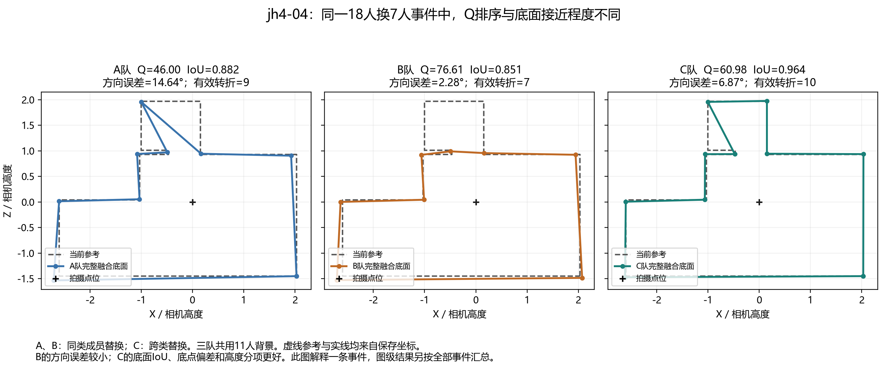

# DSTRUCT 换类反例：难度、RFUSE 与融合过程的独立检查

2026-10-29。研究对象是**同一图片中，跨类换人的变化是否大于同类换人**。升质或降质另看有符号差值。本次保留原团队、参考、类别及融合规则，重新连接楼外 RFUSE 标签、重聚合已有结果并核对原生几何。

**现有结果指向几种不同情形：有些图的跨类与同类变化只差不到1分；有些图跨类后的形状变化更大，却被总分中的不同误差抵消；同一替换块还会随着共同背景改变作用。难度和 RFUSE 类别都提供了观察角度，目前没有一个单独因素能解释全部反例。**

## 1. 本次比较的两组实验

|实验|标签与团队身份|用途|
|---|---|---|
|当前 DSTRUCT_K3，18人换7人|v2.1 当前楼外标签；人数最多类换入历史转折最多类；选型保留建筑中的33图、9楼、286个ABC，273个ABC的三队Q均可用|检查当前主条件的7张反例|
|固定7人替换块，总人数10—21|历史冻结 DSTRUCT 标签和成员路径，使用v2.1参考评分|看同一图片、同一替换块如何随共同背景变化|

A=D∪X，B=D∪Y，C=D∪Z。X和Y来自同类，Z来自另一类，D是三队共同保留的人。18/7中D有11人，X/Y/Z各7人。

以下“额外变化”是跨类幅度减同类幅度：

\[
G_Q=\frac{|Q_C-Q_A|+|Q_C-Q_B|}{2}-|Q_B-Q_A|.
\]

图级结果沿用既有背景配额→替换块→方向→图片的汇总顺序。负值表示该条件下同类换人的Q变化更大；质量升降分别看C−A和C−B。两组实验使用不同阶段的标签与团队，分别报告。

## 2. 反例没有主要集中在困难图

|当前18/7|全部可比图片|跨类幅度小于同类的图片|平均额外Q变化|
|---|---:|---:|---:|
|简单|23|2|+3.094分|
|中等|5|4|+0.827分|
|困难|5|1|+8.071分|

中等图4/5为负，值得继续看具体结构；该层平均值仍为正，来自一张幅度较大的正例。7张反例中5张差距不足1分，较大的两张是S9-18（−1.155分）和jh4-04（−6.357分）。这里用1分描述幅度，没有把它当显著性门槛。

7张图的参考在v2.1均未改变，人员池为33—35人。重新计算当前参考的转折数、短边和几何自遮挡H后，均与保存特征吻合。反例既有12转折、短边和自遮挡的复杂布局，也有4转折、无短边、无H的布局。

历史固定块14/7条件下，简单图11/47、中等图4/7、困难图0/3为负，方向也没有表现为“越难越容易失效”。详细分母见[难度和背景分析](DIFFICULTY_BACKGROUND_ANALYSIS.md)。

### 2.1 是否因为图片简单、团队分数都很高

部分反例符合这一解释。Z6-10的24支团队Q全部在96.07—99.17之间，同类和跨类替换平均只变化0.97和0.89分。uNb-82的48支团队平均96.35分，两种替换平均变化1.68和1.26分。它们的输出位置差异也较小，类别在这些局部团队中拉开的绝对差距有限。

|图片|难度标签|可比团队数|平均Q|Q最小—最大|同类／跨类Q变化|
|---|---|---:|---:|---:|---:|
|Z6-10|简单|24|98.38|96.07—99.17|0.97／0.89|
|uNb-82|简单|48|96.35|92.55—97.89|1.68／1.26|
|S9-18|中等|24|96.15|89.20—98.37|3.71／2.56|
|S9-05|中等|24|89.37|83.22—94.76|4.53／3.86|
|X7-19|中等|24|72.14|70.72—74.82|1.24／0.95|

这5张图的所有团队均没有被节点门槛筛除的候选。但“差距小”有不同来源：X7-19集中在72分附近，应检查不同团队是否保留了相近的偏差；S9-05仍有约4分的替换变化，主要是跨类没有超过同类，而不是完全没有差异。S9-18虽平均较高，也仍有89分的团队。

在全部33图的共同可评分ABC上，团队平均Q与跨类变化幅度的图级Spearman相关为−0.809。以95分作便于描述的分界，14张高分图的跨类幅度中位数为1.409分，另外19图为6.760分；高分组包含11张正例和3张反例。因此高分集中有助于解释绝对变化较小，不能单独决定额外幅度的正负。95分不是新难度阈值或显著性门槛，该相关也包含有界Q量尺与当前选队的影响。

“简单”标签也不能直接替代上述检查：同为简单的S9-04，共同可评分ABC中的21支团队Q跨度为57.83—98.72，跨类变化35.29分。若另纳入不属于三队共同可评分ABC的可评分端点，上限为98.82；本表采用前一个支持范围。应结合实际原答与团队分布，区分高分集中、共同偏差，以及同类成员差异较大的情形。

逐图数据见 `TEAM_SCORE_LEVEL_AND_SPREAD.csv`。分数水平及范围使用三队Q均可用的ABC中的去重团队，图片内团队等权；替换幅度沿用原背景配额→块→方向汇总。范围仅覆盖本条件保存团队。未用这些结果重新分类、改难度或调整Q。

## 3. 对同一批成员接入RFUSE后，发现了什么

DSTRUCT按人员原答中的结构表达和难度响应分组。RFUSE_GEOM按人员参与团队时的几何响应分组：包括融合转折、短边、冗余点、上下边界位置、底面面积与高度。本次使用目标建筑以外形成的RFUSE标签，重新描述这286个既有ABC；没有另挑一批RFUSE团队来替代它们。

- **RFUSE_GEOM_K2：286次X→Y的类别人数都完全相同。** X/Y→Z则改变2—4个类别席位。因此，这些反例确实包含同一RFUSE粗角色内部的具体成员差异。
- **RFUSE_GEOM_K3：238/286次X→Y改变细类人数。** 这种变化同时出现在正例和反例。按图等权，反例组的“跨类减同类构成距离”为2.339席，正例组为2.231席，没有把两组分开。
- 33图中，Q跨类幅度更大有26图；底面几何距离有18图；配对角距离有24图。分类对不同结果的区分程度不同。

这次没有得到“把DSTRUCT反例改用RFUSE标签就能解释清楚”的结果。更合适的RFUSE观察方式，是追查同一批成员实际改变了哪些融合结构和位置。完整逐成员和逐事件结果见[同团队RFUSE分析](RFUSE_SAME_TEAM_ANALYSIS.md)。

## 4. jh4-04：跨类改变了形状，Q却落在两支同类队伍之间

查看器中的第一条登记事件为 `84320bad6f9ea2b352a805f2`。三队都是18人，共用11人背景，没有按分差最大挑选事件。

|指标|A队|B队|C队|
|---|---:|---:|---:|
|Q|46.00|76.61|60.98|
|底面IoU|0.882|0.851|0.964|
|底点角误差|1.408°|1.847°|0.420°|
|方向误差|14.644°|2.282°|6.874°|
|有效转折数|9|7|10|

C队的底面范围、底点偏差和两个高度分项均优于B队，B队的方向误差较小。总分权衡这些分项后，Q_C落在Q_A与Q_B之间。该事件同类Q幅度30.615分，跨类幅度15.307分；而底面几何距离同类为0.05355、跨类为0.10662。

这个例子也揭示了指标的数学含义。令L=|Q_B−Q_A|，d为Q_C到区间[min(Q_A,Q_B),max(Q_A,Q_B)]的距离，则：

\[
G_Q=d-\tfrac12L.
\]

只要C的Q位于A、B之间，跨类幅度必为同类的一半。要得到正的额外幅度，C必须越过A、B区间，并再离开至少半个区间宽度。因此，负的额外Q幅度可以与明显的几何变化同时出现。此恒等式已对273个可评分ABC逐条核对。

按jh4-04全部事件汇总，额外Q幅度−6.357分，额外底面距离+0.002514。第一条事件用于说明分项权衡，图级均值仍按全部事件计算。无需为改变这个反例而调整质量权重。

其余6张反例的同类、跨类有效转折数差均为0，几何配对也没有未匹配点；它们的差异主要表现为保存输出的位置和各误差分项。正例中也有21/26图保持相同转折数，所以“转折数没变”本身同样不足以解释反例。

## 5. 固定替换块以后，共同背景仍能改变比较关系

历史固定7人块实验登记116条路径，总人数从10增至21。每一步三队加入相同的背景成员，替换比例从70%降到33.3%，50%门槛由5票变为11票。

本次只比较12个人数点的A/B/C均可评的108条路径，覆盖55图。固定这些路径再逐图汇总后，**30/55图的额外Q幅度改变正负，其中10/55图同时出现小于−1和大于+1的值**。进一步限定每图两条路径都完整，仍为29/53图翻转、9/53图两侧超过1分。

同一图片的难度不变，X/Y/Z也不变，比较关系却发生变化。这说明必须结合共同背景解释类别作用。该路径同时改变背景成员、总人数、替换比例和整数投票门槛；要判断某次翻转具体来自哪条墙线，应继续核对支持票及连接。

## 6. 50%附近漏选的机制检查

用户提出：部分结构的支持票可能只差一票，未达到50%便没有进入输出，进而显著改变质量。该假设对应明确的算法步骤。本次检查须同时查看未选身份组、已选节点、位置估计与来源连接，不能只读取最终保留节点的最小支持票。

保存端点只保留了选中节点支持票及未选计数。本次使用冻结方法重放已登记团队，补出候选身份组；先验证输出坐标、顺序和已选支持票与原结果一致。这里的票数是对应后节点（上下点对候选）的独立人员支持，不能直接把节点编号当作跨团队墙身份。

jh4-04首事件已有两个明确的对应组。通过共同背景D内完全相同的原答点身份对齐，三队D支持集合分别恰好为同样5人和同样6人：

|同一候选结构|A：D票＋X票|B：D票＋Y票|C：D票＋Z票|9票门槛下的结果|
|---|---:|---:|---:|---|
|第一组|5＋3＝8|5＋3＝8|5＋6＝11|A/B未选，C选中|
|第二组|6＋4＝10|6＋1＝7|6＋6＝12|A/C选中，B未选|

**共同背景有11人，但每个局部结构只获得其中一部分人的支持；替换块能决定该结构是否跨过9票。** 这是用户所提机制的直接实例。A/B第一组只差一票，B第二组差两票。

同时，C还有一个8票未选组涉及共同背景原答点在对应阶段被拆成两组。它应检查“同一真实结构是否被分开”，而不能只看总票数。A/B虽然共同缺第一组，Q却相差30.615分；因此需要把身份对应、未选节点和连接后的方向误差连起来解释。

已将重放扩到7张反例及正例jh4-10的全部71个登记ABC、213支不同团队：

|图片组|检查团队|存在未选候选的团队|其中有8票未选候选|
|---|---:|---:|---:|
|jh4-04，反例|24|19|10|
|jh4-13，反例|24|2|0|
|其余5张反例|144|0|0|
|jh4-10，正例|21|21|14|

jh4-13的两个未选候选均为4票，距离9票还差5票。全部重放中，已选节点均进入最终候选环序，没有发现“过了门槛、随后连接时又删去节点”；连接形状和对应是否正确仍要看原答。5张完全没有未选候选的反例表明，50%筛选不是这批反例的统一解释；正例同样存在近门槛结构，门槛跳变本身也不预定比较方向。

213队的ERP点、节点身份、环序、支持票和状态与保存结果一致。202队的底面坐标逐值一致，另11队仅有约2.22×10⁻¹⁶—4.44×10⁻¹⁶的浮点尾数差，检查表分别保留精确一致与数值等价状态。本次没有重评分或改变门槛。

票账复核另见[候选与门槛机制](VOTE_MECHANISM_ANALYSIS.md)。人工判断用于确认这些候选在原图中对应哪个真实结构，尤其是否本应视为同一墙角；无需重新判断全部图片的难度，也不代替统计复算。

## 7. 采用与后续

当前保留DSTRUCT解释原答标法、RFUSE解释融合响应的分工。反例检查重点放在具体原答如何经过对应、票数、位置和连接变成输出，不依据这7张图临时重选分类或修改难度。

研究台应并列给出：原图与完整原答；A/B/C具体成员；同类与跨类的Q幅度、几何距离；Q分项；保留和未保留候选的票数。需要人工判断时只提出已定位的结构问题。

本次材料由 `RFUSE_SAME_TEAM_ANALYSIS.md`、`DIFFICULTY_BACKGROUND_ANALYSIS.md`、逐图CSV和三个检查JSON支撑。复算入口为本目录的 `recompute_same_team_rfuse.py` 与仓库 `tools/thesis_main/analysis/diagnose_v21_exchange_counterexample_20261029.py`。新增合法空间31池的接续在另一任务中执行，本诊断保留当前33图及历史路径的实验身份。
