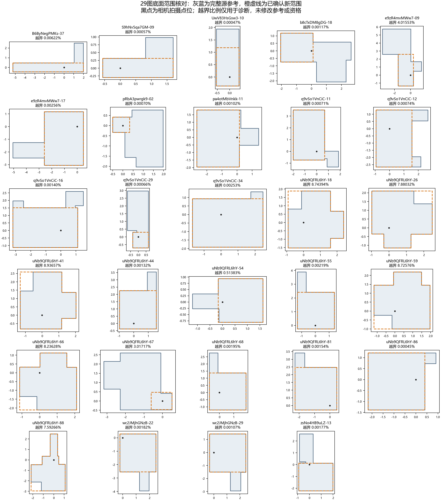

# 29张新范围参考为何没有进入正式Q

## 最新：30图顶高独立验收通过，已授权相关数据重算

用户已完成顶部选择：6张采用代表点所在近同高组均值，24张采用全点均高。主线程直接由ERP上下射线的正切比独立重建，确认所选均值、底面/横坐标不变、资格及其它参考不变；顶高极差最大9.99×10⁻¹⁶相机高度，底面轴残差最大1.02×10⁻¹²度，3项针对性测试通过。wc2-23保留原MP3D参考和历史非当前身份。[独立验收](extension_v1/adopted_references_20261028/ceiling_adopted_20261028/INDEPENDENT_ACCEPTANCE.json)。下方“顶部待复核”描述为此前阶段。

用户已授权补充实验线程继续全部受影响数据：原答及已保存团队重新评分、新空间池自然256与范围构成分析，以及依赖新参考的人员特征、楼外分类/选择和相关比较。相同成员、原答和融合规则的端点复用几何；输入改变或缺端点才新增融合。固定旧标签/团队对照与新版重拟合结果分别保存，主结论比较原固定图集、新增图集和扩展图集。旧版数据保留，重算完成并独立验收后再更新主展示数字。本段是授权与验收状态，不表示后续重算已经完成。无定时跟进。

**2026-10-28顶面复核完成：** [30份新参考采用记录](extension_v1/adopted_references_20261028/ceiling_adopted_20261028/README.md)：24份采用展示均高，6份按用户指定代表点的近同高组平均。底面、排除资格及冻结数据不变；新版本评分未重算。下文为此前分阶段记录。

**最新人工复核：** 用户认可本轮已展示的正交修正，wc2JMjhGNzB-23例外改用原MP3D参考。执行由补充线程负责，原有OOS、暂停和资格不自动改变，见 [用户确认与独立三维检查](USER_ORTHOGONAL_REVIEW_20261028.json)。重建71份候选后，底面轴残差最大约1.22×10⁻¹²度，上下点xz偏差为0；但人工GT保留的逐点顶高部分仍不同，例如q9-13极差0.09472相机高度。因此当前应称“底面严格正交、竖线对应”，不能统一称“完整等高Manhattan布局”。顶部单平面拟合与原图、评分对照另行检查，不静默均高。

## 2026-10-28正交复核：43个空间与人工修订GT分别检查

人工修订GT共有30张，来自冻结v2中的 `gt_manual_revision`，不是只有后来删改点对的7y-26和x8-03。30张的参考目录连接见 [人工GT清单](MANUAL_GT30_REFERENCE_INVENTORY.csv)：27份列为 selected_gt，wc2-26保留人工版本并采用另一个确认空间，7y-16与wc2-23未出现在该参考目录。目录角色不代替质量资格，是否参与正式评分还需核对排除状态和作答绑定。补充实验线程正在检查这30张；不得将用户修订的结构直接吸附回MP3D原布局。

[独立角度扫描](ORTHOGONALITY_SCAN_20261028.csv)覆盖43个确认空间及两份后续删点参考。去除已确认的近共线冗余点后，43个空间相对共同正交轴的最大偏差约0.02196度。正交候选已生成，最大ERP移动0.0178像素（1024×512坐标）。主线程独立检查了45个候选底面的共同轴约束、有效性和环向。

对43个空间保存的1510组Manual作答—参考配对，1502组可在修正前后同时评分，8组未填分。独立重聚合得到B8L2最大绝对变化0.003613分以内、D10为0.003722分以内；这批裁切的精度修正对质量数值影响极小。此处包含备选参考的诊断配对，不等于1510份正式质量记录。缺完整参考者以同一继承高度的未正交候选作比较，不冒称旧正式Q。

两份后续删点参考须单列：7y-26和x8-03的最大移动约7.47和2.90像素，两图70份作答的B8L2最大绝对变化0.7451分、D10为0.8297分以内。它们仍是待视觉复核候选。以上结果不能替代其余30张人工GT的检查，也尚未证明扩展后的整体研究结论不变。

固定作答时，冻结评分中的方向残差由作答自身计算，参考正交化不会改变该分项；底面重叠、边界及其他依赖参考的分项需分别比较。旧坐标和旧分数保留，正式采用与主分析更新另记。

复核脚本：`tools/thesis_main/analysis/audit_scope_orthogonality_20261028.py`。生产候选及评分对照在 `extension_v1/orthogonal_v1/`，由准备补充实验线程维护。

**最新裁定补充：** pa4otMbVnkk-11改为中等，其余难度不变；下文41图/29图难度数量为这次改档前统计。uNb-59/-66第9对、wc2-03第5对、wc2-61第4对的既有冗余处理已重新复算一致，见[回查](../../scope_redundant_vertices_20261016/RECHECK_20261028.json)。准备补充实验线程负责同步新版难度及已确认的结构视图，不使用旧预览点数计有效转折。

## 当前执行决定：范围补齐与主分析扩展（2026-10-28）

用户最新确认：全部沿用原高度；e9z-09采用LATEST_E9Z_SCOPE_RECEIPT.json中05:59:52.604Z导出的最终底面，早一份05:58导出不采用。九图高度待确认已解除；下方此前待确认与复核页记录保留历史身份。该授权是生成新版参考、补算和接入的依据，不表示计算已经完成。

已授权准备补充实验线程执行。补算使用独立版本，不覆盖冻结v2。保留原GT、原答、旧结果和人员/图片既有排除；不按完整参考可生成就自动将所有记录纳入正式质量。

### 已有难度与人数

41图都有已采用的三档难度：简单22、中等7、困难12；其中待补参考29图为简单17、中等6、困难6。e9z-09既有标签为中等。标签来源是用户确认新范围后的既有难度流程，不从新增Q或曲线反推等级。e9z-09这次再次改底面，应更新可计算结构特征并说明变化；没有新的人工定档指令前保留中等标签。

41图每图均有35个Manual人员ID，原有排除后32—35人；共1438份Manual记录。待补29图有1018份Manual记录，均35人，保留1000份。记录数与独立人员数分别统计；同图兼容目标池可能小于35。Semi次要，不扩大为全库追加。

### 补算任务和验收顺序

1. 从保存源顶平面及最新确认底面生成新版完整参考，记录逐图来源、上下点对、范围边及更新前后差异。不得被旧严格包含检查再次永久阻断；不得把原始回执其他图的默认full_gt批量覆盖当前范围。

2. 逐份核对目标绑定：人工指定优先，局部结构/延伸/封口判断，模糊时底面兜底；不按最高Q选择。明确选了另一允许空间的作答单列，不视为人员错误。缺参考、实际融合失败、不能评分分别记录，Q缺失不填0。

3. 先列逐图新旧人员池、参考与保存端点覆盖。相同成员、原答及冻结融合规则的端点优先复用几何，只重评分；人员池变化或缺端点时，才补相应自然256条顺序，保留精确有限边际与真实重复频次。不能仅因全图35人就把不同目标成员混作同目标池。

4. 补充同空间内曲线，并将不同空间选择混合的过程另列：记录空间构成、输出范围/结构/几何、各明确参考下的Q与失败。先核对现有相应团队证据，优先有限且解释清楚的比较，不为穷尽所有配比新增无界计算。不把跨空间混合结果混入同目标普通曲线，不按每个输出最高Q选赢家参考。

5. 比较原固定图片集合、新增合格集合和扩展集合：普通Manual为主，按现有三档和可计算结构条件分层；低人数至30、35和实际满员，固定图片范围分别报告Q/B8L2、D10、P10、SD、几何V、实际失败及不可评分。可用人数不足的高人数点不补齐，不将缺失填0。

6. 固定现有DSTRUCT/RFUSE等类别作为接入起点，不自动全库重新建类。检查新增图片会影响哪些历史特征、建类或选择来源；若要更新训练，另列依赖与必要重拟合范围。原分类与旧结果保留身份。

7. 提交原图集/新增/扩展的结论对照表：原方向及幅度、新方向及幅度、图片与建筑支持、变化原因。特别检查困难后段均值与低尾分离、门洞成功与质量分离，以及空间选择分歧。主线程独立验收后才更新采用结论与研究台主数字。

交付应包含新版参考/绑定/资格、逐图人数、精确团队/顺序、可重聚合结果、代码与验证记录，以及明确的可复用/新算数量。全库融合、全库分类和无关敏感性不默认重做。计算耗时较长时先给设计/覆盖及小批运行情况，不以仅写计划报告完成。

**最新2026-10-28：** 已接收05:59:52.604Z导出的新回执，仅采用e9z-09裁切更新，存为LATEST_E9Z_SCOPE_RECEIPT.json。高度复核页使用该新底面，顶部尚待确认；其余8张按用户本线程明确指示记录为沿用原顶高。导出schema升级v2，隔离旧页面草稿。以下初版“全部未答”记录保留历史身份。正式参考与评分尚未修改。

2026-10-28，独立回查冻结v2参考、原始顶平面及构造代码。

**用户已经确认底面，29张也都有原始顶面高度。它们未进入正式Q，直接原因是旧构造程序要求新底面严格包含在旧参考底面内，而非用户漏画了29张顶部。** 旧状态应读成“冻结目录尚未生成完整参考”，不能解释为“没有可以构造顶部的数据”。

## 1. 原来怎样竖切

用户确认的是整个空间的竖向切分。原程序读取源JSON明确给出的相机高度、房间高度，核对源JSON转换与原GT一致，然后为新底面每个顶点补出同一竖线上的顶部。不是按3D IoU反推高度，也不需要重新手绘已知平面上的所有顶点。

源底面记为S，已确认新底面记为P。程序先检查面积 `area(P−S)>1e−8`（相机高度的平方为单位）。一旦越界便返回 `confirmed_polygon_extends_beyond_complete_source_domain`，在此之后才会读取顶平面构造新点对。这个阈值仅容纳浮点误差，代码特意没有吸收ERP坐标舍入或人工拟合边界的偏差。

因此，底面有极小越界和确实增加一块空间，都被写成同一条缺口。

## 2. 本次几何复算

|现象|图数|越界面积占新底面|处理判断|

|---|---:|---:|---|

|边界极小偏差|20|0.000453%—0.006217%|不应笼统要求补画顶部；应处理坐标及边界表示的兼容问题|

|有明显范围超出|9|0.513827%—8.936571%|保留已确认底面，核对原顶高能否沿用到超出旧GT的部分|

这两组由实际误差量级明显分开。表中0.01%的分组点仅为诊断描述，**不是新的正式准入容差**。20图的最大边界距离约0.000011—0.000367个相机高度；9图约0.0296—0.8479个相机高度。

另用源JSON未舍入的底面重新计算越界，仍有部分微小偏差。因此，不能将20图全部解释为导出坐标保留两位小数这一种原因。

9张明显超出的图为：e9zR4mvMWw7-09；uNb9QFRL6hY-18、26、41、54、59、66、67、88。它们也都有原顶平面，待明确的是该高度适不适用于新范围的外延。

灰蓝为完整源参考，橙色虚线为用户确认的新范围，黑点为相机拍摄点位。图示用于核对范围，不能从底面图判断天花板是否同高。

## 3. 两种几何操作不能悄悄互换

- **严格切旧空间：** 将旧空间与P的竖直柱体取交，底面实际变成S∩P。明显越界时，会丢掉用户确认的一部分底面。

- **保留新底面并继承原顶高：** 按P生成上下点对，顶点落在源顶平面上。这完整保留用户的范围，但超出S的部分属于同高延伸，需要适用依据。

本次已为29张生成第二种操作的完整候选，并验证投影后的底面、高度能还原输入。候选不声称虚拟裁切边就是实体墙，不自动解除既有GT错误、OOS或作答排除。没有剪掉新底面以通过旧门槛。

## 4. 作答归属哪个空间，沿用已有规则

空间参考怎么构造，与一份作答属于哪个空间，是两件事。已有规则为：人工明确指定优先；否则看区分空间的局部角点、相邻边和延伸／封口；残缺模糊时才用底面接近程度兜底，并记录不确定性。不能按最终Q最高挑参考，也不能因新范围暂不能评分而退回旧完整空间。

规则出处见[多参考选择核对](../../../quality_reference_selection_20261013/README.md)。当前v2继承既有绑定，补充唯一候选及已保存的人工复核；个别相机外侧的临时几何兜底有独立授权状态。具体实现见 `quality_workers_v2_20261019.py` 的 `resolve_binding`、`apply_review`。这次29图的直接阻断是参考构造，不是这套归属规则被忘记了。完整参考就绪后，仍须检查每份作答的绑定和原有资格，而非把整图所有人自动送入一个新空间。

## 5. 当前结果及下一步

**用户决定（2026-10-28）：9张明显外延的图片需要逐图查看高度，不统一批准沿用原顶高。** 已建立[9图顶部复核页](height-review.html)，可直接本地打开，复用现有原图叠线／俯视／3D查看器；底面对照将超出旧GT的区域标红。全部判断初始为空，直接选择并导出，无额外“已复核”按钮。

复核选项为：可以沿用原顶高；顶部有高差、不能统一沿用；看不清、暂不确定；范围或边界还需核对。最后一项保留给红区落在凸墙／柱体等情形，不把所有底面外延问题强行归为高度问题。候选中的虚拟裁切边不要求在照片上有实体墙线。

已查看九张原图，并把横梁、装饰顶、玻璃隔断及门头等具体观察放在折叠说明中。它们只是辅助观察，不预选用户答案，不据原图投影曲线的弯曲认定顶面高差。

导出 `新范围顶部复核_2026-10-28.json`，schema为 `scope_height_review_20261028_v1`；始终包含九行，按 `target_id` 与 `source_reference_id` 绑定参考。`decision`允许 `inherit_source_height`、`height_differs`、`uncertain`、`scope_or_boundary_review` 或空值；空值表示尚未回答。`note`保存用户备注，辅助观察不进入用户答复。导出不自动改正式数据。

冻结v2中，41张新／备选范围图仍是12张纳入Manual自然256，29张尚未纳入该正式Q曲线；这描述现存产物，不是新的应排除结论。29张的参考修复属于真实的数据补齐任务，不需要再设计一轮人员分类实验。

先明确9张外延区域的高度，随后以新版本补齐参考、检查逐作答空间绑定与资格，再补个体评分及相应曲线。若作答池和融合输入不变，已有融合几何可复用；只有缺少对应团队几何时才需新增融合。旧256与既有结论保留原参考身份，不混入新参考分数重新命名为原版本。

## 文件及验证

- `MISSING29_GEOMETRY_DIAGNOSIS.csv`：逐图源／目标ID、面积、越界百分比、未舍入源的对照、至交集的Hausdorff距离及顶高。`_h`为相机高度单位，`_h2`为其平方；百分比字段为0—100尺度。

- `CANDIDATE_REFERENCES.json`：29份完整候选上下点对、底面、三维几何及原顶平面来源；统一标记 `candidate_only_not_formal`，未接正式评分器。

- `CHECKS.json`：29图均有显式顶平面；已保存越界面积复算一致；候选底面及高度投影往返检查通过。正式参考变更和新评分均为0。

- `height-review.html`、`height-review-data.js`：九图复核页及原图／新旧几何连接。生成入口 `build_scope_height_review_20261028.py`，配套HTML模板与脚本同目录。

- `HEIGHT_REVIEW_QA.json`：文件与交互逻辑测试记录。内置浏览器因URL策略拒绝打开 `file://`，没有通过其它浏览器或间接方式绕过；本轮没有真实浏览器布局或原生下载验收。

复现：`python -B -m tools.thesis_main.analysis.audit_scope_vertical_cut_20261028`。另外运行参考构造与空间绑定的既有测试，12项通过；资料目录生成与检查通过，底面对照图已直接查看。本次不重新融合，不改变旧参考与资格，不把Q缺失补0。

