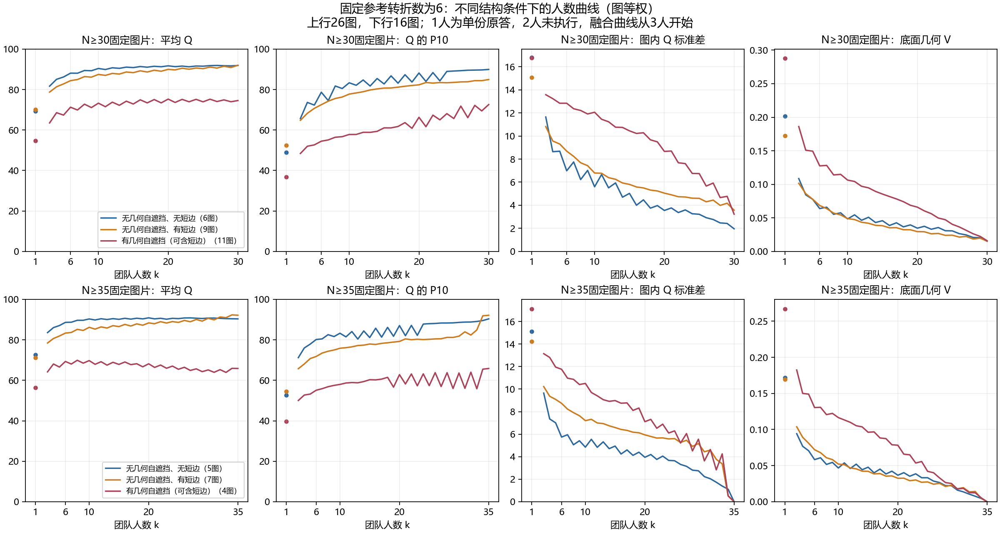

# 结构条件人数曲线与 DSTRUCT 定义敏感性

2026-10-28，冻结补充版本 `structure_sensitivity_v1`。**采用结构条件解释，保留现行三档与原版 DSTRUCT；不把本次替代类别升级为正式名单。** 本补充接在[二档／三档／连续几何的楼外比较](../README.md)之后：前一实验比较原答响应的预测增量，本实验检查已有团队结果及分类定义敏感性，两者的面板和统计量不同。

**统筹独立验收已完成：** 69组独立SVD／Ward拟合、14,625条曲线汇总、28,548行方法×ABC及853,776条方法×团队构成关联核对通过，见[独立验收](INDEPENDENT_ACCEPTANCE.md)。关联行数含方法重复，不是新增团队数量。原图已修正单人至3人跨越k=2的连线，缺失点不插值；数值未改。

## 1. 本轮增加了什么认识

1. **相同转折数下，几何自遮挡组的质量和随人数变化的表现仍不同。** 增加人数主要可以改善尾部与稳定性，不能保证平均质量继续上升。
2. **DSTRUCT 的具体名单依赖条件响应如何定义。** 用整体结构或几何条件响应替换原来的困难／简单响应后，同样59名合资格人员中，ALL名单分别变4人、7人；不是资格支持变化造成的。
3. **“配比解释一部分差异，具体成员仍占大部分”继续成立。** Q配比间占比由原14.36%变为15.93%或15.30%；三者配比内仍约84%—86%。占比稍高不构成替换正式类别的依据。
4. **旧严格ABC不能直接转名为新类别验证。** 在新标签下，许多固定成员块混类；共同合法事件的结果相同是因为复用了相同团队端点，不是两种分类已被证实等价。

## 2. 固定图片支持的人数曲线

复用普通Manual的177图及既存natural256／精确有限边际。Q均值、P10、图内标准差和状态比例按保存的逐图估计直接读取；纯几何V来自保存的pooled256路径估计，**没有新增精确V计算**。没有将重复抽到的团队去重后重新平均。保留旧估计器、权重及路径尝试数。

人数达30的候选支持157图，达35为92图。曲线使用各指标在1、3…30/35和实际全员点均可用的固定图片：质量与V分别为156、91图；状态比例保留157、92图。`VFuaQ6m2Qom-04__manual__fbe40a551f`因全员质量／V缺失退出完整曲线（35支持还缺35点），仍保留在失败及不可评状态统计和排除表中。k=2的历史deferred状态保存在源表，不插值为有效曲线。详见[共同支持](CURVE_COMMON_SUPPORT.csv)。

结构条件为H=0无短边、H=0有短边、H>0三组，H>0组允许同时有短边；**它们不是新的简单／中等／困难标签**。H仅表示声明实心墙底面模型的几何自遮挡，不是照片家具遮挡。转折与短边沿用既存定义：排除≤5°近共线节点；短边长度／周长<4%，且端点转向角均≥15°。

主要对照固定参考有效转折数为6、N≥30，共26图/16楼，各组图片在整条曲线保持不变。下表图等权，Δ均为30人减6人；P10为保存的线性分位数，另一逆CDF定义也完整输出。

|结构条件|图／楼|Q：6→30人|Q增加图片|ΔP10|Δ图内Q标准差|Δ底面V|Δ实际失败率（百分点）|
|---|---:|---:|---:|---:|---:|---:|---:|
|H=0，无短边|6/6|88.113→91.902|5/6|+11.271|−5.024|−0.04872|−1.432|
|H=0，有短边|9/7|84.419→92.020|8/9|+12.441|−5.116|−0.05298|−0.651|
|H>0|11/8|71.292→74.582|8/11|+18.111|−9.610|−0.11154|−5.078|

三个组的P10和底面V分别在所有26图上提高、下降；H>0组的标准差10/11图下降。H>0组在20→30人时，平均Q反而下降0.711分（楼等权−0.227），但P10提高6.295分、标准差降低5.442分。Q有7/11图增加、4/11图下降，提示平均幅度与支持图片比例应并列报告。

N≥35的六转折支持仅16图：H=0无短边5图/5楼、有短边7图/5楼、H>0仅4图/3楼。H>0组Q从6人69.325降至35人65.858；它是不同固定图片集合，不能与上表拼成一条30→35曲线。N≥35的92图实际均N=35，故35→全员恒等于0，不是额外人数效果。全员V=0也由唯一团队机械决定，不证明质量正确。



图已实际打开检查，中文、刻度、图例、支持标注可读；它是保存表的静态研究图，不涉及网页验收。全员点和全部V指标见[曲线汇总](CURVE_SUMMARY.csv)、[增量汇总](DELTA_SUMMARY.csv)，同时保留图等权和楼等权结果。图内Q标准差保留来源的精确总体SD／路径样本SD定义，未混称同一估计器。

连续H在固定六转折26图中，与6→30的ΔQ、ΔP10、ΔSD、Δ底面V的Spearman分别为−0.169、+0.253、−0.503、−0.686。它说明H与波动变化有描述性联系；小样本、相关条件及人员池差异尚未控制，不能解释为独立因果效应或预测验证。短边数与ΔQ相关仅+0.016，不能因前表分组差异而声称短边越多收益越大。[完整相关表](CURVE_CONDITION_ASSOCIATIONS.csv)

## 3. DSTRUCT：定义改变是否改变人员

训练仍使用原分类历史：5785份Manual、179图。它与人数曲线的普通177图不是相同范围，沿用历史资格记录包含额外条件记录，不把二者分母合并。四项peer-centered结构响应为转折数、短边数、近直线节点数、9°未匹配参考角。未用Q、时间或ABC效果拟合类别。

固定K=3，使用原稳健缩放、截断、域内至多2主成分、域等权与Ward聚类；先复现原ALL与22个楼外折，23折均与已发表类别逐人一致。总体历史特征复算最大差1.01×10⁻¹⁶。

|定义|输入|ALL类别人数（对齐原类名后）|ALL换类人数|ALL ARI|22楼外折换类人数范围／中位数|
|---|---|---|---:|---:|---|
|原DSTRUCT|整体＋困难＋困难减简单结构响应|8/39/12|0/59|1|0／0|
|仅整体|整体结构响应|10/39/10|4/59|0.785|1—9／4.5|
|几何条件响应|整体＋challenge＋challenge减plain|15/32/12|7/59|0.671|0—16／2|

challenge预先固定为有效转折>6或H>0或有短边，plain为补集；这是结构条件敏感性定义，不是推断出的正式难度规则。三种原生资格及共同资格在ALL和每个楼外折都恰为59人，另3名unknown保留。整体资格≥12图/3楼；几何响应另要求plain≥5图/2楼、challenge≥4图/2楼。主比较使用三法共同资格，因此资格仍继承原方法限制；不能声称整条流程与旧标签完全无关。

ALL仅整体的变动为W015、W017从C3到C2，W105、W127从C2到C1；几何响应为W018、W101、W105、W106、W113、W127、W132从C2到C1。几何响应的ALL C3仍为原12人，这不代表每个楼外折都相同。楼外ARI：整体0.560—0.944、中位0.771；几何0.342—1、中位0.892。类名用最大成员重叠对齐，仅便于比较；原类名、中心和完整成员表同时保留。[资格](ELIGIBILITY.csv)、[名单](LABELS_ALL_LOBO.csv)、[交叉表](LABEL_CROSSTAB.csv)、[中心](CLASS_CENTERS.csv)

## 4. 原团队配比方差：核心认识保留

231个Manual面板、40图/22楼，每面板全部924队；213444条面板团队关联完整保留。四个方法输出含原发布版和原共同支持复现版，两者完全相同。所有端点缓存齐全，所有面板人员在三种定义下均已知，未按效果重选面板。

|定义|Q配比间占比|Q配比内占比|转折数配比间占比|
|---|---:|---:|---:|
|原DSTRUCT|14.3627%|85.6373%|21.9817%|
|仅整体|15.9342%|84.0658%|23.1728%|
|几何条件响应|15.2951%|84.7049%|22.5945%|

按面板内总体方差分解，先面板→图片、图片→建筑，再楼等权聚合方差后求比；不是平均逐面板占比。三法总Q方差均38.673827，原版462条面板×指标结果与既存衔接表完全吻合。新定义并没有使配比成为主要来源，**“具体成员仍会显著改变同配比内的共识结果”保留**。这是固定有限团队方差，不是全库解释率、预测准确率或分类优劣排名。[汇总](COMPOSITION_SUMMARY.csv)

## 5. 严格ABC：不能沿用已失效的类别关系

仅重判原DSTRUCT_K3的screen、confirm、size_paths固定事件，保留D/X/Y/Z、原方向、n、m；X/Y须分别纯类且同类，Z须纯类且跨类，四块互不交叠。背景D保持原样，unknown数量单列，不另加旧设计不存在的资格门槛。失败与不可评端点保留，不填零。

|定义|原7137条阶段事件中仍合法|合法且三端点有Q|失去合法性|
|---|---:|---:|---:|
|原DSTRUCT|7137|6894|0|
|仅整体|915|898|6222（成员块混类）|
|几何条件响应|1700|1617|5437（成员块混类）|

这些跨阶段事件只作为缓存覆盖清单，不当作7137份独立证据。三法共同合法578条；没有选择新队或缺缓存的新队。小部分人员换类即可使7人块混类，所以事件合法率降低也不能反向作为分类能力差的证据。

冻结旧主方向（原最大类→原困难转折最高类）、confirm楼外选择、n=18/m=7：

|定义与自身合法支持|图片／楼／可评分事件|同类变化，楼等权|跨类变化，楼等权|跨类减同类|
|---|---:|---:|---:|---:|
|原DSTRUCT|40/10/327|3.0716|5.1970|2.1254|
|仅整体|4/4/17|0.4554|11.4577|11.0023|
|几何条件响应|22/8/93|3.8175|6.0181|2.2005|

原版图等权同类3.4375、跨类6.3860复现此前结果。上表新方法支持不同，**不能拿其较大数值宣布新定义更强**。三法共同支持只剩3图/3楼/5事件；固定三团队Q相同，三法的同类／跨类变化必然相同。这只验证重贴标签后的合法性和端点一致，不能验证类别效果等价。

同类=|B−A|，跨类=(|C−A|+|C−B|)/2，CB=C−B另列，不替换跨类定义。聚合按原背景目标数量水平先等权、再块等权到图片、图片等权到建筑，保留图等权与楼等权。所有方向、规模、阶段和extension另表报告；本次CB限定ABC三端点共同有效，不能直接等同历史独立CB支持下的均值。[主方向结果](ABC_FOCUS_SUMMARY.csv)、[全部支持](ABC_SUPPORT.csv)、[逐事件退出原因](ABC_RELABELED.csv.gz)

## 6. 采用建议与停止范围

**采用：** 在人数研究中同时展示平均Q、尾部、图内波动、纯几何V和真实失败；使用固定转折数下的结构条件帮助解释差异。连续条件作为现行三档的补充，并不要求重命名难度。

**保留：** 原DSTRUCT的研究解释与已冻结实验身份，以及“配比与具体成员共同影响团队结果”的主认识。DSTRUCT主解释地位来自结构行为与条件响应可解释、可连接团队差异，不能表述成它获得最大配比占比。

**发生改变：** 对“名单对定义不敏感”的假设应放弃；旧严格ABC只能支持原类别的事件设计，新标签必须逐事件重查。

**尚不支持：** 正式替换类别、把几何响应当作更优难度体系、宣称替代定义已获得等价或更强严格换类效果、把V下降当作质量提升。RFUSE及其它人员方法未重拟合，本轮不能推断它们不受难度定义影响。

到此可停止补充计算。若未来确需对新类别进行对称的严格换类比较，应另行冻结选队设计并先核查缓存；本次不为了给新类别创造有利事件而重新选n/m、方向或团队。

## 7. 复现、核验与交接

```powershell
python -B -m tools.thesis_main.analysis.structure_condition_curves_20261028
python -B -m tools.thesis_main.analysis.dstruct_definition_sensitivity_20261028
python -B -m tools.thesis_main.analysis.check_structure_sensitivity_20261028
python -B -m pytest tests/test_structure_sensitivity_20261028.py -q
```

依赖已安装numpy、pandas、scipy、sklearn、matplotlib。第二条仅对保存特征拟合敏感性类别并重聚合缓存，不运行融合或评分；所有输出进入本补充目录。计算前方案见[PLAN.json](PLAN.json)，字段边界见[FIELD_CONTRACT.json](FIELD_CONTRACT.json)。这是回顾性分析，已有数据此前被探索，方案冻结不等于新的盲验证。

[VALIDATION.json](VALIDATION.json)记录作者检查：源表值及估计器保持；共同曲线支持固定；图／楼聚合复算通过；原DSTRUCT23折复现；原配比462条结果最大差0；27576条方法×可评分事件的ABC指标由缓存Q重算一致。5项针对性测试覆盖缺失曲线、条件分组、类别对齐、ABC混类退出、重复团队权重及背景水平聚合。**这些是作者自检，不是独立验收。**

未修改正式难度、人员名单、目标、参考、protocol或质量端点；未提交推送。未运行全库测试和无关方法拟合。本补充通过父专题README接入；已检查项目地图与README_INDEX的既有父专题入口，按任务分工不改统筹正在编辑的全局catalog／地图。独立复核与全局入口登记由统筹接续。
