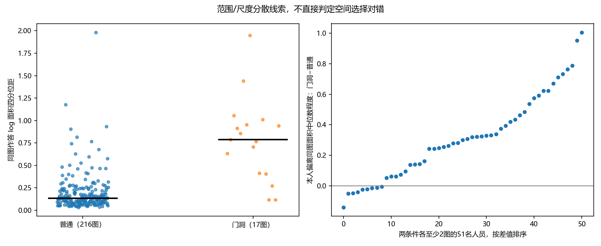

# v2：难在哪里、对谁难、造成什么标法变化

**2026-10-26来源澄清：** 本包是粗难度标签形成后的既有作答分析；简单／中等／困难来自几何初分、视觉辅助复核及研究者人工修订，详见[实际过程](../../../docs/thesis_main/topics/difficulty/图片难度全量复核与分层标准_20261010.md#现行难度分层的实际形成过程2026-10-26整理)。本包的5°有效转折、4%短边等定义不是原人工定档规则。固定六转折的无短边／有短边两组均为6简单＋4中等，自遮挡组为6中等＋7困难：三种结构条件不对应三个难度等级。该交叉计数从`image_mechanisms.csv`重聚合，原结果与标签不变。

**2026-10-24全线接续：** 本专题的条件规律已与当前v2自然人数过程、类别与快慢响应连接，见[图片条件与融合再审查](../../statistics/research_closeout_20261022/CONDITIONS_FUSION_REASSESSMENT_20261024.md)。32/47、36/47人的简化增加及困难后段27/29图V降低按实际多数采用；旧人数安排已执行。OOS子类独立统计仍由[专门清单](scope_closeout_20261022/OOS_REVIEW_20261024.md)接续。

**2026-10-22范围与多数支持已补齐：** [当前收尾](scope_closeout_20261022/README.md)明确目标绑定、完整参考与原资格的区别，补充多数人员／可比较图片分母，并归档两份缺失ZIP源表。既有结论、标签和算法保持；分类发现可单条件或联合历史，效果仍分别按Manual／Semi报告。

**2026-10-21阶段收尾：** 可采用结论、共同图片／同参考正反例及可直接整合段落见 [RESULTS_SYNTHESIS.md](RESULTS_SYNTHESIS.md)；跨线来源与支持范围见 [INTERPRETATION_INTERFACE.json](INTERPRETATION_INTERFACE.json)。本页原分析及数值保留，粗标签不变。

本轮发现支持把“难度的作用”解释为**条件引发的标法变化**：窄小转折和几何自遮挡更常伴随简化；同样条件下，人员的细节保留差异很大；门洞还涉及范围选择，边界位置误差也不能由点数解释。现有简单／中等／困难标签保留，本包没有创建难度总分、重分人员、修改参考或重算质量与融合。

2026-10-21接续：[快慢组合的条件机制](../speed_difficulty_mechanisms_20261021/README.md)。固定新Pro共同77图，区分局部转折支持不足与短墙方向敏感；Manual／Semi／门洞分列，保留本包原结果。

逐份入口为 [v2 evidence](../../statistics/v2_evidence_audit_20261019/README.md)，以 `object_id` 连接既有标法及同房逐份诊断。没有沿用旧v1样本面板。数值为探索性描述，尚非因果效应或独立验证的人员类型。

## 1. 固定6个参考转折后，条件差异仍很清楚

普通场景、Manual、正式参考可用且与当前难度目标完全相同的面板中，有33图／1023份作答的参考为6个有效转折。先算每图“有效转折少于参考”的人员比例，再让图片等权：

|参考条件|图数／建筑数|图片等权简化比例|建筑等权简化比例|
|---|---:|---:|---:|
|H=0，无短转折边|10／7|10.7%|13.7%|
|H=0，有短转折边|10／7|29.8%|28.2%|
|几何H>0|13／9|55.7%|54.5%|

这里H由参考底面与相机位置计算，表示实心墙假设下的几何自遮挡代理，**不表示照片中的家具遮挡或角点必然无法推断**。短转折边定义为长度小于周长4%，且两端转折均至少15°。有效转折排除不超过5°的近共线插点；3°／10°敏感性保持方向：短边组28.6%／31.9%，H>0组55.7%／55.9%，普通组均10.7%。

同一人员在两条件各至少有2图时，共有47人可比较。相对H=0无短边条件，32/47人在短边条件下简化增加，个人差值中位数+15个百分点；36/47人在H>0条件下增加，中位数+50个百分点。两次比较人员有重叠，不能相加；这控制了人员身份及参考转折数，没有控制所有场景或建筑因素。

**解释：** 点数是表达负担的一部分，但同为6转折时，结构是否窄小、是否存在自遮挡，比“超过4对点就是难”更能解释发生了什么。不能把少画一概认定为遗漏真实墙角，范围与参考仍需结合图片判断。

底表：[逐图条件](image_mechanisms.csv)、[固定复杂度汇总](fixed_complexity_summary.csv)、[同人比较](person_fixed6_conditions.csv)、[阈值敏感性](turn_threshold_sensitivity.csv)。

## 2. “小而弱”可以发生在近处；同一人员也会改变标法

选择已有可见性记录中的两张6转折图片作同人对照，没有依据低Q挑图：

|图片|当前粗标签|参考短边水平张角|照片和作答现象|
|---|---|---:|---|
|b8cTxDM8gDG-07|简单|12.59°|卧室上部墙面转折较清楚；33名共同人员均表达6转折|
|jtcxE69GiFV-13|中等|3.22°|浴室窗帘附近窄小转折的边界线索较弱；同33人中23人表达4转折、2人5转折、8人6转折|

黄色为各自既有参考，品红为W107，青色为W112；线条来自证据中既定处理点位。W107从卧室的6转折变为浴室的4转折，W112在两图均为6转折。共同人员的25/33出现减少，不意味着剩余8人所有角点位置都正确。

浴室参考顶点半径最大仅为1.11个相机高度单位，因此这个例子**不宜称为“远处细节”**；近处窄小特征与遮挡也可以造成简化。在固定6转折且H=0的20图中，参考半径90分位与简化比例的Spearman相关仅+0.088；10张短边图中，最小短边张角与简化比例相关−0.399。样本少且有场景混杂，目前不能据此建远近模型，但不支持用距离单变量概括难度。

H=0也不等于照片无遮挡。例如 `jh4fc5c5qoQ-13` 的冰箱、台面等影响下边界线索，同图有人表达5、有人6转折。这类RGB边界可见性不能由H直接替代。玻璃淋浴间 `uNb9QFRL6hY-60` 的旧记录同时涉及透明隔断和范围差异，更不能把几何H解释为完全遮挡。

点位、人员、裁切位置和来源见 [叠图证据](overlay_evidence.json)、[33人配对](same_people_clear_curtain.csv)、[案例逐份记录](case_person_rows.csv)。这是两张不同房间的观察对照，不是只改变可见性的实验。

## 3. 对谁难：值得保留“条件下的细节保留”这一人员轴

复用冻结R5六人标签：W109、W112、W115、W122、W126、W130。在同一图至少有2名R5及2名其他人员的固定6转折子面板中：

|条件|图数|R5简化比例的图均值|其他人员|
|---|---:|---:|---:|
|H=0，无短边|8|0.0%|13.7%|
|H=0，有短边|9|0.0%|32.6%|
|H>0|11|3.6%|65.8%|

这为“某些人员在弱线索／隐藏细节条件下仍保持复杂结构”提供了具体表达证据，不能直接命名为困难专家：多画可能是真细节、范围扩大、共线冗余或误标。R5来自相关历史作答，本轮是冻结标签的解释性核对，不是留出验证；H2包含R5，不能当作第二个独立发现。

已确认参考问题图 `pRbA3pwrgk9-12` 的35份作答仍保留在无GT正确性要求的标法分析中，未纳入正式参考比较。在该图，R5只有W115、W122表达更多局部细节，另外4人也简化，构成“整类人人补真细节”的反例。原图叠线复用 [人员研究M01](../../workers/personnel_marking_patterns_20261020/figures/M01_individuals.png)。

**值得用于人员细分类的是“面对同一类机会时如何表达”，而非全局多点或高Q。** 优先保留弱／窄细节的条件保留、门洞下范围响应、边界位置与上下界选择这三条轴；是否合并成类别，应继续用跨图与替换实验检验。

底表：[同图R5对照](same_image_fixed6_R5.csv)。已有人员画像和反例的完整语义见 [人员标法报告](../../workers/personnel_marking_patterns_20261020/README.md)。

## 4. 门洞主要应另看范围／尺度分歧

不要求GT正确，以每人每图一份独立Manual作答、同图至少3人为条件。普通216图与门洞17图的同图log底面积四分位距中位数分别为 **0.133与0.787**。同一人员在普通和门洞各至少有2图时，51人中42人在门洞下偏离同图面积中位数更多；个人平均绝对偏离的增量中位数为 **+0.299 log单位**。

这是GT无关的范围／尺度分散线索，**不是已确认的空间分歧率**：面积也会被角度、边界位置或相机高度归一化投影影响。已有人审来源的 `jtcxE69GiFV-12` 可具体看到有人取左侧入口、有人取卧室，复用 [M05同图叠线](../../workers/personnel_marking_patterns_20261020/figures/M05_individuals.png)。门洞不与普通H条件混在同一张难度表中解释，非OOS且GT有问题的作答也不因此自动剔除标法研究。

底表：[逐图面积分散](doorway_area_image_spread.csv)、[同人门洞差值](person_doorway_area_spread.csv)、[逐份无GT比较](area_peer_records.csv.gz)。

## 5. 困难图至少包含三种机制，融合影响应分别解释

当前可比较参考的普通Manual困难组32图／1010份中，755份有效转折更少、234份相同、21份更多。在234份相同中，225份原点对数也相同，其中38份仍有9°底角射线对应未匹配诊断。相同点数并不保证相同位置；未匹配诊断也不自动证明哪个真实墙角画错。

复用同房专题已经定位的三个机制，不新增融合实验或叠加其样本数为本轮独立结果：

|机制|已有案例与具体证据|对人员／融合的含义|
|---|---|---|
|窄小转折被简化|G046／S9hNv5qa7GM-05、12、21：同30人，三图均6参考转折；表达至少6对点者分别23、8、23人；-12的两个必要小转折支持14、13票，低于MV50的15票，融合只剩4角|多人共同省略真实细节时，单纯增加人数未必补回；该局部已由用户确认应标|
|支持跨过融合门槛|G057：-04和-07固定共同池下8→9人的全部9种末位加入都失分，部分局部支持仍4票而门槛4→5|人员保留习惯要连接到节点支持，不能只看平均Q或人数|
|点数不变但定位偏移|G178／uNb9QFRL6hY-79：参考／融合均4角，水平角位置偏差+25.1像素，下点纵坐标偏差仅−0.83像素，终点Q约83.76|边界选择与横向定位应独立于简化研究；同样“难”可形成不同质量曲线|

来源：[同房结构迁移报告](../../same_room/same_room_multiview_20261020/structure_transfer/README.md)，含原图叠线、投票与对应诊断。G178未证明跨相机物理角点身份，门槛结果也只针对现用融合路线。

## 6. 下一步判断

1. 优先把“窄小必要转折的保留机会”接入已有人员替换事件，解释哪类换入后让必要角点跨过门槛；同时查多画错误细节的反例。复用现有投票和同房确认案例，避免再造团队全量实验。
2. 门洞单列研究“选择哪个空间”和“同范围内画得怎样”。先用已有人审范围案例检验面积分散的语义，不能凭面积大或小判对错。
3. 点数一致但位置分散的图单独看边界局部，优先沿G178现有叠图扩展。只在可见真实边界或目标范围仍有争议时请求少量人工裁定，不要求逐对复审。
4. 保留现有粗难度作背景描述。当前最值得进一步研究的是条件敏感性，而非新建一个精确总分或强行分开中等／困难均Q。

本轮没有需要用户立即批量复核的新增清单。窗帘案例的线索强弱属于图像解释，未作真实墙面最终裁决；若用于“正确细节保留率”，仍需确认局部语义，不能把现有参考当成无误金标准。

## 7. 覆盖、复现与限制

起点10439份库存；非OOS9217份／233图，门洞17图。有效几何9113份，进入本人／同行表达比较8979份，其中1687份不满足正式质量资格，不能都称作GT错误；来源中已有GT实质错误／细节遗漏标志的表达记录为229份。正式参考相同目标的普通Manual比较为5781份／179图，不能代表233图全部已经得到参考正确性认证。

表达使用既定处理点位和环序；没有恢复未知原点、修复坐标、替换参考、调整质量用途或做N1。`reference_id` 精确匹配当前难度目标是参考条件分析门槛，GT无关面积研究不以此排除不同空间。照片可见性只检查了关键案例，没有全量人工或模型遮挡识别。小样本相关及冻结类解释不替代独立外推验证。

复现：`python -m tools.thesis_main.analysis.difficulty_mechanisms_v2_20261020`。

相关测试：`python -m pytest tests/test_difficulty_mechanisms_v2_20261020.py -q`。字段与分母见 [FIELD_CONTRACT.json](FIELD_CONTRACT.json)、[COVERAGE.json](COVERAGE.json)，来源见 [SOURCES.json](SOURCES.json)。全局研究索引由统筹接续，本包不改全局目录或主研究台。
