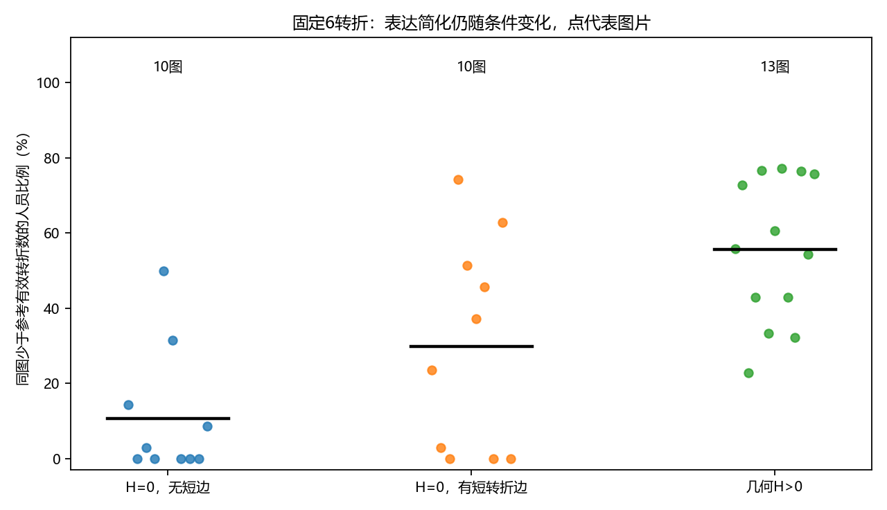
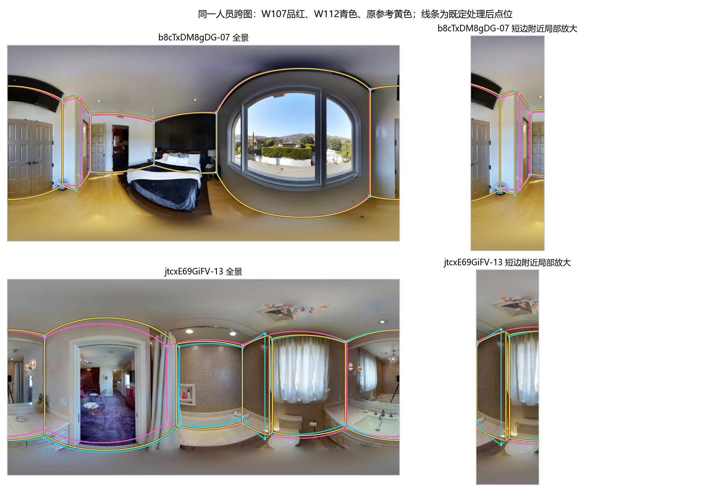
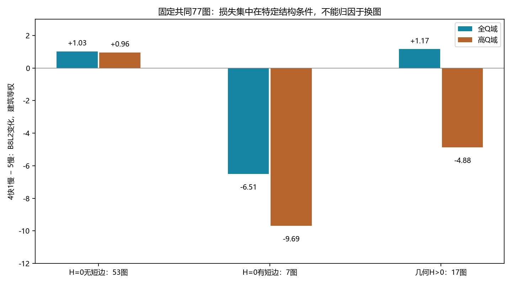

# 图片条件与人员响应：v2阶段结果定稿

**2026-10-26方法史校正：** [难度分层形成过程](../../../docs/thesis_main/topics/difficulty/图片难度全量复核与分层标准_20261010.md#现行难度分层的实际形成过程2026-10-26整理)与本包的结构条件分析分别说明。前者为几何初分后经视觉辅助和研究者修订的工作标签；后者复用既有作答解释同为六转折时的简化差异。不能把5°／4%分析阈值写成人工分层规则，或将后续分析回写成研究者最初已经制定的设计。

**2026-10-22范围与多数支持已补齐：** [当前收尾](scope_closeout_20261022/README.md)明确目标绑定、完整参考与原资格的区别，补充多数人员／可比较图片分母，并归档两份缺失ZIP源表。既有结论、标签和算法保持；分类发现可单条件或联合历史，效果仍分别按Manual／Semi报告。

日期：2026-10-21。本轮采用既有证据收尾难度条件解释，不重跑全库，不开展新人员分类。画像与可靠性采用[已定稿结果](../../workers/personnel_profiles_composition_20261020/PROFILE_FINDINGS.md)，质量分项及融合算法的结论分别由对应专题负责。本专题交付的是条件、人员原答和局部支持的连接依据。

## 1. 采用决定：三层分别解释，现有粗标签继续使用

|层次|本研究如何定义／使用|当前可以采用的含义|
|---|---|---|
|客观结构条件|固定目标及参考下的有效转折数、短边、相机与底面形成的几何自遮挡H，以及参考张角／归一半径|描述本次任务需要表达什么、哪些几何位置敏感；可复算，但依赖参考版本和几何假设|
|当前粗难度标签|沿用现有简单／中等／困难及其空间绑定；OOS、门洞、GT用途另列|作为人工辅助粗分的探索背景，允许组内机制不同；不宣称每张图都符合每个人感受|
|人员条件响应|同人跨条件的简化变化、同图不同人的结构保留和边界位置，以及固定成员团队的局部支持|解释“对谁、在何种机会下、发生什么变化”；不是新的单一难度或能力分|

**采用结论：** 当前难度粗分具有组织研究的用途；具体规律应通过结构条件和人员响应解释。没有理由根据目标Q或融合效果重新贴标签，也没有必要等到全图RGB遮挡识别完成后才能使用以下描述性结果。

H表示实心不透明墙假设下的几何自遮挡代理，不能称为照片／家具遮挡，更不能断言角点无法推断。短边采用长度／周长<4%、两端转折≥15°，包含狭长矩形的端墙，不能统称小凹凸。有效转折排除≤5°近共线插点；多点不等于正确细节。距离使用相机高度归一单位，不是实测米数。

## 2. 可直接采用的条件规律

### A. 相同表达复杂度下，结构条件仍关联简化

普通Manual、当前难度目标与正式可用参考一致的33图／1023份作答，均有6个参考有效转折。各图先计算少于参考转折数的人员比例，再图片等权：

|条件|图／建筑|图片等权简化比例|建筑等权|
|---|---:|---:|---:|
|H=0，无短边|10／7|10.7%|13.7%|
|H=0，有短边|10／7|29.8%|28.2%|
|H>0|13／9|55.7%|54.5%|

同一人员在每个比较条件各至少有2图时，两项比较分别支持47人：短边相对无短边，32人简化增加，个人差值中位数+15个百分点；H>0相对无短边H=0，36人增加，中位数+50个百分点。两组人员重叠，不相加。有效转折定义改为3°／10°后方向保持。

**采用为“条件关联”，不采用为因果难度效应。** 固定转折数及本人身份减少了一部分可比性问题，但并未控制所有场景、建筑和语义差异；少于参考转折只说明表达简化，不自动证明漏了真实必要墙角。

来源：[固定复杂度](fixed_complexity_summary.csv)、[同人比较](person_fixed6_conditions.csv)、[阈值敏感性](turn_threshold_sensitivity.csv)。

### B. 小特征及弱边界线索可以在近处出现，人员响应有差异

`b8cTxDM8gDG-07`和`jtcxE69GiFV-13`均为H=0、6参考转折，短边水平张角分别12.59°与3.22°。同33名人员在卧室图均保留6转折，到浴室图23人减为4、2人减为5、8人仍为6。浴室参考顶点半径最大仅1.11个相机高度单位，因此此例不能解释为远处细节；窗帘附近窄小转折的线索较弱是关键图像解释。

W107为6→4，W112为6→6；二者在同一图上都使用该图同一个既定参考。两图本身使用各自参考、属于不同房间，所以这是同人跨图的条件对照，不是假设同一物理房间或只改变遮挡的实验。

**采用“条件性的结构保留差异”，不采用“保留6角者必正确”或“距离决定难度”。** H=0也不等于RGB无遮挡；全量照片可见性尚未编码，现有20张固定6转折H=0图片的距离相关不足以建立稳定距离规律。

来源：[33人配对](same_people_clear_curtain.csv)、[精确参考／对象与裁切](overlay_evidence.json)。

### C. 固定同一图片后，快慢组合损失包含结构与定位两种机制

新批普通Manual的4快1慢相对5慢，跨两个人员域只用共同77图／19栋。下面每个域内先平均同图成员抽取、再图片内／建筑间等权；两域成员与基线不同，不能当作随机人员域处理。

|参考条件|共同图／建筑|全Q域ΔB8L2|高Q域ΔB8L2|高Q域两队点数相同率|
|---|---:|---:|---:|---:|
|H=0，无短边|53／16|+1.029|+0.958|100%|
|H=0，有短边|7／5|−6.506|−9.688|100%|
|H>0|17／9|+1.171|−4.876|56.7%|

短边组全部成对抽取可评分；H>0组高Q域64/68、全Q域62/68个抽取可评分，缺失不填零。固定为两域全部抽取可评分的共同71图后，H>0高Q域仍为−6.373，全Q域+0.272，另两组不变。各条件的建筑集合不同，不能按图数加权以上行来还原全体均值。

**采用有限人员池中的条件差异；不采用“快速必损”或“慢者是困难专家”。** 共同图片排除了换图解释，但高Q域5慢基线更高、成员不同，剩余提升空间和局部信息也不同，未识别速度的净因果效应。

来源：[条件与缺失支持](../speed_difficulty_mechanisms_20261021/condition_summary.csv)、[共同逐图](../speed_difficulty_mechanisms_20261021/common_image_effects.csv)、[全可评分敏感性](../speed_difficulty_mechanisms_20261021/fully_scored_common_summary.csv)。

## 3. 同图、同参考的代表性正反例

|案例与可比设计|实际局部变化|本专题采用的解释|
|---|---|---|
|UwV83HsGsw3-22：同5人规模，原设计r0的5慢对4快1慢|约x=464与570的两处参考转折，支持者从W112/W122/W130三人变为W102/W130两人；门槛恒为3。融合6→4角，Q94.216→54.764|有表达机会不等于团队有足够共同支持；既有参考下的结构保留差异，不能把全部Q差严格分摊给两个角|
|B6ByNegPMKs-48：同图同参考、同5人，r0|两队均4角，四节点均5票。远端短墙底点小偏差导致相对参考墙向偏差4.71°→40.79°；Q96.337→54.458|定位／短边敏感，不是漏角或存在票不足；现有简单标签保留，不能由低Q反推其必属困难|
|pa4otMbVnkk-14：同一5慢基线、两支4快1慢|两支混合队Q98.625与53.062，均4角、节点均5票；仅共享3人，实际变化为两人组合|相同比例不足以决定局部位置；不是单人替换实验，不把结果归因于某一个人|
|b8cTxDM8gDG-17：H>0、高Q域全部4次原抽取|4快1慢相对5慢的同图均值+14.544分|自遮挡条件存在正例，不能把组均值推广为所有图或所有快者必损；本例仅作方向反例，不补作新局部机制判断|

三图的原答、团队叠图与局部放大均已保留：[Uw22](../speed_difficulty_mechanisms_20261021/UwV83HsGsw3-22_members.png)、[B6-48](../speed_difficulty_mechanisms_20261021/B6ByNegPMKs-48_members.png)、[pa14团队正反例](../speed_difficulty_mechanisms_20261021/pa4otMbVnkk-14_teams.png)。精确队伍、参考和票账在[案例设计](../speed_difficulty_mechanisms_20261021/case_design.json)、[局部支持](../speed_difficulty_mechanisms_20261021/local_support.csv)、[相对参考偏移](../speed_difficulty_mechanisms_20261021/case_reference_offsets.csv)。精选案例解释机制，不计为额外总体样本。

**方向量的解释统一：** 上述4.71°／40.79°来自明确对应后的参考边与输出边夹角；原测量字典`dir`（如1.10°／8.80°）是自身正交规整诊断，两者不是同一量。短墙可放大端点误差，并不证明B8L2方向分项直接测量相对GT的墙向误差。分数分项、权重及敏感性采用质量专题解释，本专题不再作分数损失归因分解。

## 4. 为什么总体水平与困难图表现不必一致

总体Q是在既定图片和用途上对多个结果的汇总，困难图Q是条件子集，结构保留又是局部机会；团队还取决于其它人是否提供相同信息以及位置如何聚合。它们并非同一个量，出现排序变化不构成逻辑矛盾。

本轮快慢分析只计算**实际替换的4对**，不把保留慢者对应的第5对算入替换暴露。高Q域H>0目标图中，快者楼外总体相对Q与配对慢者平均仅差−0.070分，历史难图相对Q反而高1.013分，本图个人Q平均高0.525分；同时快者平均少0.359个有效转折，团队均值下降4.876分。该组合说明历史难图高分、当前个人总分、局部结构信息和团队输出可以不同向，不能仅用个人Q解释支持票。

具体到Uw22，快W126与慢W122楼外总体相对Q差仅−0.187；W126历史难图平均Q高5.41分，但本图4／6转折，未保留慢者提供的局部结构。它是总体水平不能替代具体机会的反例，不是W126总体能力较低的证据。画像定稿中的W122/W126共同图低尾结果仍成立，不能用本例推翻；也不能用较好低尾抹去本例的表达差异。

当前采用的是**条件响应的解释框架及真实观察**，不新增“困难专家”类别。人员类别是否具有额外预测／组队价值，由人员分类和构成研究单独检验，本专题不重复探索。

## 5. 门洞、Semi、参考问题分别保留

- 门洞：GT无关的独立Manual表达研究中，216张普通图与17张门洞图的同图log底面积IQR中位数0.133／0.787；两条件各至少2图的51人中42人在门洞下更分散。采用为范围／尺度分散线索，不称空间选错率。问卷scope响应、实际选取空间和可评分资格分别处理。
- 快慢门洞比较：高Q域仅3图／2栋，不建立门洞短边或自遮挡规律；不由面积差或Q差替用户裁定范围。
- Semi：仅18张全Q图／10栋有本轮5人快慢对照，缺高Q域，不能复制Manual的跨域或人员类型解释。初始化错误与编辑行为使用人员画像／可靠性专题，不在此补判。
- GT问题：非OOS且参考有问题的作答仍可用于表达研究。已有229份带来源GT问题标志的可比表达记录不代表全量独立GT复核；与1687份非正式质量表达记录不同。涉及相对参考正确性的汇总仍使用原资格及目标绑定，既有排除不恢复。

## 6. 可直接整合的结果段落

在当前真人v2数据中，图片条件与人员标法变化存在清楚的描述性关系。固定参考为6个有效转折时，无短边且无几何自遮挡、有短边但无几何自遮挡、存在几何自遮挡的图片，其简化比例图片等权均值分别为10.7%、29.8%和55.7%；同一人员跨条件比较亦以简化增加为主。这表明仅用角点数量不足以解释表达负担，短小结构及几何条件还影响人员是否保留转折。该结果依赖当前目标及参考，几何自遮挡不等于照片遮挡，少于参考的转折数也不自动等于遗漏真实必要结构。

同图人员与团队案例进一步揭示不同机制：部分人员对同一局部结构的保留差异会使团队支持低于投票门槛；另一些图中角点数和存在票均不变，端点位置误差却在短墙或远端投影中放大。固定共同77张普通Manual图片后，高Q域4快1慢相对5慢在无短边H=0、有短边H=0、H>0条件下的质量变化分别为+0.958、−9.688和−4.876分。损失并不统一对应漏角，亦存在自遮挡图改善及同配比不同成员结果相反的反例。因此，总体水平、困难图表现、具体局部信息与团队贡献应分别解释；这些回顾结果不识别速度的净因果作用，也不支持按当前图Q重贴难度。

本研究保留现有粗难度作为组织样本的背景变量，以结构保留、边界定位及范围／尺度分散解释其组内异质性。门洞和Semi分别报告；参考有问题的作答可研究表达，但正确性比较继续服从原参考资格。当前采用条件规律和代表性机制，不创建新的难度总分或人员能力等级。

## 7. 本轮收尾、核验及实际缺口

**完成状态：** 当前v2难度条件解释在本轮范围内收尾，可用于结果整理和跨线整合，无需等待新人员分类。机器接口见 [INTERPRETATION_INTERFACE.json](INTERPRETATION_INTERFACE.json)，仅定位现有表、筛选条件、数值与边界，不新增评分、统计面板或算法合同。

本轮回读两包已存条件表、配对表、覆盖、案例票账与对象索引，核对上述关键值、来源路径、同图／同参考及重复成员边界。未重新运行评分／融合／模型或重复已有测试，原因是本次只作结果采用与文档接口收尾，未修改计算代码。原包2项与3项定向测试及7队复放保留其原执行身份，不计作本轮重跑。未生成临时截图或启动服务。

尚存的实质缺口有三项，但不阻止上述描述性采用：（1）全量RGB边界可见性和语义必要细节未编码，不能给出“真实细节遗漏率”；（2）具体结构条件尚不能独立预测新人员／新建筑表现，不能据此承诺选队效果；（3）Semi高Q及门洞机制支持不足。若后续主张超出当前边界，再针对少量关键局部或缺失条件补证，不将无限复核作为本阶段完成条件。

全局索引、统筹模型与研究台按授权分工保持不改；统筹可登记本定稿及接口。当前没有新增必须用户人工审核的大清单。
