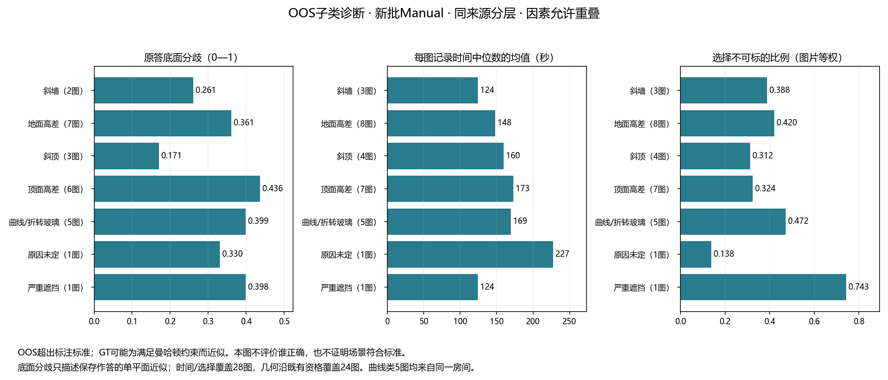

# OOS专题收尾：超出标注标准时，人们怎样表达同一场景

日期：2026-10-24。数据版本：当前真实v2；历史融合单列。入口：[28图原图与复核记录](../OOS_REVIEW_20261024.md)、[独立复核工作台](../../../../statistics/research_explorer_v1_r2_20261017/oos-review.html)。

## 1. 本专题为什么单列

**OOS单列的首要原因是场景不符合标注标准。** 斜墙、斜顶、多层顶面或地面等真实结构，可能无法忠实放进当前曼哈顿及单一顶底面的表示。GT也可能为生成满足这些约束的输出，将边界放在不符合真实结构的位置。因此，不能把“更接近该GT”直接解释为人员更正确，也不能把“偏离GT”直接解释为人员错误。

本专题观察：人员选择哪些近似表达、原答之间有多大分歧、记录时间和scope选择如何变化，以及既有融合能否形成结构输出。**这些诊断不恢复普通图资格，不用GT分数给OOS人员排名。** 即使底面一致、算法输出完整，也不代表完整场景符合标注标准。

当前所需的分类整理、原答诊断、时间和选择统计、历史融合覆盖已完成。保留q9-24原因未定及既有参考暂停，不把它们扩大为整个专题未完成。

## 2. 数据与分母

|观察层|覆盖|用途|
|---|---|---|
|OOS完整库存|28图、1,222份、61个来源人员ID、10楼|保留排除记录；Manual980、Semi8、历史condition=oos任务234|
|既有保留记录|1,187份|另外25份historical_not_accepted、10份excluded_by_review仍留库存|
|原有池分析且独立票资格|1,051份：新Manual703、旧Manual130、旧oos210、旧Semi8|结构统计沿用这一门，不因新分子类恢复历史暂停|
|几何特征可算|1,046／1,051份|5份旧Manual缺有效输入；缺失不记零|
|来源时间|1,136／1,222份|新Manual804份；旧Manual144／176、旧oos180／234、旧Semi8／8；来源分开|
|本文主要子类比较|新Manual804份、35人、28图|703份／24图有现有几何分析资格；时间和scope选择覆盖全部28图|
|参考与正式Q|存储的完整参考1222份；正式Q可用0份|参考文件完整不等于参考忠实表达真实场景|

原有整图暂停：b8-04、pRb-16、uNb-51、x8-01，共140份库存。本轮保留其库存、来源时间与任务选择，未新增这些图的几何比较；其余24图沿既有资格整理原答。历史另有x8-01的有限底面诊断，不混成本轮v2结果。

明确门洞与OOS相交为pRb-01/11两图70份；q9-24是疑似门洞35份，不能并称三个已确认门洞。图片为视角，建筑及房间重复另计；x8两图同房G231，曲线玻璃五图同房G049。

## 3. 各因素下的实际结果

分类采用用户原导出及后续确认：斜墙3图、地面高差8、斜顶4、顶面高差7、曲线/连续折转玻璃5、未定1、严重遮挡1。因素允许重叠，uNb-69同时有顶、地高差；29次因素分配覆盖28图。可见因素不自动成为每位人员实际标注目标的因素。

下面均为**新Manual、图片等权**：每图先取人员表达/时间的中位数或人员对的平均分歧，再在子类内平均。没有将人员对数或一房多视角当成独立实验。不同指标的图片支持在表中分别显示。

|可见因素|库存图／楼|几何图|底面角点数中位数的均值|原答底面分歧|时间中位数的均值（秒）|选择不可标的比例|多数人选不可标的图数|
|---|---:|---:|---:|---:|---:|---:|---:|
|斜墙|3／2|2|5.00|0.261|124|38.8%|1／3|
|地面高差、楼梯/挑空|8／4|7|6.57|0.361|148|42.0%|2／8|
|斜顶|4／2|3|4.00|0.171|160|31.2%|0／4|
|不同高度的天花板|7／4|6|5.00|0.436|173|32.4%|0／7|
|曲线或连续折转玻璃|5／1|5|8.70|0.399|169|47.2%|2／5|
|原因未定：q9-24|1／1|1|10.00|0.330|227|13.8%|0／1|
|严重遮挡：Uw-23|1／1|1|6.00|0.398|124|74.3%|1／1|

### 可以采用的发现

1. **表示不适配与人员底面分歧是不同的问题。** 三张可分析的斜顶图S9-01/07/20，新Manual共80份均为四个底面角点，图内平均底面分歧为0.115、0.225、0.173。它们展示人员可以对底面形成相对一致的近似；无法由此证明斜顶被忠实表示，更不恢复in-scope身份。第四张uNb-51继续暂停，没有混进三图几何结果。
2. **曲线/折转玻璃中，分段方式确实不同。** 五图的角点数中位数为9.5、6、10、12、6；同图人员对的角点数不一致比例，五图等权为61.8%。这是这一个房间五个视角中的重复现象，不是只挑出一个人画多了；节点是否代表正确结构仍不能仅凭数量裁定。
3. **跨门口取界使“顶面高差类”的平均分歧明显升高。** pRb-01/11为0.709和0.781；其余四张有几何支持的顶面高差图均为0.202—0.333，平均0.281。应同时记录顶面高差和门洞/范围选择，不将0.436归结为顶面高差的单独效应。
4. **同类可见结构，也可能引发不同的任务选择。** 同房曲线玻璃Uw-08有30／35人选择不可标，Uw-16只有5／30；Uw-23严重遮挡时26／35选择不可标。整体新Manual为327／804次选择不可标，28图中6图是多数人如此选择，35人中6人超过自己任务数的一半。选择统计描述参与者响应，不作为当前OOS识别正确率。
5. **记录时间也存在差异，但不是一个单调的“越不符合标准越慢”。** 斜墙子类约124秒、顶面高差约173秒，未定的q9-24约227秒，严重遮挡Uw-23约124秒。这里比较的是每图记录时间中位数的均值；实际目标、视角、任务组成及人员支持不同，不解释为子类导致的独立耗时效应。

这些发现与OOS单列的原意相容：可以研究面对表示限制时的不同近似和分歧，不需要先找到可信GT才能开展这一层研究；也不需要因存在一致的个例而否定其他图片中的系统差异。

### 除底面之外保留了什么

逐份表保留有效转折数、近共线点、短转折边，以及单一地面假设下推导的高度；逐图表同时保留高度中位数、P10/P90和一份作答内部的相对高差。斜顶三图的作答内部相对高差中位数分别约1.8%、6.0%、3.4%。这只说明该假设下输出的顶点高度较接近，**不能据此测量真实斜顶坡度或断言所有人使用了同一种近似。** 顶/底界语义和GT位置是否合理，仍应看原图与具体完整标注。

## 4. 历史融合可以说明到哪里

|已有实验|当前OOS覆盖|保存结果|本轮采用|
|---|---|---|---|
|旧v1墙线随机路径|19图、21池；每池4条路径，N=3—24|1,212个前缀，1,116个唯一成员集；1,064前缀完整几何|全员19／21池形成完整结构；另2池保留不足4节点/连接缺失|
|旧特殊墙线实验|uNb-63、x8-01、x8-09；8路径|补充x8-01的5人、40状态，其中32底面可算|旧参考暂停和旧人员池保持原身份，不接成v2人数曲线|
|旧Lee mv50原参考版|22图、24池|24个全员端点，N=1—24|仅作底面算法历史覆盖；jtc-31仅1人，无多人融合效应|
|当前v2自然人数实验|0张OOS|229个实际池与本专题无交集|未研究不等于融合失败，也不等于OOS无诊断用途|

旧墙线全员未形成完整结构的是7y-17 Manual（3节点）和uNb-69 Semi（缺连接）。4条路径满员是同一团队，不能把它们当4次独立成功。k=2的84个前缀属于排序暂缓；连接不可用141个包含这84个，不能再相加成失败数。

这些结果说明**部分超出标准的场景仍可产生完整的受约束输出**，不说明输出符合真实结构。没有使用保存的参考分数证明“加人把OOS解决了”。旧v1、旧特殊实验与当前v2的新人员没有合并平均。

在这两套广覆盖历史结果及当前v2人数实验中，未找到S9-01/07/20、pRb-11/16、uNb-51六图的既有融合结果。为当前描述专题不补跑；若以后专门研究“错误的受约束表示能否随着加人变得更一致”，可另设计有明确表示目标的实验。

## 5. 口径修正与人工判断

- **旧scope并非207次漏答。** 旧418份都有原始任务选择：normal211、oos_open_boundary94、oos_split_level63、oos_geometry40、oos_insufficient10。当前统一字段只承接了211个normal；剩余207保留在原字段，不能把统一字段空值统计成没有回答，也不能从统一字段计算旧批“不可标比例0%”。本轮已分别输出原始和统一字段。
- 时间不把lead_time补回active time；新804份是用户整理提供的来源时间，未重放原始日志，旧继承时间另列。任务总时间不是目标区域独占耗时。
- 斜墙不是必须精确135°。x8两图同房；b8-19局部玻璃斜段沿用户确认。曲线玻璃暂不强分连续曲面与多片折线。
- **目前无阻塞收尾的人工问题。** q9-24仍保留“原因未定”；b8-04、q9-24的GT疑点及pRb-16/uNb-51/x8-01旧暂停单列。需要把它们改成正式可评价目标，或裁定哪种具体近似更忠实时，再展示实际原图、GT与人员标注请用户判断；不为本轮描述统计强行补一个答案。

## 6. 文件与复算

|文件|内容|
|---|---|
|[adopted_factors.csv](adopted_factors.csv)|28图当前可见因素、房间、楼与采用来源；目标因素未裁定|
|[record_diagnostics.csv.gz](record_diagnostics.csv.gz)|1,222份匿名记录；资格、几何表达、scope原始/统一字段、来源时间|
|[image_condition_source.csv](image_condition_source.csv)|逐图×条件×来源统计；每项有效分母、缺失、顶底面诊断|
|[factor_condition_source.csv](factor_condition_source.csv)|子类图片等权汇总；不同条件/新旧来源分开|
|[worker_condition_source.csv](worker_condition_source.csv)|逐人分层诊断；不作能力排名|
|[scope_response_sources.csv](scope_response_sources.csv)|历史原始选择与当前统一字段的交叉计数|
|[legacy_fusion_coverage.csv](legacy_fusion_coverage.csv)、[逐人数](legacy_wall_by_pool_k.csv)|旧方法、池、人数和结构状态的精确来源映射|
|[字段与统计合同](FIELD_CONTRACT.md)、[摘要](summary.json)|用途与缺失规则|

复算入口：`python -m tools.thesis_main.analysis.oos_closeout_20261024`。直接复用当前保存的16,408个OOS人员对，另按新旧来源分别汇总；主要新Manual几何比较使用10,736对。结构特征复用现有人员画法函数，没有重新评分或修改点位。定向检查对24张可分析图各抽一个保存人员对，从两份点位独立计算多边形对称差/并集，核对分歧值；同时检查因素重叠、资格暂停、旧scope缺失语义和历史融合分母。

未重跑全量融合、未重新拟合分类、未裁定GT，也没有把旧结果包装成新v2全员实验。静态统计图已检查；工作台逻辑可测试，本地文件浏览器视觉检查仍受此前访问策略限制。

本轮交付核验：5项OOS定向测试通过；工作台库存、诊断分母、筛选、自动保存和导入冲突检查通过；研究目录663项资料校验通过；变更Markdown中的1,105个本地链接均可定位。已同步模型、术语、当前进度、全研究结论、地图与目录；不改采集SOP、冻结数据或资格。未连接研究总入口。
