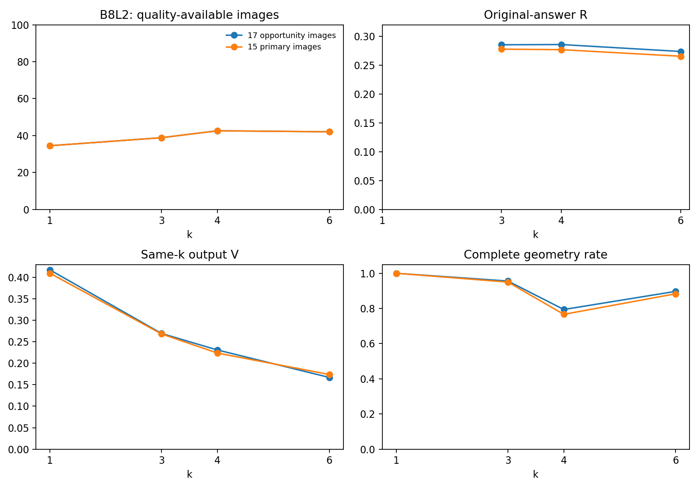
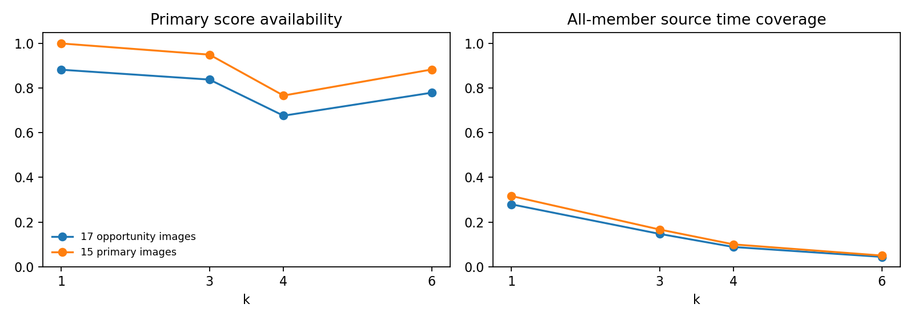
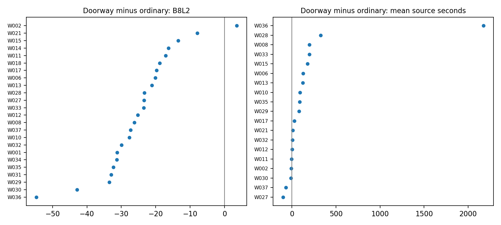

# 门洞交界：数据v1正式场景分析

门洞有246份Manual库存、20图，包含223份非OOS（18图）和23份门洞×OOS（2图）；当前质量188份、15图、24人。非OOS门洞随机融合17图808前缀已实际完成，703条完整几何、655条主质量、59条全员来源用时。另1张非OOS门洞`jh4fc5c5qoQ-14`仅2份来源，暂不纳入过程；2张OOS交叉图保留库存，其中`pRbA3pwrgk9-01`另有OOS诊断过程，本报告不混入17图主场景曲线。

消费版本为共同评分`quality_b8l2_d10_20261017_v2`及融合`wall_consensus_v1_process_20261017_v1`、分析修订`v1_complete_measurement_cache_main_panel_r2_20261017`。它们均属数据v1。当前融合`partial_publication=false`，233池完成/208图、另4池输入问题；早期“部分发布/等待”说明保存在上级history，已不作为当前状态。核心B8L2/D10、R/V、几何和时间字段用于本报告；r2恢复的辅助WQ/损失字段载荷已接入并核验；本报告仍只用核心字段作既定分析，没有新增辅助分项解释。808节点的75个源字段已逐项核对，另同步4条新增失败原因；数值与既有摘要不变，见[VERSION_SYNC](VERSION_SYNC.json)。

## 固定17图机会与15图主资格面板

17图都具备真实k=1、3、4、6随机路径，每个k为17×4=68次机会。另从既有个人参考资格确定15图主资格面板，不按融合结果成功与否挑图；该面板每个k有60次机会。B6ByNegPMKs-43、q9vSo1VnCiC-24有既有混目标证据，保留在17图的几何、R/V与失败观察中，参考质量不放行。OOS不混进这些主比较。

|面板|k|完整几何／机会|主质量／机会|B8L2图等权|D10图等权|原答R|同k融合V|有全员来源用时／机会|
|---|---:|---:|---:|---:|---:|---:|---:|---:|
|17图机会|1|68/68|60/68|34.49|35.61|未定义|0.417|19/68|
|17图机会|3|65/68|57/68|38.86|40.59|0.285|0.269|10/68|
|17图机会|4|54/68|46/68|42.59|44.30|0.286|0.231|6/68|
|17图机会|6|61/68|53/68|42.05|43.73|0.273|0.167|3/68|
|15图主资格|1|60/60|60/60|34.49|35.61|未定义|0.409|19/60|
|15图主资格|3|57/60|57/60|38.86|40.59|0.277|0.268|10/60|
|15图主资格|4|46/60|46/60|42.59|44.30|0.277|0.224|6/60|
|15图主资格|6|53/60|53/60|42.05|43.73|0.265|0.174|3/60|

Q先在每张图的可用路径内平均，再图等权；另存作答/状态等权。每个k都保留15图身份，但可用路径数不同，不能把Q曲线当无失败的固定作答集合。R是当前人员原答两两底面对称差，k=1未定义；V是同k两条真实路径输出的`1−IoU`，只在两侧均有完整底面时可算。17图每个k有102个可能路径对，k=1/3/4/6实际可算102/93/67/83对；15图相应90/81/55/71对。不同k的可算V对数并不一致，因此这不是严格相同有效对的配对变化。

观察上，V总体减小，R较平缓，完整率与Q可用率在k=4出现低谷，Q从k=4到6也略降。结果支持把稳定性、输出完整和参考接近分开描述。不能由增人本身保证“必然变好”，不能由低分断定人员差、范围错或门洞必不可标。

部分路径在有限全员边界使用同一成员集，V可为零；17图k=1与6的有效对中分别有15、11对相同集合。`V_different_subset_image_mean`另存排除相同集合的描述，但它也有自己的可算图分母。k=2的排序暂缓沿上游保留，没有插值成曲线。

## k=8与12各自固定图集

`opportunity_Nge8`固定14图（主资格13图），展示同一14图的k=1/3/4/6/8；`opportunity_Nge12`固定4图（全有主资格），展示同一4图的k=1/3/4/6/8/12。它们不接到17图曲线尾部。

14图机会面板在k=8为52/56完整几何、48/56主质量，图等权B8L2=44.91。4图面板在k=1和12都为16/16质量可用，图等权B8L2从52.80变47.08；这4图中的3图来自同一建筑。少量高人数图不能外推所有门洞场景或最佳人数。k≥8没有完整全员来源用时，因此当前不能据这些点宣称成本优势。

## 同一人员的普通／门洞对照

24人两层均有质量记录，且各层至少3份。每人先在各自任务中取均值，门洞−普通的B8L2差值中位−24.36分，D10为−23.53分；23人门洞较低，W002较高（普通47份、门洞4份，+3.54分）。这里普通为非门洞、非OOS的既有质量用途；两层是不同图片与范围机会，未随机改变同一张图的难度，也不构成人工分类的独立验证。

14人两层各有至少5份，可描述低尾：逐人第10百分位的门洞−普通中位差−19.13分。24人的逐人标准差差值中位为−7.56分，提示低均分并不必然伴随更大分散；门洞任务数较少、图集与分数位置不同，不能据此说门洞表现更可靠。每人每层保存标准差及完整支持数，少样本低尾为空。19人两层都有有效来源任务时间且每层至少3份，逐人来源用时均值差中位+79.16秒；其中5人门洞用时反而更短。时间只代表当次任务人员活动，不是统一目标空间的分摊成本，不混同同目标审计时间。

## 已有证据可解释的四例

- **S9hNv5qa7GM-08：完整输出例。** N=8的四条路径终点都是相同全员集合，5节点、4/4完整且可评价，B8L2=60.14、D10=64.00。它证明本例能够形成完整可评价输出，不认证全部墙线身份或布局正确。
- **7y3sRwLe3Va-06：完整输出失败例。** N=7终点仅3节点，四条路径都无完整质量分；它仍属于15图主资格机会，未因算法结果失败删图。
- **B6ByNegPMKs-43：混范围例。** N=8终点7节点、4/4完整，但同目标标志为false、主质量0/4。保持几何与范围诊断。
- **q9vSo1VnCiC-24：混范围例。** N=6终点4节点、4/4完整，同样不具主参考质量用途。完整几何不自动消除空间范围差异。

这些是既有绑定与已存真实过程的解释案例，不要求重新裁定范围。原图路径与既有工作台入口见[cases.csv](cases.csv)。**本轮确需用户人工裁决的最小清单为空。**

## 统计展示台接口与复算

入口：[上级CROSS_MODULE_INPUTS](../CROSS_MODULE_INPUTS.json)。`panels.csv`固定成员，`random_nodes.csv`保留808真实前缀，`same_k_pairs.csv`保留路径对，`pool_k.csv`与`panel_summary.csv`可直接画图；`inventory_records.csv`与`image_coverage.csv`覆盖246份/20图及OOS交集；`person_scene.csv`、`person_scene_pairs.csv`、`person_summary.json`用于人员配对与支持；`cases.csv`保存案例证据。逐文件字段与版本见[FIELD_CONTRACT](FIELD_CONTRACT.json)、[SOURCES](SOURCES.json)、[CHECKS](CHECKS.json)。

复算：`python -m tools.thesis_main.analysis.difficulty_doorway_v1_20261017`。原104普通Manual面板的312行未重写，且公共字段逐值与当前融合一致。低人数来源池继续等待未来v2补标，当前没有采集动作。本次已逐字段核对r2实际节点，辅助数值原已一致，仅4条失败原因需同步；旧载荷与文档保存在上级`history/pre_fusion_r2_source_sync/`，未重算或改写既有曲线。
