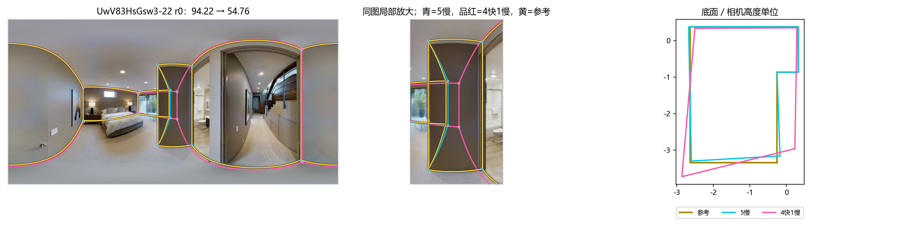
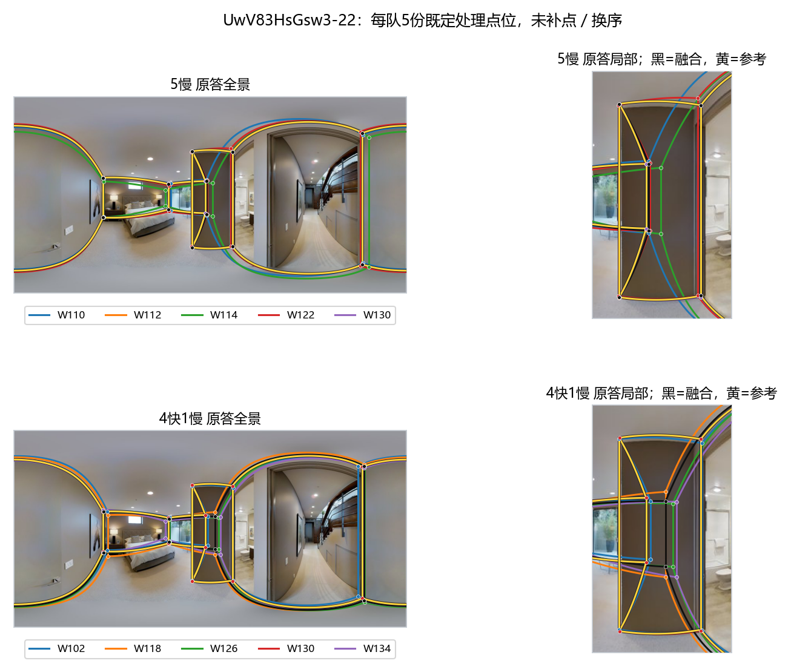
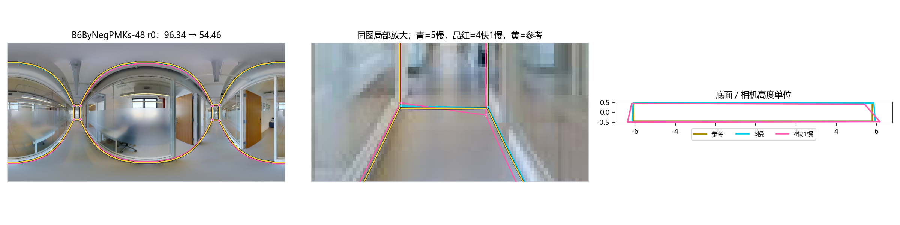
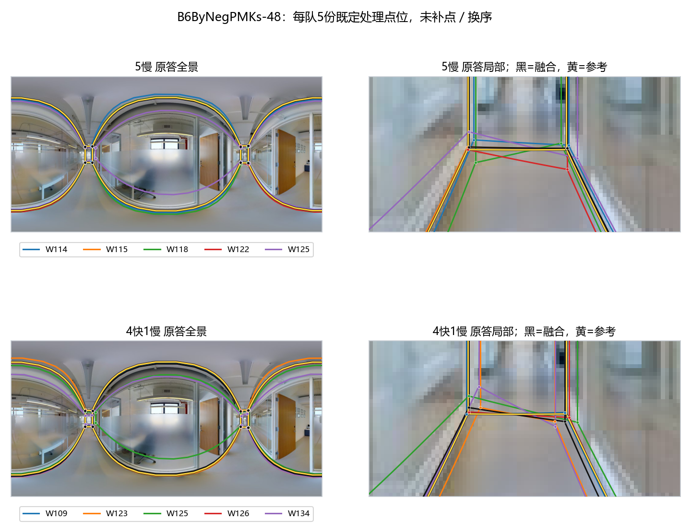
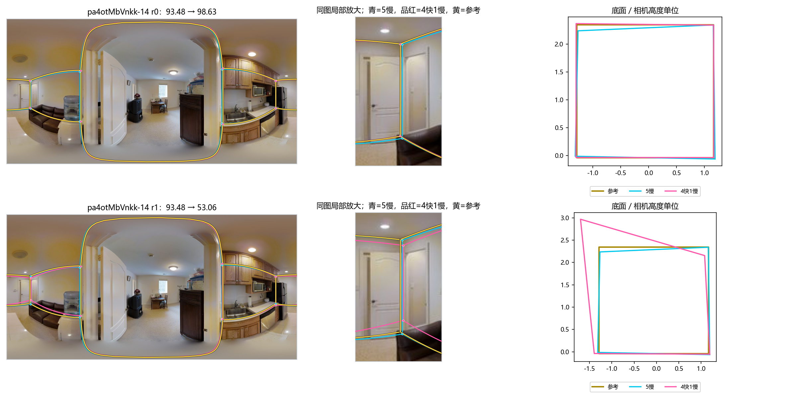

# v2快慢组合：难图损失的条件机制（2026-10-21）

**阶段收尾入口：** 与结构简化结果合并解释的[定稿](../difficulty_mechanisms_v2_20261020/RESULTS_SYNTHESIS.md)及[跨线证据接口](../difficulty_mechanisms_v2_20261020/INTERPRETATION_INTERFACE.json)。本包原设计、数值及支持范围保持。

**高Q域4快1慢的额外损失，当前最清楚地关联两种不同机制：局部转折支持不足，以及短墙方向对定位偏差敏感。不能统称为快速人员漏细节，也不能把慢者命名为困难专家。** 同一图片、同一快慢配比仍会因具体成员变化出现相反结果。

本包接续[既有难度机制](../difficulty_mechanisms_v2_20261020/README.md)，只读消费新Pro画像／组合包 `HOHONET_personnel_research_20261020` 的已有结果，并用仓库v2逐份证据连接实际成员。没有等待新人员分类，也没有按目标Q重分难度。外部包全轮对账与统筹12队复放不在本轮重复；本轮只补以下条件分解及3图7支既有团队的机制重放。

## 1. 固定共同77图后，差异仍在，并非换了一批图片

主比较：新批、普通Manual、5人，4快1慢相对同面板5慢。每次按原设计替换4个历史Q相近的快慢对，第5名慢者保留；每图4次预定成员抽取先平均，再图片内／建筑间等权。两个人员域使用相同的77图、19栋建筑，但成员与基线团队不同，不是同一队伍的随机“域处理”。

高Q域5慢基线本来更高，剩余提升空间与具体成员也不同；共同图片只消除了换图解释，没有消除这些差异。本轮给出分层关联和局部机制，不把两域均值差当作速度的净因果效应。各结构行的建筑集合不同，也不能按图数简单加权还原总体均值。

|共同77图上的人员域|4快1慢−5慢 B8L2|原任务总劳动时间比|
|---|---:|---:|
|全Q域|−0.143|0.538|
|高Q域（楼外历史同行相对Q≥0）|−2.571|0.496|

这两行复用外部包 `speed_n5_common_target_domains.csv`，其重聚合已由统筹核验。本轮在此共同面板进一步按既有参考结构分解：

|参考条件|图片／建筑|全Q域ΔQ|高Q域ΔQ|高Q域团队角点数相同率|
|---|---:|---:|---:|---:|
|H=0、无短边|53／16|+1.029|+0.958|100%|
|H=0、有短边|7／5|−6.506|−9.688|100%|
|几何H>0|17／9|+1.171|−4.876|56.7%|

H来自参考实心墙几何，不是照片遮挡识别。短边沿用长度／周长<4%、两端转折≥15°，**包括狭长矩形的短边，不等于一定有小凹凸**。三个条件不是新的难度类别，不改变简单／中等／困难标签。

按原粗标签，共同77图的高Q域简单50图／18栋、中等13图／9栋、困难14图／8栋，ΔQ分别−0.690、+1.192、−7.906。结构条件补充解释了为什么简单图中也会有大损失，不能用Q反向改标签。

### 支持范围与缺失敏感性

- 高Q域H=0短边组全部28个成对抽取均可评分；其7图的两队点数始终相同。该损失不能以“点数减少”概括。
- H>0组每域68个成对抽取，高Q域64个可评分、全Q域62个可评分；不填零、不删除失败标记。`condition_summary.csv`分别保留成对可评分次数、失败率和缺失图片数，质量均值只用可评分差值。
- 额外固定为两域全部抽取均可评分的共同71图，H>0剩11图：高Q域ΔQ为−6.373，全Q域+0.272；其余两组不变。该敏感性改变了适用面板，不能冒充全部图片结果。
- 高Q域逐次去掉一栋建筑，H=0短边组ΔQ范围−12.034至−8.194，H>0组−7.303至−0.583。说明方向不是去掉某一栋就翻转，但H>0幅度明显受Uw-22等图影响，样本也不能支持精细预测模型。
- 固定6参考转折的共同子面板仍分列在 `fixed6_summary.csv`，组内仅4／4／6图，只作为复杂度可比的辅助描述，不提高为稳定效应。

表：[条件汇总](condition_summary.csv)、[共同逐图](common_image_effects.csv)、[同图两域差值](common_domain_differences.csv)、[全可评分敏感性](fully_scored_common_summary.csv)。

## 2. 规律一：总体Q接近，仍可能缺少同一处结构的足够支持

### UwV83HsGsw3-22：6角→4角，局部从3票变2票

使用原设计replicate=0，没有选最大损失抽取。两队及B8L2：

- 5慢：W110、W112、W114、W122、W130；**94.216，6角**。
- 4快1慢：W102、W118、W126、W130、W134；**54.764，4角**。

约x=464、570的两处参考转折，在5慢队均由 **W112、W122、W130** 支持，恰为3票；换成4快1慢后，均只剩 **W102、W130** 两票，低于保持不变的3票门槛，因而不入选。这个机制不是“人数增加导致门槛提高”，两队人数和门槛完全相同。同时其它节点也有位置变化，不能把全部39.45分损失严格分摊给两个角。

一个具体可比对是 **快W126／慢W122**：楼外总体同行相对Q差仅−0.187，本图分别4／6个有效转折，个人Q52.93／69.24。但W126楼外历史困难图平均Q反而比W122高约5.41分；该图差异不支持命名W122为普遍“困难专家”。另一个配对W102／W112均画6个转折，却仍有位置和质量差异，不能只按角点数识别贡献。

**可交给人员分类和组队研究的依据：** 在有明确参考机会的特定位置，统计“本人是否表达、与哪些背景成员共同支持、是否达到团队门槛”。比全局多点、总Q或快慢标签更接近具体贡献。这里仍按当前参考解释，不新增被遮挡墙面的位置裁决。

## 3. 规律二：短边可能放大定位差异，漏角并非必要条件

### B6ByNegPMKs-48：4角不变，远端短墙方向明显改变

该图当前粗标签是简单，H=0、有短边，参考是狭长4角空间。沿用原设计replicate=0：

- 5慢：W114、W115、W118、W122、W125；**96.337**。
- 4快1慢：W109、W123、W125、W126、W134；**54.458**。

两队四个节点均有5人支持，**没有局部支持不足或节点删除**。关键是约x=755、781的远端短墙：参考两端底点y约283.76、283.76；5慢中心为283.09、283.43；4快1慢为282.14、285.72。不到2像素的单点偏差，在近地平线投影下造成两端相反的深度偏差。

这条边参考长度仅0.905个相机高度单位，两端半径约6个相机高度单位。其底面方向偏差由 **4.71°变为40.79°**，既有整体方向诊断由1.10°变为8.80°。底面IoU从97.85%降至90.78%，但B8L2下降41.88分；D10也从97.00降至59.80。**质量分数的大幅变化还包含方向惩罚的敏感性，不等于面积错误同幅度增加。**

收尾统一术语：4.71°／40.79°为本包显式参考边夹角诊断；原字典`dir`的1.10°／8.80°为输出自身正交规整性，不是相对GT的墙向误差。以上两量分别保留，分数分项解释由质量专题负责。

4快1慢队两端底点的中位数均来自W123；5慢队均来自W115。其余成员决定中位数排序，不能将全队损失归因于一人。W123与其配对慢者W114楼外总体相对Q差约+0.019，两人在本图个人Q都不高；快W109本图个人Q90.05，也不足以控制5人队的中位数。

从几何上，短边方向对相对端点误差敏感：若边向量为e、长度L，微小误差下方向变化约为两端相对误差的垂直分量除以L。全景近地平线处底点y误差又会放大深度变化。这个条件值得作为**定位／方向敏感机会**，不能一律归入“推断隐藏转折”或“照片遮挡”。

本案例支持测量敏感性和局部定位机制；没有因此把该图从简单改难，也没有判断玻璃、装饰边或远端真实边界需要重新标注。

## 4. 规律三：同一4快1慢配比不是稳定的人员能力结论

### pa4otMbVnkk-14：同一5慢基线，两个4快1慢结果相反

该图当前中等、H=0、无短边，两次原设计抽取共用同一个5慢团队，B8L2为93.481：

|4快1慢实际成员|抽取|融合Q|相对同一5慢基线|
|---|---:|---:|---:|
|W109、W114、W115、W118、W126|r0|98.625|+5.144|
|W109、W118、W126、W130、W134|r1|53.062|−40.419|

两队共有3人，不是4人；变化的是**W114+W115与W130+W134这两人组合**，不能声称只替换W134便产生45.56分变化。r2/r3分别重复上述两个精确团队，也不算新增独立证据。两队均4角且节点都5票，主要差异在边界位置及方向：整体方向诊断0.274°／8.860°，底面IoU98.78%／80.75%。

这给出一条重要边界：同样的速度配比并不保证同样几何结果。需要研究的是重复的局部定位习惯、结构机会及成员组合，不能把单例失败者划为低能力，也不能把某个混合配比宣布为固定最佳。

同样，H>0也不是快组必损：`b8cTxDM8gDG-17`的高Q域4次抽取平均改善+14.544分。它保留在全部逐图表中，不因不符合主方向而剔除。

## 5. 历史难图能力并不能直接解释团队方向

本轮严格提取每个4快1慢比较中**实际换掉的4对**；外部历史表每面板有5对，保留的第5名慢者不应计入替换暴露。按同图、建筑等权后，共同77图的高Q域：

|目标条件|快−慢楼外总体相对Q|快−慢历史难图相对Q|本图个人Q差|本图快者有效转折数差|
|---|---:|---:|---:|---:|
|H=0无短边|+0.019|+0.554|+0.139|−0.035|
|H=0有短边|−0.093|+0.968|−5.217|+0.019|
|H>0|−0.070|+1.013|+0.525|−0.359|

总体Q配平仍然成立，但历史难图分数略高的快者，在目标短边条件下个人表现可能较低；在H>0条件下个人Q均值甚至略高，团队Q却更低。说明**历史总体Q、历史难图Q、目标个人Q、目标局部信息和团队输出**不是可互换的量。此表描述历史有限人员池，不构成时间快慢的因果效应。

底表：[实际替换对](actual_replacement_pairs.csv.gz)、[共同面板的人员差异](replacement_pairs_common_domains.csv)、[案例人员](case_replaced_people.csv)。历史支持缺失保留，不把缺失难图表现填零；本轮没有重新学习人员标签。

## 6. Manual、Semi、门洞的支持边界

- **普通Manual：** 全Q域可用142图，高Q域77图；跨域主比较只用共同77图。不能把142图的+0.260与77图的−2.571直接作为人员域效应。
- **普通Semi：** 仅全Q域18图／10栋有5人4快1慢比较，建筑等权ΔQ−0.774；没有对应高Q域，不能复制Manual的跨域解释。本轮不重放Semi团队，也不借Manual类别给Semi分型。
- **门洞Manual：** 全Q域13图／9栋，高Q域仅3图／2栋。共同3图支持太少，且有不可完整评分团队；只保留分层底表，不建立短边／遮挡的门洞规律，也不将质量差异直接解释成选空间不同。
- 本轮3张机制图均为普通Manual。原答叠图没有给出清楚的“另选整个空间”证据，故没有将它们归因为范围选择。照片可见性没有全量编码，几何H不冒称RGB遮挡。

## 7. 给分类Pro和组队线的具体接续

1. **结构保留轴：** 优先用Uw-22等已有明确机会，比较同一局部的保留与共同支持。人员换入后，不只问其总Q更高没有，还问是否补到当前团队缺的那一票。把位置偏移与完整结构分别记录。
2. **定位／方向轴：** 以短边、远端近地平线、弱下界作为条件机会，比较相对同图人员的位置偏差与墙向差异。B6-48说明点数、H和范围面积都不足以独自解释这一机制；暂不拟合新难度总分。
3. **成员依赖与反例：** 使用已存4次成员抽取和正反例，检查这些习惯能否重复，而非按某一次损失给人贴标签。pa14不是单人替换实验，下一步若检验特定人员贡献，应复用合适的同规模替换设计，不把两人变化当成一人效应。

目前没有新增必须用户裁定的墙面清单。若要把“与当前参考兼容”提升为“真实必要细节”，只需针对Uw-22两处局部或B6远端边界形成少量具体问题；本轮不要求批量审核作答对。

## 8. 可追溯性与复现

逐份真源：`research/statistics/v2_evidence_audit_20261019/records.json.gz`。参考条件复用旧机制包；7支团队处理点位与逐份真源一致，参考点位绑定一致，原融合入口复放B8L2/D10与保存分数一致。复放是解释已存团队，不是新增独立团队；测量字典和局部观察完整保留。

命令：`python -m tools.thesis_main.analysis.speed_difficulty_mechanisms_20261021 --bundle <外部包根目录>`。

本包字段见 [FIELD_CONTRACT.json](FIELD_CONTRACT.json)，关键来源见 [SOURCES.json](SOURCES.json)，范围见 [COVERAGE.json](COVERAGE.json)。主题父README增加本包入口；公共评分、融合、研究台、全局索引及外部原包均未修改。
