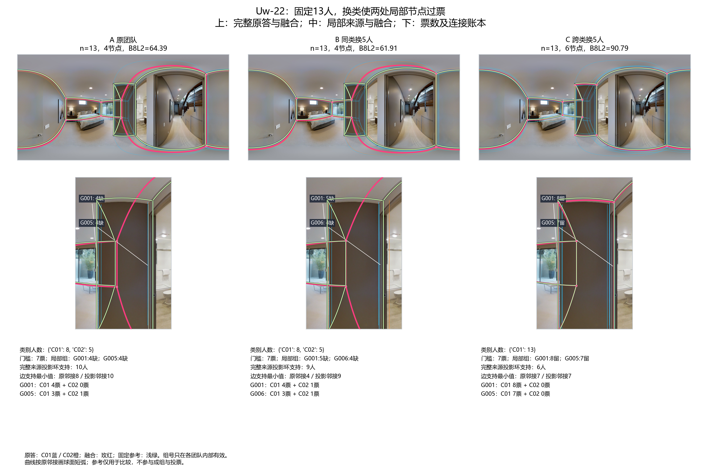
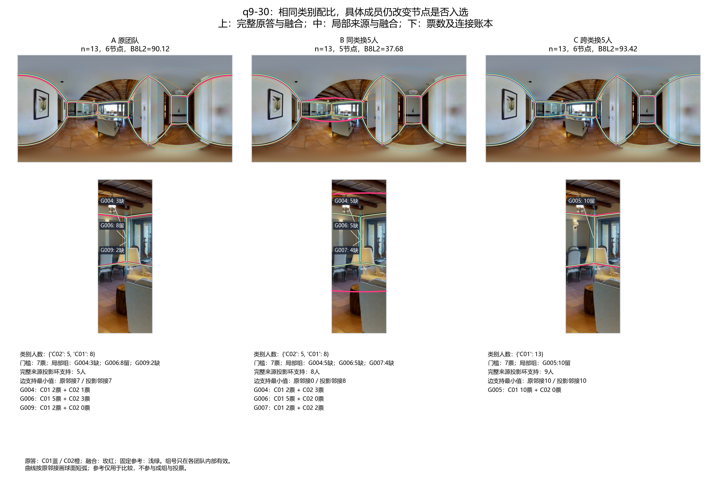
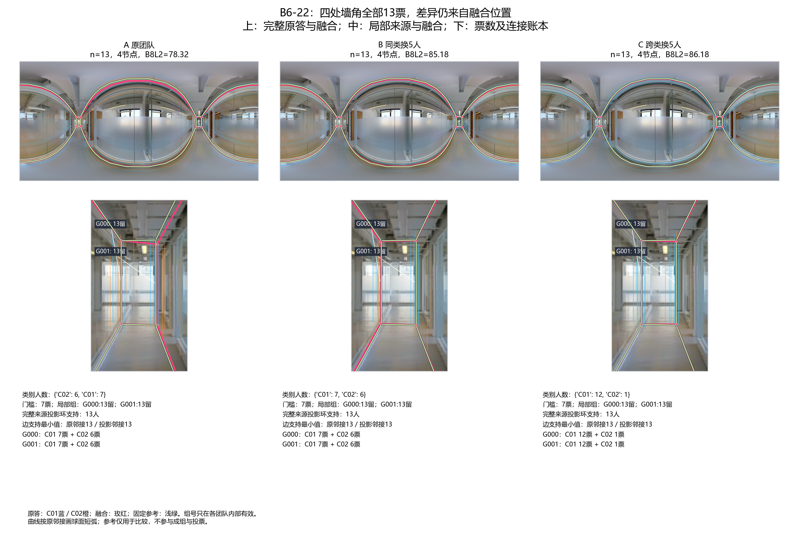
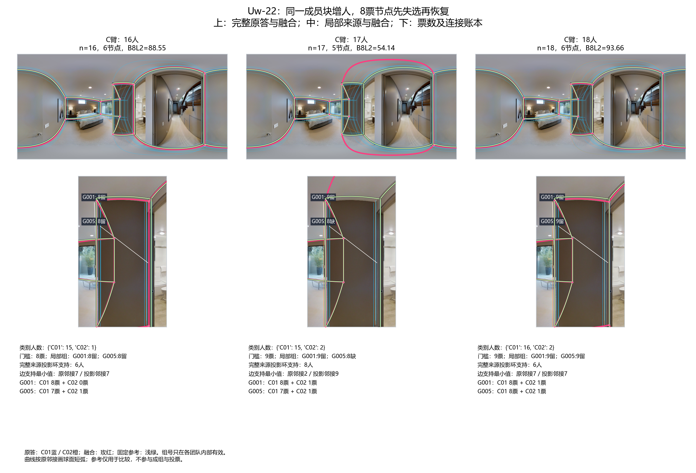
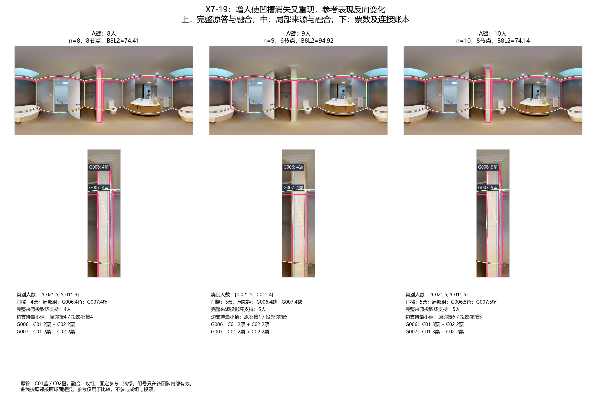
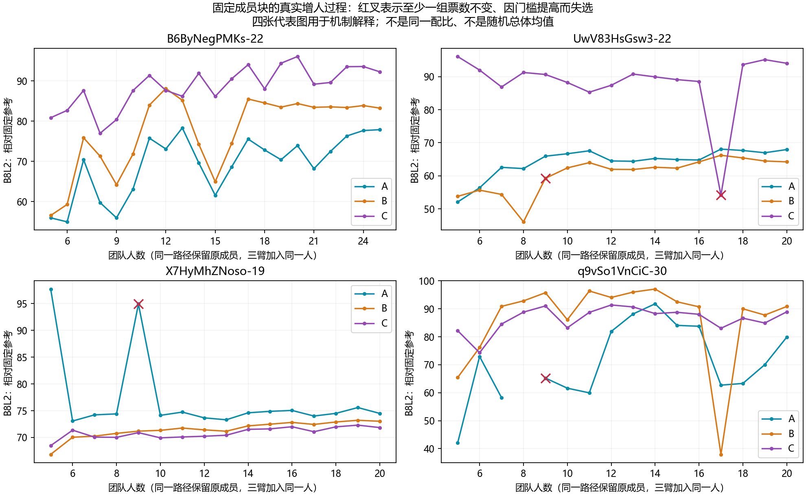
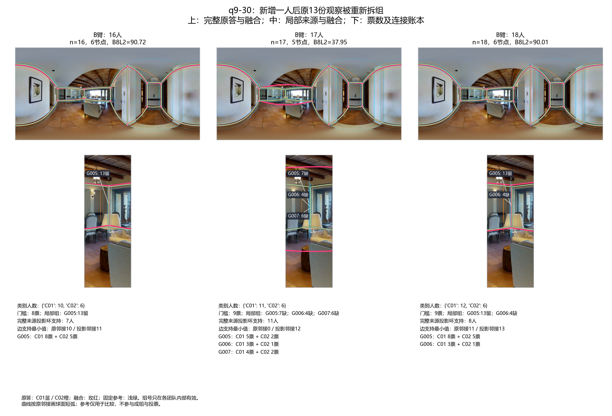
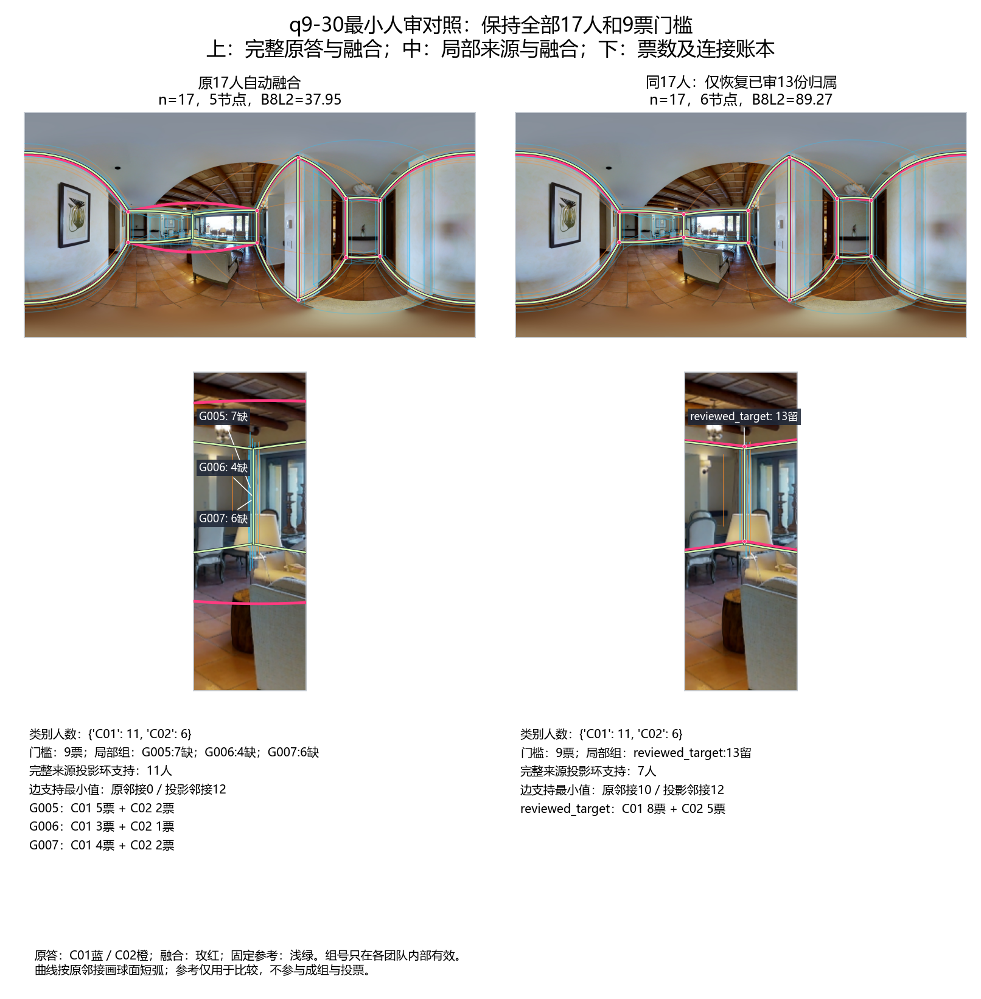

# v2人员构成与增人的融合变化机制

2026-10-20。当前逐份输入来自 `research/statistics/v2_evidence_audit_20261019/records.json.gz`。本轮接续451个ABC事件的投票分析及最新Rnew2结果，研究变化如何发生，不重拟合人员类型、不调融合或质量参数。

**主要发现：同一配比不能确定局部票数；增人既可能改变位置，也可能使已有节点因门槛或对应重组而失选。节点失选后的连接还会放大几何变化。** 这些过程已能在真实团队中分别定位，不能全部解释为图片困难或人员意见变多。

## 1. 本轮范围与输入

研究清单先保留全部233张非OOS图片、9217份作答；其中门洞17图／603份单列，普通非门洞216图／8614份。完整清单见 [NON_OOS_INVENTORY.csv](NON_OOS_INVENTORY.csv)。GT有问题或不能正式评分的图片没有从清单删除；本轮没有对它们恢复评分资格。清单不是“233图都重跑融合”。

本轮机制实算聚焦最新Rnew2已登记的共同面板：

- **固定人数：29图、6栋、35名新增人员，n=13、实际换5人，双方向共116个ABC／348支不同团队。** A/B类别配比相同，A/C改变配比；每次保留相同8人背景。所有团队从当前逐份处理点位重新形成身份组和融合，346队有质量分，2队保留不可用状态。
- **固定成员块增人：4图、4栋、4条既有路径，每条含ABC三臂。** 块成员固定，三臂逐步加入同一共同人员；B6-22为5至25人，其余三图为5至20人。195次相邻增人比较。不是随机全部进入顺序，也不是总体平均人数曲线。
- 两部分合计**543支不同自动团队结果**，540队有质量分；另有1项同17人的局部人审对照，不能算新团队。节点、成员、位置、参考、连接及失败均保存。增人路径与13人比较有重叠，不累加为独立样本。

继续沿用墙线对应、gap=7.5、全队MV50（偶数半票保留）、坐标中位数及来源投影环。逐份 `points_1024x512` 是当前用户处理后计算输入，不冒充未处理导出；没有再次平均x或排序。参考沿用各池已绑定版本，GT不参与对应、投票或定位，N1未采用。数据v2与历史协议版本号不同，不因协议名字含v1而切回旧数据。

Rnew2的C01/C02是**历史实际换人几何关系**得到的类别，不能直接改名为“细节保留者／简化者”。局部标法通过这张图实际表达的节点来描述；某人也可能在其它图片采取不同标法。

## 2. 配比变化通过局部支持过票发挥作用，但类别不等于标法

Uw-22沿用Pro的S07精确团队，固定13人、门槛7票：

|团队|类别构成|表达两处局部节点／仅一处／均未进入这两组|两组支持|输出节点|B8L2|
|---|---|---|---|---:|---:|
|A|8C01＋5C02|3／2／8|4、4，均未选|4|64.39|
|B，同类换5人|8C01＋5C02|3／3／7|5、4，均未选|4|61.91|
|C，跨类换5人|13C01|7／1／5|8、7，均入选|6|90.79|

换类后，局部两处都有来源支持的人员从3人增至7人，两处节点分别达到8和7票。变化来自多数表达的局部路径进入输出，不能说算法根据GT选择了这些节点。

**即使C全部由C01组成，仍有5人未进入这两处节点组。** C01不是统一的细节保留类型。上表“均未进入”是对应账本事实，不能把每个人自动定为主动简化者；还需看原答是否采用其它边界目标或定位。具体成员和局部类别交叉见 [LOCAL_PATTERN_SUPPORT.csv](LOCAL_PATTERN_SUPPORT.csv)。



## 3. 相同配比仍会因具体成员而改变结果

q9-30的S10中，A/B同为8C01＋5C02、同13人、同8人背景，但一处原来8票的组在B仅5票；B附近还有5票、4票的其它组，都没有到7票。这次A/B的共同观察分区未改变，**不需要重新分组就能发生局部失选**。输出从6节点变5节点，B8L2为90.12→37.68。C换为13C01后，该区域有10票组，输出6节点、93.42分。

这说明人员类型的平均价值与具体成员的局部表达不能相互替代。至于附近几组是否本来应当归同一实体墙角，本轮保留语义待审，不把算法组数直接当作真实标法数。



另一种同构成差异没有失点：B6-22在13人时，A/B/C四个组**各自全部13票**，共同观察成组不变，仍分别为78.32／85.18／86.18分。A/B的底面IoU为0.9549／0.9600，平均高度误差诊断Hmean为0.0371／0.0101。数值取自既有质量定义，不能另解释为实测墙高真值。

这里改变的是坐标中位数及其推导几何，而非角点是否存在。只研究节点数量或“有没有过票”，会漏掉这一类成员效应。详见 [POSITION_ONLY_SCORES.csv](POSITION_ONLY_SCORES.csv)。



## 4. 增人可以造成暂时失选；失选可以改善或恶化参考表现

对已经形成的某身份组，门槛为 `ceil(n/2)`。若从偶数n增加到奇数n＋1、该组原先恰为n/2票且新增者没有增加这一组支持，则票数不变、门槛加一，该组失选。这是当前投票规则的离散响应，**不证明真实人员分歧突然增加**。

|路径|人数|局部支持／门槛|节点数|B8L2|
|---|---:|---|---:|---:|
|Uw-22，C臂|16→17→18|8/8→8/9→9/9|6→5→6|88.55→54.14→93.66|
|X7-19，A臂|8→9→10|两组各4/4→4/5→5/5|8→6→8|74.41→94.92→74.14|

Uw失去参考中保留的转折；X7去掉相对固定参考多出的窄深槽，得分反而提高；下一人支持凹槽后它又进入输出。X7这里的“改善”仅指更接近绑定参考，没有重新裁决现场目标。不能把“更多节点”“更多细节”一概当好事，也不能把它们一概视为错误。





四条路径195次相邻比较中，5个一对一组发生票数不变的门槛失选，10个一对一组因支持增加而入选，11次比较改变了旧成员观察的分区。这些分别是**组数、组数、比较数**，可以重叠，不相加为195的互斥分类。B6路径没有这些结构改变，但位置和质量曲线仍变化。详见 [NESTED_STEPS.csv](NESTED_STEPS.csv)。



## 5. 对应重组可以制造失点，不能全归因于人数或困难

q9-30的B臂16→17人，原来一组有13份观察、明显高于新门槛9票。但加人后，这**同样的13份旧观察**被分到三个组：6、3、4份；加上其它来源后，三个组总支持为7、4、6，全部失选。18人时，重新形成13票组，该节点恢复。节点6→5→6，B8L2为90.72→37.95→90.01。

这里不是“原支持13票，因为门槛从8升9所以失选”。旧13票本来足够；**整队完全连接聚类不保持旧子集的分区**，新观察可能改变旧观察最后被分到哪组。两份旧作答之间的匹配并未因第三个人加入而改变，但最终整队聚类可以改变。这是现用对应流程的具体敏感性。

最小对照只把旧组按新9票门槛重新判断、保持旧坐标和旧来源环：六节点全部保留，几何与旧输出完全相同。它隔离了“提高门槛本身不足以造成这次失点”，不是合法的新17人融合方案——没有给新增者分配身份，不能替代正常融合。见 [FROZEN_IDENTITY_CONTROL.json](FROZEN_IDENTITY_CONTROL.json)。



**人工反馈已收到：** 对[三列完整原答与局部放大](q930_local_review.png)，用户判断“应该都是想标同一墙角，但是第一份那个左边标了很多奇怪的细节”。记录为大概率同一目标；不把第一份其它异常细节或所有坐标同时认证。反馈及逐观察来源见 [HUMAN_REVIEW.json](HUMAN_REVIEW.json)。

据此补做真正保持全部17人输入的最小人审对照：只将旧13份指定观察恢复为一组，其余观察全部保留，分母仍17、门槛仍9、定位仍同一中位数、连接仍来源投影环，不看GT决定归属。**输出恢复6节点，B8L2由37.95升至89.27。** 本次分数是对照结果，不是选择分组的依据。新加入者的其它观察没有删除，也没有把周边所有人一并强合。



在这处人工目标判断下，这是可以定位的“同角被对应算法拆散→多数票分散→节点失选”，并非13份观察没有足够人员支持。该结果支持做小范围自动对应修正；不证明应把所有近坐标节点都合并。完整对照状态及分项见 [LOCAL_REVIEW_CONTROL.json](LOCAL_REVIEW_CONTROL.json)。

## 6. 连接放大了失点，但连接票与存在票不同

q9的17人输出失去中间节点后，出现一条**原始直接邻接0人、投影邻接15人**的跨越连接。投影票是删除未选节点后重新相邻的人数，不能说15人原本画了这条直接边。对应的六节点旧输出不存在这条跳接。

Uw-22的17人输出同样有一条原始邻接2人、投影邻接9人的边。来源环支持较多不等于保留了大家原来的局部转折。当前连接策略没有改变；本轮把它作为失点后的几何放大过程，而不是新设独立边投票门槛。

## 7. 机制扩展：不止上述几个展示例

同一29图、双方向各58个ABC的固定13人比较如下。A/B同类，A/C换类。表内“组失选／入选”仅统计依靠共同原观察建立的一对一组关系；复杂组另列，不能按组号或近坐标硬配。

|方向|比较|节点数量改变的事件|一对一组失选／入选|旧保留观察分区改变的事件|
|---|---|---:|---:|---:|
|C01→C02|A/B|5/58|5／3|8/58|
|C01→C02|A/C|9/58|9／2|10/58|
|C02→C01|A/B|2/58|2／1|6/58|
|C02→C01|A/C|7/58|1／13|6/58|

C02→C01的13个一对一组入选分布于7个事件、5图：B6-47、Uw-12、Uw-22、pa4-10、pa4-18。这支持继续研究局部支持倾向如何转化为完整输出；不等于这些节点已人工确认都是必要细节。反向也有入选，不能把类别作用说成确定规律。

先图内事件平均、再建筑等权，节点数量改变率为：C01→C02同类7.86%／跨类18.41%，反向3.27%／13.21%。具体成员确实重要，同时类别构成仍有可见影响。组分区改变不一定改变输出，节点数不变也不一定几何不变。

本面板是已有质量可用普通Manual面板，不包含门洞或GT有问题图片的新增融合；其结论不能直接外推至清单全部233图。它与旧451事件有图片／人员重叠，不叠加为新独立验证图片。

## 8. 下一步判断

1. **优先把局部标法与人员类别连接起来。** 以当前两处局部节点／窄深槽为起点，扩展到上述5张出现相同过票机制的图。区分都表达、只表达一侧、简化路径、另一边界目标；用少数同图叠图确认实体含义，再统计Rnew2、节点习惯和具体成员如何对应。不要先把C01命名为细节型。
2. **q9的对应问题只做最小分支。** 已有同角人工判断及同17人的修复对照，下一步比较“已有高支持相容组被新观察拆散”的局部处理与当前整队重分；同时检查会否把真实相邻角误合。必须保持对人员输入排列／进入顺序的解释清楚，不能直接把依赖上一时刻分组的做法当无顺序的批量融合。暂不全面重写算法、不继续铺参数网格。
3. **人数曲线保留结构事件注记。** 保持原投票规则，把门槛失选、对应重组、位置变化及连接缺失标到曲线上，避免把短暂低谷直接命名为困难图不收敛。四条单一路径只提供机制，随机进入顺序的发生频率仍由已存多路径结果回答。
4. **门洞与GT问题图片继续在研究清单。** 前者单列机制样例；后者可研究实际路径与对应，不因缺可靠GT就删作答，也不临时恢复评分。本轮不新增大量人工逐对审查。

## 数据与复现

```text
python -X utf8 -m tools.thesis_main.analysis.fusion_change_mechanisms_20261020
python -X utf8 -m tools.thesis_main.analysis.fusion_change_mechanisms_20261020 --figures-only
python -m pytest tests/test_fusion_change_mechanisms_20261020.py -q
```

输入名单继承 `personnel_interchangeability_20261020/interchangeability_20261020/assessment/nested_new2_requests.json.gz`；类别来自同包 `NEW2_CLASS_MEMBERS.json`。原池快照提供已采用参考和成员object_id定位，实际作答坐标直接从当前逐份证据读取。原答—组—最终点、每队参考和完整质量分项保存在 [STATES.json.gz](STATES.json.gz)、[TEAMS.json.gz](TEAMS.json.gz)；成员块和路径见 [DESIGN.json](DESIGN.json)。不修改任何上游包。

字段、单位及分母见 [FIELD_CONTRACT.json](FIELD_CONTRACT.json)。3个关键测试覆盖门槛失选、旧观察重分、人审仅移动指定观察且保留分母；运行时另检查嵌套成员与最小对照几何。没有重跑旧451事件、全仓测试或重新训练类别。全局目录由统筹登记，交接见 [HANDOFF.md](HANDOFF.md)。
