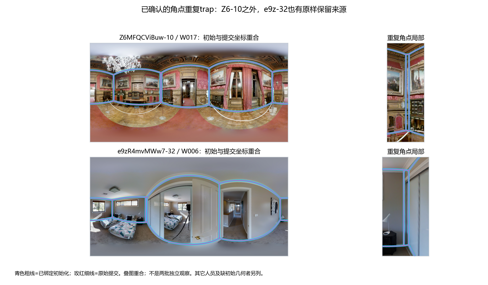
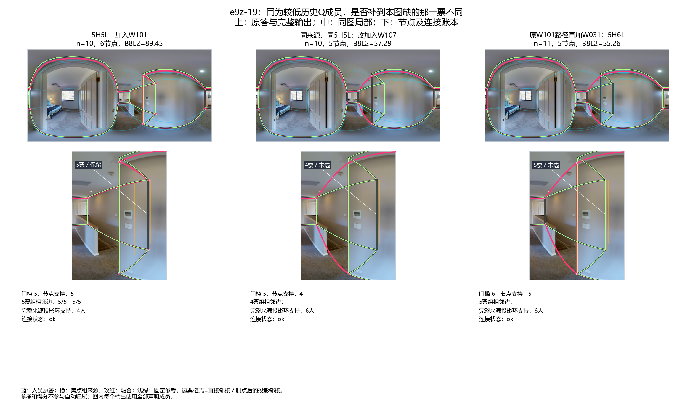
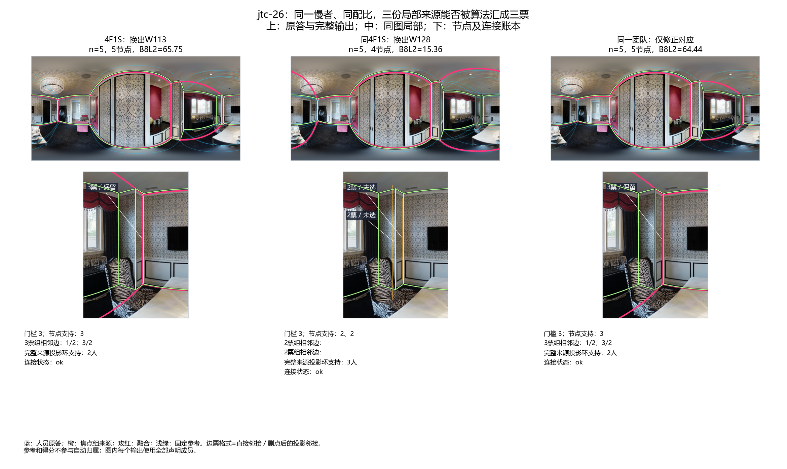
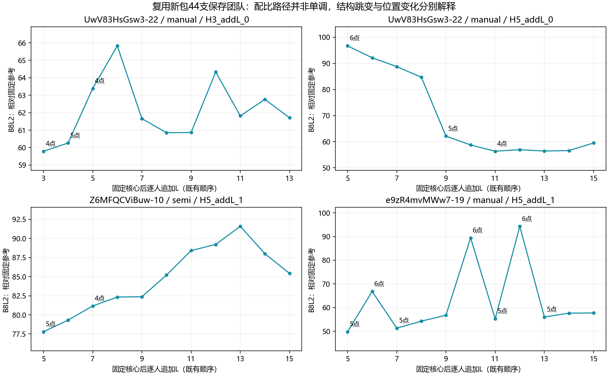
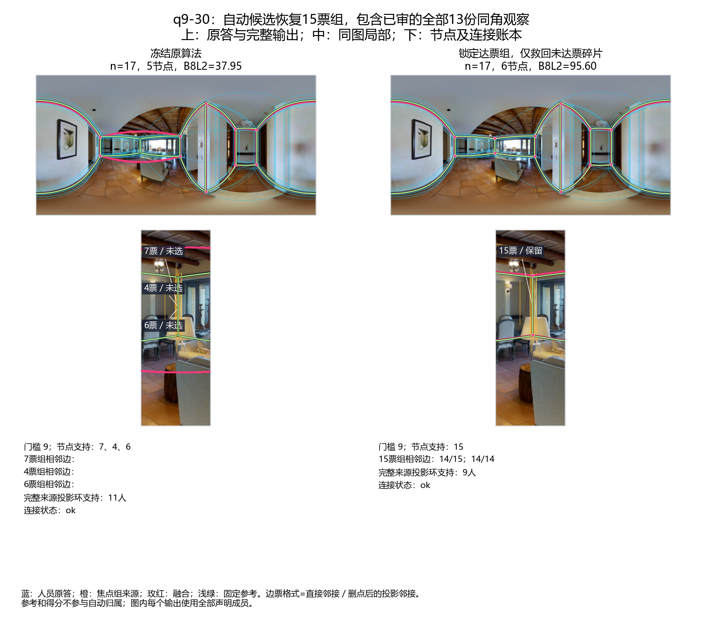
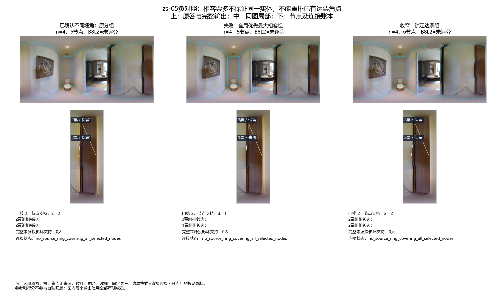
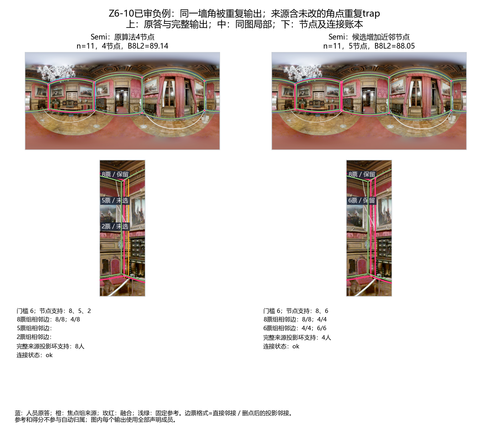

# v2融合变化机制接续：具体成员、对应修正与Semi初始化

2026-10-21。接续[前轮451事件及Rnew2机制研究](../fusion_change_mechanisms_20261020/README.md)，使用当前v2逐份输入、现用冻结融合入口和Pro已保存团队。本轮不改变人员分类、投票资格、参考、评分或生产融合算法。

**目前最有内容的发现：局部贡献由“本图表达了什么、能否认成同一组、是否达票、怎样连接”共同决定。低历史Q者可能补上关键一票；相同配比也会因具体成员及对应重组而表现不同。Semi中还存在共享错误初始化被保留的机制，不能把它解释成独立发现的真实细节。**

共识的目标仍是表达声明人员池在既定规则下的支持。B8L2/D10用于事后衡量参考表现，没有参与下面的对应选择，也不是把共识改成最接近GT的布局。

## 1. 类似trap问题排查已收束

按当前逐份接口检索全部1099份Semi记录，没有重做历史部署审计：574份有精确初始化绑定，525份缺初始几何。使用已有的错误类型和未改证据，并核对已确认未改记录的初始化／原始提交坐标（绝对容差1e−9像素，仅容纳浮点尾差）。

|证据|记录／图片|本轮怎样采用|
|---|---|---|
|已确认初始化错误，历史最终坐标未改|25份／6图|其中20份保持历史最终几何且仍符合当前池资格；另外5份均为当前已排除、无当前点位的W026记录，不恢复资格|
|上述20份中的角点重复trap|10份／4图|Z6-10：4份；e9z-03、e9z-32、q9-15：各2份|
|其它已确认错误未改、仍在当前池|10份／2图|B6-22角点漂移9份，7y-13过度解析1份|
|只有“已知错误未改”的自报信息|45份／13图|单列，不提升为精确初始化核查结论|

这不是全部Semi的错误率估计：改过坐标但缺错误残留裁决、初始缺陷未裁定等记录不能归为“已修好”。排查没有删人、去重或修改票权。

Z6-10蓝8人组与橙6人组已由用户判断为想标同一墙角，橙组位置偏移较大。两组共享4人，不能相加当作14名独立支持者。W017可精确确认原样保留`corner_duplicate`初始化；W125/W129报告修改过但缺精确初始化，W132只有未改错误的自报证据，不能一概认定四人都原样复制。详见[旧P1追查](Z610_P1_TRAP_NOTE.md)。

本轮4支Semi案例团队及11支保存增人团队均涉及Z6-10，均包含至少一名已确认未改的来源。**团队包含来源不等于它单独导致全部输出变化**；只有下面的具体节点账本支持局部机制解释。其它5张确证图片本轮没有新增团队融合，不能宣称已测完其融合影响。

逐份定位见[初始化标记](INITIALIZATION_FLAGS.csv)、[逐图汇总](INITIALIZATION_IMAGES.csv)、[保存团队来源](INITIALIZATION_TEAM_EXPOSURE.csv)。列表包含保留、排除及自报层，使用时读取证据级别和资格列。

## 2. 固定人数与配比：具体成员提供了什么

### e9z-19：低历史Q的正贡献可以是“补到这一角的一票”

固定原9人5H4L，焦点组4票，未达5票。下表前两行都只追加1名新来源L成员，保持人数、H/L配比及新旧来源构成相同。

|团队变化|人数／配比|焦点支持／门槛|节点|B8L2／D10|
|---|---|---|---|---|
|加入W101|10／5H5L|5／5，保留|6|89.447／91.833|
|相同原9人，改加W107|10／5H5L|4／5，未选|5|57.290／61.008|
|沿原W101路径再加W031|11／5H6L|5／6，失选|5|55.259／59.065|

W107按目标楼外历史、同条件／新来源／L层和原池资格筛选，再按规范人员ID取首名；未看目标图几何或得分挑选。W101/W107历史同行调整Q分别−4.879／−2.807，后者整体历史表现还稍高，却没有补到该节点。两支10人团队的共同旧观察分组不变，差异在局部表达和补票。

原路径再加W031时，5名支持者没有消失，只是全员分母上升、门槛变6。**补入一名有用的人与继续加人，并不保证相同方向的参考收益。** 另一个W031直接加入原9人的10人对照为56.575，但新旧来源比例不同，作为次要对照。

### jtc-26：相同慢者、相同配比，还取决于背景成员与对应

原5快团队B8L2=15.144；W106替换W113后成为4快1慢，局部来源由2增至3，达到5人团队的3票门槛，B8L2=65.753。两人的楼外历史Q配平，但W106在目标图的个人Q更低：这支持“个人总体误差不能替代局部边际贡献”，不证明慢本身造成改善。

固定同一W106，枚举换出原5名快者的五种背景，只补算尚缺四组；它们没有再次逐对配平历史Q，不能作为新的纯速度因果比较。

|换出人员|已知三份局部来源是否仍在|原算法结果|仅修正对应后的结果|
|---|---|---|---|
|W113，原保存对照|在，3人同组|5节点，65.753|相同|
|W128，新对照|在，却落入两个各2票组|4节点，15.357|3票组恢复，5节点，64.442|
|W103，新对照|在，同样拆散|4节点，19.200|3票组恢复、5节点；没有覆盖全部节点的来源环，保留未连线状态|
|W104，新对照|只剩2份已知来源|4节点，18.280|未恢复|
|W116，新对照|只剩2份已知来源；所选组还包含另一来源|已有5节点，但无完整来源环|仍无完整来源环|

固定5快核心再增加W106至6人，三份已知来源仍被拆散；修正能恢复局部票组，但仍无完整来源环。这和“替换W113”的结果不同，不能承诺只要把该人加进来就有效。

“已知来源”是固定焦点成员清单，不代表已经认证该图每份原答的全部目标。恢复节点不等于恢复完整布局；无完整环时不强行x排序，本轮也不安排大量排序审核。

## 3. 固定核心增人：位置、支持与门槛分别起作用

Uw-22原5H核心为6节点、B8L2=96.693。增加至8人仍有6节点，但得分降至84.681、遗漏从1.05%增至6.10%，说明仅看节点数量会漏掉定位变化。

第9人加入后，焦点左节点仍只有原4名H支持，门槛却从4变5，因而失选；输出5节点、B8L2=62.135。旧观察没有重新分组。即使团队仍是5H4L，高Q人数占多数，也不保证每个具体角点都得到这5名H共同支持。

图中44行来自4条既有路径。它们是具体成员顺序的实例，不是对进入顺序随机化后的平均曲线；不能据此确定最佳人数或总体单调规律。

Semi Z6-10须单独解释：保存3H核心路径在N=8、9、10、11时节点数为5、4、5、4；门槛为4、5、5、6。8→9及10→11还发生旧观察重组，不能全部归为奇偶门槛。另一路5H核心中，重复trap附近节点从5/6人时保留到7人时失选，叠加后续定位改变；节点减少在这里可能去掉已知重复，不能一律叫结构丢失。

## 4. 最小自动对应候选：正结果与失败一起保留

冻结原算法不变：沿用原两两周期匹配、gap7.5、全N的MV50、中位数定位及来源环连接。本轮只在研究副本改变如何从同一个匹配图提取身份组，不输入GT、Q、人员类别或人审关系来决定归属。

先尝试“依次提取最大完全相容组”，同支持时按原角距离和规范观察ID破同票。它在zs-05把已确认不同的墙角误合，因此不采用。它是逐次最大组的贪心分区，不是全局最优分区。

收窄候选为：**锁住本次团队中所有已达票原组，只从未达票观察提取完全相容且达到原门槛的组**。每组每人最多一票，残余观察保留；定位与连接沿用原规则。它没有锁定“上一人数前缀”，不引入进入顺序记忆。完全相容的搜索采用已有有界实现，达到上限会报待审，本轮未触发截断。

|案例|冻结原结果|收窄候选|解释|
|---|---|---|---|
|q9-30，17人|5节点，37.948|6节点，95.601|自动15票组包含用户已审的全部13份同角观察，另2份为自动新增来源，未逐份人审认证|
|q9-30，16／18人|6节点，90.722／90.012|不变|没有为制造效果改动已达票组|
|jtc-26，换出W128|4节点，15.357|5节点，64.442|同一团队恢复被拆散的局部三票|
|B6-47，固定13人第一组|6节点，33.122|7节点，53.257|扩展案例的参考改善；新增目标尚非人工确认的真值|
|yq-25，旧18份同角关系|被拆成3＋10＋5，输出5节点|提取12票，输出6节点|部分救回，仍未认全18份|
|Z6-10，11人Semi|4节点，89.138|5节点，88.046|用户确认新增组与既有8票组为同一角；重复trap来源帮助解释，这是已确认的重复输出失败|

q9-30新15票组相邻边的直接／投影支持分别为14/15、14/14；原缺角后的捷径为0/15。完整来源投影环支持却从11降到9：完整环支持数也不能代替局部目标和连接解释。15票组包含的新增人员为W127、W134，具体原点位可从`METHOD_STATES.json.gz`追溯。

8条已确认不同目标约束（5图）上，原算法及收窄候选均未误合，全局提取版误合1条。原算法本来已通过这8条，因此不是新增8个修复成功。3条旧同目标约束在收窄候选中仍有拆散：q9-32、yq-25、zs-05。所有关系均完整映射到当前v2来源点对，但历史资格未恢复，相关面板只作身份诊断、不计质量结论。

**候选留在研究分支，尚不能替换现用算法。** 它能修复“未达票碎片中存在相容多数”的一类错误；无法修复已达票组内部错误，不能把同一角的多个达票组自动去重，也不保证恢复后存在覆盖全部节点的来源环。Z6说明即使两两相容和多数支持都满足，仍可能需要初始化或少量人工身份信息。

## 5. 本轮覆盖、入口与下一步判断

- 方法对照32支具体团队／12图：Manual28支、Semi4支。新增设计7支小对照，其余复用指定案例及旧关系；另读取44行保存增人路径，不重跑88048支团队。
- 原方法24支可评分，收窄候选23支可评分；6支历史身份面板不作评分，其余无来源环的输出保留`no_connection`。没有把失败填0、删掉后重算同分母均值，或将增加节点当自动成功率。
- 本轮没有OOS或当前门洞标记的团队；历史“门口停止点”不自动等同当前门洞交界标签，不外推到这些条件。
- 所有案例是开发和机制对照，不是独立盲测；不报告自动墙线正确率，更不能声称达到90%。

**研究判断：** 人员研究继续沿“本图局部表达→对应票数→门槛→定位及连接”解释组合收益，保留同配比换具体成员与固定核心增人两类对照。算法方面保留收窄候选和失败对照，下一步如扩大验证，应先在Manual中查看新增节点的归属，再单独研究Semi初始化相关重复；不把过滤trap作答或更高GT得分当作现成修正规则。当前没有必须再次请用户裁决的目标；缺完整来源环的候选保留未排序状态。

复算入口：[专用脚本](../../../tools/thesis_main/analysis/fusion_mechanism_followup_20261021.py)。`python -m tools.thesis_main.analysis.fusion_mechanism_followup_20261021`复放32团队并制图；`--figures-only`只读取保存状态、检索初始化证据及制图。已有`inputs/pro_cases`、历史选择及路径快照时不再依赖外部下载包。原点位始终读[当前v2接口](../../statistics/v2_evidence_audit_20261019/records.json.gz)，参考和池配置复用原引擎，不换GT。

结果字段见[字段说明](FIELD_CONTRACT.json)，交付边界及验证见[接续说明](HANDOFF.md)。本主题只新增本包、专用脚本和测试；全局目录、总体进度和展示台由统筹接入。
