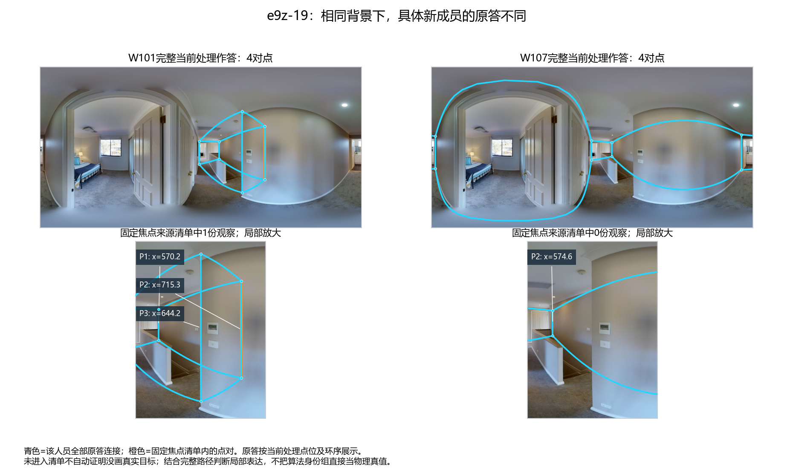
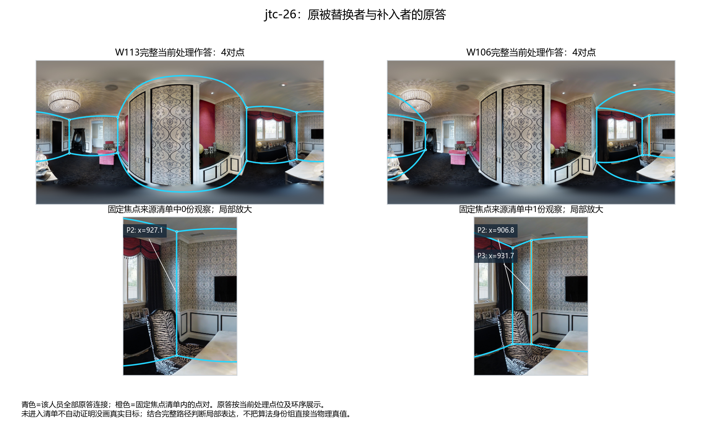

# 融合变化机制：本轮采用结果

2026-10-21。本专题在当前v2和现用算法下完成阶段收尾。新增的是已有结果的完整成员—原答—对应—投票—定位／连接证据链，不新增团队搜索、分类或评分。画像含义衔接[已定稿的人员画像与可靠性](../../workers/personnel_profiles_composition_20261020/PROFILE_FINDINGS.md)：历史Q/T说明跨图表现，不能代替当前图的局部贡献；Semi高终稿Q不能代替纠错证据。

**可以采用的结论是：相同人数和配比不能唯一决定融合；具体成员改变局部表达、对应及中位数，而支持门槛和连接将这些变化传递到输出。增人既可能补票，也可能让原票失选；Semi共享错误初始化还可能形成被多人保留的重复表达。** 这些是具体机制及已发生的实例，不是普遍最佳配比、困难图必然不收敛或自动算法成功率。

## 1. e9z-19：补到一票、换同层成员、再增人是三种不同操作

固定9人背景为W002、W017、W032、W034、W035、W102、W116、W131、W134，历史构成为5H4L。H/L在目标建筑之外校准；它们是本次Q分层，不是标法分类或投票权。

当前焦点来源为：W002第4、W017第4、W102第3、W116第3点对；W101的第2点对补入（以下索引均为零起点的`source_pair_index`）。

|精确成员变化|原答／对应|票数与门槛|定位、连接与输出|固定参考质量|
|---|---|---|---|---|
|原9人加入W101|W101在x≈715处表达点对，归入原焦点；旧观察分组不变|4/5→5/5|节点5→6；中心x≈713.49，上／下y≈189.32／356.48；两侧直接／投影边票均5/5|B8L2 56.808→89.447；D10 60.545→91.833|
|固定同9人，W101换为W107|同新来源、同L、同10人5H5L；W107在此段从x≈574.61直接连到987.08，没有x≈715的局部节点；共同旧观察分组不变|5/5→4/5|焦点失选，节点6→5；删点后跨越边直接／投影支持2/6|B8L2 89.447→57.290；D10 91.833→61.008|
|原W101十人团队再加W031|原5份焦点观察仍在，W031没有补到本组；旧观察分组不变|5/5→5/6|焦点失选，节点6→5；不是原支持者消失|B8L2 89.447→55.259；D10 91.833→59.065|

这里“没有局部节点”是对当前处理作答的坐标及路径描述，不把W107的物理意图或其它范围判为错误。W101整份作答也不因此成为更好的空间：两人都为4对点，空间选择明显不同。**整份点数相同也可以提供不同局部支持。** W107历史Q还略高于W101，却没有补到这一票；该对照不支持将某人永久命名为“互补型”。

再看[原答—票数—完整融合三列](e9z_same_ratio.png)，可直接对应上表。成员选择、原答差异和融合结果均已存在于保存团队，未利用GT选择当前归属。

## 2. jtc-26：缺来源与有来源却拆散必须分开

原5快团队为W103、W104、W113、W116、W128；局部票组只有W104第3和W116第4点对，两票未达三票。用W106替换W113后，W106第3点对进入同组，达到3/3，输出从4节点变5节点，B8L2由15.144升到65.753。

完整原答带来一项必要修正：**W113不是这片区域没有画点。** 他有第2点对x≈927.13；W106则有第2、3点对x≈906.78、931.74。原算法把W113的单个近邻点与W116的x≈907.21归到另一2票组，而把W106的两个相邻点分别对应到x≈907与942附近的两组。因此只能说W106补到了当前焦点组，不能断言W113没有表达同一物理角。两人都为4对点，局部及其它部位的配置不同；这个差异是点数总量无法表达的。

原历史Q配平、速度不同，**不能由这一次补票推出慢者普遍更细**；W106此图个人B8L2约10.30，反而低于W113约39.55，仍能对这个团队作正贡献。

接着固定W106及4快1慢比例，只把W128换成W113：

|证据阶段|同一局部的具体事实|
|---|---|
|人员与原答|仍有W104第3、W106第3、W116第4三份完全相同的观察，没有重新采集或移动点位|
|原算法对应|W104与W116在2票组；W106第3点对进入另一2票组，其中正是W113第2点对x≈927.13。W113在原5快队时与W116第3点对成组；换背景后，同一W113点对转而与W106第3点对成组。两组都不足3票|
|投票及连接|局部失选，输出4节点；一条跨越边直接／投影支持为1/3，不能解释成三人原答都直接画了它|
|研究候选的同团队对照|从未达票观察中提取完全相容的W104＋W106＋W116三人组；全N、三票门槛和原已达票组不变|
|定位及完整输出|中心x≈941.96，上／下y≈198.63／328.76；两侧边的直接／投影支持为1/2、3/2；形成5节点输出|
|质量变化|B8L2 15.357→64.442，D10 15.412→65.880|

这能采用为“**具体背景改变对应分区，从而使已有局部票数未被汇到一起**”的机制证据；这里不把三人局部组、边支持和完整环支持混为一本票，也不认证W113单个近邻点究竟意指哪一物理角。原来同4快1慢的高分队与上述低分队共有4人；在后者同一输入上修正对应的对照，排除了“只是新队员个人Q更差”作为全部解释。

反例也保留：同样加入W106但换出W103，候选能恢复三票及5节点，却没有覆盖全部节点的来源环；不补分、不强制连线。换出W104时只剩两份固定焦点来源，候选不恢复。**算法没有把原本足够的观察汇合，与当前团队缺少相应来源，是两类原因。** 未在固定焦点清单里的人不统一命名为主动简化者。

## 3. “同角被拆散”有独立于上述局部解释的人审对照

q9-30在17人、9票门槛下，同一批旧13份观察被分到三个组，组总支持7、4、6，均失选；输出5节点，B8L2=37.948。用户已判断这些观察大概率想标同一墙角，保留其对个别原答其它异常细节的意见。

三种结果必须分开采用：

|结果身份|改变什么|结果|
|---|---|---|
|现用算法|原对应、全17人MV50、中位数、来源环|5节点，B8L2 37.948|
|人工对应机制对照|只恢复已审13份观察归属，其余原答保留|6节点，89.267；说明真实多数可能被对应拆散|
|自动研究候选|不输入GT或人审标签，只救回原未达票观察中的相容多数组|15票组包含已审全部13份，6节点，95.601；新增2份未经逐份人审认证|

得分不用于判断哪个对应成立；自动候选更高分也不证明它比人审13份更真实。全局最大相容组提取曾在zs-05误合已审不同目标；收窄候选仍未解决3条旧同角拆散，并在下面的Semi案例重复输出。同角拆散可以作为已有机制采用，**通用自动修正则尚未完成**，后者不阻止本专题结论收尾。

## 4. 增人还会改变位置和门槛，不能全归为对应错误

Uw-22固定5H核心W102、W110、W112、W115、W130，再加入W105、W113、W132至8人，节点同为6但B8L2从96.693降至84.681。它说明存在输出位置／几何变化，不要求节点数量变化才能影响质量。

继续加入W103至9人，左焦点的4份观察及分组不变，门槛4→5使其失选；右组仍5票。输出变5节点，B8L2=62.135。该次可直接解释为原支持没增加而分母上升，不能说“困难让大家突然更不一致”。前轮X7-19则有失选后更接近参考的反例，说明门槛失选的质量方向取决于被去掉的实际结构；详见[前轮第4节](../fusion_change_mechanisms_20261020/README.md#4-增人可以造成暂时失选失选可以改善或恶化参考表现)。

## 5. Semi：共享错误初始化进入投票与对应

Z6-10的11人团队为W017、W031、W037、W101、W119、W125、W126、W129、W131、W132、W134。现用算法保留8票组，附近两组分别5票、2票未选。研究候选从未达票来源救出6票组，与原8票组同时保留；两组共享W017、W125、W129、W132四人，合计是10名不同支持者、14份点对观察，不能当14名人员。

**用户确认两组理论上都想标同一墙角，橙组偏移较多。** W017旧P1初始化正是人为角点重复trap，初始与原始提交坐标相同。它在原8票组提供第1对，在新增6票组提供第2对。W132报告错误未改但缺精确初始几何；W125/W129报告编辑过，不能等同已修好或完全未改。

这条证据能支持：共享错误初始化的重复可能被保留并成为融合来源，等权多数票不会自动识别它。不能因此推断全部人有相同心理动机，也不能说6票都由完全未改trap贡献。

候选让输出4→5节点、B8L2 89.138→88.046，但本例失败依据是**用户确认同一墙角被重复输出**，不是分数下降。另一路既有5H核心从6人到7人时，重复附近节点因未达新门槛退出，节点5→4而参考分数上升；去掉一节点不一定损害必要结构。保持初始化证据、是否编辑和最终表达分开，才与已定稿的人员可靠性结果一致。

本轮没有删除trap来源、调整权重或替换实际提交。此为Semi机制，不能借它解释上述Manual结果。

## 6. 采用决定、交付与实质缺口

采用五种可重复检查的变化机制：**局部补票、门槛失选、对应拆散、达票后位置变化、共享初始化重复进入输出**。这里“可重复”指来源、成员、票账和输出可回读重现，重复出现的前轮案例亦已列明；不是五种机制的全库发生概率估计。

阶段收尾包括：

- [11条精确成员变化表](MECHANISM_TRANSITIONS.csv)，覆盖原答贡献、同配比换人、同团队对应对照、人工对照和Semi失败；
- [16个去重展示状态的完整证据链](MECHANISM_CHAINS.json)，每状态含当前团队名单／object_id、全部处理原答、固定焦点来源、来源到票组映射及中心、完整边票／来源环、最终坐标、绑定参考和既有质量；
- 两张新增人员原答图，与已有完整融合图配套；没有新增团队、重新评分或随机顺序实验。

16是展示状态数，11是对照数，不是新图片或独立实验数量。它们引用本专题已保存的32团队对照（12图）及前轮人审状态；没有累加为新的样本。

**本轮已足以采用机制解释并完成专题收尾。** 尚缺的是全库发生频率、未审目标的物理身份及通用自动对应修正有效性；这些不改写成已完成，也不设为已有机制结论的前置条件。门洞和OOS没有本轮新增的机制团队，结论不外推；GT有问题的作答仍可研究表达，但不从本轮普通质量面板推断其评分结论。

后续大团队类别研究可以直接引用这套解释链：先确认具体替换和实际表达，再看票数、位置及输出。不因类别标签变化就预设结构改善；不需要等待新类别定稿才能使用上述发现。本轮不再追加算法修补或大量人工逐份审核。
