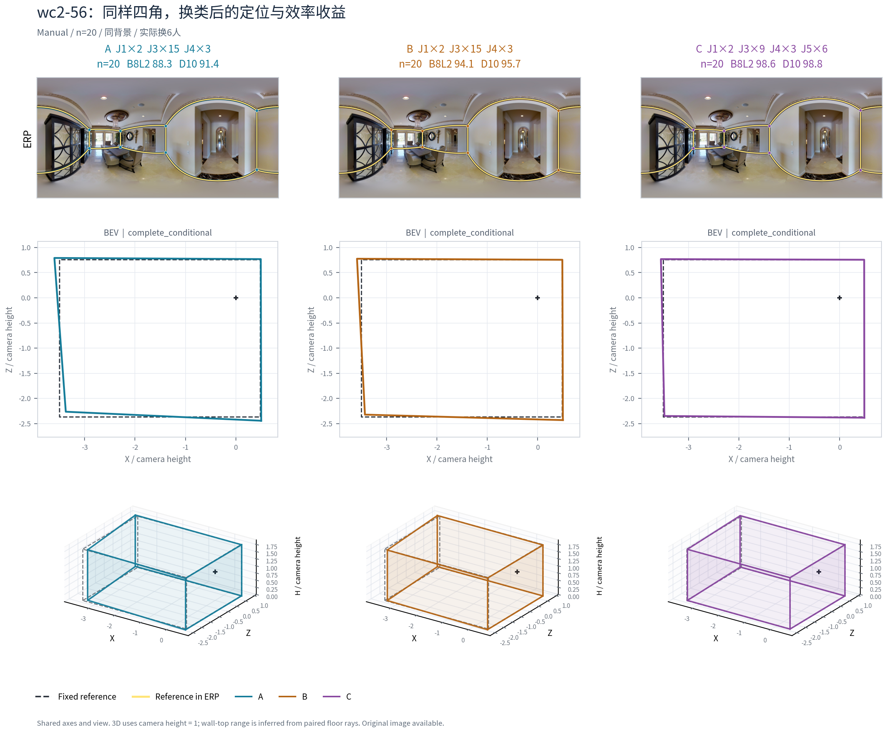
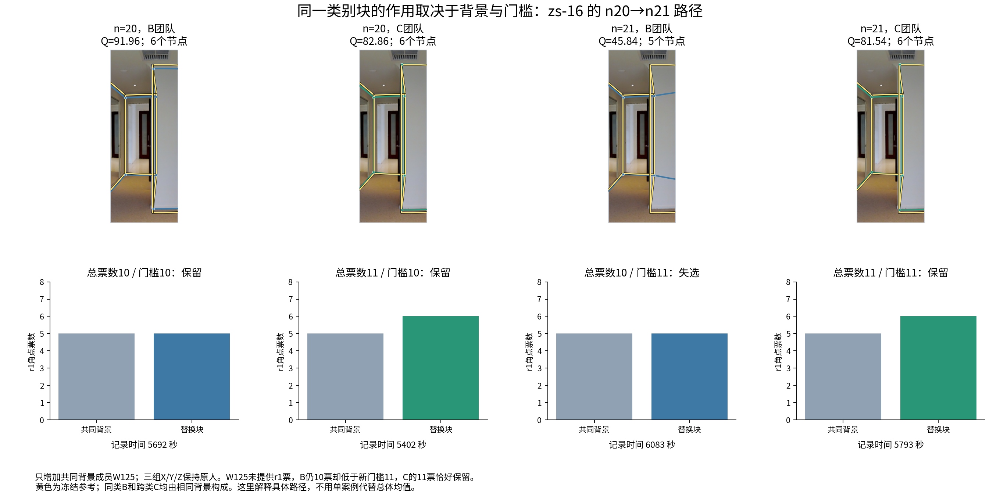
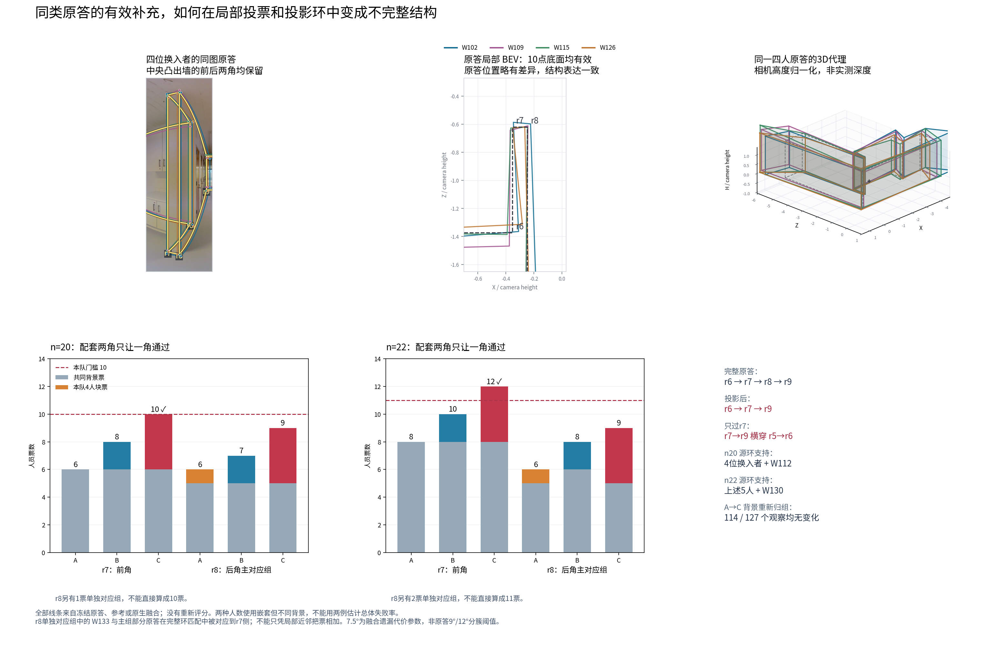

# 融合共识与人数过程：论文采用结论

2026-10-22。本次落盘基线为本地main `3f74c12ad`，已包含合并PR #23的`8bfd3e476`。本专题整理已完成的共识、人数和构成研究，并对齐新main的wc2-56、zs-16与B6-47。原答、参考、资格、评分、现用融合和历史快照均保持；本次没有新增团队、重新融合或评分。仅采用已归档并在上轮读核的材料；新Pro closure实际已收到阶段01、既有分类基线和3489个Manual端点，尚缺最终ABC关联；旧案例ZIP不属于本次新交付。其未核新数值不纳入本专题。新人员分类的总体采用由人员专题负责，这里解释其实际作用如何传到融合。

**当前可以采用的研究结论是：融合是对声明团队表达的汇总；人数和构成通过局部表达、观察对应、支持门槛、坐标中位数及连接共同改变输出。已有普通Manual面板中，多数图加人后的成员选择波动降低，但参考质量的改善较有限且并非逐图同向；v2具体案例进一步解释了这种差别。**

## 1. 方法已经形成什么

现用墙线方法接收每个人已处理的上下点对与既定环序，逐双人作周期匹配，以相容关系形成多人身份组，对每组按全团队N做MV50，随后估计位置并独立形成来源建议环或接入人工排序。gap7.5为跳过一个节点的代价，不是同角半径。算法不读取目标GT、Q或人员类别来决定当前归属。

固定团队S及候选组C后，支持人数为该组不同人员数，保留条件为`2*support >= |S|`。偶数半票保留；同人不同观察不能在同一组多计票。固定身份下，这是逐身份二元分歧的一种最小化选择。身份由当前团队重新计算，因此固定成员的“存在票”解释不能替代对应正确性。

组内位置使用所有身份来源、每人等权，周期展开后的x中位数与上下y中位数形成共享x点对。连接选取覆盖全部保留节点的来源投影环，直接邻接与删点后的投影邻接分别记账；无完整来源环保留未连线，可由人工辅助。少于4对、缺连接、位置未定与底面自交分别输出状态，不用补点得到漂亮曲线。N=2的排序暂缓属于明确政策。

原“绑定／上下独立／自适应”是方法形成过程中的原型和可选对照；当前工作路线已收束为上述墙线身份后融合，不再把重做三路当未完成前置。

## 2. Lee与墙线各自已验证的用途

|方法／表示|已经支持的研究用途|适合怎样采用|
|---|---|---|
|Lee等权BEV区域投票|底面多边形切tile，每块每人最多一票；固定池的人数、构成、范围误差与换组波动研究；有历史扩图及精度结果|作为范围共识基线及面积分析工具，明确输出只包含底面|
|现用墙线融合|上下成对的节点、人员支持、位置及来源连接；实际成员子集、人数路径和类别块替换；允许小量人工身份／排序辅助|作为完整上下布局的研究工作流程，区分自动输出与辅助输出|
|人工对应机制对照|在已确认目标处只改来源归属，保留全N、原门槛及估计器|检验某次损失是否来自对应，不能称自动性能|
|最大相容组／多数救回候选|q9等正例、zs误合和Z6重复输出负例均有保存状态|保留为研究分支；未替换现用方法，不阻止现有机制结论采用|

Lee不需要先认墙角身份，因此与墙线的错误来源不同；但它没有顶部端点，不能直接作为完整上下布局替代。两者都表达投票支持，均不保证接近GT。已有三人2t7完整对照中，Lee与精确弧底面相同，点方法略近参考，只能作为实例，不足以宣布某表示或融合普遍领先。详见[已归档质量／完整输出研究](../../fast_research_return_20261006/README.md)。

方法采用不等于完成全库语义认证。现有输入、参数、票账与人工接口已足以运行和研究；相邻目标误合、分散同角拆散和端点目标差异是保存实例中的实际限制。

## 3. 人数过程：已有支持及v1/v2区别

|证据层|实际支持／分母|可以采用什么|
|---|---|---|
|10月初Lee历史扩图|137图尝试、136图可计算；固定N≥20为33图，1—N最多24人|范围共识平均改善主要集中在前段，8→20的IoU点估计增幅较小；全员相对单人平均为113图改善、22图变差、1图不变|
|Lee解析面积人数研究|固定33张Manual高人数图，原GT／MV50，图等权|8→20参考对称差／参考面积0.219906→0.212110，换组对称差／全员并集0.043773→0.011028；两种分母不同，不互当同一种噪声|
|墙线数据v1广图过程|233完成图×条件池、208图；其中181 Manual、43 Semi、9 OOS诊断池；41,859保存前缀、23,951唯一子集|实际重建当前子集对应、投票、中心和连接，保存完整率、同k波动、参考分项及真实全员端点；不是v2数据重跑结果|
|墙线v1固定8→16主面板|27张普通Manual图、11楼；固定共同可用团队对的V|18图参考Q提高、9图下降，图片等权B8L2平均+0.272973；26图V降低、1图提高，平均0.077499→0.054599|
|v2 Rnew2构成及固定成员块|29图／6楼固定13人116个ABC；4条路径195次增人步骤；合计543不同团队|局部票数、旧观察分组、位置和连接的实际机制；不是随机全部进入顺序或v1总体曲线的直接更新|
|v2精选机制与新main对齐|前轮32队／12图方法面板、11条精选变化／16展示状态；新增main的5个ABC／15端点复用|以精确成员和来源解释变化；15端点是已有材料，本次新增计算团队为0|

各行来自不同数据快照或设计，不相加成一个样本量。41,859含不同请求路径，随机基线本身为11,248前缀／10,079唯一子集；主27图来自符合固定人数及原主资格的面板。v1的rPc-22整池失败在该历史包保留，后续修订包另已恢复，不列为当前v2尚未处理问题。OOS池只作诊断；门洞及Semi在各自层分析，不借普通Manual的27图建立总体结论。

**人数方面可以正面采用：当前固定普通Manual面板中，多数图片的融合对选人更不敏感；接近参考的平均收益相对较小，存在质量下降图。** 这足以支持将稳定性和参考表现并列，不必证明每个图片都成立。v1每池4条随机路径偏重广图描述；早期12图24排列提供较细过程实例；v2的固定类别块和具体路径用于解释构成机制。

同一v1保存主表按条件分别重汇总，固定8→16且两端都有共同有效V对的图片如下；Q采用原表同路径成对变化，V采用严格共同对，图片等权：

|条件|图／楼|B8L2提高／下降；平均变化|V降低／提高；平均8→16|
|---|---|---|---|
|普通Manual|27／11|18／9；+0.273|26／1；0.077499→0.054599|
|普通Semi|17／10|5／12；−0.658|17／0；0.023872→0.004928|
|门洞Manual，条件子面板|4／2|0／4；−12.047|4／0；0.185358→0.111989|

因此普通Semi在该v1面板也更稳定，却没有平均质量改善；Manual与Semi的图片和初始化不同，这不是两条件的因果优劣比较。门洞只有4图／2楼，是所选可比区间的结果，不升级为所有门洞图规律。新汇总见[分条件人数表](COUNT_PANEL_BY_CONDITION.csv)；没有修改原资格或补算缺失端点。

当前全员结果确实计算并保存，作为每图声明人员池的实测终点。某个n20团队不能当35人池的全员结果；自动路径也不接上人工辅助全员终点。满员时只有一个成员集，跨组波动为0是设计结果，不是正确性或最佳人数证明。

完整率必须随人数一起报告。历史12图的Uw-09全员仅3节点，8→16同路径参考分析只剩8条有效路径；v1广图端点也保留普通Uw-09、门洞7y-06和OOS诊断7y-17不足4对的情况。不能只显示可评分曲线而隐藏失点、缺连接或无效几何，也不能把这些状态自动反定义成困难。当前尚无“困难图必然越加人越远”的结论；困难所含的局部表达、范围及GT条件分别研究。

原答一致性R、融合换组差异V、相邻人数变化Δ和参考质量Q是不同量。均匀抽取同一固定池时平均原答两两差异R的期望不随人数变化；融合V则由成员、投票和算法决定。Lee的并集归一化对称差、墙线的1−IoU与B8L2不直接横比。

## 4. 与新main的精确机制对齐

### 4.1 wc2-56：所有角都全票，具体成员仍改变位置

n20、换6人、共同14人背景。A/B完整类别构成相同，C改变；三队4角均20票，门槛10。B8L2为A88.284、B94.093、C98.596，C−B为+4.504。这一变化来自中位位置及推导几何，节点数和是否达票都没变。

一个角的底部y中位数，B为318.4033，由W118/W124两中心秩决定；C为319.5369，由换入W115和原背景W131共同决定。替换的作用既可以让新成员进入中位数，也可以改变背景成员的排序位置，并非把某个人的整份layout直接选出来。A→B已有5.808分具体成员差异，同类不等于任意互换。

### 4.2 zs-16：同一类别块的效应翻转，主要来自B失选

n20与n21的X/Y/Z六人块分别保持相同；n21仅向三队共同背景增加W125。关键角的背景5票、X3票、Y5票、Z6票使A/B/C分别8、10、11票；新增W125没有增加这个角的支持，门槛由10变11。

|人数|A：支持／门槛；节点；Q|B：支持／门槛；节点；Q|C：支持／门槛；节点；Q|
|---|---|---|---|
|20|8/10；5；45.657|10/10；6；91.959|11/10；6；82.864|
|21|8/11；5；45.909|10/11；5；45.844|11/11；6；81.544|

C−B由−9.095变为+35.700，C自身却由82.864略降到81.544。这里不是“增人后C变准”，而是同一类块提供的支持余量使C保留角点，B恰因门槛提升失选。这个现象不需要所有困难图都如此，也不要求撤销该类别在已有多数图中的条件用途。

### 4.3 B6-47：保留真实成套表达，不保证整套结构过票

同一高历史Q、相对较快的4人块W102、W109、W115、W126都画了中央凸墙配套两角；在n20 C，两角为10/9票、门槛10；n22 C为12/9票、门槛11。两次只保留前角。原观察已经存在而分布到不同组，未进入主组不改称没画。

完整来源投影环跳过失选角形成r6→r7→r9，且实际中位位置使该边与另一条边相交；n20直接／投影邻接支持1/8，n22为2/9。两支C底面无效，B8L2/D10保持缺失。相应A/B可评分。A→C的共同背景共簇关系变化为0，因此这不是背景全面重组造成的失败；B→C另有部分重组，分别保留。

节点召回提高与最终布局失败可以同时发生。这个机制补充了现有“位置变化”与“节点失选”：需要把**配套结构的支持不均、投影连接、实际定位**连起来解释，而不是因为某一角失选就断言必然自交。它是现用算法的明确局部失败，没有制作重排／补点后的高分版本。

## 5. 与已有五种机制共同形成的论证

- **局部补票：** e9z-19同为10人5H5L及同新来源成员，W101补到关键第五票，换成W107仍只有四票；之后再加W031，五票仍在而门槛升六，节点退出。
- **对应拆散：** q9-30同17人只恢复已审13份同角来源的人工对照，Q37.948→89.267；自动候选另救回15票组、Q95.601，但多出的2份未人工认证，且有其它失败。
- **局部配置与背景：** jtc-26的W113也画了x≈927的近邻点；W106则有两个相邻点。其替换效果不能写成“W113没画”；同4快1慢背景改变时三份焦点观察被拆散，再用同团队对应对照隔离算法作用。
- **全票位置变化：** wc2-56将原B6-22/Uw实例补成大团队清楚案例，成员通过中心秩影响全局范围、边界及高度分项。
- **Semi共享初始化：** Z6-10用户确认两个票组想标同一角，W017确证原样保留旧P1重复trap。自动救回会把同角再输出一次；不能用独立人数支持或高终稿Q认证其语义。
- **配套结构失选及连接放大：** B6-47中补入者都表达了两角，却只有一角达票，投影边与中位位置共同形成自交。它不否定真实结构补充本身，也不等于新成员画错。

[既有定稿与原答图](../fusion_mechanism_followup_20261021/RESULTS.md)保留11条变化和16展示状态，现用算法／人工对照／自动候选始终分开。新main的15端点对应表在[ENDPOINT_ALIGNMENT.csv](ENDPOINT_ALIGNMENT.csv)，来源和本轮定向核对见[CHECKS.json](CHECKS.json)。已有结果足以解释组合效用，不要求继续重写自动对应。

多数规律与失败应同时报告：新main Manual指定联合方向的64个ABC、8图／6楼中，62个三端可评分事件的楼等权净Q+5.691、记录总时间−3.632%，7/8图平均双优；另有上面的2个C失败。这里引用人员专题已采用汇总，不重新搜索方向或将案例当群体效应。Semi指定方向28事件／5图／4楼主要支持记录时间用途，净Q约+0.153，另行解释；不把Manual的质量收益移植到Semi。

## 6. 本专题采用与交接

本次可直接用于论文的方法、结果及讨论：声明团队的一份共识；稳定性与参考质量分开；具体成员及构成经局部支持和位置传递；增人门槛与对应重组的不同机制；真实结构补充也可能在连接阶段失败；Semi初始化来源影响独立表达解释。全员实测终点、完整率与无效输出均已保留。

实质未完成部分是通用自动对应正确率、未知目标的语义裁决以及跨新人／新图的外部验证；它们不作为本轮收尾的前置。当前不需要新增人工批量审核，不自动改变方法、资格、GT或评分。后续如改算法，应另立候选对照，继续保留本次生产基线。

[字段及来源](FIELD_CONTRACT.json)、[交付与目录登记清单](HANDOFF.md)。全局模型、进度和目录由整合线程同步；本分支不修改研究台。
