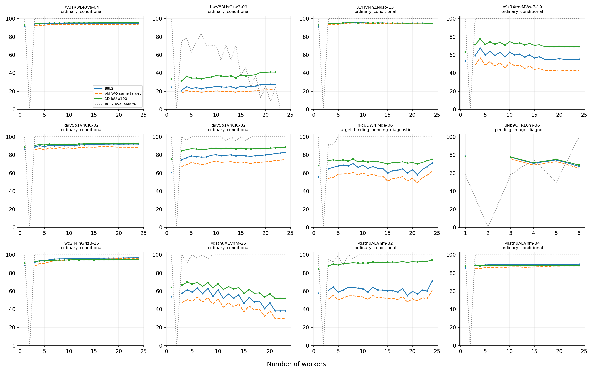
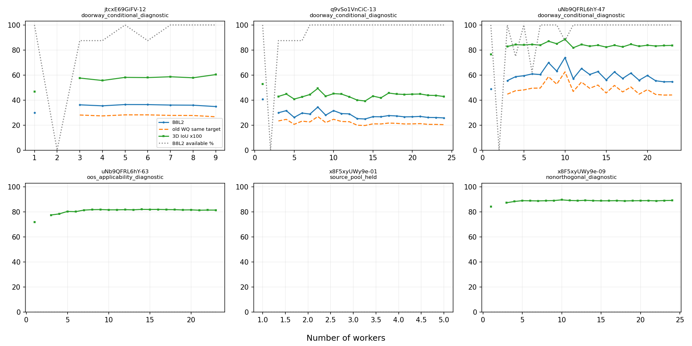

# 墙线融合：原版B8L2与难度v6接入

**最新用途修订：** [门洞／OOS计算与用途分开（v2）](usage_v2/README.md)。门洞继续条件计分；OOS新增完整诊断数值但全部禁用于质量评价及算法比较。下文6,247及OOS暂停分数描述保留为初版快照，最新计算覆盖见v2。

2026-10-16。**已对原12图＋6图特殊层的实际冻结融合结果完成B8L2接入，没有重跑融合、插值人数过程或等待Pro新模型。** 共7,320个路径状态、6,693个唯一成员子集。当前得到6,247个B8L2条件数值；其中普通且本模块列明限制均清楚的比较子集为7图、3,578个路径状态。二者不是同一分母，也不新增正式资格。

本次继续用户原意：融合表达人员对标注位置的支持，评分只评价既有输出；增人可以更稳定而不更接近GT，门洞／OOS也可能稳定地偏离参考。没有以质量反选对应、参考、投票规则或人员。

## 1. 实际冻结版本与变化

- 评分：`WQ-B8L2-20261015`原参数，见[参数](score_parameters.json)。复用[原working_models.py](../../quality/quality_ab_feedback_handoff_20261015/prior_AB/src/working_models.py)及既有冻结测量入口。没有采用Pro新A/B/C或Q-Profile，也未调B8L2参数。
- 难度：`scope_preferred_difficulty_scope_resolved_20261016_v6`。实际标签、参考、门控和成员冻结于[input_snapshot.json](input_snapshot.json)。之后CURRENT更新不自动覆盖本包。
- 几何：原12图来自[10月14日实际子集](../wall_consensus_population_20261014/README.md)，另6图来自[10月15日特殊层](../wall_consensus_quality_20261015/special/README.md)。参数仍为gap=7.5、全N的MV50、全成员中位数，原连接不改。
- 对接：[共同v6输入](../../statistics/b8l2_shared_v6_20261016/inputs)的参考几何、完整参考资格、成员身份、票资格和目标绑定均已核对，[逐图记录](shared_input_comparison.json)。共同单人分数没有冒充融合分数，891份旧快照未用作当前分母。

18图的实际来源池人数及作答坐标都未改变，不需要重算融合。所有来源池至少5人；x8-01虽有5人，仍受GT暂停。来源池“至少3真人”不删除合格池内k=1节点；k=2继续只保留节点、暂缓排序及布局质量。

相对本模块10月15日快照，q9-32简单→中等，rPc-06中等→困难，yq-25中等→困难，uNb-36简单→待复核。其余14图类别不变。v6新增目标S9-09、zsNo-13和改档7y-19不在这18图内，不能声称本实验已覆盖它们。新目标中的外推顶界预览未升级为完整GT。

**rPc-06是实际参考完备性的增量：**同一已确认底面现在具有源明确顶平面下的内裁切完整参考。新增548个完整条件分数来自参考信息补齐，不能归功于换B8L2。24名池内作答的多空间归属仍未唯一绑定；固定新目标的分数仅作诊断，不纳入普通主比较，也不裁剪原作答或融合结果来迎合该空间。

uNb-36只作待复核诊断；e9z-19、yq-25、yq-34保留原留出用途。门洞、OOS与普通图分开。人工粗难度部分参考过作答，是探索性分层，不称独立验证。

## 2. 只换评分的对照

设`F=(1/I−1)+Sb²/32`、`d8=1.5D²/(D²+8²)`、`H=(Hm/0.8)²+(Hc/0.25)²`，原B8L2为`100/(1+sqrt(F²+d8²)+H)`，I=0取0。D仍为自身最优共同正交轴残差，未改成相对GT墙面关系。均高棱柱3D IoU也未改变。

[score_only_comparison.csv](score_only_comparison.csv)固定旧几何、旧参考和旧用途，仅代入原B8L2。5,223个旧有完整WQ的唯一子集均可比较，B8L2相对WQ数值差中位数约+4.83点，范围约+0.007至+13.23。**数值增大是评分尺度与组合改变，不是融合准确率提高。**rPc新顶界增加的分数不在这组“只换评分”对照中。

当前参考下同时保存B8L2、WQ、3D IoU及底面、边界、方向、高度分项。rPc当前WQ是同新参考重测的对照，不能当成旧10月15日已有分数。

## 3. 参考接近与稳定性：反例仍成立

下表为同一路径8人和16人都可评价的集合，不是用不同有效分母相减。原12图每图24路径，特殊层每图8路径。

|图片|用途|有效成对路径|B8L2 8→16人|3D IoU×100变化|
|---|---|---:|---|---:|
|7y-04|普通比较|24/24|94.53→94.75|+0.36|
|X7-13|普通比较|24/24|95.76→95.29|−0.35|
|q9-02|普通比较|24/24|90.36→91.43|+0.79|
|q9-32|当前中等、普通比较|23/24|77.65→78.95|+0.55|
|e9z-19|原留出诊断|24/24|62.72→58.05|−2.53|
|yq-25|原留出诊断|23/24|62.71→53.82|−7.24|
|yq-32|普通比较|23/24|63.98→61.18|+0.73|
|q9-13|难标门洞条件诊断|8/8|34.43→26.65|−7.55|
|uNb-47|可标门洞条件诊断|8/8|69.89→62.51|−3.19|

**e9z-19仍是更稳定但更偏离指定参考的例子。** 换组底面1−IoU为0.1754→0.0726，B8L2绝对差14.75→5.96，但B8L2和3D IoU均下降。它仍属原留出诊断，不混入普通限制清楚子集。

**yq-32仍有指标方向冲突。** B8L2和WQ下降，而同参考3D IoU改善；原冻结分项显示方向残差增大、高度损失减小。换公式未消除此差异，不能据总分下降声称每个几何方面都恶化。

**边际变化也可能依赖评分。** yq-34的8→16人WQ约+0.34，而B8L2约−0.10；幅度小且为原留出诊断，只说明“轻微收益”的方向并非对指标稳定，不作显著性或总体结论。

**Uw-09保留失败分母。** 8人17/24、16人11/24可得完整质量，同时有效仅8条。全员3节点、无完整质量。不能只看这8条的B8L2约+0.61，就宣称整图增人改善；也不能由不完整终点推断未来新人必然不收敛。

**稳定性本身不保证单调。** uNb-47换组底面差约0.060→0.083，yq-32约0.052→0.054。此处是已保存的同人数团队比较，未将质量分数差当作几何稳定性。



图中为各k可评价路径的条件均值，灰线为B8L2数值覆盖率；不是所有点都属于普通主比较。原留出、待复核和目标未绑定用途按上文保留。实际前后变化优先读同路径表。奇偶票制没有平滑，缺失不补0。

## 4. 特殊层仍保留

|特殊图|当前去向|全员结果|
|---|---|---|
|jtc-12|可标门洞；既有场景／参考限制保留，条件诊断|4节点，B8L2 34.83，3D IoU×100 60.37|
|uNb-47|可标门洞；既有场景／参考限制保留，条件诊断|7节点，B8L2 54.68，3D IoU×100 83.68|
|q9-13|难标门洞；范围解释仍需谨慎，条件诊断|5节点，B8L2 25.75，3D IoU×100 42.84|
|uNb-63|OOS子型／表示适用性未决|4节点，仅几何诊断，3D IoU×100 81.44；B8L2留空|
|x8-01|已知GT问题，来源池暂停|6节点保留；当前参考质量留空|
|x8-09|明确非正交可标|6节点，3D IoU×100 89.13；无D消融诊断87.68；完整B8L2留空|

对合法非正交目标，不将自身非正交残差当成人员标错。`B8L2_no_D_diagnostic`是明确的诊断消融，不是另行调参采用的新主算法。x8-09从8到16人底面换组差约0.035→0.025，3D IoU几乎不变，继续支持“特殊场景可以稳定”，不预设失败。



6图864路径状态中，411有门洞条件B8L2，183有非正交几何诊断、176有未定OOS几何诊断；x8-01全部40状态暂停参考质量。另40个两人状态和14个无连接状态没有完整质量；x8-01内的8个k=2同时受两人政策与GT暂停。数值缺失不能全部叫算法失败。

## 5. 全部状态与有效分母

|当前用途|全部路径状态|B8L2有效|3D IoU有效|
|---|---:|---:|---:|
|普通条件比较（含原留出标记）|5,736|5,206|5,206|
|rPc目标绑定未决诊断|576|548|548|
|uNb-36待复核诊断|144|82|82|
|门洞条件诊断|448|411|411|
|明确非正交诊断|192|0|183|
|OOS适用性未决诊断|184|0|176|
|x8-01来源池暂停|40|0|0|
|总计|7,320|6,247|6,606|

6,247状态对应5,729个唯一子集，不是6,247名人员或独立图片。普通比较中再要求当前成员质量限制清楚、无原留出、目标绑定清楚且完整可算，得到7图3,578路径状态／3,319唯一子集。这是本模块明确的比较口径，不授予正式资格。7图为7y-04、Uw-09、X7-13、q9-02、q9-32、wc2-15、yq-32。

主几何失败／政策状态另列：250少于4对、328两人暂缓、58无连接、38完整几何不适用；另有上述非正交、OOS和GT暂停。所有状态保留在原分母中，`by_image_k`同时给出完整质量、主比较、两人及连接缺失数。

自动实际全员与人审终点分别保存。yq-25当前自动5节点B8L2为38.18，既有同输入辅助6节点为69.80；这是已知对应修正后结果差异，不能把辅助终点接进自动人数曲线或用GT高分反过来认证对应。uNb-36旧辅助输入不同，明确仅历史记录。

## 6. 人员组合、同房线怎样消费

|文件|主键与用途|
|---|---|
|[trajectory_scores.csv](trajectory_scores.csv)|`image,path,k`，真实人员名单与评分／分项／用途／缺失；只含墙线方法|
|[subset_scores.csv](subset_scores.csv)|`image,subset`，6,693唯一成员集合，避免把重复路径当独立团队|
|[by_image_k.csv](by_image_k.csv)|`image,k`，所有路径数、有效分母、条件均值与主比较均值|
|[matched_changes.csv](matched_changes.csv)|同一路径跨人数比较，保留成对有效数与全部路径数|
|[same_k_comparison.csv](same_k_comparison.csv)|预定配对抽组的实际几何差异、成员集合与分数差；同一子集终点仍可能重复出现|
|[coverage_and_changes.csv](coverage_and_changes.csv)|当前／旧难度、参考完备性、人数门、输入变化及几何来源路径|
|[automatic_endpoints.csv](automatic_endpoints.csv)、[assisted_endpoints.csv](assisted_endpoints.csv)|实际全员自动／辅助结果，明确旧辅助是否同输入|
|[member_registry.json](member_registry.json)、[input_snapshot.json](input_snapshot.json)|作答对象ID、真人ID、房间与建筑字段、用途限制、逐份目标绑定、当前完整参考与原作答坐标|
|[score_only_comparison.csv](score_only_comparison.csv)|旧参考/旧几何不变时的纯指标变化；与新目标完备性增量分开|

`geometry_source`指向已保存的真实子集状态，包含人员进入顺序、点对、节点来源及候选连接；与`image+subset`联接，不用临时节点号跨结果认身份。可扩展到已有177全员终点或其它真实缓存，但先核对当前目标与成员资格；全员终点不能代替缺失人数轨迹。

本18图之外没有新增人数过程。若同房线缺少实际共享成员的墙线几何，需按明确名单另算，不以Lee底面轨迹或终点插值替代。本包不研究时间，不使用lead_time；下游若连接active_time，须沿其审定来源、秒单位及目标可比性处理，不能把旧任务耗时当新范围任务耗时。

## 7. 复现、核验与剩余事项

```powershell
python -B -m tools.thesis_main.analysis.wall_consensus_b8l2_20261016
python -B -m tools.thesis_main.analysis.wall_consensus_b8l2_20261016 --aggregate-only
python -B -m pytest tests/test_wall_consensus_b8l2_20261016.py tests/test_wall_consensus_quality_20261015.py tests/test_wall_consensus_population_20261014.py -q -p no:cacheprovider
```

首次运行冻结实际输入；重放读取本包input_snapshot，不重新取CURRENT。使用共同冻结参考/绑定核对，不写共同评分表。原17图有同完整参考的分项直接复用，rPc新增完整参考在冻结融合几何上测量；没有重跑对应或投票。

测试验证原B8L2闭式参数、缺高度不能变完整分、人数／目标限制和非正交分项处理，并保留此前融合前缀与缺失分母检查。实际分数范围、旧WQ/3D IoU复用一致性、7,320状态及6,693唯一集合另见[VALIDATION](VALIDATION.json)。图件为交付分析图，没有临时截图。

未重审原图实体身份、全库调参、扩充采集或证明难度标签独立有效。rPc目标绑定、uNb-36待复核、x8-01参考错误及未定OOS继续由既有任务处理，不要求用户重复回复已明确事项。数据线负责共同统计与全局catalog；待登记路径见[REGISTRATION_REQUEST](REGISTRATION_REQUEST.json)。本模块不改公共入口、CURRENT、全局catalog或其他线程结果，未提交／推送。
