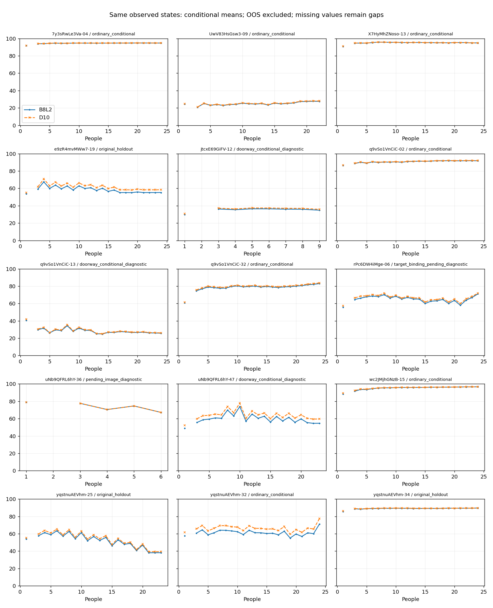

# 融合18图：新增批次核对与B8L2／D10对照

2026-10-17。新增70份涉及19图，与现有融合18图**没有重叠**。本次独立核对现有377份来源的人员身份、预处理坐标、环序索引、人员池和参考几何，均不要求重跑融合；最新路由对rPc来源归属及单人质量资格有变化，单独记录，不混入纯指标对照。已给保存的真实人数过程、自动全员终点及人工辅助终点补D10；未插值、未调融合参数，也未按GT选择成员。

共识表达人员对“该标在哪里”的支持。增人研究首先观察稳定性，再分别观察与指定参考的差异，不要求质量曲线随人数增加而上升。当前仍为墙线身份→全池MV50→全成员中位数→来源建议或人工连接；不恢复历史三路为必做任务。

## 版本与实际覆盖

- 当前来源：[共同评分入口](../../quality/quality_b8l2_d10_20261017/CROSS_MODULE_INPUTS.json)，输入`analysis_results/research_input_20261017/manifest.json`。读取的是3222份／261图库存；本模块没有将全库存误称为已运行融合面板。
- 两指标：[参数](MODEL_PARAMETERS.json)。主指标B8L2仍为`WQ-B8L2-20261015`；D10为`B8L2-D10-20261016`，仅方向尺度8°→10°，其它参数不变。D10不是A10。
- 实际几何：[原12图人数过程](../wall_consensus_population_20261014/README.md)与[另6图特殊层](../wall_consensus_quality_20261015/special/README.md)，沿用gap=7.5、MV50和全成员中位数。
- 用途：[前版计算／用途分离](../wall_consensus_b8l2_20261016/usage_v2/README.md)。门洞条件计分；OOS数值仅诊断，禁止人员质量评价及算法优劣比较。目标待定、范围未绑定、原留出用途分别保留。

|交付|数量与含义|
|---|---|
|真实人数路径|7,320个状态，6,693个唯一成员子集|
|完整两指标数值|6,638状态，包括391个OOS诊断状态|
|同一非OOS评分掩码|6,247状态／5,729唯一子集；包含原留出、目标待定及未绑定诊断，不等于全部主比较资格|
|原普通主比较子集|仍为7图、3,578路径状态|
|全员自动终点|18个，失败及暂缓保留|
|既有人工辅助终点|8个，6个有完整分项；uNb-36输入不同、Uw不足4对，不混入自动曲线|
|新增测量／重融合|均为0；已有完整状态的五个测量分项足以计算D10|

缺失的高度、缺连接、点不足和两人排序暂缓保持缺失，没有为了补D10而补点或补顶。OOS完整诊断保留在`*_numeric`列，标准B8L2/D10列为空。非OOS标准列仍需结合用途、留出和`primary_comparison_eligible`解读。

## 输入与用途桥接

[18池核对](pool_bridge.csv)和[377份来源对照](member_bridge.csv)保留逐条结果；[输入快照说明](INPUT_BRIDGE.json)包含本次所读共同合同。

当前池人数、有效人员集合、点坐标、既定环索引、完整参考及池分析门与旧实验一致；新增19图没有进入这些池。共同包在收尾时更新为`quality_b8l2_d10_20261017_v2`（全库1911份质量可用）。rPc-06的24份此前待定绑定现在明确：21份归当前裁切空间、3份归原GT空间，21份单人质量由不可用转可用。来源坐标与本融合实验声明的参考不变，融合仍对旧声明目标作诊断；未因此把全池当成同一范围，也未重新按空间分池。52份OOS的`quality_use`文字从`oos_diagnostic_only`变为`not_qualified`，已逐份记录；两版均禁止质量用途，本模块仍保留可计算的诊断和几何稳定性。

最新多空间归属由统计线更新，本模块只消费、不改变路由。逐路径新增`current_team_target_relation`：rPc哪些团队全属声明目标、哪些包含其它目标可直接区分。B8L2/D10仍用原共同掩码进行公式对照，原主比较集不自动扩展；按最新范围重新分池形成共识将是另一项实验。本次不开展，不能归因于D10。结束前重新读取共同v2入口，与运行时版本一致。

## 有用的发现

固定同一路径8人和16人都可计分后，13张有成对结果的图在B8L2与D10下的变化方向全部一致。以下是有区分力的例子，单位均为评分点：

|图片及用途|成对路径|B8L2变化|D10变化|
|---|---:|---:|---:|
|7y-04，普通|24/24|+0.222|+0.222|
|q9-32，普通|23/24|+1.304|+1.137|
|e9z-19，原留出诊断|24/24|−4.671|−4.489|
|yq-25，原留出诊断|23/24|−8.890|−9.152|
|yq-32，普通|23/24|−2.795|−3.089|
|q9-13，门洞条件|8/8|−7.777|−8.611|
|uNb-47，门洞条件|8/8|−7.386|−7.706|

这是指定区间和有限面板的敏感性结果，不是所有k都单调，也不是困难图必然失败。Uw-09仅8/24条路径在8和16人同时可计分，两指标变化约+0.61/+0.60；全员仍只有3节点、完整质量缺失，不能据幸存路径宣称整图改善。

5,729个同资格唯一子集中，D10比B8L2高的中位数约0.369、均值1.282、最大6.501。方向尺度增大减轻惩罚，因此这个提升是公式造成的，**不代表共识几何变好**。全员yq-32从71.14变77.38、uNb-47从54.68变59.61，几何完全相同。

几何稳定性不受换评分影响。[保存的同人数换组结果](same_k_geometry_and_legacy_scores.csv)原样接续，其中B8L2旧分项列仍有原版本含义。e9z-19换组底面差8→16人约0.175→0.073，同时B8L2与D10的参考分均下降；“更稳定”与“更接近参考”仍是不同观察。本轮不从评分反推图片或人员的不确定性来源。

图为各k可评分路径的条件均值，不是固定有效路径集合；判断人数变化优先读[同路径对照](matched_changes.csv)。缺失处断开，奇偶票制不平滑；OOS不绘质量曲线。

## 查阅与复算

- [逐路径状态](trajectory_scores.csv)、[去重成员子集](subset_scores.csv)、[逐图逐人数](by_image_k.csv)：保留用途、失败、节点和资格字段。
- [自动全员终点](automatic_endpoints.csv)、[人工辅助终点](assisted_endpoints.csv)：分别保存，人工结果不拼到自动轨迹。
- [字段合同](FIELD_CONTRACT.json)、[核验结果](CHECKS.json)。
- `python -m tools.thesis_main.analysis.wall_consensus_d10_20261017`：读取共同入口，核对来源，复用测量分项；任何实质人员／参考变化须另行处理。

6项相关测试通过，覆盖D10公式、缺失不补值、诊断不进入质量列及原用途边界。检查了实际状态数、输入坐标、来源池和参考一致性。本轮没有扩大融合图片、重新选人、调参、推送或验证全库自动对应正确率；新增图的融合实验仍未开展。
