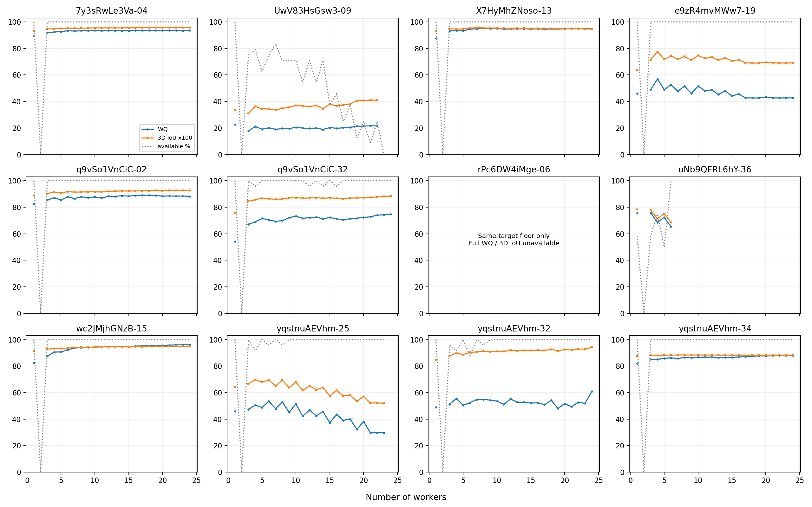

# 墙线融合人数过程：WQ接入与特殊场景补充

> 2026-10-15接续说明：本文为当前融合质量接入报告，数值使用原WQ。12图与另6图特殊层属于有限覆盖，条件、诊断及完整评分须分开解释；不同评分版本的下游比较仍待实施。 当前统一状态见[资料核对](../../../docs/thesis_main/四线程成果与论文主线核对_20261015.md)。该句原属文档整理阶段；后续已获授权并完成描述统计，当前版本见统一状态入口。


2026-10-15。**已完成实际评分，不是仅同步文档。** 原12图保存的6,456个路径状态、5,894个唯一人员子集全部登记；按固定参考补WQ-LS08-20261014、同参考现用3D IoU及分项。另按场景和覆盖预先选定6图，实际运行8条随机加人路径，新增864个路径状态、799个唯一子集。原12图不重跑融合，不调融合或评分参数。

主发现：增加人数未必使参考质量提高，稳定性与参考质量仍可反向；WQ与3D IoU也会给出不同变化方向。门洞／非正交不能被视为必然无法形成完整共识。本轮是现有人员池的条件研究，不识别纯人员／图片噪声，也不验证未来新增人员的收敛。

## 1. 可直接消费的结果

|文件|内容与分母|
|---|---|
|[subset_scores.csv](subset_scores.csv)|按`image + subset + reference_axis`唯一：5,894个实际成员集合，原GT、修订GT和固定难度目标分别记账|
|[trajectory_scores.csv](trajectory_scores.csv)|按`image + path + k + reference_axis`唯一；selected_target正好6,456行。含实际人员／作答／对象集合、版本、状态、分项|
|[by_image_k.csv](by_image_k.csv)|每图每k的全部路径数、完整质量有效数、不可评价率、两人暂缓数、少于四对数与条件均值|
|[matched_changes.csv](matched_changes.csv)|1→8、8→16、16→24、8→24在**同一路径两端均可评价**时的变化，另存全部路径分母|
|[same_k_scores.csv](same_k_scores.csv)|相同人数的两个预定独立抽组，保留底面差异和质量分数差；质量分数相近不等于几何相同|
|[endpoint_comparison.csv](endpoint_comparison.csv)|实际自动全员与既有人审终点分别评分；不会把人审终点接到自动曲线上|
|[references](references)|各图实际完整点／底面几何及参考ID，不只保存名称|
|[image_registry.csv](image_registry.csv)、[member_registry.json](member_registry.json)|图片、建筑、原房间分组、实际成员和已有人员／场景限制；缺房间信息的建筑回退组不能冒充真实同房|
|[特殊层目录](special/README.md)|43图覆盖台账、6图冻结输入／真实子集状态／逐k质量与完整性，以及原177中3图的全员诊断|
|[FIELD_CONTRACT.json](FIELD_CONTRACT.json)、[VALIDATION.json](VALIDATION.json)|字段、单位、缺失政策及本次定向验证|

同房研究可直接连接以上名单、图片ID、参考版本与逐k分母；比较时固定同一参考目标及同一图片集合。多个随机路径复用同一批人，全员终点的24次出现也不是24份独立观测。房间ID不完整的情形须另处解决，不按建筑名臆造同房。

## 2. 评分来源与用途

复用人员模块`frozen_engine()`，从已审查的`research/quality_joint_closeout_review_20261015/pro_closeout_delta.zip`临时载入原字节评分代码；运行后临时文件自动清除。没有新造评分式、参数拟合或Q-Profile等级映射。

WQ为 `100 I / (1 + I K)`，`K=Sb²/32 + 1.5D²/(D²+37.5) + (Hm/0.8)² + (Hc/0.25)²`。D仍是自身共同正交轴残差，不是相对GT方向误差。3D IoU采用现用平均顶点墙高棱柱代理，不称真实室内体积IoU。分数均为研究工作指标，不是正确概率。

当前loader按原prepare入口得到的12图输入与冻结快照完全相同。参考继承难度模块的[绑定表](../../difficulty/difficulty_target_integration_20261015/fusion_reference_bindings.csv)：11图有同目标完整参考；rPc-06只有同目标底面，原完整GT保留为另一个参考轴，不能借其顶部给新范围补完整WQ。原／修订GT与selected_target没有按分数择优。

所有结果都是条件比较，**不因可算就获得正式资格**。`member_registry.json`保留原留出、人员和场景限制；曲线里`original_holdout`及`restricted_members`与数值一起消费。融合只读取当步人员，不读取GT、人审全员身份或未来成员。

## 3. 原12图的实际分母

固定难度目标轴6,456状态的互斥去向如下：

|去向|状态数|
|---|---:|
|完整条件WQ／3D IoU|5,288|
|同目标仅底面参考|548|
|两人暂缓排序|288|
|少于4对|250|
|无来源连接|44|
|完整几何不适用|38|

不填零、不删失败。少于4对时若底面仍可算，保留底面诊断，不纳入完整质量均值。WQ缺失包括政策暂停、缺顶面、连接和几何问题，不能统称算法失败。均值只描述其明确的有效集合。



曲线每个点为当k有效路径均值，灰线为完整质量有效率；主要前后对照使用matched_changes的同路径集合，避免换分母造成改善假象。MV50奇偶效应保留，不做平滑纠正。

### 已有具体结论

- **简单图的后段改善通常较小，但不必同向。** 8→16人同路径下，7y-04的WQ约+0.21，X7-13约−0.34，q9-02约+0.99，wc2-15约+1.13；这些不是通用最佳人数结论。
- **e9z-19：更稳定却更远离当前参考。** 8→16人24/24路径均可比较，WQ 51.52→45.66，3D IoU×100 73.90→71.37。同人数换组底面1−IoU均值0.1754→0.0726，WQ绝对差15.53→6.09。结果更集中，参考偏差没有随之消失。
- **yq-32：指标判断确实可能不同。** 8→16人同23条有效路径，WQ 54.83→52.73，3D IoU×100 91.29→92.02。方向残差均值6.80°→8.21°、方向损失0.750→0.843；高度损失反而0.0169→0.0060。该WQ下降主要伴随方向分项恶化，不能简单表述为“所有定位更差”或证明WQ优于IoU。
- **Uw-09必须同时看可用率。** 8人17/24、16人11/24可得完整质量，两端同时有效仅8条；全员只剩3节点，完整质量缺失。不能将有效子集的均分轻微上升解释为整图改善，也不能把满员失败直接归因于图片固有难度。
- **yq-25自动流程仍有已知对应限制。** 全员自动5节点，WQ29.71／3D IoU×100为52.00；同输入既有人审6节点分别60.02／69.91。这表明自动与辅助有实际差异，不证明人工为提高GT分数而选节点。两者分开交付；uNb-36旧辅助输入已变，明确不作为当前轨迹同输入对照。

共同十图当前为6简单／1中等／3困难；唯一中等rPc-06缺同目标完整顶界，因此本轮不能画出三档都具备同目标完整WQ的对照。保留底面分析，不换参考来凑三档。

## 4. 门洞／OOS没有被普通面板代表

原12图不含这些场景。43张带特殊标记的图中，原177图交付仅覆盖jtc-12、uNb-47两个可标门洞，以及uNb-63一个OOS。其余包括探索层门控、适用性未决等，并非融合失败后被本轮删掉。43含OOS待定项，与粗类“42单列”不是同一口径。

本次新增的6图在评分前按场景与覆盖选定，见特殊层DESIGN：两个可标门洞、两个明确非正交可标图、原177中未定OOS，以及人数最多的难标门洞（图号打破并列）。每图8路径、共108份人员—图片记录；当前未混入condition=oos任务或Semi。完整名单和所有未运行图片的去向见覆盖表。

- 门洞可标两图有明确固定完整参考，计算条件质量；q9-13的范围／可标性仍未决，只作指定参考诊断。
- x8-09为合法非正交，保留3D IoU及既有`WQ_no_D`诊断，**不输出含正交罚项的WQ作为人员质量**，也不将无D分项升格为新主评分。
- x8-01已有明确GT问题，不做参考质量曲线；节点和完整性仍研究。
- uNb-63的OOS子型未定，保留几何代理诊断，不输出完整WQ质量判断。
- 本特殊台账未发现仅底面目标；rPc-06的仅底面情况属于原12图。未决OOS不擅自改成已确认“表示不适用”，也不据可算就认定可标。

详见[特殊层结果](special/README.md)。这些例子补上场景覆盖，但6图不能代表全部门洞／OOS。

## 5. 验证、复现与下一步

```powershell
python -B -m tools.thesis_main.analysis.wall_consensus_quality_20261015
python -B -m tools.thesis_main.analysis.wall_consensus_special_20261015
python -B -m pytest tests/test_wall_consensus_quality_20261015.py tests/test_wall_consensus_population_20261014.py -q -p no:cacheprovider
```

两脚本均提供`--aggregate-only`，只重建汇总。原12图评分消费已保存融合；特殊层首次运行会从冻结规则重新做当前人员前缀融合，输入另存，不改变原177或12图结果。特殊层重新执行应确认loader仍与本次snapshot一致，输入变化须另存版本，不能混用本次结果。

7项定向测试通过，覆盖两人／不足4对、同路径缺失分母、真实仅底面不借顶界、非正交不输出Manhattan质量及原前缀隔离。158个与人员模块相同成员、相同参考且已有完整分数的缓存结果复核一致，最大WQ差3.6e−15，3D IoU无差。没有重复审计全部上游几何或全仓测试。

本轮只新增本模块目录、两个工具及定向测试。没有更改公共模型、索引、合同、评分或融合参数、GT、源作答、正式资格；未提交推送。建议统筹将本页登记为数值接入入口，并用实际5,288状态覆盖替代“WQ尚未接入”的模块状态。上轮已完成的文档整理保留。

目前无须用户重复审核已有墙线或顺序。本轮也没有新增视觉语义认证。后续重点是使用实际同房映射、固定图片／参考／路径集合解释曲线，并研究当前对应或方向分项造成的具体差异；rPc新顶界、x8-01问题参考及未决OOS由既有参考任务处理，可用分析不等待它们全部解决。
