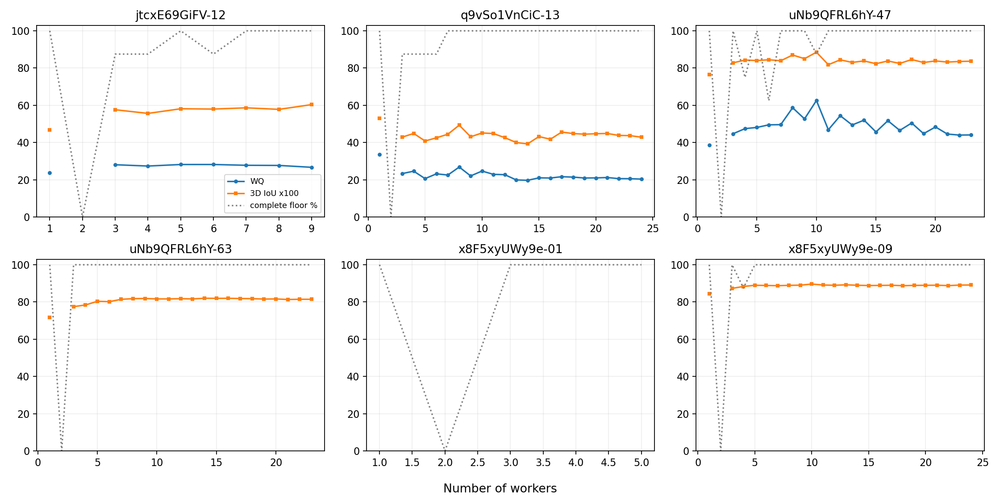

# 门洞与OOS：覆盖台账和6图有限人数过程

2026-10-15。原普通12图没有特殊层；本轮实际补算6图、每图8条随机进入路径，864状态／799唯一人员子集。选择在查看本轮分数之前固定，见[DESIGN](DESIGN.json)。冻结参数gap=7.5、全N的MV50、全成员位置中位数；自动连接，不使用人工终点或未来成员。GT仅在输出后评分。

[43图覆盖台账](coverage_inventory.csv)逐图保存场景、OOS子型、门洞可标性、当前条件人数／门控、原177是否覆盖、参考状态和消费去向。未入原177不等于实验失败；condition=oos的任务不与manual池混合。只有两张已明确非正交可标，其余OOS子型大多未定，不能全部叫表示不适用。

|图|人数|场景／用途|全员节点|全员结果|
|---|---:|---|---:|---|
|jtc-12|9|可标门洞，固定参考条件质量|4|WQ26.69，3D IoU×100=60.37|
|uNb-47|23|可标门洞，固定参考条件质量|7|WQ44.08，3D IoU×100=83.68|
|q9-13|24|难标门洞，范围仍未决；仅指定参考诊断|5|WQ20.36，3D IoU×100=42.84，不据低分裁定标错|
|uNb-63|23|OOS子型／适用性未定|4|只保留几何代理：3D IoU×100=81.44；WQ留空|
|x8-01|5|明确非正交可标，但已有GT问题|6|不评分；保留融合完整性|
|x8-09|24|明确非正交可标|6|3D IoU×100=89.13；WQ_no_D诊断87.68；完整WQ留空|

“指定参考”不等于所有前缀的语义范围都已认证。uNb-47使用当前固定参考，旧方位争议不通过本轮评分重新裁决。x8-01不把参考问题改写成人员错误。WQ_no_D来自冻结评分接口，只作敏感性诊断，未另调参数。

8→16人，同一路径完整可评价8/8：

- q9-13：WQ−5.90，3D IoU×100−7.55；同人数换组底面1−IoU约0.290→0.263。更接近一致并未同时更接近指定参考。
- uNb-47：WQ−6.97，3D IoU×100−3.19；换组底面差约0.060→0.083。本例也说明增人后的稳定性并不保证单调改善。
- x8-09：3D IoU×100变化约−0.04，换组底面差0.035→0.025。非正交可以得到相当稳定、范围接近的共识，不能预设OOS必然失败。
- uNb-63：3D IoU×100约+0.19，换组底面差0.034→0.020；这是几何诊断，仍不能解除表示适用性未决。

本6图所有前缀均未出现少于4节点，但48个k=2状态按既有政策暂缓排序，另有14状态无来源连接。因此“有至少4节点”“完整连接可用”“参考质量可用”必须分开。完整WQ有411个条件数值，其中含q9-13指定参考诊断；非正交183个及未定OOS176个只保留适用诊断，x8-01全部40状态保留参考暂停。状态表里x8-01的8个两人状态同时受参考暂停，主score_status记reference_hold，逐k表仍单独记录两人政策。

实际消费文件：

- [逐路径评分](trajectory_scores.csv)、[逐k分母](by_image_k.csv)、[同路径前后变化](matched_changes.csv)、[同人数几何差异](same_k_geometry.csv)。WQ不可用率包含适用性暂停，不能直接称算法失败率。
- [全员对照](endpoints.csv)同时保留原177中已有的自动／辅助终点，标明输入是否相同；新增6图当前自动端点单列。
- [输入快照](input_snapshot.json)、[实际人员与用途限制](member_registry.json)、[压缩子集状态](states)保留真实名单和可重评分几何。

仅有限8路径，不作总体显著性或“困难必然慢收敛”的结论；不要求人工为本轮补齐所有OOS子型。未重做照片语义审核，未知保持未知。
