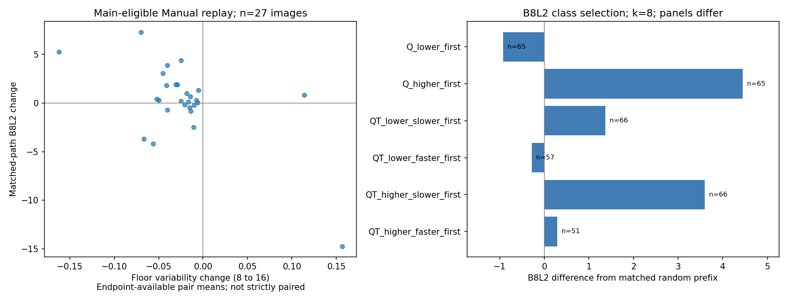

# 数据v1：墙线融合真实人数与组合过程

**当前分析修订：r2，数据仍为v1。** 消费者先读[CURRENT.json](CURRENT.json)，再读其指向的[MANIFEST.json](MANIFEST.json)；原41859前缀、233池208图、14603团队和536同房状态的成员、参考、资格与B8L2/D10主分全部保持一致。本次修复完整辅助测量缓存，并区分含留出的描述与正式主资格比较。

## 本次修正与消费者应读的表

### 缓存字段恢复

旧代码从CSV复用测量时筛选了不完整的字段列表，导致更早Q/T扩请求及后续同房扩请求丢失辅助字段。本次将完整测量字典保存于各池`score_cache.json`，同时绑定实际输入点、源索引、环序状态及参考；重用前核对上下文。缺少完整旧缓存时，只能从有证据的快照恢复或对保存的几何重测，不能通过列筛选静默丢字段。

当前全部15个辅助数值字段及遗漏的失败原因已恢复：**7641个唯一子集、101007个字段单元**。来源为本模块原随机基线和统计线程已冻结的旧消费快照；先逐集合核对成员、参考和核心分项，再补原来为空且来源有实际值的字段。未填0、未覆盖已有非空值。恢复范围比独立审核的单次同房扩展窗口更广；该窗口中2435行`floor_WQ_upper_bound`及其它14字段各2402行均已补齐。

本次无子集批量重评分、无重融合。另实际测量7个已存状态，只用于核验冻结引擎在不同状态下的完整载荷字段；不是新增轨迹或更换评分。B8L2/D10及所有原核心分项数值的最大差均为0。详细证据见[修订核验](REVISION_CHECKS.json)、[逐字段恢复来源](measurement_field_recovery.csv)和[完整缓存字段](MEASUREMENT_CACHE_SCHEMA.json)。

旧根目录表、被改的池内观测表、旧清单及来源表保存为[修订前快照ZIP](history/v1_complete_measurement_cache_main_panel_r2_20261017/pre_revision_tables.zip)。没有复制全套几何。当前几何仍为各池原`states.json.gz`。

### 30图描述、27图主比较与严格配对V

|用途|图片／建筑|B8L2升／降|B8L2平均变化|D10平均变化|V下降／上升|V均值8→16|
|---|---|---|---|---|---|---|
|含原留出描述|30／12|19／11|+0.134215|+0.010316|27／3|0.079633→0.060397|
|正式主资格|27／11|18／9|+0.272973|+0.199946|25／2|0.077499→0.055229|
|同27图、固定两端共同有效V对|27／11|18／9|同上|同上|26／1|0.077499→0.054599|

单位：质量变化为评分点；V是底面1−IoU。图片等权，没有把路径或像素当独立图片。主资格按原`main_comparison_allowed`同时检查同一路径的8、16人端点；排除的3张原留出为e9z-19、yq-25、yq-34，原描述保留，不更改其原资格。

[主资格27图](random_8to16_main_panel.csv)是正式人数比较入口；[含留出30图](random_8to16_descriptive_panel.csv)仅作描述。两端V有效重放对集合在主面板4图发生变化：B6-11、Uw-09、uNb-50、wc2-53。表内有各端数量、具体重放对ID、共同有效对数量，不能称原端点均值为严格相同有效对比较。Uw-09在端点可用对口径下V增加，严格配对口径下V下降，说明这个区别会影响单图解释。

严格配对另见[random_8to16_main_strict_V.csv](random_8to16_main_strict_V.csv)，总体对照见[面板摘要](random_8to16_panel_summary.csv)。严格V只固定比较对，不重新选人员、图片、参考、资格或几何；不强迫稳定性单调。原[random_matched_changes.csv](random_matched_changes.csv)明确标为含留出描述，正式各区间主门结果为[random_matched_changes_main.csv](random_matched_changes_main.csv)。

主结论仍是：当前有限面板多数图片的换组波动降低，但参考质量可升可降。不能把V或质量变化直接命名为图片／人员独立噪声，也不能由满员机械零差异证明总体收敛。


2026-10-17。本包实际扩展独立图片的融合过程，不只是重评分旧18图。数据属于v1；源包名中的v2/v6分别是用途／难度版本。精确输入和工作规则冻结于[input_snapshot.json](input_snapshot.json)，实际完成见[STATUS.json](STATUS.json)和[MANIFEST.json](MANIFEST.json)。全部合资格池已尝试；失败和限制仍分别保留。

采用当前全部至少3名有效独立人员且通过既有来源池／图片门的图×条件池；保持Manual、Semi、OOS来源分开。选择不读取最终质量。整池输入失败与人数不足、既有排除等见[资格台账](pool_eligibility.csv)，不删掉坏成员凑可运行池。

每池4次随机无放回排列、保存完整人员顺序；每个k只用当前人员重建身份、MV50票、全成员中位数与来源连接。gap固定7.5；原理和参数不因当前质量改变。k=1保留单人基线，k=2暂缓排序，不能把它解释为算法失败或人员不收敛。

双人匹配缓存只由这两份当前作答的角距离矩阵和固定gap决定，不含全员成组或人审；每个子集仍重新成组与计票。已存真实子集仅在人员、点坐标和源索引一致时复用。原始／人工辅助全员身份和顺序不传给新子集。几何状态保存于各池`states.json.gz`，具体来源写入`origin`。

## 当前可消费结果

- [逐人数轨迹](trajectory_scores.csv)：成员、来源、层、节点、失败状态、参考分项、B8L2/D10、原答分歧和实际时间覆盖。
- [唯一子集](unique_subsets.csv)：去除同一池内重复成员集合；重复路径不是独立人员。
- [逐人数摘要](by_pool_k.csv)：完整、可连接、可计算、可评价数量及实际分母。
- [相邻步骤](transitions.csv)：旧观察同身份关系变化、既定身份的达票变化、节点变化和面积变化。
- [同k跨顺序](same_k_stability.csv)：4条随机路径的6对比较；同时保存相同集合、共同成员数和可计算标志。
- [每路径终点](path_endpoints.csv)：真正该路径成员集的终点，不接人工修正终点。
- [完成池](completion.csv)：独立图片和池数、复用／新增几何数量；失败文件另列。

原答分歧R为当前人员原答底面的平均两两对称差，另保存相机高度平方单位面积；归一化分母为固定池全员有效原答并集面积。有效／可能人员对数明确保存，k=1没有两两R。大外扩可能放大并集，因此跨图不能只看归一化值。固定有限池均匀抽组的R期望不随k改变，不能把随机曲线起伏解释为人数必然提高／降低原答一致性。

同k稳定性V为实际两个融合底面的1−IoU及对称差，附共同人数。它与R、参考误差均不同；重复成员集合的零差异、全员只有一个集合造成的零波动，都是有限池设计事实。4条路径用于广图初步比较，不宣称足以精确估计每图稳定性分布。

## 参考、用途与时间

B8L2作工作主指标，D10只把方向尺度8°改10°，共用输入／分项／参考／资格。完整分数仅当实测可算才保存；不足4对或缺顶界不补全，缺失不填0。`diagnostic_*`是数值列，不是质量资格。

主流程对声明来源池全部成员形成一个共识；按既定空间归属记录各人的目标，不按GT偷偷删人。参考采用池所声明的当前目标。混合空间或其它目标作答存在时，`same_target=false`，分数只作固定参考诊断。当前所有成员均有适用质量资格且属于声明目标时才写B8L2／D10质量列；`main_comparison_allowed`另保留原留出和普通／门洞用途限制。不能由单人已评分推导整池都同目标。

门洞在资格及几何条件满足时计分；OOS的全部GT参照数值只诊断，禁止质量排名和算法优劣结论。Semi单独解释初始化条件。新增空间、范围及GT错误不在本模块修改。

用时只汇总已审计的来源active seconds，全部成员有真实来源才给总数；缺失不补0，不把任务人员总时间冒充同目标时间。本包不测量团队协作耗时或标注者看到他人标法后的学习。

## 复算和请求接入

```powershell
python -m tools.thesis_main.analysis.wall_consensus_v1_process_20261017 prepare
python -m tools.thesis_main.analysis.wall_consensus_v1_process_20261017 run --jobs 4
python -m tools.thesis_main.analysis.wall_consensus_v1_process_20261017 requests --jobs 4
python -m tools.thesis_main.analysis.wall_consensus_v1_process_20261017 room --jobs 4
python -m tools.thesis_main.analysis.wall_consensus_v1_process_20261017 aggregate
python -m tools.thesis_main.analysis.wall_consensus_v1_summary_20261017
```

已有池的`DONE.json`支持续跑。重建输入前应完成本批，输入／人员或请求改变必须另记修订，不覆盖旧数据release。人员Q/T及同房请求均已接入，实际回执见下文；没有按最终质量挑选成员或顺序。普通图片数、条件池数和庞大状态行数分别报告。


## 本轮实际完成与发现

### 覆盖与失败分母

|口径|实际数量|
|---|---:|
|通过来源门且N≥3的图×条件池|237|
|准备阶段整池缺配对点|3：S9-01、S9-07、pRb-11|
|实际进入重放的池|234|
|运行阶段整池输入失败|1：rPc-22，R01424超出画布；没有删掉该人凑池|
|完成池／独立图片|233池／208图|
|分条件完成|Manual181图，Semi43图，OOS来源9图；图可跨条件重复，不能相加当独立图数|
|Manual内部场景层|普通153、门洞17、OOS诊断9、受限2|
|实际前缀状态／唯一图池成员子集|41,859／23,951|
|本轮新算几何／复用历史子集|23,739／212|
|完整参考数值／允许质量用途数值状态|32,305／26,057；前者含诊断，二者均不是独立人员或图片数|

单独4条随机基线为11,248前缀、10,079唯一子集，另存`random_baseline/`。Q/T和同房轨迹追加复用相同集合几何，不能把所有41,859行当随机抽样结果。

Manual全员端点中的不足4对有3图：普通层Uw-09、门洞7y-06、OOS层7y-17；各为3节点。保留“当前方法／人员池下不完整”状态，不直接改难度，也不宣称GT或人员判断一定错。其它图满4对或几何可算不代表墙线身份全已人工确认。

### 随机增人：稳定性与参考表现的响应不同

以下是保留的含留出描述，不作正式主资格结论：在普通Manual图中，有43图能比较8→16人区间；其中30图有相同路径两端的完整质量和两端稳定性，含3张原留出。正式主比较27图见本页修订节。每图4随机路径，25图四条均可计分、4图三条、1图两条，条件有效分母仍保留。

这30图图片等权的B8L2变化约+0.134、D10约+0.010；19图B8L2改善、11图下降。对应的同k换组底面差均值约0.0796→0.0604，27图降低、3图提高。它支持这批图中减少人员选择波动比持续靠近参考更明显的描述，不支持普遍单调或无限新人员收敛。这里V为4路径的6对比较均值，配对有效数见逐图表，不宣称高精度总体估计。

### Q/T优先进入：已有可用的组合信号

已执行人员线程172图、2,580条路径，覆盖14,603个独立请求团队。原请求173图、2,595路径、14,845团队；rPc-22的15路径／242团队请求因整池输入问题未执行。这不是242次不同几何失败。回执见[TEAM_RESULTS.csv](TEAM_RESULTS.csv)及[TEAM_RESULT_STATUS.json](TEAM_RESULT_STATUS.json)。

固定B8L2的楼外Q分类、k=8，在同样65张可比图片中，Q较高者优先相对Q较低者优先：B8L2平均+4.712、D10+4.318，原答分歧R平均−0.01134；38图B8L2更高、23图更低、4图相同。17栋建筑等权后B8L2差为+1.304；uNb占23/65图，因此不能用图片平均值声称普遍选人收益。

Q×T也有可检验差异，但本轮是**优先进入策略**，并非每个前缀都是纯类型团队。k=8的共同51图中，较高且较快优先相对较高且较慢优先，B8L2约−3.683、D10约−3.532；这不能推断快慢的因果效应。类型支持数不足／为零、补入其它类型的成员数均可从[实际构成](subset_composition.csv)及请求元数据查到。没有为让某组胜出改分类或重选人。

完整输出和可评价机会同时读[组合覆盖](worker_policy_coverage.csv)。[政策对随机](worker_policy_vs_random.csv)和[同图政策直接对照](worker_direct_contrasts.csv)保留实际成员所对应的结果，不拿不同有效图片均值直接相减。D10重新分类形成的团队标记`selection_metric=D10`，与固定B8L2分类后只换评分公式分开。

时间预算证据很稀疏：上述65图Q对照只有4图双方来源时间齐全，不能由几幅图的成本差指定通用省时策略。Q×T当前每图每政策主要是一条请求顺序，没有完成固定构成再换具体成员的独立稳定性实验；随机基线的V不能冒充这个结果。



当前左图使用正式主资格27图的端点可用对均值，非严格配对V；旧30图图件已归档。右图各政策实际可评价面板不同，条形均值仅作入口，政策间比较优先使用同图直接对照表。

### 同房：9对已实际重放

已接入9对、7建筑、18张图，每对共同人员N为4—15，4条相同顺序用于两侧。536个前缀全部有实际状态：447个完整条件测量、72个两人排序暂缓、13个仅底面参考、4个缺连接；434个状态允许质量用途。不可计算、暂缓与参考限制分别保留。

[同房结果manifest](SAME_ROOM_PROCESS_RESULTS.json)链接[逐前缀状态](same_room_trajectory.csv)和[各视角内稳定性](same_room_within_view_stability.csv)。共同人员终点不是原图全员终点；没有跨视角BEV相交，没有用关系传递补新同房事实。后续由同房线程按既有分组和固定可比人数分析迁移，不把本几何交付冒称迁移规律已成立。

## 核验、修正与剩余边界

本次10项定向测试通过，另含完整缓存扩请求保持及主资格／严格V回归；此前8项检查的历史说明仍保留：覆盖缓存匹配与直接融合一致、逆输入顺序一致、k2暂缓、R配对分母、OOS／混合目标质量屏蔽、缺时间及CSV布尔值。另对7y-04、rPc-06、yq-32三个真实全员集合逆输入顺序从头融合，与保存的节点及连接一致，见[fresh_set_checks.json](fresh_set_checks.json)。子集重复结果、B8L2/D10共同掩码、OOS质量禁用和同房同人员同k均有实际输出检查。

本轮曾发现CSV文本`False`被当作留出True，已修正并重汇总。修正只影响用途标志，不改变几何或评分；71份历史明确留出仍保留。详细记录见[用途标志修正](holdout_flag_correction.json)。临时汇总不用于最终结论，当前表均为修正后结果。该更正是数据v1内的分析修订，不是新增数据v2。

本轮完成真实人数与请求组合的几何、数值和可消费交付；仍未认证所有自动墙线身份、形成通用选人最优策略、验证未来新人员，或识别独立的人员／图片噪声分量。新增数据v2尚未开始。全局登记需求、复算范围及后续安全任务见[HANDOFF](HANDOFF.md)。
