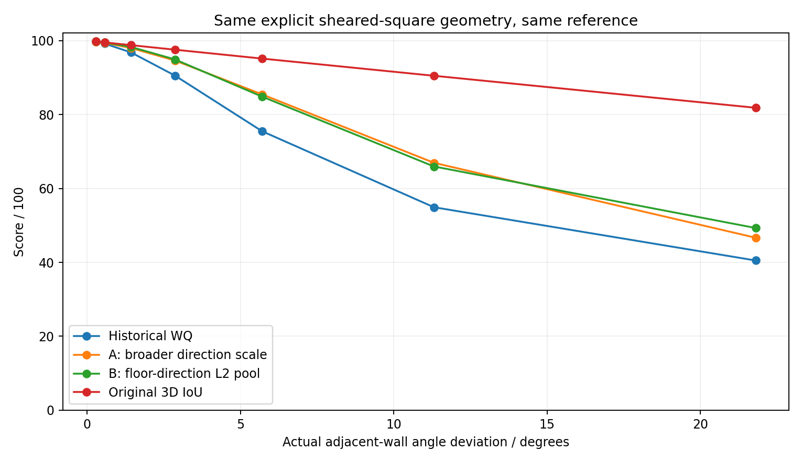
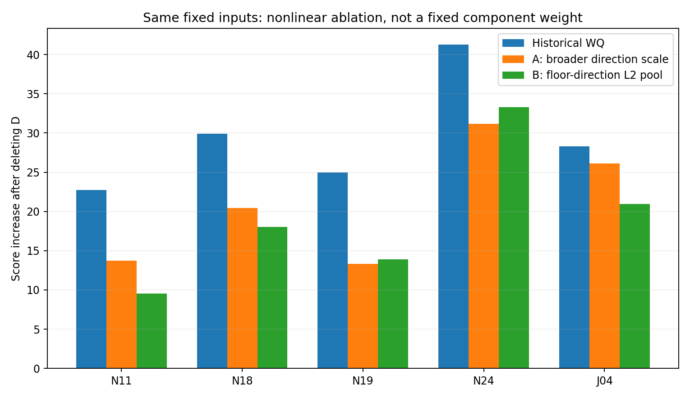

# HOHONET质量评分：A10与B8L2双工作版

## 结论与采用方式

**推荐A10作为主分析工作版，B8L2作为并行敏感性工作版，二者共同进入下一批粗核验。历史WQ-LS08保留对照，不再把“原参数不变＋多写解释”作为本轮终点。** 两版参数均已实际执行普通粗调、冻结选择、门洞局部探针与普通回归；均已计算1145份固定绑定结果。正式默认、原始几何、GT、原有资格、生产人员类别与票权未改变。

A10解决的是：当前方向Hill响应在小至中等残差处过陡，导致某些尚有较好底面和高度表现的作答被大幅压低。B8L2除放缓方向响应外，还将底面一致性和方向规整性从直接相加改为欧氏范数合并，明确减少两个几何后果共存时的累计。

B不是“识别了哪些误差真正同源”的因果去重器。它也会折减独立但同时出现的误差，这是必须接受并继续检查的代价。因此A适合作为较易解释的主分析，B用于检验结论是否依赖强叠加，并作为有竞争力的替代工作分。并列版本按全体统一运行，不能逐例挑A/B较高值。

## 1. 数据和版本

当前读取main为`e3dcf9d11daf9390d6acc09974101f7b6b88a3dd`，对应2026-10-15现有数据收尾交接。最新main明确要求两条路线继续调参，并未冻结Q-Profile五档为主方法。当前全量联合CSV来自前轮真实补包，不是截断文本恢复。

实际完整数值为1145份，每个record_id唯一：931普通manual条件记录、115门洞条件记录、10门洞目标暂缓、28新增两图范围诊断、3台阶参考暂缓、39semi次层、9严重例外、10历史旁证。931普通层仍区分574冻结参考、262唯一现存参考条件绑定、95既有路由；这些不是931份新人工确认。原字段原样保留。

当前两图38对象包含36份作答，34份几何可用、2份配对不可用。本轮重新计算68个双底面配对，原有28份WQ最大绝对差2.84×10⁻¹⁴。其余6份可用几何仍受原manual/semi与排除限制约束。

实际执行72个显式几何控制，其中24个为剪切×独立平移组合控制；不计作新增真人样本。全部1145行原WQ最大误差4.26×10⁻¹⁴。完成31项测试、41个结果文件的清洁重跑。`provenance/CLEAN_REPLAY_COMPARISON.json`保存最终文件一致性。

本环境仍未获得公开原图与完整LFS字节，未重跑全库当前loader，也未新增RGB视觉裁决。这不影响两版基于已核实分项的全1145连续评分，但限制新增参考角度/可见性测量和两图顶界的最终裁决。原图未重新打包。

## 2. 测量目标、单位和公式

工作分衡量的是“对固定参考的底面/高度符合程度，加上当前Manhattan表示下的自身方向规整性偏好”。它不是纯GT距离、物理结构正确概率或所有必要墙体完整性的保证。特别是D不是参考相对的真实相邻墙角。

令

\[
O=I^{-1}-1,\quad b=S_b^2/32,\quad F=O+b,
\]
\[
d_c(D)=\frac{1.5D^2}{D^2+c^2},\quad
G=(H_m/0.8)^2,\quad L=(H_c/0.25)^2.
\]

I为底面面积IoU；Sb为声明底边的双向球面平均最近弧距离，单位度；D为底面边长加权、自由共同正交轴下的RMS残差，单位度；Hm和Hc分别是参考相对周长均高误差与去均高后的最近底边高度RMS。底边最近关系不是语义墙面对应。

**历史WQ：**
\[
Q_W=100/(1+F+d_{\sqrt{37.5}}+G+L).
\]

**A10：**
\[
\boxed{Q_A=100/(1+F+d_{10}+G+L).}
\]

A只将方向响应尺度从√37.5≈6.124°调到10°。1.5上限、Sb²/32以及高度0.8/0.25均保留。10°是方向损失达到其上限一半的尺度，**不是10°以下都可接受**，也不是观测到的点击噪声标准差。

**B8L2：**
\[
\boxed{Q_B=100/(1+\sqrt{F^2+d_8^2}+G+L).}
\]

B的方向尺度为8°，合并阶数为2。它把整个`O+Sb²/32`作为一组，再与方向合并，而不是把O、Sb、D分别取最大值或三个项全部压平。这样，D=0时仍严格保留原有的IoU与边界处罚，不天然奖励方向规整但遗漏细节的作答。

程序使用以下连续、I=0稳定的等价实现：
\[
Q_B=\frac{100I}{I+\operatorname{hypot}(1-I+Ib,\,Id_8)+I(G+L)},\quad Q_B(0)=0.
\]

没有自由平移、旋转、缩放来提高参考匹配；没有新顶部补值。计算上缺任何一个所需分项，完整Q都不产生。底面上界采用单独接口，不能冒充完整评分。

## 3. 同源累计究竟怎样处理

在A中，方向仍是加性补充，只是小误差响应更缓。近零D时，方向损失系数由0.04D²变为0.015D²；系数减少62.5%不是总分固定少扣62.5%。大D仍趋近相同的1.5损失上限。

B中，固定F时方向新增的损失为
\[
\Delta K_D=\sqrt{F^2+d^2}-F
=\frac{d^2}{\sqrt{F^2+d^2}+F}.
\]

F为0时保留方向的孤立响应；F与d相等时，合并损失由2F变为√2F，减少29.29%；F远大于d时，额外项约为d²/(2F)。因此它不是统一方向权重，也不是硬max：当F,d均大于0时，二者变差仍会继续降分。

两版满足0≤Q≤100I≤100，对每个冻结误差分项单调不增；I趋近0、Sb或高度趋向严重端时Q趋近0。A/B都不低于旧WQ是公式性质，不能据均分上升推断准确率提高。A/B之间有双向差异，不是逐条谁都更高。

**这项折减的代价不能隐藏。** 同一剪切改变I、Sb和D，是明确同源控制；但独立平移再叠加剪切时，B也会减少方向相对于底面误差的边际负担。因此我们没有识别真实重复比例，也没有用相关回归把D残差化。`factorial_pooling_cost.png`展示了这一独立共存误差的折减。它是评价效用的取舍，不是统计独立性检验的结论。

在固定拓扑、非退化边的小扰动下，F通常为O(|δ|)，d为O(δ²)。A保留O(δ²)方向项；B的额外方向约为O(|δ|³)。这精确说明它为何更容忍“底面已较接近且方向残差很小”的情况，也说明它可能低估微小独立方向误差。到结构强错误或高度强错误时，仍由对应分项继续响应。

## 4. 实际调参及为何选这两个数

普通阶段比较28个配置。A扫描c=6.124/8/10/12°与Sb分母32/48/64；B扫描相同c与p=1.25/1.5/2/3，保留F为整体。高度不随本轮方向疑问再做大范围优化。

下表的反序来自30份已曝光开发意见；313对是不同档的配对，117对的类别至少相隔两档，二者均相互依赖，不是独立准确率。

| 路线   |   方向尺度c |   合并p |   313对反序 |   117对跨至少两档反序 |   严格范围268对反序 |   5.71°剪切分 |   11.31°剪切分 | 选定   |
|:-------|------------:|--------:|------------:|----------------------:|--------------------:|--------------:|---------------:|:-------|
| A      |        6.12 |    1.00 |          33 |                     2 |                  25 |         75.45 |          54.91 | False  |
| A      |        8.00 |    1.00 |          31 |                     1 |                  25 |         81.50 |          61.33 | False  |
| B      |        8.00 |    1.50 |          33 |                     1 |                  26 |         83.95 |          64.79 | False  |
| B      |        8.00 |    2.00 |          35 |                     2 |                  27 |         84.82 |          65.94 | True   |
| B      |        8.00 |    3.00 |          36 |                     2 |                  28 |         85.35 |          66.55 | False  |
| A      |       10.00 |    1.00 |          33 |                     0 |                  28 |         85.42 |          66.93 | True   |
| A      |       12.00 |    1.00 |          36 |                     1 |                  30 |         87.88 |          71.26 | False  |

A10相较c8进一步缓和N11/N18/N19及小剪切；相较c12保留较强的中大方向区分。A10在30份开发定性序中没有跨至少两档的反序，是支持证据，而不是唯一最优证明。Sb分母仍32：放松边界会同时抬高D近零的遗漏或定位问题，本轮没有足够证据承担这个代价。

B8L2以c8保留比A10更强的孤立方向响应，再用p2专门缓和共同出现的几何负担。p1.5合并较轻，p3更接近max、更压低次要误差，p2具有简洁闭式解释。这是基于响应控制与定性表现的工作选择，不是从30份人评精确估计出的真实误差分布或唯一最优参数。

普通参数先保存到`ORDINARY_FROZEN_WORKING.json`，随后门洞阶段对A的c=9/10/11、B的c=7/8/9及p=1.5/2/2.5做12个局部探针，并逐一计算普通回归变化。弱门洞资料未产生足以支持场景专属修改的系统性证据，最终保留各自普通参数。没有“门洞分越低越好”的目标，没有OOS调参。先后执行不是从未看过门洞的盲法隔离。

## 5. 几何控制：改善与仍然失败的地方

| 控制                    |   底面IoU |    D |    WQ |   A10 |   B8L2 |   现用IoU |
|:------------------------|----------:|-----:|------:|------:|-------:|----------:|
| shear_0.05              |      0.98 | 1.43 | 90.53 | 94.61 |  94.90 |     97.53 |
| nonorthogonal_self_0.05 |      1.00 | 1.43 | 92.79 | 97.08 |  95.55 |    100.00 |
| shear_0.1               |      0.95 | 2.86 | 75.45 | 85.42 |  84.82 |     95.12 |
| shear_0.2               |      0.90 | 5.65 | 54.91 | 66.93 |  65.94 |     90.48 |
| rhombus_1               |      0.01 | 0.50 |  0.91 |  0.91 |   0.91 |      1.30 |
| branch_omission_0.1     |      0.99 | 0.00 | 98.58 | 98.58 |  98.58 |     98.77 |

5.71°真实相邻墙角偏差的剪切，底面IoU95.12%，旧WQ75.45、A85.42、B84.82。11.31°偏差则仍只有A66.93、B65.94，并未取消方向作用。另一端1°急角的退化菱形，三者都低于1分；D本身却减小，说明对这条控制而言总分下降不能归功于D已正确测量墙族关系。

若用几个明确但非等价的工程参考点解释偏好：I=0.8且其余理想时三者80；局部高度RMS0.1时86.21；整体高度偏差0.1时98.46；孤立D=5°时A76.92、B70.36。它们大体体现结构规整性、范围、局部高度、整体高度的关注顺序，但这些量级并未被认证为相同心理严重度，不能作为任意幅度的硬排序。D更不能因此改名为真实参考墙角。

两版保留以下失败/限制：

- **合法非正交参考自比不满分。** A缓解、B有时缓解，但仍有方向先验损失；若任务要纯参考距离，不能把这两版当成那个量。该边界诊断不通过修改GT或资格规避。
- **遗漏正交窄分支仍可能98分以上。** D=0时A/B与旧WQ完全相同；它们没有额外奖励遗漏，但也没有解决必要结构计数问题。N13/N29同理。
- **方向族塌缩、凹凸角以及不同点数覆盖不能由D解决。** 合法凹L自比及严格共线插点通过不变性控制；真正的墙族/邻接错误仍需对应诊断，不能把未匹配角点直接变成完整Q=0。
- **高度严重端未被封顶。** 四倍整体房高、其他理想时三者均6.64，现用均高棱柱IoU25。没有上轮算术A/RA的九十多分问题。
- **现用IoU对冗余点敏感。** 同一声明墙带插入低侧共线点，WQ/A/B保持90.36，角点均高IoU可由100降到90.38。这是该均高实现的表示敏感性，不是所有实体体积IoU的性质。

## 6. 真实作答：额外方向信息现在值多少扣分

| 案例   |    WQ |   A10 |   B8L2 |   现用3D IoU |   WQ删除D增分 |   A删除D增分 |   B删除D增分 |
|:-------|------:|------:|-------:|-------------:|--------------:|-------------:|-------------:|
| D02    | 96.02 | 97.35 |  97.74 |        97.72 |          2.15 |         0.83 |         0.43 |
| N09    | 93.16 | 93.97 |  94.41 |        92.63 |          1.31 |         0.50 |         0.06 |
| N10    | 92.41 | 93.67 |  94.31 |        95.14 |          2.03 |         0.78 |         0.14 |
| N11    | 49.38 | 58.38 |  62.61 |        84.34 |         22.75 |        13.75 |         9.52 |
| N13    | 71.05 | 71.26 |  71.39 |        75.54 |          0.35 |         0.13 |         0.00 |
| N14    | 91.50 | 92.02 |  92.31 |        89.19 |          0.83 |         0.31 |         0.02 |
| N18    | 47.25 | 56.71 |  59.12 |        80.58 |         29.92 |        20.46 |        18.05 |
| N19    | 66.02 | 77.66 |  77.06 |        92.50 |         24.96 |        13.31 |        13.92 |
| N24    | 48.11 | 58.19 |  56.07 |        85.97 |         41.25 |        31.17 |        33.30 |
| N27    | 42.62 | 49.64 |  50.37 |        86.16 |         39.00 |        31.98 |        31.24 |
| N29    | 57.32 | 57.36 |  57.38 |        76.67 |          0.07 |         0.02 |         0.00 |
| J04    | 33.53 | 35.67 |  40.83 |        67.80 |         28.28 |        26.15 |        20.98 |
| P01_A  | 56.09 | 56.89 |  57.38 |        61.18 |          1.30 |         0.50 |         0.01 |
| P01_B  | 39.53 | 45.70 |  49.19 |        70.46 |         29.81 |        23.64 |        20.15 |

“删除D增分”定义为固定同一原始I/Sb/Hm/Hc，仅把D设置为0后的分数差。不是将几何真的修好后的预测值，不是固定方向百分比，也不能与其他删除增分直接相加。

N18的方向实际负担由29.92降为A20.46/B18.05；N19由24.96降为13.31/13.92；N11由22.75降为13.75/9.52。方向并未删除，特别是高D的N24/N27仍有30分以上的实际方向负担。N18的新增细节是否视觉正确未在本轮新增裁决，升分不能当成确认其细节正确。

J04中A只由33.53到35.67，B到40.83，B更明显地缓解一个局部投影后果同时进入范围/方向的负担。但仍不能说局部错误“已经被正确折算”，也不把定性“其余多数有价值”强译为60或80分。

N13对N27的有用区分保留：A71.26>49.64，B71.39>50.37。N29几乎不动，说明这一轮没有通过整体加分来冒充遗漏修复。N18与N24的相对位置也揭示两条路线不同：A仍偏好N24，B偏好N18；开发粗档更支持后者，但不能把这一对当调参必须通过的门。

D02的约3.98分缺口并非全部方向。旧WQ的Shapley分摊为范围1.63、底边0.09、方向2.19、整体高度0.005、局部高度0.059；实际删除D为2.15。A97.35、B97.74，没有强制满分。N10约7.59分缺口中实际删除D只增2.03；N14约8.50分缺口中只增0.83。相近参考仍有范围/定位差异，不能把所有四至八分缺口都归给方向。

另外检索到109对同图同参考的近似匹配上下文：I差≤0.02、Sb差≤0.5°、Hm差≤0.03、Hc差≤0.02，D差至少2°。这些门只是诊断匹配，不是人类容忍标准。绝对分差中位数由WQ17.28降为A10.67/B11.26；A仍在109/109对偏好较小D，B为108/109。它表明可以显著减轻幅度而保留大部分方向区分；**并不证明较小D总是正确，也不是条件因果识别**。全部配对保留供核验。

## 7. 同资格整体比较及负结果

931普通manual条件记录均分：WQ60.79、A65.70、B67.88、现用IoU78.87。门洞115条件记录分别28.90、31.77、35.41、56.93。九份严重例外均分15.96、16.60、19.23、40.97；B严重端范围9.00–25.86，仍需下一批检查其区分，不将某个未经校准的“严重分界”强加上去。

同图/同参考/不同人员的6565个非双方平局配对中，A相对旧WQ有319个反序，B有409个，IoU有1369个；两边分差都至少5分的反序，分别为0、1、225。这些是排序敏感性，不是错误率，5分不是已认证的最小重要差异。

B的唯一一个两边均超过5分的反序是B6-11的R01496/R01536。前者I=.731、D=.69、较大高度偏差，后者I=.795、D=3.61且其他分项更好。旧WQ65.79>59.98，B66.61<72.32。缺少该对完整人工判断，不能称新旧谁错，已列为正反兼容的核验对象。

可选有序读数的留一图开发复核：WQ18/30同档、29/30相邻一档内；A14/30同档、29/30相邻内；B16/30同档、28/30相邻内。留建筑同档WQ16、A15、B15，A/B相邻内均28。**A/B并未在所有统计指标领先。** 本轮不因四次精确命中之差否定响应层面的合理修改，也不称这是独立泛化；所有44份仍是已曝光/压力选样开发证据。旧五档切点不能照搬到新分数。

## 8. 下游：固定结果换指标与改变政策分开

### 人员

同一931普通条件集合，先在人员×图片×参考×条件单元聚合，再减去该单元参与者均值；至少5单元才输出，24人共享全体覆盖只有4个单元。相对WQ，A人员排名相关0.9991、B0.9974，最大名次移动均1，探索性相对三组换组均0；IoU相关0.7713、最大移动13、6人换组。

这些相对三组用于延续已有敏感性描述，不是人类五档、人员正式多轴类别或等额分人政策。没有重新训练项目正式多轴分类器，未修改生产资格/权重。均值中心化不能消除所有任务组成和同伴水平差异。

整体排名近似不代表选人集合相同。对65个目标单元，排除目标整栋建筑后再估计候选人员排序，k=1/3/5时A有2/3/4组与WQ选人不同，B有3/10/6组不同。所有目标仍限于有历史观测的人员；表中是所选个人的均分，不是未来预测或新融合效果。

### 既有图片难度

按最新固定难度目标连接，1050条参考ID一致、95条不同；不同者不混入同目标关系。普通三类分析为836份、95张图。按图片等权均分：

|难度|图片/作答|WQ|A10|B8L2|现用IoU|
|---|---:|---:|---:|---:|---:|
|简单|71/671|65.33|70.18|72.17|80.15|
|中等|10/80|52.57|57.62|60.37|75.85|
|困难|14/85|52.36|57.99|60.55|76.67|

“简单高于另两层”保留；中等与困难没有稳定严格顺序，新两版的均值顺序略反转但差很小。没有修改困难标签、重选参考或以显著性挑模型。这只描述当前人员构成下的条件质量关系；同参考ID不等于本轮重新验证了难度目标几何完全一致。

### 融合

220个冻结终点中144完整；联接成员、留出和当前目标限制后89个可用于保守数值比较，其中12对自动/辅助具有同图同参考。辅助减自动均值：WQ+0.021、A+0.033、B+0.021、IoU−0.014分。量级很小，不支持宣称某个融合策略胜出。

本轮已经区分三个层次：固定终点重评分已执行；目标建筑外选人的历史诊断已执行；改变选人/票权后重新运行融合算法没有执行。不得从前两者推断第三者结果。

## 9. 新增两图及后续人审

全部36份旧身份及限制闭合：28份原manual存档与当前数组尾差已经由独立审查核实；4semi、2已排除但几何可用manual、2不可配对manual保留原资格。本轮对34份当前几何计算两套底面，共68配对。

N05原/新底面IoU43.19%/52.19%；N28为41.85%/37.56%。新完整分数始终NA，只给非负高度损失下的上界。没有因哪个模型分数更高更换空间，也没有复制旧顶界。全部逐作答新旧数值和不确定几何模式在`TWO_IMAGE_CHANGELOG_36.csv`。

原图字节未能在本环境取得，因此本轮没有完成新增合法空间的RGB裁决或接受任何新顶界。可看页面`review/TWO_IMAGE_REVIEW.html`包含34份当前几何、2份不可用说明，加载本地原图文件夹后即可显示；新顶界始终空白。最必要的新顶界证据是B6新角x≈805.91及至x≈836.91原凹角间新闭合段，Uw近端跨接缝x≈68.69/973.40两端及闭合语义。八个新底点经度已用原生投影反算并做往返测试。

原本地Codex20份普通核验页可原样复用：公式变化不会改变它展示的固定作答/参考。20份预测已冻结到独立PRIVATE模型key；未参与本轮调参，历史未曝光没有认证。当前包没有20张新RGB卡payload，故不宣称重新生成；提供受限的既有页面JSON重用器和真实loader复算入口。另保留十份开发挑战绑定，涵盖降幅、结构遗漏、强D与反序，不只选支持新方案的例子。

本轮实际可交付采用规则：**主报告统一使用A10，B8L2与旧WQ/原IoU并列做敏感性；下一批先隐藏分数、看图给粗档或指出超容忍部位，再展开相同对象的模型差异。** 如研究结论因模型不同而变化，原样报告，不按论文有利程度选择版本。

## 10. 文献与迁移边界

Cheng Sun, Min Sun, Hwann-Tzong Chen (2021). *HoHoNet: 360 Indoor Holistic Understanding With Latent Horizontal Features*. Proceedings of the IEEE/CVF Conference on Computer Vision and Pattern Recognition (CVPR), 2573–2582. [官方题录](https://openaccess.thecvf.com/content/CVPR2021/html/Sun_HoHoNet_360_Indoor_Holistic_Understanding_With_Latent_Horizontal_Features_CVPR_2021_paper.html)；[公开PDF](https://arxiv.org/pdf/2011.11498)。本项目的WQ系数不是该论文原有的人类质量标尺，不将研究候选归功于原论文。

Bowen Cheng, Ross Girshick, Piotr Dollár, Alexander C. Berg, Alexander Kirillov (2021). *Boundary IoU: Improving Object-Centric Image Segmentation Evaluation*. CVPR, 15334–15342. [官方题录](https://openaccess.thecvf.com/content/CVPR2021/html/Cheng_Boundary_IoU_Improving_Object-Centric_Image_Segmentation_Evaluation_CVPR_2021_paper.html)；[公开PDF](https://arxiv.org/pdf/2103.16562)。官方摘要支持区域与边界敏感性不同；不证明当前I/Sb/D完全独立，也不认证本轮欧氏合并或参数。未把二维像素阈值迁入角度/BEV。

OECD/European Union/EC-JRC (2008). *Handbook on Constructing Composite Indicators: Methodology and User Guide*. OECD Publishing, Paris. DOI:10.1787/9789264043466-en。[官方页面及PDF入口](https://www.oecd.org/en/publications/handbook-on-constructing-composite-indicators-methodology-and-user-guide_9789264043466-en.html)。这是组合指标设计背景，不是全景标注的领域标准；本轮范数、消融和单调性关系由上文代数独立推导。

本轮外部检索核对官方题录/可返回摘要；未声称完整重新阅读所有PDF。原始实现定义主要依据包内冻结代码与本轮独立数值复算。最重要的新证据是同输入控制、真实逐例与完整下游连接，不是借文献权威替代参数验证。
