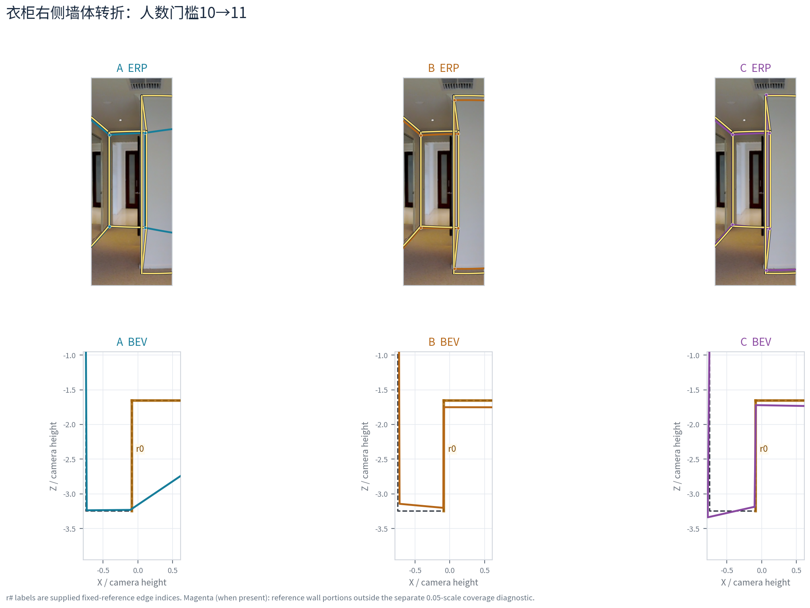

# 质量评价解释与参考适用边界收尾（2026-10-22）

## 采用结论

**当前证据足以采用“整体工作分＋分项与局部几何解释”的结果组织方式。** B8L2 保留主工作指数身份，D10 为同输入、同参考、同资格下将方向尺度 8°改为10°的敏感性；它不会改变几何。S09 近分异形、局部凹口恢复和多余凹槽移除的[论文结果](PAPER_RESULTS.md)继续采用。本轮接入 PR #23 合并后的三条换类路径与一个失败端点，把“哪个分项变化、为什么总分如此”解释清楚，不把类别号或角点数当作质量真值。

基线为 main `8bfd3e476bd5ae6edc1424e2c8ea07dd2f69a235`。逐份真人 v2 仍为10,439份；非OOS研究起点9,217份／233图，门洞603份／17图单列。正式质量7,302份中，普通Manual5,719、普通Semi901、门洞Manual571、其它条件111份；这些不是全库10,439份都适合质量推断。下列新换类案例全为普通Manual，不能据它们推广Semi或门洞的类别效应。

## 总分和分项各自的解释

对 `iou_2d=I>0`，冻结 B8L2 等价写作：

```text
F = (1/I - 1) + Sb²/32
D = 1.5*d²/(d² + 8²)
H = (Hm/0.8)² + (Hc/0.25)²
Q = 100/(1 + sqrt(F² + D²) + H)
```

这里 `dir=d` 是**作答自身**最佳正交轴下的边长加权RMS残差，不是与GT逐墙夹角的距离。底面IoU与底边球面距离连接固定参考；`Hmean` 是沿墙长均高的相对偏移，`Hcenter` 是去均值后的近邻边界高度轮廓残差。全局与局部高度分别响应统一高低和局部不平；底面差异很大时，后者不能被解释成完全纯净的高度误差。五个原测量及公式身份见[既有结果表](PAPER_RESULTS.md#冻结分项在这里回答什么)。

- **遗漏与外扩**分别是参考未被覆盖面积／参考面积、候选超出面积／参考面积；`I=(1-omission)/(1+extension)`。两者帮助解释区域IoU下降的方向，不是额外两项扣分。面积差也可能来自底点定位，而非人员选择了不同空间。
- **结构支持、节点数、参考角／边召回**是局部解释；它们没有作为新项加入Q。足票说明输出如何形成，不说明它必然准确；同点数也不说明同墙角或同位置。
- **3D展示与IoU3D100**并列参考。前者显示由上下点射线推导的几何，后者沿用冻结引擎的**角点均高棱柱代理**，不能叫真实连续实体体积IoU；它的角点均高也不等同质量项中的沿墙长均高。
- **总分边际响应依赖其它项。** S09两队共有较大的方向损失，底面差异在总分上被压缩；`yqst-24` 则因方向不同而在近似3D代理下拉开分数。这是已验证的测量/组合性质，尚不足以推导新总分或新权重。

## 最新同参考换类案例：分项与几何对齐

以下均为目标建筑外类别、同背景、固定人数n及实际换人数m的已有端点；A为基线，B同构成换人，C改构成换类。只读取已存几何和分数，不重跑融合。[14个精确端点与全部五分项](LATEST_CASE_COMPONENTS.csv)保存原团队键、来源、参考版本、可评分状态及公式损失；其中13个可评分，另1个失败明确留空。

| 图与团队 | 节点数 | B8L2／D10 | 底面IoU | 底边角距／自身方向° | 遗漏／外扩 | 解释 |
| --- | ---: | --- | ---: | --- | --- | --- |
| wc2-56 n20/m6 A→B→C | 4→4→4 | 88.28/91.39→94.09/95.68→98.60/98.80 | .961→.977→.990 | .406/2.403→.185/1.591→.074/.643 | .019/.021→.007/.016→.003/.008 | 同点数也可提高定位与规整性；三队四角全部20票，提升不靠新增角点 |
| zs-16 n20/m6 A→B | 5→6 | 45.66/48.55→91.96/92.51 | .771→.940 | 1.745/13.767→.510/1.358 | .003/.293→.018/.044 | 必要转折被保留，外扩和歪斜明显减轻；遗漏单项反而上升，仍整体改善 |
| zs-16 n20/m6 B→C | 6→6 | 91.96/92.51→82.86/87.07 | .940→.945 | .510/1.358→.441/3.059 | .018/.044→.003/.055 | C区域IoU略好、底边更近，方向残差较大，故总分更低；不是高度主导 |
| zs-16 n21/m6 B→C | 5→6 | 45.84/48.80→81.54/86.18 | .774→.949 | 1.571/13.699→.385/3.258 | .015/.272→.004/.049 | 与n20反向，差别主要来自B丢角并外扩；完整对应/门槛解释由融合专题提供 |
| B6-47 n20/m4 C | 8 | 不可评分 | 缺失 | 缺失 | 缺失 | 既有环序产生自交底面；多节点不能证明更准确，失败进入分母 |

完整图号分别为 `wc2JMjhGNzB-56`、`zsNo4HB9uLZ-16`、`B6ByNegPMKs-47`；均固定当前 `gt_original`。wc2 A/B/C 的五分项、zs两个n和B6失败详见[原机制表与图](../../workers/personnel_effective_exchange_conditions_20261022/mechanisms/positive_cases/REPORT_ZH.md)、[失败有效性记录](../../workers/personnel_effective_exchange_conditions_20261022/mechanisms/b6_47_failure/ENDPOINT_VALIDITY_DIAGNOSTIC.csv)。这些是同一研究结果中的机制例，不能把三队或相邻n当独立图片累计。




zs-16的B→C中，底面块F为 **.0718→.0643**，方向块D为 **.0420→.1913**，高度损失H为 **.0042→.0050**；把较小的F改善与较大的D增加合成后，Q下降9.10分。固定其余测量、仅将方向输入置零，两队为 **92.93／93.53**；这只是归因控制，不能当改过几何或采用删D方案。D10将分差缩为5.44分而几何没有变化。wc2则三项底面、底边、方向共同变好，C虽没有新增角点也得到更高分。两例说明评分能反映大幅失准，也允许不同分项权衡；不能只用点数或单项面积判断分数是否合理。

**Semi保留独立反例。** 既有 `Z6MFQCViBuw-10` 的8→9→10→11人输出为5→4→5→4节点，Q79.91→91.78→79.62→89.14。最后11人虽恢复4点，严格底面角点召回只有.50，3D代理89.12低于9人的93.02；自身方向更规整也不等于局部定位同步恢复。它只说明这一Semi路径的质量解释，不能与上述Manual结果混合估计，亦不能从终稿或分数推断人员主动纠正初始化。[原分项与团队键](CASE_ROWS.csv)

## 参考适用性与计算、资格的区别

本轮Q评价的是审计包中的当前处理后点对、共享x与既定环序；原始导出、收到的用户处理坐标和最终点位由该包分别留存，不能由处理后Q推断原始标注没有错。处理可能改变可见几何，但不能以此消除原始输入诊断或人员处置记录。新批缺原始导出时仍明确缺失。

从当前逐份证据回读得到：

| 范围与计算层 | 完整诊断 | 仅底面诊断 | 不可计算 | 正式完整质量 |
| --- | ---: | ---: | ---: | ---: |
| 全库存10,439份 | 9,363 | 941 | 135 | 7,302 |
| 非OOS 9,217份 | 8,175 | 938 | 104 | 7,302 |

全库存完整诊断中 **2,061份没有正式质量资格**；非OOS中相应为873份。941份仅底面对象中有13份拥有完整参考，说明“仅底面”也可能是作答完整测量条件不足，不能一律归因为GT缺顶部。正式分数、诊断分数和可评分几何状态分别读取，不因底面IoU可算、已有参考或高诊断分就恢复资格。详细计数在[参考与资格回读](REFERENCE_COUNTS.json)。

| 情况 | 当前可采用解释 | 不应怎样解释 |
| --- | --- | --- |
| 可评分且用途合格 | 固定目标/版本下比较B8L2、D10及各分项；普通/门洞与Manual/Semi分别汇总 | 不同参考/用途直接合并成个人错误率 |
| 完整数值可算但资格暂停 | 作为明确标注为诊断的几何解释；原因沿对象保存 | 把诊断B8L2冒称正式分数，或重新准入投票 |
| 仅底面 | 当前底面区域/边界及参考范围的条件诊断 | 补造顶界、三维或完整Q，或将完整Q缺失记为0 |
| 无效底面/不可计算 | 保留失败原因与实际分母；已有新换类B6-47 C为实例 | 删掉失败使成功均值改善，或用0代替不可评分 |
| 图片GT问题 | 仍研究人员怎样表达；评分遵守明确暂停或沿用参考裁定 | 将图级限制归到个人头上 |
| 个人排除/历史未接纳 | 按各自处置与证据保留审核负担；可算诊断仍不恢复正式用途 | 将所有排除等同严重错误，或所有低分等同排除 |

非OOS中的清理状态为 retained 9,009、人工排除89、历史未接纳108、待定11；89+108=197是现有处置组成，与GT暂停或“严重错误”不是同一分母。例 `d709cefe9dcba87b`（B6-11）有完整诊断64.87但正式Q为空且个人排除；例 `70e8f5079c7b09c6af6d`（B6-37）仅有底面IoU .8144、缺完整参考，不能生成完整Q。两者处置原因不同。

**三项既有人工裁定分开采用，不再请求重判：**

1. **M01·pRb-12**：`pRbA3pwrgk9-12` 的GT把木质装饰当作天花板，故正式质量暂停。另有“GT没标该墙角、蓝色是另一种标法”的观察，不是这次排除的原因。35份作答全部有完整诊断，正式Q全部为空、质量不可用，且个人错误归因标志为否；数值实现与裁定相容。旧上下文字段 `gt_detail_omission=true` 只表示另有细节省略背景，不能作为暂停原因或“GT坏所以任何多点答案都正确”的依据。[已确认原说明](../../workers/personnel_marking_patterns_20261020/README.md)
2. **G046**：三视角A↔A、B↔B的同角两个转折与“两个转折应标”已确认；它不是M01·pRb-12。现有参考已表达，保留其局部必要结构及身份确认；附近原答命中20次与最大单一身份组14票仍不同，不把它们合成已确认20票。[已有确认及局部记录](../../same_room/same_room_multiview_20261020/local_features_20261021/README.md)
3. **G015壁炉**：用户已确认理论上应表达凸体，继续用当前简化GT评价。可见结构表达与固定参考一致性可分别描述；不隐式补GT、不改分、不外推为所有细节多的人更正确。[已有采用记录](../../same_room/same_room_independent_followup_20261021/README.md)

本次没有发现需要改动底层资格或评分实现的冲突；发现的是解释时容易误用的上下文字段和不同分母，以上已明确。

## 论文可用的新增结果说明

> 在同背景、同人数和固定参考的实际换类结果中，质量改善既可来自必要转折的保留，也可在角点数完全相同时来自定位与自身规整性提高。wc2-56三支20人团队均表达四角，B8L2仍由88.28升至94.09和98.60；zs-16的两支六角团队则显示分项权衡：候选C的底面IoU略高于B，但自身方向残差由1.36°增至3.06°，总分由91.96降至82.86。结合既有S09近分异形，整体质量分不应作为局部结构等价判据；区域误差、底边位置、自身方向、高度和结构支持需分别解释。正式评价同时遵守参考与用途资格，完整诊断可计算、仅底面可计算和正式质量可用是不同状态。

这段和[PAPER_RESULTS](PAPER_RESULTS.md)可共同用于论文结果。采用的是多例一致的测量解释，不重新估计人员类别效应；类别总体方向与失败分母仍以人员专题为准，门槛/对应机制以融合专题为准。

## 核验、复现与交付边界

运行 `python -B -X utf8 -m research.quality.v2_profile_combo_quality_20261021.closeout_20261022`，只回读10,439行资格与选定14个保存端点，检查其中13组B8L2/D10与冻结公式一致、1个无效底面保留空值、同案例参考一致；输出以上CSV/JSON。损失块和方向归零只用于解释，不改冻结分数或真实几何。CSV空值是未提供/不可算，不是0；计数JSON为交叉状态的记录数，不是新eligibility合同。

Downloads的三份后期质量ZIP（结构研究、恢复最终版、三路线）已只读核对文件清单与核心报告：RCS、EBC2等仍是研究候选，旧891份覆盖及原始测试不能改称当前v2验收。已有[三模型采用记录](../quality_three_model_review_20261017/RECORD.md)和[三路线独立审查](../quality_three_routes_feedback_20261016/README.md)保留了其用途；本轮吸收的是“自身规整性与参考结构不同”“改分不等于改进”两点解释，不采用新总分。

本轮只新增质量主题结果、来源小表和可执行回读；旧PAPER_RESULTS/README加接续。使用的最新原图、保存几何和人员/质量资料都已在main普通文件中，无须重复拷贝Downloads ZIP；本次未删除或宣称完成全部ZIP核验。全局索引交统筹：在现有 `MAT-v2_profile_combo_quality_20261021` 下增加本页、LATEST_CASE_COMPONENTS.csv、REFERENCE_COUNTS.json及脚本的引用，不新增评分身份或数据包版本。

**剩余实质问题：** 局部必要性相对总分的权衡仍未有普适人评标尺；现有证据足以支持局部诊断并列，不足以决定新的权重。若未来论文要量化未确认墙角的客观真值，需要具体图的局部语义裁定；M01、G046、G015既有裁定不重问。当前收尾不依赖新增大规模参数搜索、全库融合或N1接入。
