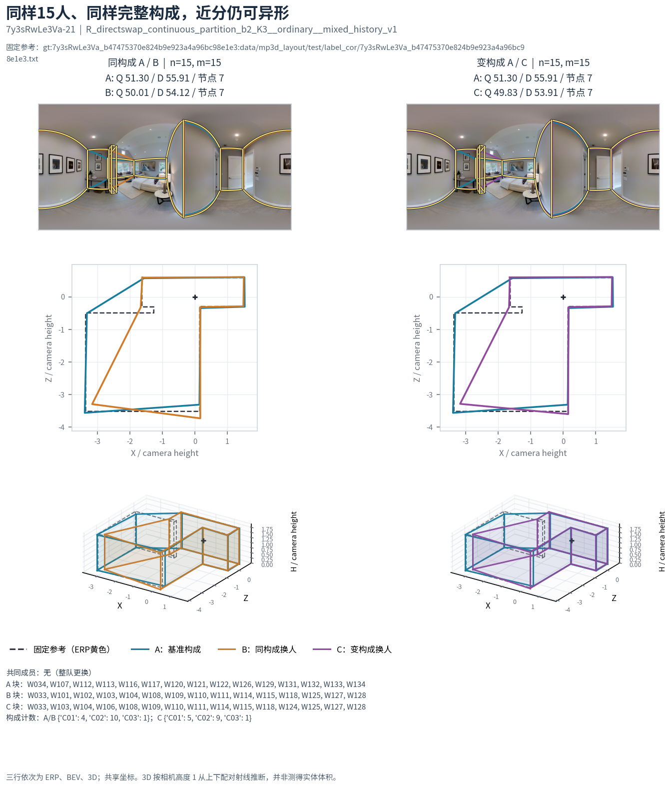

# 质量测量与实际布局差异：论文结果草稿

2026-10-22接续见[最新换类与参考适用边界](CLOSEOUT_20261022.md)：继承本页正反例，对齐main新增端点并明确GT暂停、仅底面和个人排除；已有人工裁定不重问。

**采用判断。** 在当前真人 v2、固定处理点与绑定参考下，B8L2 可作为整体质量的工作主指标，D10 只报告方向尺度敏感性；分析结构等价、必要细节或具体错误时，必须并列局部几何。现有证据支持这一**双层报告方式**，尚不支持更换总分、重新调权或把点数、耗时、旧 3D IoU 代理当作准确性的替代指标。下文数字回读[冻结逐份证据](../../statistics/v2_evidence_audit_20261019/)和[既有融合保存案例](../../workers/personnel_interchangeability_20261020/REPORT_ZH.md)，不是新评分模型。

## 冻结分项在这里回答什么

| 量 | 直接测量对象 | 能解释的差异 | 单独解释不了的事 |
| --- | --- | --- | --- |
| `iou_2d` | 输出与固定参考的底面区域重合 | 大块范围遗漏、外伸 | 小凹口、局部转折与墙角身份可能占很少面积 |
| `S_bottom_deg` | 底面边界的对称球面距离，单位角度 | 相对参考的底边位置偏移 | 哪一条可见墙应对应哪条参考墙、误差是否集中于一角 |
| `dir` | 输出自身相对最佳曼哈顿轴的方向残差，单位角度 | 歪边、不规整；与参考重合好仍可单独下降 | 范围正确性；弧形开口等非理想线索的语义 |
| `Hmean` | 沿墙长平均高度相对参考的差 | 整体一致偏高／偏低 | 哪个角点异常，以及局部高度变化的形状 |
| `Hcenter` | 去均值后、两边界近邻对应的高度轮廓差 | 局部高度不一致 | 底面／墙身份差很多时的纯高度归因 |

五项经冻结非线性公式合成，不能把原值或逐项“删除增益”当成固定百分比权重。`IoU3D100` 是均高棱柱代理，不是实际连续 3D 实体体积交并比；本页仅并列展示它所保留的信息。所有“遗漏／多余”在没有单独视觉裁定时均指**相对当前参考**。

高度职责已有[固定底面控制](../../quality_height_calibration_ready_20261013/README.md#2-三类高度异常的实际响应)独立支持：两侧分别高／低 20% 时 `Hmean=0`、`Hcenter=.1633`；只抬一角 20% 时为 `.05／.0645`；整体统一偏 60% 时为 `.60／0`。因此均高与局部不平确实是不同测量轴，孤立角点同时触发两轴。上述是几何响应控制，不是新增真实标注的人工质量排序；该历史报告的候选总分也不冒充当前冻结 B8L2。

## 同图正反例：总分、分项和几何

| 固定比较与来源 | B8L2／D10 | `iou_2d` | `S_bottom_deg`／`dir` | `Hmean`／`Hcenter` | 3D代理 | 结构证据及解释 |
| --- | --- | --- | --- | --- | --- | --- |
| S09：`7y3sRwLe3Va-21` 团队 A／B，均 7 点 | 51.30／55.91；50.01／54.12 | .906；.777 | 1.43°／10.19°；1.21°／10.35° | .0215／.0179；.0044／.0142 | 88.83；77.21 | 两底面彼此差约 .277；参考角点和边的 9° 召回两队却同为 .7／.6。[同图 ERP、BEV、3D](../../workers/personnel_interchangeability_20261020/interchangeability_20261020/figures/cases/S09_same_composition_different_shape/paired_1.png) |
| `yqstnuAEVhm-24` W118／W134，均 6 点 | 86.98／87.75；49.46／53.63 | .911；.922 | 1.03°／1.78°；.44°／11.32° | .0017／.0081；.0100／.0328 | 90.96；91.68 | 3D 代理和底面 IoU 近似，W134 局部位置／连接形成更大自身方向残差；是否符合可见墙面须保留语义判断。[同图与局部放大](../v2_structure_quality_interpretation_20261020/same_image_overlay.png) |
| S2：`yqstnuAEVhm-01` 团队 A／B，4→8 点 | 75.03；78.80 | .841；.845 | 1.65°／2.81°；.83°／2.65° | .0615／.0221；.0502／.0275 | 79.01；82.15 | 相对参考的凹口恢复，9°角点及邻边召回 .50／.375→1／1；总分只升 3.77、面积 IoU 只升 .004。[局部叠加](../../workers/personnel_composition_followup_20261019/corner_case_S2.png) |
| S3：`X7HyMhZNoso-19` 团队 A／C，8→6 点 | 72.35；92.88 | .930；.965 | 1.73°／4.30°；.48°／1.63° | .0530／.0106；.0415／.0052 | 88.04；92.63 | 相对参考的额外深凹槽消失，参考角点及边召回仍 1／.75；单向召回无法识别候选多余结构。[局部叠加](../../workers/personnel_composition_followup_20261019/corner_case_S3.png) |

S09 的两队方向残差都约 10°。按冻结 B8L2 公式，底面块损失为 **.168／.333**，方向块损失为 **.928／.939**；L2 合成后几何损失为 **.943／.996**。因共同较大的方向损失占据合成尺度，明显的底面差异只留下 **1.29 分**总分差。固定其它四项、仅将方向输入置零的归因控制使两队成为 **85.16／74.83**；这说明当前组合的边际响应，不是建议关闭方向项或证明 A 的语义质量必然更高。S09 是**近分异形**的直接反例，不能用总分阈值宣布几何可互换。

反向的 `yqst-24` 表明，旧 3D 代理近似并不保证规整程度相同。仅把方向输入置零时两份 B8L2 成为 **88.36／90.24**，原有 37.52 分差的主要来源是方向项；这项控制同样不是新模型。S2 则提示真实必要细节在面积和总分里可能较弱，但团队替换同时改变其它几何，**不能**将 +3.77 分严格归因为“恢复四角”的单一因果效应。S3 提供相反方向：减少点数可以移除相对参考多余的错误局部结构。S2 与另一个删凹口对照 S1 属于同一图的关联证据，不计作独立复现。

## 点数与耗时为什么不能代替准确性

| 普通 Manual、同图同参考 W109／W112 | 报告活动耗时（秒） | 点数 | B8L2 | 底面 IoU／方向残差 | 本图可见关系 |
| --- | --- | --- | --- | --- | --- |
| 简单 `b8cTxDM8gDG-07` | 24.94／207.72 | 6／6 | 98.42／97.00 | .987／.61°；.986／1.08° | 相近质量下近 8.3 倍耗时 |
| 困难 `yqstnuAEVhm-29` | 172.36／1825.21 | 11／14 | 41.06／91.46 | .713／19.11°；.965／1.96° | 多出的当前参考局部路径与范围、定位一起改善 |
| 困难 `jh4fc5c5qoQ-04` | 86.72／665.03 | 12／12 | 97.27／47.04 | .982／.95°；.868／12.33° | 相同点数、耗时更长，仍因定位／歪边大幅下降 |

[三图同图原图与底面叠加](profile_W109_W112_reused.png)把局部表达和位置变化对应到图像。两人的共同 99 图普通 Manual 均分 84.32／84.99，故三图是机制说明而非总体频率估计。新批时间字段来自用户处理后报告，未重放原始活动日志；它表明“耗时”没有单调准确性含义，不推出认真程度或真实交付时长。`yq-29` 的 14 点更贴近当前修订参考，`jh4-04` 的同 12 点却差很多；“多点好”和“同点同质”都不成立。

底点 y 的透视灵敏度还提供一个受控边界：固定其它点与参考，只改一个接近地平线的底点 ±2 像素，在两座不同建筑的真实作答上 B8L2 分别为 **33.84／39.55／43.91** 与 **11.27／18.68／25.58**。[控制结果和图](../v2_structure_quality_interpretation_20261020/README.md#研究范围与最重要的观察)说明小像素变化可造成大 3D 与分数变化；两例不能估计一般发生率，也不直接支持统一宽容区。

## 可直接纳入论文的结果陈述

> 在当前非 OOS v2 标注的普通 Manual 层，同图同参考案例显示，整体质量分可识别明显的范围、方向和高度失准，却不构成布局几何等价判据。两个各含七角点的融合结果分数仅差 1.29 分，但底面 IoU 分别为 0.906 和 0.777，3D 代理值分别为 88.83 和 77.21；共同较大的方向残差在当前 L2 组合中压缩了底面差异的边际总分响应。另一个固定团队案例中，参考凹口由缺失变为保留时，参考角点及边召回大幅提高，底面 IoU 和总分却只小幅增加。相反，去除相对参考多出的凹槽可显著提高总分，而单向参考召回保持不变。因而整体分数适合描述参考条件下的总体表现，局部结构解释需并列节点、边界、方向、参考身份和原图证据；角点数或任务耗时均不能单独代表标注准确性。

**适用边界。** 此段是描述性与机制性结果，不给出算法优越性的普适显著性、人员心理动机或语义真值证明。普通 Manual 的正式质量面板为 5,719 份／177 图；全部非 OOS 库存 9,217 份／233 图、门洞 603 份／17 图是不同分母。门洞单列，OOS 不用于评分结论；GT 暂停图可研究标法但不得用当前 GT 分数裁定正确性。下一步若要写“某个墙角真实存在”或判断 `yqst-24` 的弧形开口，应在具体图上做集中人工裁定；当前无需大批量人工审核。门槛、对应变化的机制详见融合专题，不在本页重证。

**来源与核验。** S09 的原团队键、完整五分项和图在[人员互换案例](../../workers/personnel_interchangeability_20261020/interchangeability_20261020/cases/S09_same_composition_different_shape.json)；S2/S3、`yqst-24` 和两项单底点控制在[冻结复算摘要](../v2_structure_quality_interpretation_20261020/FINDINGS.json)；W109/W112 的逐对象 ID、参考、分项在[本专题明细](CASE_ROWS.csv)与原 `records.json.gz`。本页只归纳已存结果，冻结 B8L2/D10、参考、资格、点位与融合均未改变。
