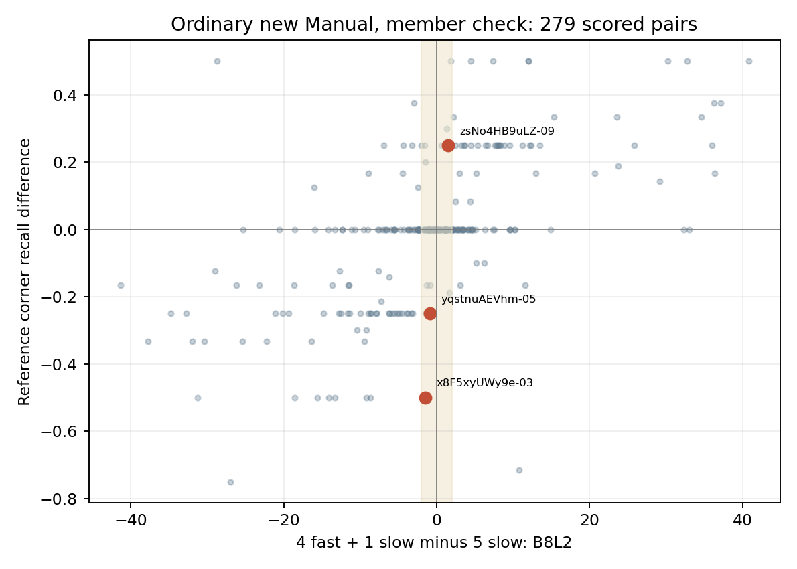
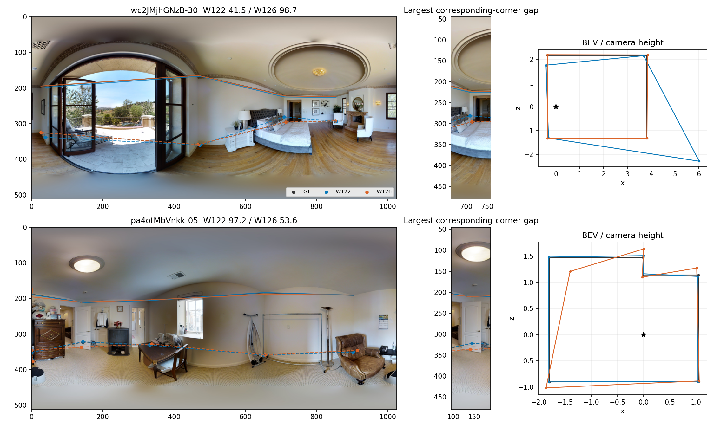
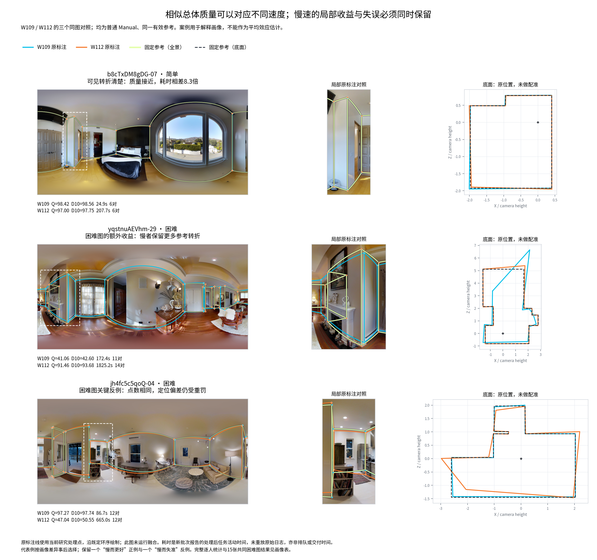

# v2 人员画像、局部结构与组合质量续研（2026-10-21）

**本专题收尾与论文结果表述：** [总分—分项—实际几何的正反例与采用结论](PAPER_RESULTS.md)。下文保留复现、分母和成对事件明细。

本包把已有的人员画像、快慢换人和固定团队结果接到**同一参考下的质量分项与点位差异**。沿用质量主题从全部非 OOS 9,217 份／233 图起步的清单；门洞交界 603 份／17 图单列，本轮具体成对机制聚焦普通层，GT 暂停图片仍可观察标法、不可拿当前 GT 分数断言正确性。逐份证据从 `research/statistics/v2_evidence_audit_20261019/records.json.gz` 读取；团队分数和几何来自下载包 `HOHONET_personnel_research_20261020` 已保存的 4 条机制路径，快慢换人来自该包 `claims/speed_n5_comparisons.csv.gz` 和 `claim_teams.json.gz`。没有重跑融合、改原始处理点、参考、人员资格或 B8L2/D10。本文的“保留／遗漏／错误”若无额外人工裁定，均指**相对当前绑定参考**；点数本身不是语义真值。

## 三条主要发现

**相近均分不能代表相同的下尾风险。** 普通、非门洞、Manual、当前正式质量可用、同图同参考的 W122/W126 共同 106 图中，两人平均 B8L2 为 **86.08／86.42**，但第 10 百分位为 **50.11／61.00**，低于 50 分的图数为 **10／2**。这说明人员画像若只列均值，会漏掉偶发的大幅结构或定位失败；低于 50 只是描述性切分，不能直接叫“严重标错率”。也不能据此认定 W126 每图都更好：`wc2JMjhGNzB-30` 的 W122/W126 为 **41.54／98.68**，而 `pa4otMbVnkk-05` 反向为 **97.21／53.61**。两图都同点数，差异主要不在“多画几个点”。

**B8L2 能识别大幅结构和定位差异，但近似同分仍可能隐藏局部变化。** 从普通新批次 Manual 的 279 条已保存、双方可评分的“5 慢→4 快 1 慢”成员核对事件中，88 条 `|ΔB8L2|<2`。对这 88 条施加事后诊断筛选（角点数变，或严格参考角点覆盖差至少 .2，或墙段覆盖差至少 .1，或同点数对应底角最大距离至少 .2 个相机高度），得到 **20 条／19 图／14 栋**，其中 9 条得分上升、11 条下降。这是发现机制的线索，**不是**独立图片上的发生率、评分错误率或预注册阈值；同图事件重叠，多个几何判据也同时变化。

| 同图固定参考的换人事件 | B8L2 变化 | 参考角点覆盖（严格 0.05 尺度） | 几何差异 | 解读边界 |
| --- | ---: | ---: | --- | --- |
| `zsNo4HB9uLZ-09` | 86.98→88.49 | .50→.75 | 两队均 4 点；最大对应底角距 .104h，墙段覆盖 +.163 | 总分只升 1.51，局部参考覆盖改善更明显 |
| `x8F5xyUWy9e-03` | 88.48→87.00 | 1.00→.50 | 6→4 点，墙段覆盖 −.109；点数不同不计算一一角点距 | 用户修订参考下的相对遗漏，尚非新的视觉真值裁决 |
| `yqstnuAEVhm-05` | 88.55→87.66 | 1.00→.75 | 均 4 点，最大对应底角距 .303h | 点数不变仍有局部位置与覆盖变化 |



**组合质量取决于局部支持能否过门槛，不等于成员平均 Q。** `jtcxE69GiFV-26` 固定四人，只用较慢的 W106 换下 W113，团队 B8L2 **15.14→65.75**、3D 代理 **40.79→81.61**、底面 IoU **.421→.835**、方向残差 **17.11°→3.60°**。虽然 W106 在本图个人 B8L2 仅 10.30（W113 为 39.55），他为关键局部角点提供第三票，使其达到不变的三票门槛。反向机制在 `UwV83HsGsw3-22`：5H→5H+3L→5H+4L 为 **96.69→84.68→62.14**，严格参考角点覆盖 **1→.833→.667**；第九人使门槛 4→5，原本只有四名 H 支持的角点失选。另一个 `e9zR4mvMWw7-19` 的 9→10→11 人路径为 **56.81→89.45→55.26**，关键点支持 4<5→5=5→5<6。三例共同说明：人员历史 Q 可以帮助构造候选团队，但不能替代**逐节点支持与对应状态**；它们是精选机制案例，不证明固定配比的总体优劣。

## 同图正反例：分项、角点和三维代理一起看

| 当前普通 Manual 同图作答 | B8L2 | 底面 IoU | 方向残差 | 3D 代理 | 对应角点最大底面／顶部距离 |
| --- | ---: | ---: | ---: | ---: | ---: |
| `wc2JMjhGNzB-30` W122→W126（均 4 点） | 41.54→98.68 | .678→.988 | 14.33°→.16° | 67.34→98.61 | 2.399h／2.431h |
| `pa4otMbVnkk-05` W122→W126（均 6 点） | 97.21→53.61 | .983→.868 | .95°→8.90° | 98.17→85.83 | .493h／.509h |
| `jh4fc5c5qoQ-04` W109→W112（均 12 点） | 97.27→47.04 | .982→.868 | .95°→12.33° | 97.97→85.81 | .558h／.605h |

这些同参考例子中，B8L2 分项、底面和 3D 代理同向指出显著失准，并非总分“漏检”。对应角点距离按已有环序的唯一循环匹配计算，以相机高度归一；它是**两份输出之间**的距离，不能单独证明哪份对。原图叠加与最大差异处局部放大见下图，BEV 黑星为相机位置。`wc2` 的 W122 底面远伸，`pa4` 则是 W126 的局部凹凸与位置更偏离参考；不能从此推出固定人员习惯。



W109/W112 的 99 个同图样本均值为 **84.32／84.99**，但个案相反。`b8cTxDM8gDG-07` 两人均 6 点、98.42／97.00；`yqstnuAEVhm-29` 为 11／14 点、41.06／91.46，W112 保留当前修订参考中的局部路径，底面 IoU .713→.965、方向 19.11°→1.96°，所以收益不能只归因于“多三点”；`jh4-04` 则同 12 点而 W112 方向失准、分数低 50.23。已保存的三图同图叠加见下图。这些是事后选择的解释例，不以三图替代 99 图画像，也不能从报告活动耗时推断真实交付时长。



`Uw-22` 的 5H→8 人虽仍是 6 点，最大对应底角距离已有 .231h，B8L2 降 12.01；8→9 人点数变 6→5，不能硬造一一角点距。`e9z-19` 和 `jtc-26` 也因节点数变化保留距离缺失。Semi 的 `Z6MFQCViBuw-10` 则单列：8→9→10→11 人节点数 5→4→5→4、B8L2 79.91→91.78→79.62→89.14，但观察对应分组也改变；不能简化为“加低 Q 人主动纠正错误点”，更不能混入 Manual 机制估计。

## 对质量研究的判断

现有 B8L2/D10 在以上大偏移、凹凸变化和范围遗漏上有响应；当前更紧迫的缺口是**解释**近似同分但结构不同的事件，以及区分“参考细节被保留／删去”和“多余局部错误”。此前质量包的 S1/S2/S3 及 `yqstnuAEVhm-24` 已显示：参考召回是单向的，可能漏掉候选额外错误；面积或总分对小细节的响应也可能较弱。当前这些新增换人例与之相容，但不能据此断言应改总分。最小补充诊断是在研究台并排显示：同图参考身份与质量用途、B8L2/D10 及五个冻结分项、3D 代理、点数、严格角点及双向墙段覆盖、候选未匹配角点、同点数唯一对应角点的底／顶距离和匹配状态、逐节点支持及门槛、人员均值与低尾的共同样本分母。缺失的 3D/分项或不同点数距离须显式留空，不能补零。展示时 Manual/Semi、门洞和 GT 暂停层保持分开。

本轮没有产生必须立刻人工复核的裁定。若要把 `x8F-03` 的局部差异从“当前修订参考下失去覆盖”升级为“真实墙角被删”，或者把遮挡处的 `e9z-19` 断言为客观真值，应只对具体转折提供同图叠线、局部放大与参考版本，让用户集中判断；不要求逐对审大量作答。

## 复现、表字段与同步边界

在仓库根目录运行：

```powershell
python -m research.quality.v2_profile_combo_quality_20261021.reproduce --bundle '<HOHONET_personnel_research_20261020 的解压目录>'
```

[CASE_ROWS.csv](CASE_ROWS.csv) 保留 28 行个人／团队和测量状态；[PAIR_DIAGNOSTICS.csv](PAIR_DIAGNOSTICS.csv) 为 16 个同图或连续团队对，`corner_distance_status` 解释距离空值；[SUMMARY.json](SUMMARY.json) 为共同面板与筛选计数。`full_audit` 个人行回读冻结逐份证据，`saved_fusion_geometry` 团队行回读已有融合保存几何与分数，`saved_claim_scalar` 换人行只有原包已存标量，没有强行补 3D 或五个分项。复用的 `profile_W109_W112_reused.png` 是人员研究原图副本；另两图由脚本生成。研究包只补质量主题证据，全局目录与地图由统筹同步；原始输入、评分器、正式结果和算法版本均未改变。

字段合同：两表的 `case_id` 只定位本包案例，`identity`／`base_id`／`candidate_id` 保留原作答或已存团队键；`condition`、`layer`、`origin`、`image`、`reference_id`、`reference_version` 共同限定可比范围。`B8L2`、`D10`、`IoU3D100` 为已有冻结数值，`iou_2d`、`S_bottom_deg`、`dir`、`Hmean`、`Hcenter` 为原五分项输入；`diag_corner_recall_05` 与 `diag_wall_coverage_05` 是相对参考的严格诊断，不等同 9° 角／边召回。`bev_corner_*_h`、`top_corner_*_h` 是**两输出之间**按唯一循环对应得到、以相机高度归一的距离；`different_corner_count` 时必须空白。`measurement_status` 明示来源可用性；空值表示未保存、不可对应或不适用，绝不是零。团队重复路径及换人成对事件不能当独立样本统计置信区间。
