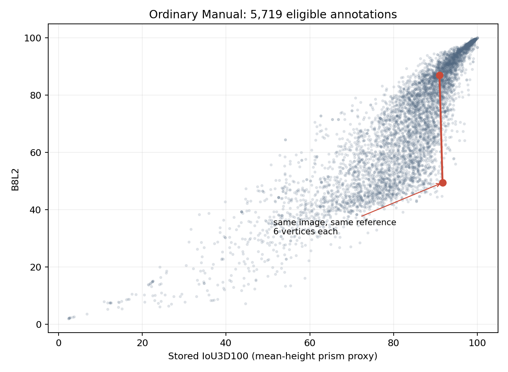
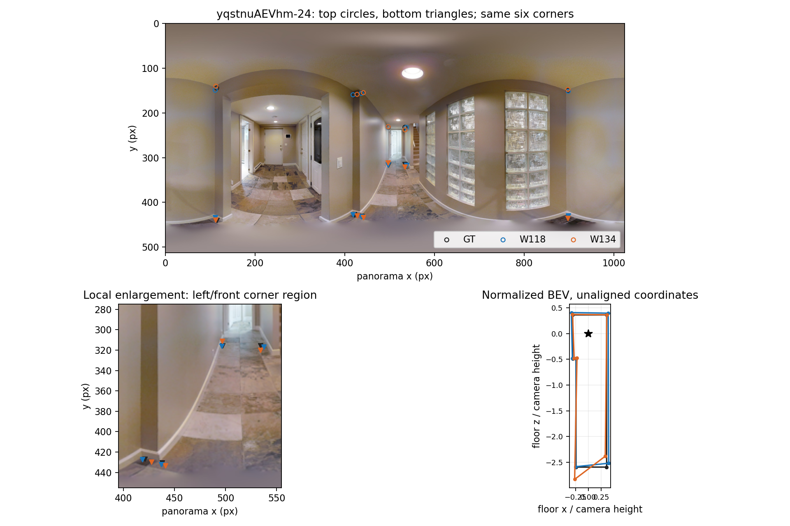
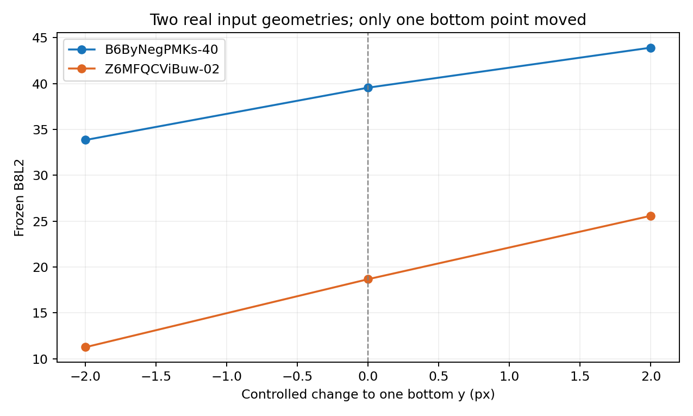

# v2 真实结构差异、质量分项与融合影响（2026-10-20）

本包解释现有 B8L2/D10，而非提出新总分。逐份入口为 `research/statistics/v2_evidence_audit_20261019/records.json.gz`；原作答处理点、绑定参考和冻结分项均取该包。融合实例只读取人员线程已经保存的团队结果，不重跑融合。本文的“真实／错误结构”在未经额外人工裁定处，严格指**相对当前固定参考的局部结构**；既有 S1/S2/S3 图曾作视觉复核，但不推断所有房间的客观真值。

## 研究范围与最重要的观察

从全部非 OOS 的 **9,217 份／233 图**起步，其中门洞交界 **603 份／17 图**单列（571 份为门洞完整质量用途）；不把它们与普通图合并成一个效应估计。普通 Manual 且有正式完整质量的共同观察面板为 **5,719 份／177 图**。GT 有问题的图仍可观察人员怎样画，但不能凭当前 GT 分数宣称谁画得正确；例如 `pRbA3pwrgk9-12` 的细节遗漏讨论只作语义线索，其 35 份当前质量均暂停。

1. **3D IoU 代理值接近，并不限定结构质量分接近。** 普通 Manual 同图、同参考的 92,438 个作答对中，7,635 对储存的 `IoU3D100` 差小于 1 分；其中 438 对 B8L2 差大于 20 分，涉及 123 图、22 栋建筑，292 对连原角点数也相同。这是相互重叠的作答对计数，**不是**438 次独立实验或错误率；`IoU3D100` 是平均高度棱柱代理，也不是真实连续实体体积 IoU。它证明两个量保留的信息不同，不能单凭它决定 B8L2 的强弱是否合理。
2. **局部结构的增减必须辨认方向。** 已有固定团队对照 S1：删去参考凹口，8→4 点，B8L2 87.37→69.72，9°参考角点覆盖 1.00→0.50、相邻边覆盖 1.00→0.375；S2：补回同一图凹口，4→8 点，75.03→78.80、角点覆盖 0.50→1.00。S1/S2 同图，不是两张独立支持图。另一图 S3 删去相对参考多出的深凹槽，8→6 点，72.35→92.88；参考角点覆盖始终 1.00、边覆盖始终 0.75。故“少点”可同时表示漏真角与去伪角，单向覆盖率会漏掉候选的错误凸凹。
3. **相同总分也可掩盖位置和形状差异。** 人员线程 S09 的两个 7 点融合结果 B8L2 为 51.30／50.01，但各自对参考的底面 IoU 为 0.906／0.777，二者互相的底面差为 0.277，真实转角 F1 为 0.571；3D 代理为 88.83／77.21。总分相近来自分项的不同组合，不能用来推论融合几何可互换。反过来，S05 的 6／5 点团队 B8L2 83.46／82.12、底面形状差仅 0.018，且两者都漏掉同一参考凹口；多一个节点并不自动是保留了必要结构。此前 185,474 个独特团队对中，405 个不同原节点数的对照仍通过既定新形状判据，涉及 13 图、4 栋；这些是现有人研究的重复团队对，不是新独立标注。
4. **近地平线底点的像素误差会被投影放大，评分也会响应。** 两个不同建筑的真实作答固定其余全部点、参考和冻结评分器，只将一个底点 `y` 改为原值±2 像素。`B6ByNegPMKs-40` 的 B8L2 为 **33.84／39.55／43.91**，`Z6MFQCViBuw-02` 为 **11.27／18.68／25.58**（次序为 −2／原值／+2）。前者对应径向距离为 21.72／17.14／14.15，后者为 26.70／20.10／16.11，单位是相机高度；这是透视几何的灵敏度，不意味着应给所有近地平线点统一宽容或直接改分。两图低分、不同建筑，仍需扩大真实条件才能估计常见性。

## 同图分项、角点与三维表现

`yqstnuAEVhm-24` 的两份 Manual 均 6 个角、同一参考。下表的底面角点距离按共同环序与视觉同位置逐点配对，**不做**重排或几何配准；最大底面距离 0.246、均值 0.089 个相机高度，第 6 对最大。原图叠加及局部放大见下图。

| 作答 | B8L2／D10 | 3D 代理 | 底面 IoU | 底点偏差° | 方向° | 整体／局部高度 | 将方向项置零后的 B8L2 |
| --- | --- | --- | --- | --- | --- | --- | --- |
| W118 (`v2:new:106360`) | 86.98／87.75 | 90.96 | 0.911 | 1.026 | 1.781 | 0.002／0.008 | 88.36 |
| W134 (`v2:new:106376`) | 49.46／53.63 | 91.68 | 0.922 | 0.441 | 11.320 | 0.010／0.033 | 90.24 |

只把方向输入置零是**归因控制**，不是新的评分候选：此时两者排序反转，说明 37.52 分的主差异由方向响应驱动。B 的底面 IoU、底点位置甚至略好，3D 代理几乎一样；它的某个局部底点/连接相对 A 和参考发生变化，方向项识别到了这点。照片中有弧形开口，是否应将这 11.32° 视为严重布局错误，需要局部墙面语义判断；当前证据不足以据此调低方向权重或称其过罚。`D10` 同方向，但分差略小。

融合的三个结构例子仍使用人员线程的原始图与完整来源：[S1 漏掉参考凹口](../../workers/personnel_composition_followup_20261019/corner_case_S1.png)、[S2 补回凹口](../../workers/personnel_composition_followup_20261019/corner_case_S2.png)、[S3 消除多余凹槽](../../workers/personnel_composition_followup_20261019/corner_case_S3.png)。S3 的对应参考角点都命中，恰恰说明只看“参考角点召回”无法给额外错误局部结构归因；不同角点数时也不能伪造逐角点距离。互换反例见 [S09 同数同分但形状不同](../../workers/personnel_interchangeability_20261020/interchangeability_20261020/figures/cases/S09_same_composition_different_shape/paired_1.png)。

| 固定团队变化 | B8L2 | 底面 IoU | 底点偏差°／方向° | 整体／局部高度 | 3D代理 | 参考角点覆盖 |
| --- | --- | --- | --- | --- | --- | --- |
| S1 A→C，凹口被拉平 | 87.37→69.72 | .895→.804 | .60／1.38→1.85／3.39 | .041／.019→.066／.024 | 87.39→75.16 | 1.00→.50 |
| S2 A→B，凹口补回 | 75.03→78.80 | .841→.845 | 1.65／2.81→.83／2.65 | .062／.022→.050／.027 | 79.01→82.15 | .50→1.00 |
| S3 A→C，多余凹槽消失 | 72.35→92.88 | .930→.965 | 1.73／4.30→.48／1.63 | .053／.011→.042／.005 | 88.04→92.63 | 1.00→1.00 |

S2 的局部参考角点从半数恢复到全数，底面 IoU 却只升 .004，总分只升 3.77：小结构可能在面积和总分中占比不大；这**提示**必要细节可能被低估，不能凭一个同时改变其它几何的团队对照断言评分缺陷。S3 相反，错误凹槽消除带来明显方向与总分收益，而单向参考角点覆盖不变。

## 判断与必要补诊断

当前 B8L2 **确实能反映一部分**漏结构、错误凹槽和方向异常；但单一总分、点数、单向参考召回及 3D 代理各自都有盲区。最小补诊断是：沿同一固定参考并列保存候选的**未匹配转角/凹凸及对应角点距离、双向墙段覆盖、底面形状差、五个原分项与 3D 代理**。不同点数或不可评分时保留缺失状态，不硬配对应或以零填充。先用它解释既有换人事件中高影响的局部变化；暂不改变 B8L2/D10、融合算法、人员类、资格或 N1。

“人员保留了 GT 未画出的真实细节”仍缺可靠量化证据：`pRbA3pwrgk9-12` 等可做图上语义审查，但其当前暂停质量不可转成“某类人员更优”的分数论证。若下一阶段确实要裁定 `yqstnuAEVhm-24` 的方向差或这类 GT 漏细节，只集中展示**同图叠线和局部放大**，请人工判断可见墙角及目标范围；不送大量逐作答对给用户审。

## 复现与边界

在仓库根目录运行 `python -m research.quality.v2_structure_quality_interpretation_20261020.reproduce`，生成 [逐项数字](FINDINGS.json)与三张图。脚本对两个同参考案例和两项原分数做断言，固定输入仅从逐份 v2 审计取；融合数字回读 [451 事件结构包](../../workers/personnel_composition_followup_20261019/STRUCTURE_REPORT.md)和原团队缓存。控制实验只移动处理后一个底点，是反事实敏感性而非人员真实修正。没有重算全量质量、调参、N1 或门洞/OOS 混合估计。图使用仓库全景输入，不另改源图。全局目录和地图由统筹同步，本包只更新质量主题入口。
