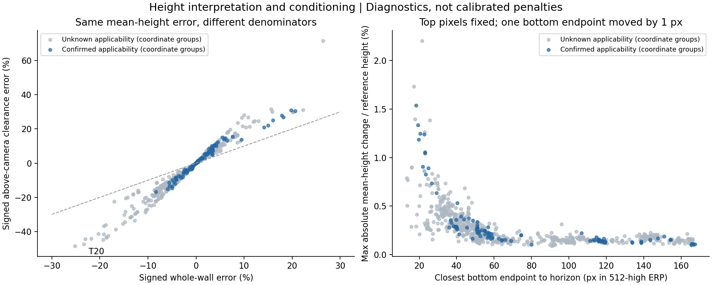

# 高度解释与底点敏感性补充

> 阶段记录。当前决定、后续和审核状态统一见[候选决策入口](DECISION_STATUS.md)；下方“下一步”“无需人工介入”及未提交状态为本阶段完成时的历史记录。

2026-10-12；落实上一轮边角复核。当前不需人工介入。本轮只补诊断与证据口径，没有新增处罚项、改参数、改GT或正式资格。

**主要结论：T20的整体偏低对本次1像素底点扰动是稳定的；净空比例能帮助解释顶部压低，却不是第二个独立误差项。真实记录的重建敏感性确有差异，但不能用这个微扰直接估计人员噪声或修正质量分。**

## 1. 一个高度偏差，两种归一化

沿用固定相机高度1、底面y=−1的条件重建。作答与参考的周长加权平均墙高分别为μa、μg，则：

`整墙有符号误差 = (μa−μg)/μg`

`净空有符号误差 = (μa−μg)/(μg−1) = 整墙有符号误差 × μg/(μg−1)`

净空指相机以上平均顶面高度，并非地面至天花板高度，也不是实测米数。两式分子相同，不能分别算作两条独立错误证据；本轮没有把净空加进总分。参考净空非正时标不可用，不填0。

| 已审核案例 | 作答/参考整墙高度 | 作答/参考净空 | 整墙偏低 | 净空偏低 |
|---|---:|---:|---:|---:|
| T20 / R00397 | 0.7664 | 0.5254 | 23.36% | 47.46% |
| S034 / R00418 | 0.8866 | 0.7443 | 11.34% | 25.57% |

两个均高来源与旧39条中的记录、参考对象、Hmean逐项绑定核对；S034仅属于旧审核解释层，没有加入907开发分母。净空表示下T20仍有更大的整体压低，因此改分母不会自动解决P04对局部不平的偏好；更不能为了满足P04再次调尺度。

907的归一化倍数`μg/(μg−1)`中位2.171、范围1.320—3.910；净空比范围0.514—1.717。明确适用143条净空比范围0.832—1.310。由此，旧报告“最大整体误差26.4%，未覆盖0.5以上增强区”只针对原整墙尺度，不能扩大解释为没有明显顶面压低。是否达到人的严重等级仍未确定。

## 2. 重复坐标敏感性已落地

只把同一图片、同一参考、原顶底三维坐标序列完全相同的记录分组；不旋转起点、不做近似合并，不删除人员记录，不推断数据来源或抄袭。坐标组也不是独立图片、建筑或独立人群。

| 统计口径 | 全部开发记录 | 明确适用层 |
|---|---:|---:|
| 作答记录 | 907 | 143 |
| 不重复坐标组 | 739 | 114 |
| 弱St损失大于整体＋局部损失，按记录 | 483/907＝53.25% | 76/143＝53.15% |
| 同一判断，按坐标组 | 364/739＝49.26% | 50/114＝43.86% |
| 四次相对二次增加至少2分，按记录 | 46 | 6 |
| 同一判断，按坐标组 | 43 | 5 |

记录口径保留，几何机制解释同时使用坐标组口径。因此不再把记录比例解读成“多数不同几何由St主导”；损失占比也仍不等于实际扣分。上一轮27条诊断案例恰好来自27个不同坐标组，无需重选。

## 3. 只动底点，保持全部顶部球面方向

[实验设计](conditioning_design.json)固定512高ERP中±1像素两种扰动：逐个底角移动，另作全部底角同向移动。顶角方向、水平角、点数、环序及参考保持。由底点新俯角重建深度，顶点沿原视线重新取垂直墙角位置；原数组不写回。

若底点原水平距离为ρ、俯角为α，则`ρ′=1/tan(α+πδ/512)`。同一顶点三维向量乘正数`ρ′/ρ`，球面方向以及由端点定义的顶部球面弧保持。高度与自身起伏仍可能改变，说明重建高度受底点影响，不能将其处罚解释成“顶部输入错了多少”。

739个坐标组共计算8188个扰动场景，全部保持投影可用；最大顶部单位向量变化仅3.89e−16。31个原角点的顶底水平坐标存在不超过4.45e−16的浮点差，验证用1e−12算术容差，不吸附或改动源点。

这里只重算线性高度profile的精确周长均值/std，没有重新验收扰动后的完整多边形，没有重算IoU、最近边Hcenter或Q。自身std不冒充Hcenter。投影可用不等于完整layout可用。

| 按907记录统计，变化除以固定参考墙高 | 中位数 | 95分位 | 最大值 |
|---|---:|---:|---:|
| 单个底点±1px，逐角最大绝对均高变化 | 0.213% | 0.605% | 2.206% |
| 单个底点±1px，逐角最大绝对自身std变化 | 0.203% | 0.601% | 1.773% |
| 全部底点同向±1px，最大绝对均高变化 | 0.703% | 1.605% | 3.799% |

均高与std的最大值分别取各自最敏感的角与方向，不假定来自同一个扰动。按739坐标组重算的单点均高变化中位0.210%、95分位0.649%，结论量级相近。

真实907最小底点地平线余量13.338像素，明确适用层最小18.303像素；均比旧极端控制的1.458像素远。旧控制的大幅放大不能直接搬到真实池。反过来，真实池也不是全都等敏感：

| 案例 | 适用性 | 单点最大均高变化 | 单点最大自身std变化 | 含义 |
|---|---|---:|---:|---|
| R00421，jh4fc5c5qoQ-02 | 未知 | 2.206% | 1.773% | 当前最敏感之一；原自身std/GT均高0.2365，不是凭扰动产生的新质量标签 |
| R03349，Z6MFQCViBuw-08 | 明确适用 | 1.537% | 1.607% | 顶部方向不动，也可明显改变重建起伏；原自身std/GT均高0.0712 |
| R01355，B6ByNegPMKs-18 | 未知 | 0.788% | 0.904% | 原自身std仅0.1069%，相对倍数大，绝对变化仍须单列 |
| T20 / R00397 | 未知 | 0.132% | 0.148% | 底点最小地平线余量60.36像素，非近地平线放大案例 |

T20全部底点同向±1像素时，最大均高变化也只有参考墙高的0.471%，远小于原23.36%的整体偏低。**在此固定参考与重建表示内，小幅底点微扰不足以解释T20。** 这不排除更大输入错误、配对问题或参考问题，也不给出正确处罚强度。

1像素是机制探针，不是已测得的人员噪声分布；表中数值不是置信区间，不能据此自动给敏感作答减罚。若有像素级定位误差模型，应另有真实重复标注或其它证据支持。



## 4. 本阶段判断与后续边界（历史计划）

- 净空作为解释量保留，不新增一项整体处罚；T20高度差异对本次小扰动稳定，不能用数值不稳定为它免责。
- 底点敏感性是处理后重建的诊断，和原输入配对问题并列。它说明St与物理高度有不同响应，不证明St应无条件加入总分。
- 局部保留自身profile与参考比较两层，不用放大倍数取代绝对量级。原窄峰采样问题另记：精确局部RMS0.001549，对齐/漏峰采样造成当前分数最大约0.137分偏差，暂不抢先重写引擎。
- 当前仍不冻结四次或净空分母。下一步有价值的问题是：在整体高度、底面位置可区分的控制中，St还能保留哪些局部定位信息；不继续扩大权重搜索。
- 本轮无需人工介入；只有某个具体质量尺度或案例语义将改变方法选择时，再提交最少必要材料。没有向已有“不确定”回执补标签。

## 5. 产物、字段与验证

[conditioning.json](conditioning.json)保存907条诊断、739组成员、记录/坐标组双口径统计、两个旧审核均高解释，以及按四类敏感性准则分层选择的17条诊断案例。选择理由全部保存，没有新人工等级。字段定义补入[field_contract.json](field_contract.json)。复用原inputs/results，不复制整批输入或修改既有分数。

```powershell
python -B tools/thesis_main/analysis/quality_height_conditioning_20261012.py --study research/quality_top_height_response_20261012 --figures
python -B -m pytest tests/test_quality_height_conditioning_20261012.py tests/test_quality_top_height_response_20261012.py tests/test_quality_review_constraints_20261012.py -q -p no:cacheprovider
```

21项相关测试通过，包括新增7项：归一化恒等式、净空不可用、顶射线保持/可逆性、跨地平线显式失败、整体底点移动解析解、精确坐标分组、冻结分母与审核层隔离。图已查看。未运行无关融合、训练、Label Studio测试；未重跑完整几何引擎。研究报告/质量状态页、索引和地图已同步；规范合同、SOP、原输入、正式资格及分数未改。未生成检查截图，未提交或推送Git。
