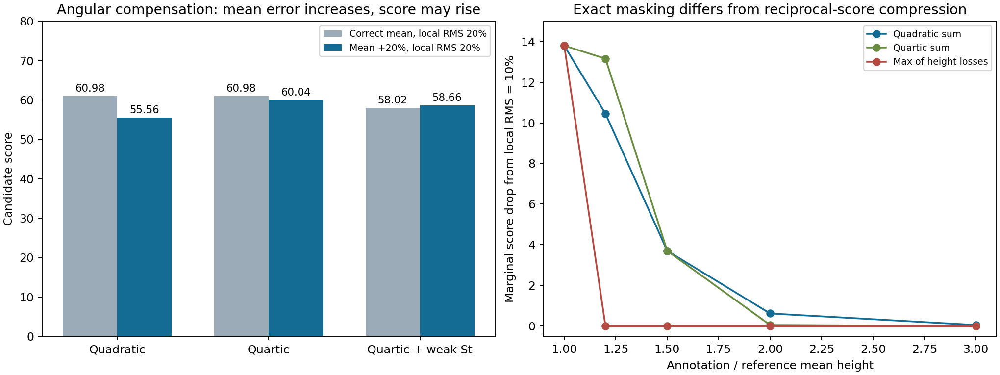

# 整体高度与局部不平共同变化：遮盖、压缩及补偿

> 阶段记录。当前决定、后续和审核状态统一见[候选决策入口](DECISION_STATUS.md)；下方“下一步”“无需人工介入”及未提交状态为本阶段完成时的历史记录。

2026-10-12，接续[局部位置与范围研究](LOCAL_PROFILE.md)。本轮固定120个几何控制，其中108个在相机域内；比较9个既有响应候选和2个既有max组合，每个候选177次相邻控制变化。另回放907条开发记录、739个精确坐标组。

**新发现：弱顶部项可抵消新增高度处罚，甚至令分数上升；max组合会产生真正的局部遮盖；相加组合则主要表现为总分映射的边际压缩。三者不能混为一谈。** 本轮没有选择新的正式总分。

## 实验与比较口径

沿用参考均高2.4、同正方形底面，整体均高比固定为0.5/0.6/0.8/1/1.2/1.5/2/3；局部周长RMS为参考均高的0/2.5%/5%/10%/20%；水平尺度0.5/2/10。交替角点起伏保持均高和底面不变。12条有顶点不在相机以上，保留域外状态，不赋零分，不进入比较。

St用冻结球面引擎2048点/向，F用既有flatness每周长512点，均为实算；Hmean与Hcenter由该同底面解析构造精确给出，IoU=1、Sb=D=0。所有有效控制均以St8192/F2048再次计算。输入设计见[joint_response_design.json](joint_response_design.json)，全部控制及比较明细见[joint_response.json](joint_response.json)。知道旧审核后制定，不称独立预注册。

每次只增加局部RMS，或将整体均高比从1往偏低/偏高方向推进一档；其余控制条件保持。两端都有效才比较。这里的“错误增加”只指被控制的Hmean/Hcenter增加，不等于人类判断所有可见因素都更差。

## 1. 弱顶部项会产生补偿，不保证高度分量单调

|候选|比较数|分数上升|分数不变|分数下降|
|---|---:|---:|---:|---:|
|relative2、relative4、log2、log4（各自）|177|0|0|177|
|relative2_weakTop|177|1|0|176|
|relative4_weakTop|177|2|0|175|
|relative2_Fguard、relative4_Fguard、relative2_mean1（各自）|177|0|0|177|
|Q_dbounded1_max_height|177|0|78|99|
|Q_dbounded1_max_top|177|5|0|172|

增分/不变的数值容差为1e−8分，不是质量通过线。有限网格上未发现反转不证明全域单调。

最清楚的反例：水平尺度0.5、局部RMS固定20%，均高比由1变1.2。

- Hcenter保持0.2，Hmean从0增至0.2；St却从6.542°降至4.477°。
- `relative4_weakTop`整体损失增加0.02560，顶部损失下降约0.04445，局部损失保持0.64；总分由58.01846升至58.66000，增加0.64155分。
- 高采样增幅仍为0.64154分。不是采样误差或漏设局部项，而是不同度量沿此几何路径发生补偿。

另一反例在均高比0.5、尺度0.5下，局部RMS由0增至2.5%，weakTop两种幂次候选均增加约0.13275分。该均高比不在907条真实记录的当前范围内，不能把它计为真实误排率。

这否定了“保留一个弱St仍自然保证高度偏差增大就降分”的保证；没有证明人在这对图上一定偏好原图。若研究要求整体/局部高度偏差不能被角度项抵消，则这些直接相加的弱St候选不满足该要求；若允许权衡，就必须明确这个代价。

## 2. max遮盖与相加后的边际压缩不同

令G、L分别为整体与局部损失，先固定其余分量。在相加形式中，若Q=N/(K+G+L)，加入局部项造成的分差为：

`ΔL = N·L / [(K+G)·(K+G+L)]`。

G变大时分差变小，但L仍存在。相反，`max(G,L)`在G≥L时，移除局部项可完全不改变分数；只有局部项超过整体项后才起作用。这是结构遮盖，不是同一现象。

固定局部RMS10%、无St/F、同底面时：

|均高比|平方相加的局部扣分|四次整体＋平方局部的局部扣分|最大值组合的局部扣分|
|---|---:|---:|---:|
|1|13.7931|13.7931|13.7931|
|1.2|10.4493|13.1584|约0|
|1.5|3.7037|3.7037|0|
|2|0.6202|0.05485|0|

均高比2时，四次整体候选的总分本身已约5.8275，不能由局部再扣得少就断言“严重整体错误被放过”。同时，单一总分确实可能不再清晰展示附加局部问题，诊断分量仍有必要。



## 3. 真实开发集上的算子消融

对原907记录，冻结各自IoU、Sb、D、St、F，只在评分算子中分别将Hmean/ratio归零、Hcenter归零或二者同时归零。**这不是几何修复实验**：真实改高度可能同时改变St/F，因此不能把消融分差当作独立物理因果贡献，也不能由分差相加或相关性证明双罚。

|候选|局部项被结构遮盖的记录/907|局部项被结构遮盖的坐标组/739|明确适用坐标组/114|
|---|---:|---:|---:|
|平方或四次的高度相加|0|0|0|
|max(整体损失,局部损失)|477|360|51|
|max(整体＋局部损失,弱顶部损失)|231|186|26|

结构计数按max不等式判定，并仅计局部损失>1e−12的数值非零项；这是浮点容差，不是严重度标签。原始“局部边际分差为零”还包括Hcenter约1e−16的数值近乎完全匹配案例：相加候选中有17条/7组，不能误写成真实局部遮盖。

另定义“局部可见比例”：有当前整体误差时加入局部项的分差，除以整体误差归零时加入局部项的分差。平方相加在739组的最小值约0.712，四次整体相加约0.917；明确适用层约0.839和0.970。当前真实数据的Hmean均低于既有0.5尺度，使四次项很弱，所以保留了更大的局部边际响应；这不代表严重整体错误下也如此。

该比例不是概率，max_top时可大于1。分母数值为零记null，不能把null直接当作局部被遮盖：全体180组、明确适用24组，在孤立局部作用数值为零时，加入整体误差后反而使局部项开始影响分数。输出同时保留`local_unmasked_by_global`解释这一状态。

真实Hmean最大0.26445、Hcenter最大0.22322；明确适用层分别最大0.20615、0.10365。两项均未达到既有0.5/0.25损失尺度，更没有同时达到者。尺度不是质量界线，这仅标记该公式区间及共同跨尺度响应缺少真实覆盖，不是人工严重等级的缺失证明。按固定准则选出13组含T20，保留原因和null人工等级，不据候选分差新增好坏标签。

## 本阶段判断与后续（历史计划）

1. 不因为max看起来能“避免重复处罚”就采用它：它有可复现的平台与较小项遮盖；这是否可接受属于评价目标，不能靠简洁性决定。
2. 不把弱St叠加视为单调性保险。本轮已找到与高度分量方向相反的分数变化；权重小不等于不存在补偿。
3. 暂不因倒数总分的边际压缩改公式。保留分项诊断；中等整体偏差被四次响应明显放宽是否恰当仍待判断，没有选定幂次或阈值。
4. 下一步在明确适用的16幅真实参考几何上施加同类固定单变量变化，检验反例是否只限于方形尺度控制。它仍是以真实参考为底的控制实验，不冒充新的真实人员错误或独立人工验证。

本阶段当时无需人工介入。只有当选择取决于是否允许角度误差改善补偿高度偏差，且真实参考控制已整理出清晰成对图时，再向用户提出具体审核问题。

## 复现与验证

```powershell
python -B tools/thesis_main/analysis/quality_joint_response_20261012.py --figures
python -B -m pytest tests/test_quality_joint_response_20261012.py tests/test_quality_local_profile_20261012.py tests/test_quality_top_residual_20261012.py tests/test_quality_height_conditioning_20261012.py tests/test_quality_top_height_response_20261012.py tests/test_quality_review_constraints_20261012.py -q -p no:cacheprovider
```

907×9=8163个原候选分数回放差为0。108个有效控制全部高采样复核，候选总分最大差0.000161；所有增分反例方向保持，最小增幅0.01054，大于该数值变化量级。相关42项测试通过；测试支持实现和数值性质，不证明评分符合人工质量判断。比例分母数值零的最后细化后重跑本轮6项也通过。独立只读复核未发现阻塞问题，并提醒null可见比例不等于遮盖，已单列说明。

新增脚本、测试、设计/结果/报告/图及字段说明，入口和地图同步。未改变正式评分、输入/配对、GT、资格或留出；未运行无关采集/运营/训练测试；无Git提交或推送，无临时检查截图。研究图为可复算产物保留。
