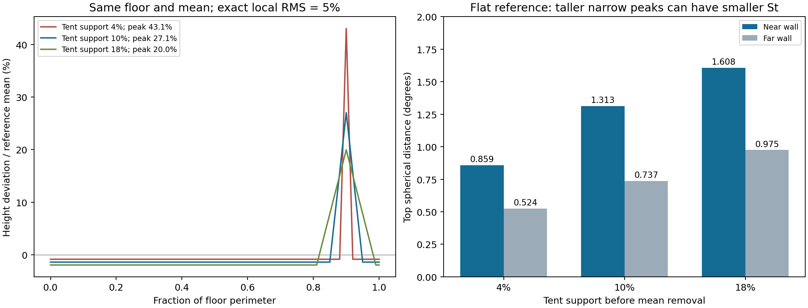

# 局部位置与范围：同均高、同RMS控制

> 阶段记录。当前决定、后续和审核状态统一见[候选决策入口](DECISION_STATUS.md)；下方“下一步”“无需人工介入”及未提交状态为本阶段完成时的历史记录。

2026-10-12，接续[均高对齐顶部残差研究](TOP_RESIDUAL.md)。本轮完成24个固定几何控制、907条Hcenter回放及20组真实极值诊断。结论是：**Hcenter保留了相对于非平参考的位置差异，不能简化为自身起伏RMS；St虽对位置和范围有不同响应，却不保证补上高而窄的局部峰值。** 目前没有证据支持因这些反例增加新处罚项。

## 固定比较及其含义

相机在原点，底面y=-1，矩形x∈[-1,5]、z∈[-2,2]，周长20。所有24控制共用同一底面细分、点数和环序，顶底保持垂直点对。只改变顶部轮廓：均高2.4；沿底面周长精确RMS为参考均高的5%或10%；近墙/远墙中心；三角形支撑为周长4%、10%、18%；参考为平顶或同样起伏位于近墙的非平顶，共2×2×3×2=24条。

先减去三角形的精确均值，再缩放到指定RMS。因此“4%支撑”指**减均值前的三角形范围**；支撑外仍有共同的小幅负偏移，不能说只有4%的墙高变化。另报告超过自身均高±参考均高10%/20%的实际周长比例。两个显示刻度均不是质量阈值。

[设计](local_profile_design.json)在实验前落盘，知道已有审核后制定，不是独立预注册。Hcenter沿用归档`centered_height.py`的均高中心化、双向最近底边投影和最大平方残差并列规则，调用仓库现有高度引擎；St调用冻结球面引擎，不重新实现投影。Hcenter默认每向4096点，St每向2048点。同底面控制另用分段线性残差的精确周长积分核验Hcenter。

## 1. 同样RMS不决定峰幅；St也不是峰幅保护项

平顶参考、近墙起伏、RMS固定5%时：

|三角形原支撑|最大偏离自身均高/参考均高|偏离超过20%的周长|精确Hcenter|St|
|---|---:|---:|---:|---:|
|4%|43.09%|2.10%|0.05000|0.859°|
|10%|27.05%|2.48%|0.05000|1.313°|
|18%|19.97%|0.00%|0.05000|1.608°|

高而窄的峰值可能有更小的St。St是角度边界上的平均距离，Hcenter是底面周长上的均方根，二者衡量方式不同。这不是数值漏采：Hcenter精确积分相同，高采样St差也很小。这里直接反驳的是“保留一个弱St就能保证识别高窄峰”的推断，**不是**已经证明窄峰应该比宽缓起伏罚得更多。

同一支撑10%、同一RMS5%移至远墙，St由1.313°变为0.737°，Hcenter仍是0.05。物理高度profile统计相同，不表示图像上的角度定位误差相同；这一变化保留了投影信息，但其评分价值不能仅凭数值不同来断言。



## 2. 非平参考：Hcenter能看见自身RMS看不见的错位

采用支撑10%、RMS5%的近墙起伏作为参考：

|作答|作答自身RMS|参考自身RMS|精确Hcenter|St|
|---|---:|---:|---:|---:|
|起伏仍在近墙，与参考完全相同|0.05|0.05|0|0°|
|起伏移至远墙，均高/RMS保持|0.05|0.05|0.07352|1.250°|

两份作答的自身RMS完全一样，Hcenter却能区分相对于参考的空间错位。因此不能用“自身std”替代Hcenter，也不能给匹配非平参考的作答一律增加自身不平处罚。该结论依赖参考与既有几何对应的可信性；最近底边投影不是物理同墙角认证。

## 3. 真实案例覆盖：有局部起伏，未发现同样集中的严重峰值证据

开发边界仍为907记录、739精确坐标组，明确适用143记录/114组，未知764记录/625组。没有新增留出、人工标注或人员资格变化。

|描述量|全体739组|明确适用114组|
|---|---:|---:|
|最大峰幅/自身RMS|3.854|3.352|
|最大峰幅/参考均高|42.25%|23.55%|
|超过20%偏差的周长比例非零|8组|1组|
|参考自身RMS/参考均高的最大值|1.112%|0.784%|

本轮三类控制的峰幅/RMS分别为8.617、5.410、3.994，均比现有组的最大值更高。控制刻意检验集中峰值的机制，不代表当前真实样本已经覆盖这些形状。真实参考自身非平程度也小于本轮5%/10%的非平控制，不能把控制成功当作已完成真实严重非平参考验证。

8个超过20%显示刻度的组涉及7图、6栋建筑；其中明确适用只有R01954一组，其峰幅23.55%、超刻度周长5.20%、Hcenter=0.10365。未知层R00421峰幅42.25%、超刻度周长52.38%，属于大范围起伏的几何描述，不能称为窄峰或凭未知适用性补人工等级。

按峰幅/RMS取极值的明确适用前三，其峰幅仅4.07%—6.70%；未知前三仅2.45%—8.85%。集中比值高不等于绝对偏差严重。按support20固定取前三时，明确适用层只有一个正值，因此另两条是按id选到的零值并列，并非异常图片。结果保留这些选择理由，不把它们自动推入人工审核队列。

20组取例的原始分量、几何统计、选择理由及高采样值见[结果JSON](local_profile.json)。其中按参考std选出的6条，仅对应两个参考：明确适用层`e9zR4mvMWw7-16`，未知层`X7HyMhZNoso-05`；不是6个独立非平参考证据。

## 4. 真实Hcenter与自身RMS差异从哪里来

看到上述取例后追加一个条件对照，已明确记入设计的事后补充：只在副本中把参考高度profile摊平到原均高，底面保持，重算所选20组Hcenter。不改GT，也不表示参考应该平顶。该对照区分参考起伏参与与底面投影加权的影响。

|案例|适用性|自身RMS/参考均高|原Hcenter|摊平参考副本后的Hcenter|
|---|---|---:|---:|---:|
|R02297 / e9zR4mvMWw7-16|明确|0.020948|0.013769|0.020898|
|R00421 / jh4fc5c5qoQ-02|未知|0.236486|0.223220|0.223257|

R02297的差异主要随参考高度profile摊平而消失；R00421几乎不变，剩余差异不能归于参考自身不平。后一情况中，双向最近底边投影会让参考侧以自己的周长测量作答高度profile，与作答自身周长权重不同。因此即使参考平顶，**底面不同时Hcenter也不必等于自身RMS**。不据此认定Hcenter有错，或自动替换底边对应。

## 判断与后续

- **保留Hcenter的参考相对含义。** 不改成自身平整度处罚；参考可信与最近边对应的局限继续单列。
- **峰幅和范围目前只作诊断。** RMS相同可能掩盖局部形状差异，但当前真实数据不足以支持新增峰幅罚项或阈值。
- **不以本轮结果决定保留/删除St。** 它提供投影角度信息，但会带入几何尺度，也不是可靠的高窄峰保护项。先前均高对齐残差的混合问题仍成立。
- 下一步回到组合本身：把“整体高度偏差”和“局部偏差”同时增加，检查现有候选是否出现遮盖、弱化或重复处罚；采用固定几何偏差阶梯和真实覆盖标记，不为T20反向挑权重。先前20%—30%整体偏差被明显放宽是否恰当、公式增强区间缺少真实覆盖的问题尚未解决；几何尺度不定义人工严重度。

本阶段当时没有需要用户重复人工审核的问题。若后续决策确实取决于“高窄峰与宽缓起伏谁更严重”或某参考非平是否可信，会先准备具体成对图和会影响的选择，再请求判断。

## 验证与交付边界

```powershell
python -B tools/thesis_main/analysis/quality_local_profile_20261012.py --figures
python -B -m pytest tests/test_quality_local_profile_20261012.py tests/test_quality_top_residual_20261012.py tests/test_quality_height_conditioning_20261012.py tests/test_quality_top_height_response_20261012.py tests/test_quality_review_constraints_20261012.py -q -p no:cacheprovider
```

907条Hcenter与冻结值最大误差3.40e−16；四项已有profile统计最大误差8.75e−16。24控制Hcenter数值与精确积分最大误差2.47e−6，16384采样后1.54e−7。20真实组Hcenter从4096改16384的最大变化3.40e−6；St从2048改8192，真实选例及控制最大变化分别1.11e−5°、1.13e−5°。没有对全部真实组作高采样认证，也没有宣称对任意更窄尖峰足够。

相关36项测试通过。独立只读复核未发现阻塞性几何/公式问题，关于投影响应的价值、重复参考与高比值低幅度的限制均已纳入正文。未重算正式Q/IoU，未运行无关采集、运营或训练测试。新增研究脚本、测试、设计/结果/报告/图和字段说明，项目地图与入口索引同步登记。GT、原始输入、人员资格、协议及留出未改，未Git提交/推送；研究图保留，无临时检查截图。
