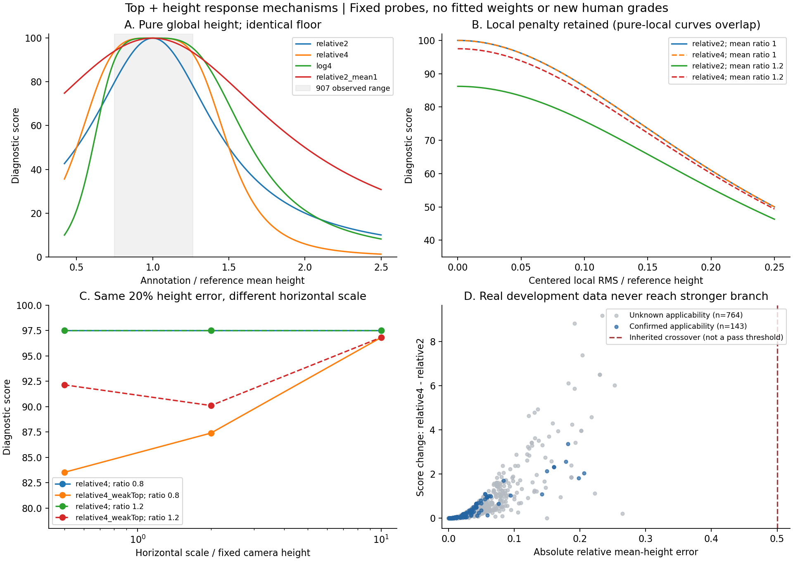
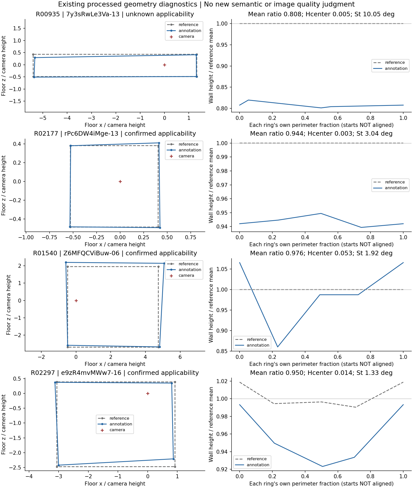

# 顶部与高度组合：响应形状、信息差异与真实覆盖

**当前研究入口：[候选决策、证据状态与待判断问题](DECISION_STATUS.md)。** 本文为响应形状阶段记录；各阶段的“下一步”“无需人工介入”和验证计数只说明当时状态，不覆盖当前入口。

2026-10-12。接续[现有审核约束核查](../quality_review_constraints_20261012/README.md)。本轮比较907条真实开发记录、既有179条控制及新增70条解析几何控制。正式算法、GT、人员资格和原输入未修改。

后续边角复核已落实为[高度解释与底点敏感性补充](CONDITIONING.md)：907记录对应739组坐标；净空仅作同一高度偏差的另一归一化；8188次底点微扰显示T20的整体偏低对±1像素扰动稳定。下方原分数和记录口径保留，解释同时参考补充中的坐标组口径。

**独立判断：改变整体高度响应形状，可以同时减轻T20、保留局部处罚并加重部分极端高度错误；但这只证明机制可行，不能确定处罚恰当。** 四次探针对20%的纯整体高度误差仍给97.50分，907条真实记录又没有覆盖其增强处罚区，因此不能据此选定四次函数。弱St会带入明显投影依赖；F则包含自身平整先验。两项都不能仅凭“补回信息”直接相加，也不能仅凭相关性永久删除。

## 1. 设计与证据边界

[运行前方案](protocol.json)先于本轮数值运行保存，但制定时已知道旧审核；不是独立预注册验证。固定9个探针，不搜索指数、切点或新权重：整体误差用相对差或真实均高比的绝对log，整体响应取二次或四次；局部保持二次、尺度0.25，整体沿用尺度0.5。旧弱St权重1/16、旧Fguard及整体尺度1分支作对照。结构与底边保持原设置。

指数也是模型选择，不能称“没有参数”。相同数值尺度不意味着相同物理边界：相对误差0.5对应均高比0.5/1.5，log误差0.5对应约0.6065/1.6487；后者同时改变低估/高估对称性及交叉位置。

| 证据 | 分母 | 可支持的解释 |
|---|---:|---|
| 原开发池 | 907记录、83图、19建筑 | 分量及改分分布，不是准确率 |
| 明确适用层 | 143记录、16图、11建筑 | 适用边界内的影响；不是143个质量合格标签 |
| 适用性未知层 | 764记录、67图、19建筑 | 单列描述，不当负例或已验收参考 |
| 旧审核数值并集 | 45记录 | 已暴露约束，与907重叠30条 |
| 排除上述重叠后 | 877记录、82图、19建筑 | 敏感性分析，仍非独立留出或独立人群 |
| 旧控制 | 71高度＋65匹配＋43结构 | 179条；1条不可算保留，65匹配中4条相机域外 |
| 新解析几何控制 | 14均高比×5局部幅度＝70条 | 65条顶面全在相机上方；另5条域外保留 |

新控制用相同矩形底面、参考墙高2.4、相机高1；顶角交替起伏，保持指定均高及精确周长RMS。St/F未计算，只评估无St/F分支。[字段合同](field_contract.json)说明0占位及未计算标志。控制没有人工质量等级。

907沿用原开发屏障，未使用留出，不补标签，不把新公式接入正式loader。冻结研究快照不替代当前正式输入。P05的输入/处理后双层诊断继续保存在上轮证据中，不以新几何得分认证输入正确。

## 2. 响应形状解决一种权衡，也暴露另一种

令整体相对误差为e、局部项为h。对照损失为`(e/0.5)^2+(h/0.25)^2`；四次探针只把第一项改成`(e/0.5)^4`。e小于0.5时放松，大于0.5时加重，局部项不变。0.5是沿用函数尺度，不是人认可的容忍线。

下表为底面、结构及局部顶面均正确的控制分数，**不是人工质量等级**；所列纯整体控制全部满足相机在顶面下的假设。

| 作答/参考均高比 | 旧二次 | 相对四次 | log四次 | 旧二次放宽尺度至1 |
|---:|---:|---:|---:|---:|
| 0.5 | 50.00 | 50.00 | 21.31 | 80.00 |
| 0.6 | 60.98 | 70.94 | 47.86 | 86.21 |
| 0.7 | 73.53 | 88.53 | 79.43 | 91.74 |
| 0.8 | 86.21 | 97.50 | 96.18 | 96.15 |
| 1.2 | 86.21 | 97.50 | 98.26 | 96.15 |
| 1.3 | 73.53 | 88.53 | 92.95 | 91.74 |
| 1.4 | 60.98 | 70.94 | 82.98 | 86.21 |
| 1.5 | 50.00 | 50.00 | 69.81 | 80.00 |
| 2 | 20.00 | 5.88 | 21.31 | 50.00 |
| 5 | 1.54 | 0.024 | 0.92 | 5.88 |

相对四次在大幅高估时更强，但20%—30%偏差明显放宽。log四次对半高/双高对称，却不是所有严重高估都比旧相对二次更强：1.5倍时69.81对50。选择“对称”不自动确定人的严重性。

纯局部RMS为参考高度10%时，两种相对响应均给86.21；整体20%与局部10%并存时，旧二次75.76、四次84.35。这证明局部通道保留，不证明86.21恰当。相对四次在均高比趋零的数学极限仍余5.88分，log四次趋零；该极限不满足本控制相机室内假设，不拿它冒充真实域内案例。



## 3. 真实数据揭示覆盖缺口

907的均高比范围为0.74760—1.26445，Hmean最大0.26445，最大绝对log比约0.29089。明确适用143条最大Hmean为0.20615。**全部907条在两种表示中都未进入0.5以上的增强处罚区。** 因而四次在此池只会减弱或保持整体项，不能称907验证了四次在该增强区间的响应。这不是“真实样本没有严重高度错误”的结论：T20整墙偏低23.36%对应净空偏低约47.46%，人工严重度不能由0.5尺度定义。

| 改动 | 全907中位改分 | 至少2分的改动 | 明确适用143条 |
|---|---:|---:|---|
| 相对二次→四次 | +0.182 | 46条增加，其中8条至少5分 | 中位+0.140；6条至少2分，0条至少5分 |
| 四次再加弱St | −0.198 | 68条降低，其中13条至少5分 | 最大降低1.741，0条至少2分 |
| 四次再加旧F | −0.553 | 74条降低 | 9条至少2分，最大降低3.197 |

2/5/10分只是改分幅度统计，不是合格或严重阈值。排除旧审核重叠的30条后，877条仍有42条因四次上升至少2分；弱St造成65条下降至少2分，其中12条至少5分，影响并非只发生在T20。

按运行前准则，在明确适用与未知两层分别按整体误差、局部项、弱St增罚、F增罚、局部表示差异各取前三；排除旧审核45条，合并27条真实案例。全部理由、几何及分量存于[机器结果](results.json)。以下四条展示不同机制，不称代表性样本：

| 真实案例 | 适用性 | 均高比 / Hcenter / St° | 旧二次→四次→加弱St | 观察范围 |
|---|---|---|---|---|
| R00935，7y3sRwLe3Va-13 | 未知 | 0.808 / 0.0047 / 10.048 | 75.09→83.92→70.84 | 自身较平、主要偏低，St增罚显著；未新判质量等级 |
| R02177，rPc6DW4iMge-13 | 明确适用 | 0.944 / 0.0028 / 3.045 | 91.35→92.44→90.86 | 较小整体偏低仍有St增罚，未判断恰当与否 |
| R01540，Z6MFQCViBuw-06 | 明确适用 | 0.976 / 0.0531 / 1.924 | 75.33→75.48→75.02 | 均高接近但有起伏；四次几乎不抬分，局部仍起作用 |
| R02297，e9zR4mvMWw7-16 | 明确适用 | 0.950 / 0.0138 / 1.333 | 78.74→79.41→79.17 | 自身std/GT均高0.0209比Hcenter大；参考自身不严格平顶 |

最大整体误差R02330混有较大底面差异（IoU约0.347），旧二次5.81、四次6.01；不是“仅整体高度坏”的真实验证。图示为既有处理后几何，未新做原图语义评级。高度曲线各按自身周长和起点绘制，不能从相同横坐标推断同一物理墙角。



## 4. St保留信息，也带入额外依赖

同样20%纯整体低估，只改变底面横向尺度0.5、2、10，无St四次分数均97.50；加1/16 St后为83.52、87.39、96.81。St带入球面距离对房间尺度和相机位置的响应。若评价图上边界定位，这可能有用；若评价统一物理高度偏差，它是额外尺度依赖。不能不声明评价对象就判断对错。

四次＋弱St中，St损失在483/907条、76/143条明确适用记录上超过整体与局部高度损失之和。但**份额大不等于实际扣分大**：明确适用层新增扣分仍均小于2。在固定几何的小扰动下，二次St压过四次整体项也符合两种响应阶数的预期，不能用“主导条数”直接判失败。

两项测度也不同：旧St沿球面顶边弧长采样、取双向平均最近弧距离；Hcenter沿底边周长采样、比较中心化高度。旧窄峰控制把底周长支持从0.0002缩至0.00002，St仍约0.409°，Hcenter从0.00556降至约0.000006；同一窄峰对齐采样后Hcenter又约0.009375。这同时揭示测度差异与有限采样漏峰，改整体幂次不能修复，1/16 St也不能充分保障尖峰检出。

此前真实907极窄高峰筛查为0，不证明未来不发生；当前不为合成窄峰立即追加强罚。源码可在输入来源ZIP定位：`frozen/scope_engine/legacy_geometry/geometric_components.py`的球面采样/距离和`top_structure_20261012/mechanisms/centered_height.py`的中心化最近底边比较。不能仅凭相关就说St完全冗余。

## 5. F与局部表示不能直接互换

907中Hcenter与自身周长加权std的差异中位约0.000157、最大0.01327；明确适用层最大0.00718。参考起伏、不同底面及最近边对应使两者不完全相同。907参考自身std/均高最高约0.01112，明确适用层最高约0.00784，也不能假定参考严格水平。

旧“非平参考且作答完全正确”控制中，Hmean/Hcenter/St全为0，恢复F却使100降至92.67—93.34。F是自身平整先验，不是遗漏的参考误差。若场景明确要求平顶，可以研究这个先验；若参考允许非平顶，它会处罚正确作答。不能由该控制直接否定平顶适用域中的F，也不能无条件加入所有场景。

## 6. 回看旧审核，只作约束

| 候选 | T20顶部单独处罚率 | S034顶部单独处罚率 |
|---|---:|---:|
| 相对二次 | 18.04% | 11.40% |
| 相对四次 | 4.71% | 7.40% |
| log四次 | 7.58% | 7.46% |
| 相对四次＋弱St | 23.77% | 15.91% |
| 相对四次＋F | 5.20% | 12.75% |

相对四次符合P04方向，log四次略反向，加弱St再次反向。不能以此淘汰log或选四次；P04只比较顶部、带不确定表达，没有数值处罚目标。

相对二次→四次时，P01差值14.10→13.68；C01 −2.17→−2.14；C02 2.96→1.72；C03 9.85→9.86；C04 1.23→0.38。局部未加强，避免了上轮局部尺度0.125探针把C03拉开到约15分的现象。但C01/C02/C04仍无数值通过线，“更接近”不自动算更准确。

本轮从已核对相同分量与身份的907输入补齐旧定向对真实均高比，log分支可比较全部45条；没有从绝对Hmean猜正负。

## 7. 本阶段决定与复算（后续见当前入口）

1. **继续比较整体响应形状，暂不冻结四次。** 它证明不必只在“整体全放松”与“局部全加重”间选择；20%—40%中间区间的处罚仍未被真实质量证据识别。
2. **分别报告整体、局部和顶部定位。** 保留St不意味着必须加进总分；固定相加有问题也不意味着永久删除St。后续若研究抵消整体高度后的顶部残差，应重新构造几何并验证，不能从St减去一个高度标量冒充距离。
3. **Hcenter继续作为局部候选，同时保留自身及参考profile。** 采样漏峰与平顶先验适用域分别处理，不通过加强全部局部处罚掩盖表示问题。
4. **本阶段当时无需新增人工审核。** 本轮没有进入必须选择生产公式的步骤。增强响应区间的真实覆盖缺口已记录；若后续需冻结中间尺度或严重等级，应准备有区分目的的材料，而不是重复审T20。

[inputs.json](inputs.json)保存907记录、990对象几何、原资格及上轮审核证据；[results.json](results.json)保存完整候选结果、27条真实诊断案例、原控制状态、70条新控制及验证。两张图可重建，不是检查截图。

```powershell
python -B tools/thesis_main/analysis/quality_top_height_response_20261012.py --output research/quality_top_height_response_20261012 --figures
python -B -m pytest tests/test_quality_top_height_response_20261012.py tests/test_quality_review_constraints_20261012.py -q -p no:cacheprovider
```

独立核对4535个原分数，最大差1.4211e−14；从冻结三维顶底边对907条重新精确积分均高和自身std，最大归一化误差小于7e−16。未重新计算全部IoU、St或最近边Hcenter，不冒称完整几何引擎重跑。14项针对性测试通过；不运行无关训练、融合或Label Studio测试。两张图已逐张查看，内容及标签完整。

地图、文档索引和质量状态页已同步。无协议、SOP、正式schema、资格或分数变更；新增字段仅为开发产物，受上述字段合同约束。未生成检查截图，未改Downloads原包，未提交或推送Git。
