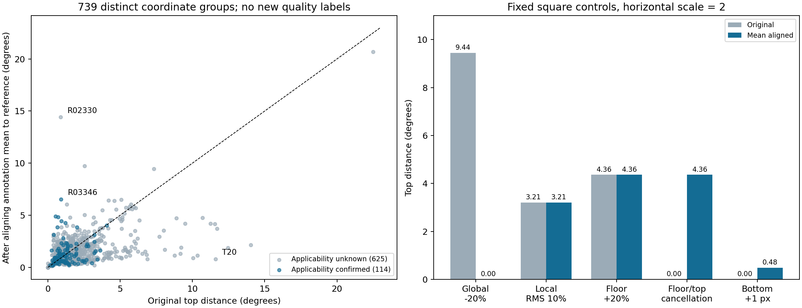

# 顶部均高对齐残差：机制与边界

> 阶段记录。当前决定、后续和审核状态统一见[候选决策入口](DECISION_STATUS.md)；下方“下一步”“无需人工介入”及未提交状态为本阶段完成时的历史记录。

2026-10-12。本轮执行上轮计划：在几何上消除整体均高差，再重算顶部球面距离，检验剩余量的含义。它能解释T20的旧顶部项为何对整体高度敏感，但**不能直接作为“纯局部不平项”加入评分**。底面误差、投影高度和原本互相抵消的偏差仍会进入残差。

## 方法与证据边界

设作答和参考的底面周长加权整墙均高为 μA、μG。主诊断只将作答顶部所有点的y加上 μG−μA，然后沿用原球面弧距离计算 St(A对齐至G, G)。底面和水平坐标不动。反向诊断将参考顶部平移至作答均高，再算 St(A, G对齐至A)。这是两个不同投影高度上的对照；不是从原St数值中减去Hmean，也不是优化寻找使St最小的平移量。

原始和变换后的所有顶部端点须在相机以上；不满足则标不可用，不剪裁。球面距离沿全部声明边界的**大圆短弧**计算，不进行可见性推断或物理墙角配对。它是边界集合距离，不证明对应正确。这里不重新认证完整布局有效性。

沿用907条开发记录、739个精确坐标组：明确适用143条/114组，适用未知764条/625组；没有新增留出或人工质量标签。记录与坐标组均不视为独立图片/建筑样本。设计先写入[top_residual_design.json](top_residual_design.json)，知道旧审核后制定，不称独立预注册。

## 控制实验：能去掉什么，又会带入什么

三个水平尺度0.5、2、10，各9类几何，加1条对齐后越过相机高度的控制，共28条。参考整墙高2.4。局部控制的沿周长RMS为参考均高的10%；它不是10%最大偏差。下表以水平尺度2为例，单位均为度，零值仅显示舍入后的数值。

|控制|原St|对齐作答至参考后的St|解释|
|---|---:|---:|---|
|整体均高低20%，其余相同|9.444|0.000|纯整体平移被消除|
|同均高，交替局部起伏|3.208|3.208|局部形状差异保留|
|均高低20%＋同样局部起伏|9.566|3.208|在相同参考高度上还原上述局部控制|
|底面径向大20%，高度正确且平顶|4.360|4.360|无均高/局部高度错误仍有残差：底面会影响它|
|底面和顶端射线尺度抵消，原顶边界重合|0.000|4.360|对齐可能解除抵消，不能当作原St的非负子项|
|固定顶部射线，全部底点同向移动1像素|0.000|0.483|残差会带入由底点变化引起的重建均高变化|

底点1像素控制在三个尺度上的残差分别为0.232°、0.483°、0.618°，不是实际噪声或质量容忍阈值。它说明“顶部定位没变”与“均高对齐后的顶部残差没变”不是同一件事；不能把残差上升归因于顶部标错。

相同的局部起伏换投影尺度，残差分别为2.749°、3.208°、0.874°；仍然不是脱离房间几何的局部起伏量。整体偏低＋局部起伏控制在尺度0.5上，两种对齐方向得到2.749°与5.341°，说明选择对齐高度也有实质影响。相同非平参考与作答相互比较保持0，不额外施加“必须平顶”的先验。

域外控制的原始作答/参考均在相机以上，但作答对齐至较低参考后有顶点落到相机以下，主残差返回null；反向诊断仍可用。不可把这类失败当作零误差。本轮739个真实坐标组的两种对齐均未越域。

## 真实开发集

|口径|数量|主残差数值上升数|原St中位数|主残差中位数|两种对齐差的最大值|
|---|---:|---:|---:|---:|---:|
|全体记录|907|385|1.317°|1.229°|2.655°|
|全体坐标组|739|302|1.472°|1.262°|2.655°|
|明确适用记录|143|68|1.061°|0.880°|0.246°|
|明确适用坐标组|114|55|1.042°|0.925°|0.246°|
|未知坐标组|625|247|1.629°|1.324°|2.655°|

上升计数使用1e−8°数值容差，**不是明显恶化或质量下降计数**。补看大于0.01°的变化，全体286组、明确适用53组；0.01°只是便于排除微小数值变化的描述切片，不是新质量阈值。这些结果只否定“对齐必然减少距离”的直觉，不能单独判断上升是纠正了抵消还是重复处罚底面。

|真实案例|适用性|原St|主残差|反向残差|冻结Hcenter|冻结底部距离|
|---|---|---:|---:|---:|---:|---:|
|T20 / R00397|未知|11.588°|0.810°|0.574°|0.01066|0.788°|
|R03346 / Z6MFQCViBuw-08|明确|0.903°|6.530°|6.379°|0.07601|3.680°|
|R02330 / uNb9QFRL6hY-56|未知|0.877°|14.413°|11.758°|0.07508|11.112°|
|R00464 / wc2JMjhGNzB-40|明确|4.077°|4.019°|4.037°|0.08280|2.853°|

T20的结果支持其旧St对整体均高差强烈响应；不等于把11.588−0.810度解释为可相加的“纯整体误差”，也不自动给出T20合理总分。其整体偏低仍需单独评价。R03346和R02330说明原顶部距离小也不保证处理后几何无问题；这里只展示诊断矛盾，不猜测人员错误成因。R00464均高平移影响很小，提示并非所有真实顶部误差都能通过均高解释。

按固定准则选出的18组保留全部选择理由与高采样复核值，见[top_residual.json](top_residual.json)。取例在明确适用/未知层分别进行，包含T20；不称独立人工验证，也未新增S034到907集，因此本轮不重新裁决P04两图的相对处罚。



## 本阶段判断与下一步（历史计划）

1. **不把“均高对齐残差”直接替换旧St或叠加入分。** 它适合解释机制，但没有隔离底面、投影高度和局部高度三者。给它一个弱权重也不会消除这些语义混合。
2. **整体高度与局部高度仍需分开观察。** 本轮没有为四次响应、宽容区或任何具体强度背书，也没有新增严重整体高度的真实验证证据。此前中等偏差明显放宽是否恰当仍待判断。
3. 下一步先用同底面、同均高、同局部RMS但不同局部位置/支持范围的控制，检查Hcenter与St究竟各自遗漏什么；同时核对上表明确适用的矛盾案例。只有找到具有可解释增量的信息，才值得继续讨论顶部项如何进入组合。
4. 原输入诊断与处理后几何继续分层；本次对齐仅在临时几何副本上计算，没有修复P05或改变人员输入。需要人工判断的是不可由几何决定的墙角语义/可接受性，届时再整理少量有明确问题的图请求审核；本阶段当时无需重复审核。

## 复现、验证与修复记录

```powershell
python -B tools/thesis_main/analysis/quality_top_residual_20261012.py --figures
python -B -m pytest tests/test_quality_top_residual_20261012.py tests/test_quality_height_conditioning_20261012.py tests/test_quality_top_height_response_20261012.py tests/test_quality_review_constraints_20261012.py -q -p no:cacheprovider
```

907条原St重新计算与冻结值最大误差7.11e−15°；18个真实取例及全部28控制从2048改8192采样，三种距离的最大差为1.39e−5°。这个有限复核不等于所有739组都通过高采样认证，不覆盖任意窄尖峰。相关29项测试通过，覆盖主要几何不变性、底面混入、域外、对齐方向、输入不修改和冻结数据边界。没有重算IoU/Hcenter或正式Q，未运行无关运营/训练测试。

构造新控制时发现旧解析辅助函数为A/G共用同一底面列表；对新控制就地缩放会重复缩放并使二者一起变化。已在新生成器中分别深复制，增加垂直点对、非共享存储及1.2倍比例回归测试，并重跑全部结果。旧辅助函数本身及此前只读使用不受修改；907真实计算从独立冻结几何读取，不受此问题影响。最终产物不保留这批错误控制数值。

独立只读复核未发现阻塞问题，提醒上升计数包含微小变化，已按上述口径说明。字段合同新增两个产物说明；项目地图与索引登记本附录和工具/测试。图为可复算研究产物，无临时检查截图。正式输入、GT、资格、留出、评分合同均未修改；未提交或推送Git。
