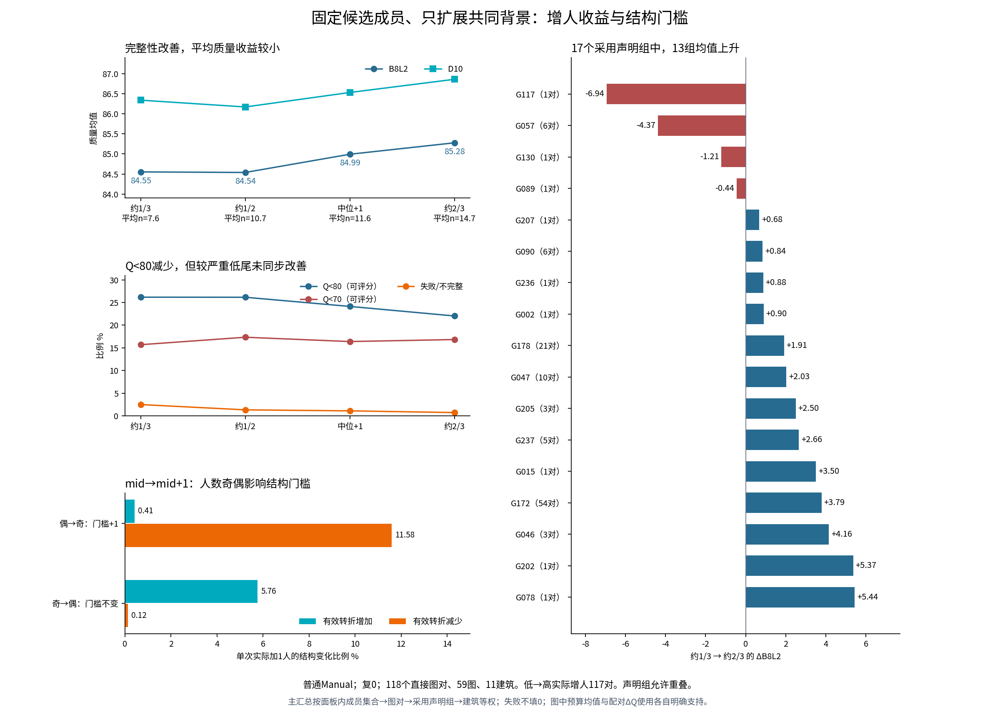
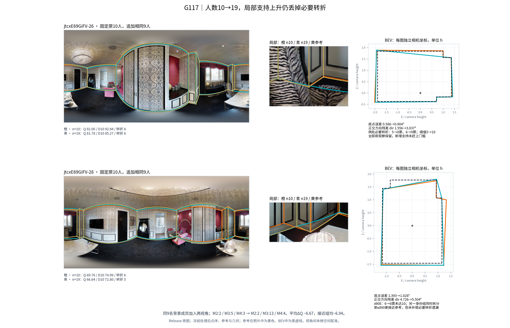

# 嵌套背景增人：多数声明组改善，收益大小与局部门槛有关

本补充分析使用本轮已完成的精确团队结果，不追加全量融合。范围为普通 Manual、当前结构分类面板的复 0；在每个图对与类别对中，候选成员及所选候选集合固定，只依次加入预先按散列顺序确定的共同背景人员。同一组实际加入者在两张同房图上重复。人数由共同成员容量决定；这不是按目标 Q 挑出的最佳增人方案。

## 1. 最值得保留的判断

**增人对多数已有声明组的平均质量有益，但“多加人”与“保住稀缺必要转折”是两个问题。** 从约共同容量的 1/3 扩展到约 2/3，17 个允许重叠的采用声明组中，13 组的平均 ΔB8L2 为正。G078 为 +5.44，G202 为 +5.37，G046 为 +4.16，G172 为 +3.79，G015 为 +3.50；这些正结果应保留。另有 G117 −6.94、G057 −4.37 等明确反例，不能用总体均值代替其机制。

按图对、声明组、建筑逐层等权后，低→高预算的配对 ΔB8L2 为 **+0.733**，ΔD10 为 **+0.518**；失败/不完整从 **2.49% 降至 0.73%**。获益超过 5 分的机会占 **18.60%**，损失超过 5 分仍占 **11.40%**。这支持“增人往往改善完整性，并在多数声明组改善质量”的有范围判断；劳动成本和强负尾说明，它并不是对所有视角都划算的默认翻倍操作。[表：`results/budget/ADDITION_GROUP.csv`、`ADDITION_SUMMARY.csv`、`BUDGET_SUMMARY.csv`]

## 2. 全量预算与低尾

四个预算角色是 `ceil(N/3)`、`floor(N/2)`、`floor(N/2)+1`、`ceil(2N/3)`，其中 N 为该图对共同合格人员容量；按面板候选容量约束裁剪。低→高实际人数范围为 3–12 人到 4–23 人。下表的平均人数是分层加权后的设计描述，不是一项固定人数实验。

| 预算角色 | 平均人数 | B8L2 | D10 | 失败/不完整 | Q<80 | Q<70 | 有效转折均值 |
|---|---:|---:|---:|---:|---:|---:|---:|
| 约 1/3 | 7.61 | 84.55 | 86.34 | 2.49% | 26.18% | 15.70% | 5.54 |
| 约 1/2 | 10.66 | 84.54 | 86.17 | 1.32% | 26.17% | 17.35% | 5.33 |
| 中位预算 +1 | 11.64 | 84.99 | 86.53 | 1.10% | 24.14% | 16.39% | 5.31 |
| 约 2/3 | 14.69 | 85.28 | 86.86 | 0.73% | 22.04% | 16.84% | 5.23 |

Q 均值及阈值比例只对当前预算有正式 Q 的端点计算，失败/不完整独立报告，未填成零分。为判断低尾是否仅由新增可评分结果引起，还在**前后均可评分的同一支持**上比较：低→高的 Q<80 从 **26.01% 降到 21.77%**，但 Q<70 从 **15.58% 升到 16.36%**。因此，改善普通低尾与改善较严重低尾没有同步发生。平均质量上升不是所有风险下降的替代证据。[表：`results/budget/ADDITION_SUMMARY.csv` 中 `Q_lt70/80_joint_*`]

| 实际增人步骤 | 配对 ΔQ | ΔD10 | 损失>5 | 获益>5 | 可计时子集劳动比 |
|---|---:|---:|---:|---:|---:|
| 约 1/3 → 约 1/2 | −0.219 | −0.391 | 11.19% | 15.10% | 1.503 |
| 约 1/2 → 中位 +1 | +0.707 | +0.592 | 3.34% | 9.12% | 1.154 |
| 中位 +1 → 约 2/3 | +0.386 | +0.434 | 8.97% | 11.07% | 1.326 |
| 约 1/3 → 约 2/3 | +0.733 | +0.518 | 11.40% | 18.60% | 2.006 |

各步骤支持不完全相同；同人数裁剪别名不计入真实增人效应。表中 ΔQ 先在同一视角前后均可评分的机会中计算，再逐层汇总，所以不要求等于上一张预算均值表的简单相减。人数、加入身份与类别构成同时改变；这里估计的是本轮固定顺序的**实际增人效果**，不是剥离成员构成的纯人数因果效应。

劳动比只使用前后都有完整耗时且计时语义相同的端点。低→高有 2,904 次可计时视角增人机会，占 22,688 次的 **12.80%**，覆盖 35 图、34 图对、9 建筑、10 声明组；分层加权的可计时比例为 49.55%，两者不可混称。计时且 Q 前后有效的 2,840 次机会、34 图上，配对 ΔQ 为 **+1.352**，损失>5 占 **10.56%**，获益>5 占 **19.69%**。劳动约翻倍与这一计时子集质量结果应一起解读，不能把它自动换算成交付时间或金钱成本。[表：`results/budget/TIMING_SUPPORT.csv`、`ADDITION_SUMMARY.csv` 中 `*_time_matched`]

## 3. 同一增人操作能否在两视角重复？

低→高的两视角效应按 ±1 分定义“小变化”，保留全部真实增人机会：

| 两视角 ΔQ 状态 | 分层加权比例 |
|---|---:|
| 两边均小变化 | 6.52% |
| 两边均上升超过 1 分 | 22.76% |
| 两边均下降超过 1 分 | 10.96% |
| 一正一负且均超过 1 分 | 20.04% |
| 仅一边超过 1 分 | 34.03% |
| 至少一边配对质量不可用 | 5.69% |

这些状态先保留“无实质变化”，没有预先只挑源、目标都显著变化的事件。增人常有正效应，但完全相同的加入者仍会因视角的初始偏差、局部支持和对应过程，呈现不同幅度甚至相反方向。G015 的组均增人效应为 +3.50，但其低→高跨视角相反状态占 60%；这与同类换人的成员反转案例相容：类别或预算均值可以有稳定趋势，具体成员集合的作用仍依赖视角。[表：`results/budget/ADDITION_GROUP.csv`、`ADDITION_LINKS.csv.gz`]

## 4. 奇偶门槛给出明确的结构机制

冻结融合要求至少 `ceil(n/2)` 票。本比较仅使用 `mid → mid+1`、确实新增 1 人的记录，避免把其它预算间恰巧只加 1 人的操作混入。

| 实际加 1 人 | 支持门槛 | 有效转折增加 | 有效转折减少 | 参考节点 5°召回变化 | ΔQ | 损失>5 |
|---|---|---:|---:|---:|---:|---:|
| 偶数→奇数 | +1 | 0.41% | 11.58% | −1.77 个百分点 | +0.474 | 4.86% |
| 奇数→偶数 | 不变 | 5.76% | 0.12% | +1.13 个百分点 | +0.667 | 2.45% |

前者 54 图对、9 建筑，后者 62 图对、8 建筑；其人数与条件并非完全相同，所以不能把两行 Q 差解释为普遍的奇偶因果效应。**结构变化的方向却与实际门槛直接吻合**：偶→奇时，新增人员若不支持原先刚过线的转折，原转折就可能失去资格；奇→偶时门槛不升，新增票更容易让一个已有少数意见转折过线。原答并未被抹去，变化发生在有效融合支持条件。[表：`results/budget/SINGLE_ADDITION_PARITY_*.csv`]

## 5. G117：新增票增加，仍赶不上支持门槛

该例从 G117 的低→高事件中挑选“两视角均降 Q 且均丢转折、平均 ΔQ 靠近组均”的事件，供机制解释，未用作群体效应估计。精确键为 `SRB_7a7973ce4edb6c5ca1f9`、`selected_mask=45`；10→19 人。两视角平均 ΔQ 为 −6.671，接近 G117 组均 −6.944。

原 10 人：`W101|W108|W113|W114|W115|W116|W126|W127|W129|W130`。

加入 9 人：`W104|W106|W107|W119|W121|W124|W131|W133|W134`。

当前该建筑楼外结构分类选择的是行为 JOINT 家族（表达、冗余及几何特征，不是 Q/T 联合标签）。构成为 **M2:2 / M3:5 / M4:3 → M2:2 / M3:13 / M4:4**；加入 8 个 M3、1 个 M4。该折 M4 的转折表达中心较高；其人数从 3 增至 4，占比却从 30% 降至 21.05%。标签解释需和实际局部原答连用，不能把另一建筑的 M3 名称直接搬来。

| 视角 | Q | D10 | 节点/有效转折 | 底点误差° | 正交方向残差 dir° |
|---|---:|---:|---:|---:|---:|
| jtc26，10→19 人 | 92.003→81.782 | 92.936→85.274 | 8→6 | 0.586→0.904 | 1.556→3.037 |
| jtc28，10→19 人 | 69.762→66.641 | 74.989→72.797 | 6→5 | 1.393→1.028 | 4.726→5.504 |

`dir` 是候选轮廓相对其最佳正交轴的内在方向残差，不是相对参考绝对墙向的误差。

**jtc26 给出一个干净的局部支持稀释机制。** 图中窗边、座椅附近的两处小转折由固定参考保留，原图墙面和顶部线索可见，底边部分被家具挡住。其局部身份组的旧观察全部保留，没有旧观察换组；第一处支持从 5 增到 8，新增 `W106,W124,W134`；第二处从 6 增到 9，新增 `W104,W121,W134`。然而总人数门槛从 5 升到 10，两处都被取消，连接变成跨越小折返的边。原答的信息没有减少，新增者的局部支持不足以维持其融合资格。

**jtc28 同时发生稀释和对应重组。** x≈908 的必要转折保留原 6 票，只加入 `W107,W133` 的 2 票，8 票未过 10。另一原 x≈873、9 票的身份组拆成：4 个原观察与 6 个新增观察组成 x≈890 的 10 票组；其位置更接近参考 x≈890；另 5 个原观察与 3 个新观察组成 x≈870 的 8 票组、未入选。底点分项因此改善，但仍不足以补偿必要转折丢失及轮廓正交残差恶化。不能把该视角所有变化统称为纯稀释，也不能把整个 G117 的组均负效应都归结为这一个案例。

四端点按冻结程序重放，Q、D10、底点、dir、Hmean 与保存结果最大差均为 0。节点身份链接仅依据同一视角原 `(object_id,pair_index)` 的保留关系，不新增未经确认的跨相机角点对应。[精确证据：`cases/budget/G117_LOW_HIGH_KEY_VOTE_LEDGER.csv`、`WITHIN_VIEW_GROUP_LINKS.csv`、`VOTE_OBSERVATIONS.csv`、`REPLAY.json.gz`]

## 6. 支持、采用建议与连接方式

本补充复用 90,139 个已保存的唯一端点，覆盖 1,212 个实际预算面板、309 个候选成员序列、118 个普通可比直接图对、59 图、11 建筑及 17 个允许重叠的采用声明组。四类步骤共产生 45,400 条双视角增人记录，其中 45,338 条真实增人，62 条因裁剪而同人数，后者不进入增人效应。低→高为 11,344 条双视角实际操作、117 个直接图对。它们是有限成员集合上的重复计算，不能当作独立房间样本。主汇总顺序为面板内成员集合等权，再类别对序列、直接图对、原声明组和建筑等权；全部计权层级均保存。[`results/budget/BUDGET_RECEIPT.json`]

建议保留三点：

1. **保留多数房间组增人有益的结论。** 对 G078、G046、G172 等本轮正效应条件，可把较高预算作为有依据的候选；无需因 G117、G057 反例否定这类收益。
2. **把局部支持余量作为人数决策解释项。** 只统计人数或原答局部命中次数不够，需看同一身份组的票数离下一门槛多远。已有必要短转折接近门槛时，增加不能表达该转折的成员可能同时增加劳动和遗漏风险。
3. **中位附近的小增量值得优先检查，但不是已验证最优停止规则。** 本轮 mid→mid+1 的平均增益 +0.707、损失>5 3.34%，成本增幅在可计时子集约 15.4%，优于无条件扩倍的平均成本收益直觉；它仍是保存面板上的描述性发现。使用源视角选预算、观察目标几何后补收、无目标 GT 在线停止应另按各自信息预算评价，本表不能替代这些策略的验证。

研究台连接主键为 `series_id + transition + selected_mask`；其一行含两视角共四个 `team_key`、前后精确成员、实际新增者、类别向量、图片、pool、参考、门槛、Q/结构变化与缺失状态。`panel_before/after` 接本轮设计；`team_key` 接端点标量及保存几何；G117 的 `local_feature_key` 和 `object_id@pair_index` 接局部身份组和原答。详见 `REPRODUCE.md`。本补充主分析新增融合数为 0；仅 G117 的 4 次全状态重放补充局部机制票账，未改变评分。
