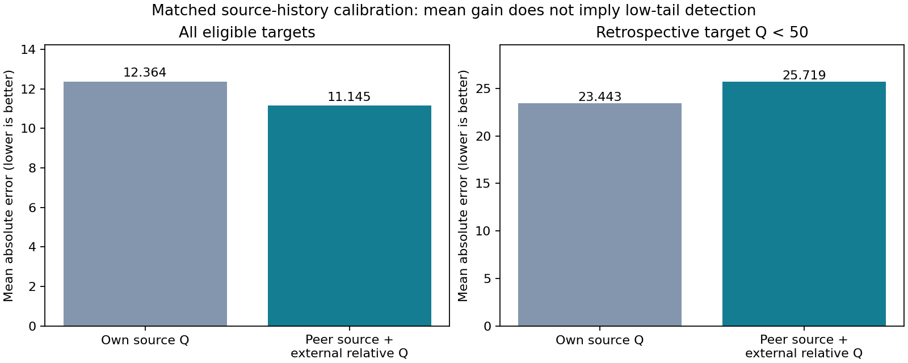
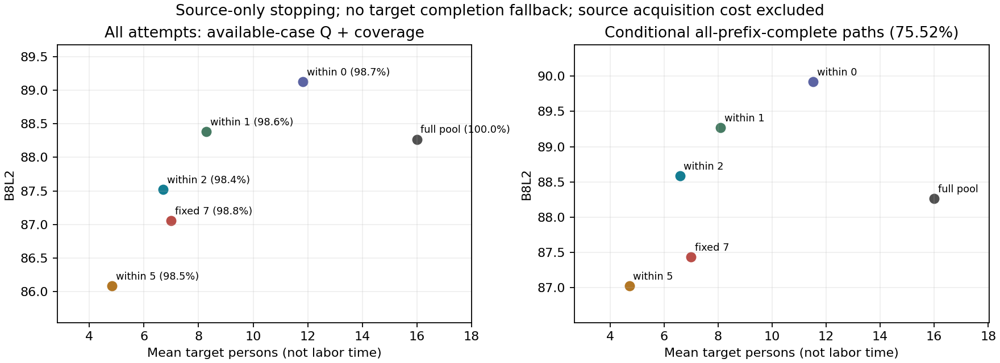

# 同房多视角：独立接续与研究判断

2026-10-21（UTC+11）。输入固定为 main `3391bc6ba241172e06fa114728b4c58d40558b3f`。本包是独立追加研究，不是新 Pro 压缩包的归档副本；没有重写评分、参考、人员标签、投票资格或融合方法。

## 本轮解决什么

把同房研究收束为三个可分别检验的问题：

1. **房间共同信息与个人倾向各贡献多少？** 对个人 Q 和结构表达保留同源其他人员基线，而不把全部同房迁移收益归于人员类别。
2. **预测更准是否意味着更会选人或确定人数？** 单独评估真实保存融合路径中的人数选择，保留固定人数与全员基线、失败和低尾。
3. **结构、位置和目标表示如何解释跨视角反转？** 复用已经确认的 G046 对应；G015 目标定义差异已获人工解释，现有 GT 和评分冻结。

## 已实际完成的独立工作

- [个人质量校准](calibration/README.md)：从当前逐对象证据重建源图、目标图和楼外历史；与保存的 480,632 行特征逐项核对。严格多数历史、最少多数与最多历史分别报告，B8L2 与 D10、不同来源分开。
- [结构迁移增量](structure/README.md)：对 11,153 行已有逐目标预测重新计算误差，增加建筑符号、留一楼和描述性区间。比较本人源视角、同源他人和楼外历史。
- [人数选择与固定预算](stopping/README.md)：使用已保存的真实融合节点，不插值、不补零、不用目标 Q 选择停止人数。以实际输出说明覆盖及可比口径。
- [云端人工审阅与采用口径](review/README.md)：真实原图与当前参考，G015 已确认理论上应表达壁炉转折；按用户要求继续以当前 GT 评价，不改参考或分数。

本轮没有重新运行新 Pro 声称的 33,953 次原生团队求值，也没有读取其未取得的源代码。已有 124,924 个前缀仍是原仓库实验，不因本次再分析变成新增独立样本。

## 最值得保留的研究解释

### 个人 Q：公共难易水平与个人相对表现可以分开

在源图 Q 已知的应用条件下，用同房源图其他人员的质量估计公共任务水平，再加入此人在目标建筑外相对同任务同行的差异，是清楚且可检验的校准方式。与本人源图简单平均比较时，必须同时报告仅使用本人实际作答源图的同预算版本，以及使用所有可用源图的扩展版本。

同预算最多历史下，B8L2 MAE 从本人源图平均的 **12.36366 降至 11.14471**，改善 1.21895，七楼中六楼改善；逐一去掉任一楼后，整体改善仍为 0.92898–1.48246。允许使用本人未作答源图的他人信息时为 11.12581，属于扩展信息预算。

但目标 Q<50 的事后子集，校准 MAE 为 **25.71876**，劣于本人源图的 **23.44290**，有明显高估。因此它适合预期质量校准，不能单凭这一结果用于严重错误筛选或保证某个人的目标交付质量。目标 Q<50 分层仅是事后诊断，不进入预测。

### 结构：部分个人信息有用，但房间共同结构不可忽略

本人同房历史相对同源他人，对参考角点数差的误差减少约 0.096 个；收益不均匀。9°参考角点未匹配比例的预测 MAE 减少约 1.099 个百分点，去掉任一楼仍保持正增量。

但“未匹配”也可能来自位置偏离，不能把它改称人工确认漏角率。GT-free 的相对同行点数差增量仅约 0.0066 个，留一楼可以变号。带符号底点偏移和面积对数偏差则全部七楼都是本人源历史比同源他人更差。

适合论文的结论是：**房间共同结构、个人对结构的表达倾向、视角相关定位，需要分别建模和解释。** 仅看到本人跨视角相似，不能证明人员分类捕捉到了全部迁移机制。

### 人数：以目标收益与资源预算共同评价

源图近最优前缀规则需要已经取得源图整条曲线，属于利用既有源经验的目标人数选择，不是从当前目标在线观测就能知道未来峰值。人数不是劳动时间，源图建立及评分成本也不能隐去。

本轮全员完整路径、最少多数历史的共同完整支持上：源曲线距最高点 2 分以内的最早前缀，平均 6.580 人、Q 88.587；固定 7 人为 Q 87.433；全员平均 16 人、Q 88.268。该源规则的平均人数与平均 Q 有吸引力，但平均目标级低十分位为 80.101，反而低于固定 7 人的 81.636。

共同完整面板只保留 1,160/1,536 条实际顺序（75.52%），不能隐藏排除。全部尝试中，源规则平均人数 6.703、可评分率 98.44%、有效结果 Q 87.522；固定 7 人可评分率 98.77%、有效 Q 87.055；全员可评分率 100%、Q 88.268。有效 Q 来自不同成功子集，因此不能把后两项直接包装为无条件效用优劣。完整率与低尾需要同时报告。

这没有复现 Pro 的目标几何不完整后继续收答规则；本包的源规则不使用目标状态追加人数，所以与其 7.36 人结果不是同一协议。不能把协议差异写成原报告算错。本包将原始可评价率、共同完整支持、人数和相对全员损失并列；具体数值以停止分析表为准。

## 新 Pro 返回：有价值，但证据身份必须分开

来源：[2026-10-20 新返回](https://chatgpt.com/c/6ad74362-edbc-83ec-9ae2-016b29eed74b?messageId=2ef88220-c95d-5787-8ef9-bac05fde8222)。新回复已明确上传服务返回 403，47.1 MiB 包未持久保存。本轮精确名称检索及 16:34 UTC 后生成文件清单均未找到该包，因而没有可供独立代码复算的完整新交付。

值得保留的方向：区分绝对 Q 预测与实际选队；承认源图赢家未跨到更大团队面板；保留省时方案低尾；把身份组支持、投票门槛和位置中位数分别解释。以下仍是 **Pro 报告结果，未由本包重放验真**：新选队与省时团队、跨视角完全相同换人、G117/G015 新团队票账、Semi 新团队及其全部求值数量。

特别需要修正其使用方式：

- “80.3% 换人方向一致”筛选了源、目标两端效果均至少 2 分。目标端结果在实际决策时未知，应另报全部事件以及仅由源端阈值选择的覆盖与命中，不能用该条件比例充当部署预测成功率。
- 细类收缩改善 0.303 MAE 是相对非分类收缩，不是超过最强连续校准式的独立增量。
- 省时方案质量区间跨零，不等于已证明质量等效；报告中的大损失低尾必须保留。
- M0→M1 团队的历史 Q_peer 差约 17.863 分（Pro 报告），不能把总替换效应全部解释为纯标法因果收益。

## 分类版本纠正

当前 `personnel_taxonomy_20261021/CORRECTION_RECEIPT.json` 优先于原 HTML/PDF。普通 Manual 转折差、短转折差已改为 0.60707、0.33591；匹配角点数后 A2 类内减类间角距为 Manual −0.49611°、Semi −0.24339°。旧报告的 0.647/0.352 和 −0.872°/−0.177° 不再作为当前统计。本包没有再次重拟合类别。

## G015 人工判断已完成：结构应表达，评价参考冻结

2026-10-21 用户确认：7y3sRwLe3Va-11 的壁炉凸体理论上应标，现有四角 GT 确实简化了；但整个质量评价仍把现有 GT 作为正确参考。**不修改 GT、原答、融合或评分，不重算或调整排名。**

这项确认只增加案例解释：更接近固定 GT 并不在这一局部自动等于更充分地表达了可见必要结构；相对 GT 的损失也不能单独证明该结构是乱画或人员能力差。它不推翻既定评分，不改变总体统计，不推广到其他人员类别。见 [采用口径及云端审阅](review/README.md)。本仓库仅保留归纳后的解释，不保存原始聊天回执。

G046 三视角 A↔A、B↔B 已确认，不再请求。附近原答命中与同一融合身份组票数仍分别解释。

另一个交付缺口不属于人工语义判断：新 Pro 实际 ZIP 或等价代码/结果表仍未取得。新团队替换、人员配比及其融合票账没有被本包复现；三项独立补算不能替代整份 Pro 研究。

## 复现与适用范围

从仓库根目录执行三个 `tools/thesis_main/analysis/same_room_*_review_20261021.py`，各子目录 README 记录精确命令、输入、预算和输出。原数据为 v2；Manual 为主，未将普通 Manual 的结果外推 Semi 或门洞。直接关系、声明组重叠、参考资格和缺失身份保持不变。没有把 9 个声明组当成 9 个独立房间。

这是可用于同房章节的阶段性实证收束，不是整个同房任务全部完成的宣告。已独立实算的部分、Pro 待验部分及人工问题已明确分开。

