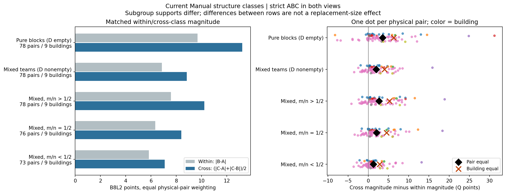
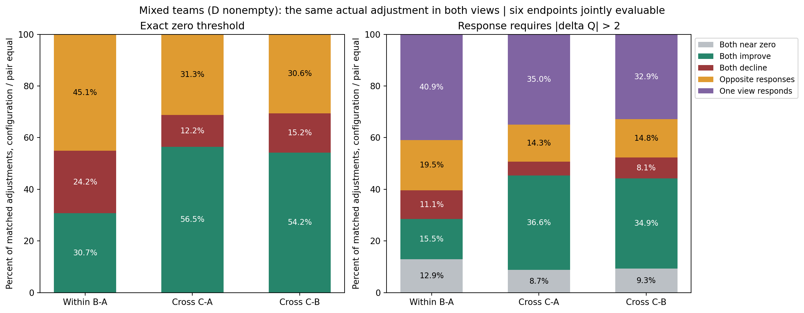
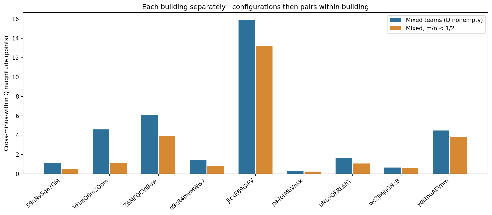
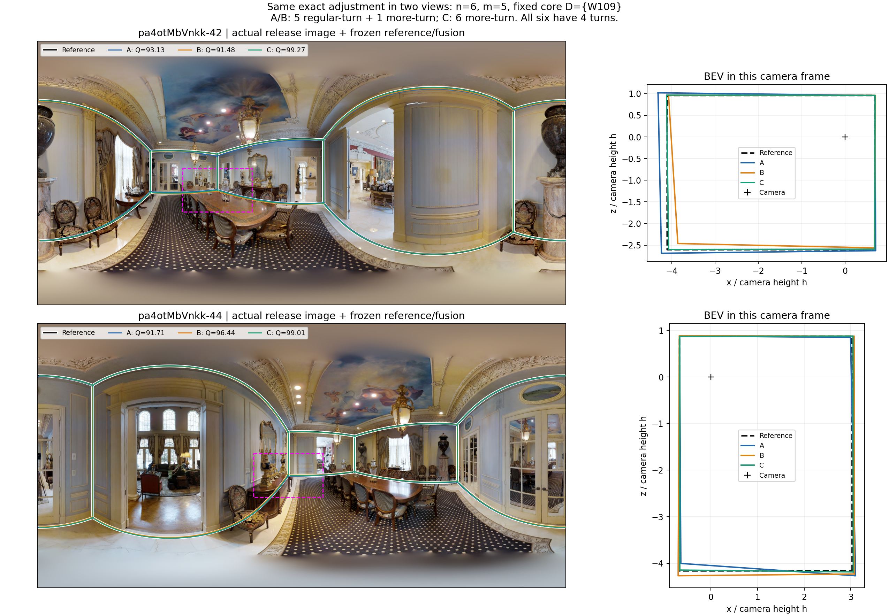
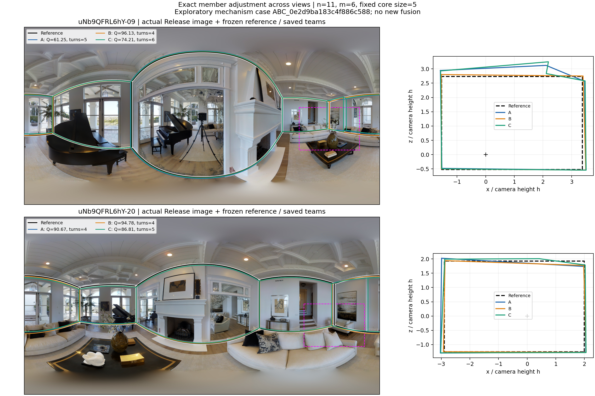

# 当前人员类别构成作用的同房跨视角重复性与差异来源
## 大块严格匹配、有限条件分析与遗失成果重建终稿

**本轮已完成实际重建和收尾。最值得保留的结果是：有共同背景、甚至替换少于半队时，跨类调整的质量幅度仍通常大于同类换人；但具体成员块的作用明显依赖视角，类别不能替代人员历史、局部票账和定位分析。** 扩大目标块与给固定目标块追加背景，是两种不同操作，平均效果也不同。

实际输入为 GitHub main 提交 `e92abe8631d7f01dc192ee796b46f295ece37a6d`，真实数据仍为 v2。新实验身份 `same_room_strict_abc_rebuilt_20261023_v1`，分析身份 `SRLB_REBUILT_20261023_v1`。旧大块精确设计与111,054端点原件未找回；本报告的62,676个ABC、311,333个端点是新冻结设计下真实执行的结果，不冒称恢复旧实验，也没有以旧报告数字为重建目标。

### 可以直接进入论文的判断

1. **类别与成员都重要。** 普通Manual结构主域中，同类幅度7.208分、对称跨类幅度9.322分，额外2.114分，61/78图对为正；同类内部仍有相当大的成员不确定性。
2. **差异不只来自纯块或大比例替换。** 混合团队额外幅度1.960分；少于半队替换仍为1.251分。去掉50图对的uNb建筑后仍分别为2.460、1.604分。
3. **主要方向要说具体。** 最广的TURN3“常规转折→较多转折”在混合团队中，C−A为+3.810、C−B为+2.492分；它贡献主总体的多数加权额外幅度。近共线分段变多方向主要是降质性变化，不能用一个“跨类有效”概括所有方向。
4. **平均方向可保留，单次调整不可照搬。** 混合团队C−A超过2分的状态中，双方同向41.92%、单边35.03%、反向14.31%、双方近零8.74%。同时筛两端响应会把同向率提高到73.01%；只根据源端响应的对应条件率是53.83%，二者回答不同问题。
5. **扩大替换块与加背景不能混写。** 固定A/n的主方向m5→6、m5→7有多数图对净收益；固定XYZ增加D，常同时抬升源类队B、削弱目标队C的优势。平均转折变化小，定位分项更直接地解释部分变化。
6. **人数路径稳定性已补齐建筑层。** Manual前段高Q、较多转折角色优先的平均升质，在路径与建筑重抽中都保留；困难图10→20平均Q后段变化小，不能写成证明完全不变。图内低尾与成员波动的改善仍有实际用途。

以上是本轮结论，不替代此前同房平均/个人相似性、全量有限配比和分类研究。主张到证据的逐项连接见[中文主张索引](CLAIM_INDEX_ZH.csv)。

## 1. 严格ABC究竟补足了什么

在每个既有直接同房图对的正式共同人员池内，构造 `A=D∪X，B=D∪Y，C=D∪Z`。D/X/Y/Z两两不相交，三个替换块均为m；X/Y同源类，Z来自另一目标类；两视角使用完全相同的实际成员。每个事件同时提供同类换人和跨类替换，因此不再用不同支持的AC与同配比结果相减。

当前Manual结构为主，联合Q/T独立对照；角色按目标建筑外历史中心对齐，保留分类家族和类数，不直接拼不同折的同号类别。结构家族JOINT不是联合Q/T。本轮没有重分类、改评分或改融合组件。

主域29,543事件、78物理图对、9栋楼、1,398配置，实际m5–8、n5–24；其中27,112事件六端点Q共同可评。m5/m6/m7/m8分别有78/46/23/2图对、9/8/3/1楼，m8仅n8–11。严格ABC需要两块互斥源类人员，容量为 `min(floor(源类人数/2),目标类人数)`；旧AC的m9–10容量不能直接转成严格ABC容量。小空间26格全枚举；大空间依据类别容量和背景作确定性均衡覆盖，不按目标Q挑队。

全研究含其它范围/门洞与Q/T对照，共62,676唯一事件、95物理图对、14栋楼、76图片条件池、311,333去重请求。各方法/条件有重叠，不把它们加成独立样本。Semi在当前正式双视角共同池中没有m>4严格容量，记为容量不足；Semi人数路径另行完成，并未填成零效应。范围、难度、直接同房身份与参考资格各自保留。

效应定义：每视角同类幅度为`|B−A|`，对称跨类幅度为`(|C−A|+|C−B|)/2`，二者之差为额外幅度。先对两视角平均，再在图对/类别方向/n/m配置内平均成员组合，再图对等权；另报建筑等权及声明组分层。质量主比较取同一六端点共同支持。实际完整成员、来源和分母见[精确设计](design/STRICT_ABC_EVENTS.csv.gz)、[方法与支持](METHODS_AND_SCOPE_ZH.md)、[字段合同](FIELD_CONTRACT.md)。

## 2. 混合团队中，跨类幅度优势仍存在

以下都在各行自己的同一六端点Q支持上比较同类与跨类，Q为0–100分：

|条件|图对/楼|共同Q/尝试ABC|同类幅度|对称跨类幅度|差值：图对等权|差值：建筑等权|正向图对|
|---|---|---|---|---|---|---|---|
|纯块 D=∅|78/9|1,640/1,770|9.680|13.214|3.534|6.317|64/78|
|混合 D≠∅|78/9|25,472/27,773|6.869|8.829|1.960|4.020|61/78|
|混合 m/n>1/2|78/9|14,396/15,575|7.573|10.222|2.649|5.209|61/78|
|混合 m/n=1/2|76/9|2,369/2,644|6.333|8.399|2.066|4.549|60/76|
|混合 m/n<1/2|73/9|8,707/9,554|5.836|7.087|1.251|2.804|50/73|

这些条件行的均值不能再直接相减解释替换规模的因果作用；真正固定A或固定XYZ的比较在第5节。D10同样支持主方向：混合额外1.816分、少于半队额外1.156分。建筑等权的效应较大，表示少数图对但作用较强的建筑获得了与uNb相同的权重；两种计权均有用途。

结构和位置没有完全复制Q幅度模式。六端点Q共同支持下，混合队实际转折的额外幅度为0.133个、短转折0.109个、近共线分段−0.004个。限制六次几何比较均有唯一循环对应后，14,880个混合事件、74图对、7楼的Q额外幅度仍为0.894分；但对应底点距离同类0.1021h、跨类0.0900h，额外−0.0120h（建筑等权+0.00225h）。**质量变化较大不等于几何位移较大**；位置往正确方向移动较少，也可比更大的无益移动改善更多。

异角点数、对应歧义、缺完整底面都另存，未把不可对应记为零。简单/简单的50图对7楼额外幅度1.533分，40/50正向；困难/困难只有2图对2楼，额外9.453分，两对均正。后者是有内容的条件证据，不足以把不同支持均值之差命名为纯难度作用。[逐条件及逐n/m](results/N_M_CONDITIONS.csv)、[难度组合](results/DIFFICULTY_PAIR_CONDITIONS.csv)、[几何共同支持](geometry_summary/GEOMETRY_CONDITIONS.csv)

## 3. 最终是哪一类换哪一类

下表只列混合团队，C由目标类块Z替代源块X；B是同一源类的另一块Y。全套纯块、混合、比例层、具体W编号、楼外原类号、实际n/m和背景均在[中文方向小表](direction_tables/DIRECTION_READABLE_ZH.csv)中。成员并集是覆盖名单，不是一支实际队；[楼外角色/成员](direction_tables/FOLD_DIRECTION_ROLES_MEMBERS.csv)与[精确背景索引](direction_tables/DIRECTION_BACKGROUND_MEMBER_INDEX.csv.gz)可直接连接逐事件。

|历史角色方向（保留家族/类数）|图对/楼|n / m|Q：C−A|Q：C−B|跨类额外幅度|C−A损失>5分|
|---|---|---|---|---|---|---|
|TURN3:常规转折 → TURN3:较多转折|65/5|6–24 / 5–8|3.810|2.492|1.604|11.59%|
|JOINT4:常规转折、较少近共线分段 → JOINT4:较多转折、较少近共线分段|6/2|6–19 / 5–6|6.687|7.857|3.620|3.18%|
|JOINT4:常规转折、较少近共线分段 → JOINT4:常规转折、较多近共线分段|4/1|6–19 / 5–6|-2.512|-2.529|1.362|10.49%|
|TURN2:较少转折 → TURN2:较多转折|3/1|6–18 / 5–6|12.553|13.313|4.604|15.11%|
|TURN3:较多转折 → TURN3:常规转折|3/1|6–17 / 5–5|0.915|0.465|-1.103|23.52%|
|JOINT5:常规转折、较少近共线分段 → JOINT5:较多转折、较少近共线分段|2/1|6–18 / 5–6|10.647|10.106|5.276|2.05%|
|JOINT5:常规转折、较少近共线分段 → JOINT5:常规转折、较多近共线分段|1/1|6–18 / 5–5|-0.381|-2.229|0.256|27.75%|
|TURN3:常规转折 → TURN3:较少转折|1/1|6–16 / 5–5|-8.973|-6.712|5.226|41.05%|

**TURN3常规→较多转折是当前最广的有用方向。** 普通主域（含纯块与混合）中，该方向65图对5楼，主总体图对权重份额81.61%，对总体额外幅度贡献1.448分（总效应2.114分），是按同一权重的可加分解。结构JOINT4“常规且较少近共线→较多转折且较少近共线”贡献0.272分；建筑等权时它贡献1.916分，说明主张不能只围绕uNb的大量图对。完整贡献恒等式和检查见[DIRECTION_CONTRIBUTIONS](reader_tables/DIRECTION_CONTRIBUTIONS.csv)。

这些方向还体现不同机制。以下机制分量采用普通主域（含纯块与混合）的六端点共同Q支持，与上表混合域分开报告：TURN3常规→较多的C−A平均实际转折仅+0.115、短转折+0.055，底面角误差−0.262°，内部正交方向残差−0.477°；它的升质不能全部解释成增角。JOINT4常规/少近共线→较多转折/少近共线则转折+0.458、短转折+0.313，底面误差−0.655°。TURN2少→多的转折变化达+4.385，但只有3图对1楼，保留为该支持中的结构性强效应。

相反，JOINT4常规/少近共线→常规/多近共线几乎不增加真实转折，底面与方向误差变差；Q变化幅度更大主要体现降质。TURN3常规→较少转折也只有1图对，属于强降质而非通用推荐；反方向较多→常规3图对的额外幅度为负。**“跨类”是比较类型，推荐需要具体角色方向和支持条件。** [Q与结构共同支持表](reader_tables/QUALITY_STRUCTURE_COMMON_SUPPORT.csv)

### 时间与坏尾必须与该方向共同支持

普通结构全域只有4,227个事件同时满足六队Q、完整正时间、单一且同来源语义；混合为4,059。这个较窄支持上，混合C−A平均Q+10.178、劳动比1.056，C−B为+10.278、劳动比1.071；不能把这些Q与全质量域的+4.198/+3.182交换使用。方向小表保留每个方向的Q/T共同事件数和劳动比；缺时间不补值。

联合Q/T对照有31图对8楼，混合额外2.055分；少于半队1.331分。它的支持不同，不能据此排名哪套分类“更强”。例如CQT5历史Q中间/较快/常规→历史Q较高/较慢/较多，在全域10图对3楼C−A+7.253；自己的共同Q/T域+6.049、劳动比1.064。历史Q中间/较快/常规→Q中间/较慢/常规在11图对2楼全Q+4.167，但共同Q/T仅+0.852、劳动比1.625，体现明显的时间代价。这些比值是逐对再分层的算术平均，不是全库总劳动相除，不代表排队或并行交付时间。

混合C−A损失超过5分的比例为11.19%，C−B为14.16%，尽管平均方向为正。新增评分失败与恢复评分分别1.16%、1.10%，以全部尝试并按相同层级计权；坏尾以可评共同支持计。它们不是同一分母，也不能用平均升质覆盖掉这些代价。[完整方向结果](results/DIRECTION_RESULTS.csv)

## 4. 同一实际替换块，跨视角重复多少

严格超过2分为实际响应；恰为2分列入近零。下表为混合团队、图对等权：

|调整|双方近零|双方同向非零|双方反向|单边响应|只筛源端响应：同向率|两端都响应：同向率|
|---|---|---|---|---|---|---|
|BA|12.93%|26.61%|19.53%|40.94%|37.85%|58.47%|
|CA|8.74%|41.92%|14.31%|35.03%|53.83%|73.01%|
|CB|9.27%|43.07%|14.78%|32.88%|55.64%|74.05%|

零阈值与实际幅度阈值都完整保留。全主域零阈值下同类B−A同向54.38%，跨类C−A同向69.19%；它并不意味着这些变化都有实际幅度。混合团队的2分阈值更清楚地显示：跨类更容易在两个视角都形成同向变化，同类更常单边响应或反向，但具体跨类调整仍有大量单边与反向情况。

“只筛源端”先限定六队共同可评，再分别把a/b作为源端；它是回顾性共同支持描述。两端都超过阈值的73.01%同向率经过目标端响应筛选，不能写成仅观察源图即可预测目标的成功率。原报告80.3%之类两端筛选数字保留原条件身份，本轮不以它作为泛化目标。

相同类别构成也没有消除成员差异：主域同类换人的7.208分幅度，与跨类9.322分处于同一数量级。类别提供有范围的方向组织，成员与视角的剩余不确定性仍需要保留。这与既有“同房公共水平可迁移、具体局部优势不完全迁移”相容。

## 5. 固定原队扩大m，与固定替换块增D：两条不同路径

主方向按覆盖最广的TURN3常规→较多转折确定，没有按效果选择。以下在各条实际路径内固定原队A、固定n，并按登记路径恢复规范化X/Y之前的真实A身份。Q/结构/定位采用同一前后12端点共同支持：

|固定A路径|图对/楼|C本身Q变化|B本身Q变化|净差|净差正向图对|
|---|---:|---:|---:|---:|---:|
|m5→6|41/4|+0.746|−0.030|+0.776|31/41|
|m5→7|21/3|+1.067|−0.474|+1.540|16/21|
|m5→8|2/1|+5.444|−0.515|+5.959|2/2|

每行是合法的固定A对照，但行间支持不同，不能再相减估计第七或第八人的边际作用。m5→6、m5→7的C转折平均变化+0.002、−0.006，底面误差−0.059°、−0.101°。因此这条正向规模路径主要不能用“增加必要转折数量”解释；位置改善是更直接的线索。

固定XYZ、从纯块加入D至最大背景的共同支持为65图对5楼：C平均−3.482、B+1.259，净差−4.741分，跨类额外幅度变化−2.012分。纯块→半队阶段C−2.178、B+1.920；半队→首次少于半队C−1.025、B−0.723；后续首次少于半队→最大D中C−0.108、B+0.986。这里每段自身支持不同，不把分段均值硬相加。

**给固定类别核心加人常会缩小其优势，但不能全部归因于必要结构被稀释。** 主背景跨度C转折平均−0.081，底面误差+0.191°；B转折−0.090、底面误差−0.021°。两队数量结构变化相近，定位方向却不同。背景增人也改变奇偶和投票门槛；已有局部票账可以确认具体案例，不能由类别名推断全体机制。

固定A m5→6的C变化，在2分阈值下35.64%双方近零、43.61%仅单边响应、14.46%双方同向非零、6.30%反向；平均净收益并不要求每次调整都跨视角重复。其损失>5分比例7.15%、新增不可评分1.19%。固定XYZ纯→最大D的C损失>5分28.55%，需与平均回落一起说明。

完整35,603条转移、所有实际n/m、共同支持、同源时间及反例已保存。[锚点路径报告](anchor_paths/README_ZH.md)、[阶段小表](anchor_paths/KEY_PATH_JOINT_METRICS.csv)、[精确路径](anchor_paths/ANCHOR_PATH_EFFECTS.csv.gz)

## 6. 建筑、重叠关系和关键成员敏感性

### 6.1 删除占50/78图对的uNb建筑

|去掉uNb后|图对/楼|同类幅度|对称跨类幅度|额外幅度：图对等权|额外幅度：建筑等权|正向图对|
|---|---|---|---|---|---|---|
|全部|28/8|5.886|8.541|2.655|4.536|26/28|
|混合 D≠∅|28/8|5.551|8.011|2.460|4.313|26/28|
|混合 m/n<1/2|24/8|5.286|6.890|1.604|3.020|20/24|

主混合效应不是由uNb独自维持。逐栋留一时，混合图对等权额外幅度1.779–2.460分，正向图对76.06%–92.86%；少于半队为1.085–1.604分，正向65.15%–83.33%。对应建筑等权范围分别2.539–4.490、1.507–3.125分。9栋楼各自的混合与少于半队平均额外幅度均为正，但强度明显不同。

原主域图对去重计权为2.114分，建筑等权4.233分，先声明组再建筑等权4.223分；混合对应1.960/4.020/4.015。物理图对不因重叠声明重复成新样本。图对等权回答当前观察图对集合的表现，建筑等权回答不同建筑的平均表现，声明组层体现既有分组组织，三者不必挑唯一“正确均值”。

### 6.2 关键人员：只说合法缺席子域实际支持的结论

按目标类容量≤10的事先规则检查28位实际W编号；23人有合法匹配缺席，5人没有。较宽匹配固定图对、方向、n/m和D类别构成；更严匹配固定实际D。存在指人在D/X/Y/Z任意一块，不人为删除原答或补造队伍。

两种匹配中均有19/23人的缺席子域平均额外幅度为正，W031、W103、W113、W125为负。不能把它概括成整个结果“不依赖某一个人”：宽匹配只保留相关事件4.70%–65.86%，固定D保留1.57%–12.26%；另五位没有可比较缺席。负向子域中有些匹配前或包含该人时已为负，并不能解释为删掉此人导致转负。每人的真实楼外角色与范围见[成员敏感性中文表](reader_tables/KEY_MEMBER_SENSITIVITY_ZH.csv)及[角色折表](sensitivity/MEMBER_FOLD_ROLES.csv)。没有公开真实姓名的输入，沿用匿名W编号。

|人员|原子域额外Q幅度|宽匹配：图对/楼；事件保留|宽：包含|宽：缺席|固定D：图对/楼；事件保留|固定D：包含|固定D：缺席|
|---|---|---|---|---|---|---|---|
|W001|1.304|31/3；58.33%|1.528|1.442|31/3；10.59%|1.963|1.897|
|W002|2.408|11/2；52.80%|2.611|4.362|11/2；12.26%|4.195|5.126|
|W008|无合法缺席|—|—|—|—|—|—|
|W012|1.086|23/3；65.86%|1.237|0.482|23/3；11.84%|1.343|0.810|
|W013|2.097|13/2；62.09%|1.247|3.558|13/2；11.12%|0.027|3.362|
|W015|1.745|21/2；47.48%|1.739|0.428|21/2；8.74%|1.781|0.492|
|W017|0.975|23/3；46.93%|0.745|3.268|23/3；9.26%|0.930|3.463|
|W028|1.695|42/3；52.41%|1.789|1.443|42/3；10.20%|2.341|1.256|
|W029|无合法缺席|—|—|—|—|—|—|
|W031|0.725|5/2；55.31%|0.035|-0.345|5/2；6.54%|-2.574|-2.662|
|W032|1.871|42/4；52.96%|1.747|1.749|42/4；9.72%|2.076|2.044|
|W034|无合法缺席|—|—|—|—|—|—|
|W035|无合法缺席|—|—|—|—|—|—|
|W036|1.563|26/2；54.88%|1.407|1.279|26/2；9.14%|1.517|2.110|
|W037|3.704|2/1；14.49%|1.614|1.325|2/1；3.89%|3.497|0.820|
|W102|2.957|20/6；35.74%|2.748|2.845|20/6；6.45%|3.284|4.798|
|W103|-0.315|1/1；26.83%|0.177|-1.502|1/1；2.66%|-1.854|-3.480|
|W104|4.118|3/2；51.87%|4.412|4.193|3/2；5.30%|6.466|4.124|
|W105|0.136|1/1；4.70%|0.449|3.691|1/1；1.57%|0.256|4.375|
|W109|2.563|28/7；35.10%|2.757|1.986|28/7；5.78%|3.896|3.153|
|W112|2.244|41/5；45.35%|2.131|2.971|41/5；7.82%|2.080|3.094|
|W113|-0.827|3/2；42.36%|-1.098|-0.174|3/2；4.60%|-3.329|-2.522|
|W115|1.921|32/6；37.94%|2.083|0.904|32/6；6.22%|2.770|1.530|
|W122|2.129|22/5；26.45%|2.252|1.188|22/5；4.40%|4.060|1.873|
|W125|-0.827|3/2；41.80%|-0.891|-0.340|3/2；4.48%|-2.438|-1.576|
|W126|2.786|28/6；45.39%|2.410|3.109|28/6；6.90%|3.294|4.169|
|W127|无合法缺席|—|—|—|—|—|—|
|W130|2.479|18/7；32.64%|3.952|2.788|18/7；4.61%|2.801|1.148|

上表均为图对等权额外Q幅度。完整匹配前后事件数、质量可评数、图对/建筑、成员角色与精确层表一并保存，不用不存在的缺席对照制造零效应。[成员匹配结果](sensitivity/MEMBER_MATCHED_SUMMARY.csv)

## 7. 历史Q接近、结构类别与连续画像各解释什么

三块历史Q是目标建筑外的同任务调整相对Q，不是目标评分。主条件为三块均值极差≤2分，宽条件≤5分，历史量完整；仍保持原类别，不为本轮结果调类。

|三块历史Q极差|匹配|图对/楼|近Q/同支持宽域Q事件|近Q额外幅度|宽域额外幅度|近Q正向图对|
|---|---|---|---|---|---|---|
|≤2|同图对/方向/n/m|20/4|1,088/5,472|1.312|1.153|40.00%|
|≤2|再固定实际D|20/4|1,088/1,442|1.311|1.113|40.00%|
|≤5|同图对/方向/n/m|40/5|5,580/12,678|0.819|1.439|55.00%|
|≤5|再固定实际D|40/5|5,580/6,359|0.826|0.897|55.00%|

这个对照在相同图对/方向/n/m，或再固定D的共同设计支持内，比较近Q成员子域与包含它的更宽集合；不是因果消除历史质量。≤2条件额外Q幅度1.312分，但仅8/20图对为正、建筑等权0.322分。固定D后近Q1.311、宽域1.113。≤5条件近Q0.819、同配置宽域1.439；固定D后0.826对0.897。**没有一个可从这些数字换算的“历史Q解释百分比”。** 更严格条件不必单调减少效应，因为支持的成员、图对和权重随之改变。

≤2的共同Q域中，转折额外幅度仅0.002个（7/20图对正），近共线额外−0.028个，底面误差变化的额外幅度0.058°，内部方向残差0.382°。同数唯一对应且Q共同可用487事件、17图对、4楼，几何额外底点距离仅0.00424h，建筑等权接近零。它支持“仍存在少数位置或结构上的条件差异”，不支持把该窄域概括为稳健的普遍结构优势，也不反过来否定此前广图原答结构差异。

既有粗细类、连续Q/T比较继续引用原身份：类约束QT10与连续QT10在19,896个相同A/D/m锚点实际选到同一队，没有额外数值收益；分类的解释和组织价值仍成立。当前结构粗类使用家族/角色，ALL粗细同类不能推断每个楼外折都同样没有细分。Q/T对照与结构分类的支持也不同，不以哪一套平均数更高作胜负结论。[已有方法采用与19个原文件精确来源](integration/EXISTING_METHOD_ADOPTION_ZH.md)

## 8. 原图、原答、参考与完整票账的两个机制例

### 8.1 G130：同样四角，定位改善带来两视角升质

事件`ABC_0001066d44f97b218867`，pa4otMbVnkk-42/44，n6/m5，D为W109。X为W030/W101/W103/W113/W131；同类Y为W106/W107/W108/W110/W118；目标Z为W102/W115/W122/W126/W130。它按普通结构事件ID的首个完整事件选取，不按收益挑选。

42图A/B/C的Q为93.130/91.478/99.272；44图91.708/96.436/99.011。C−A为+6.142/+7.303，同类B−A为−1.652/+4.728。六队都是4转折、0短转折、0近共线冗余；各身份组6票、门槛3，边均有直接或投影支持，位置由成员中位数形成。因此这例的跨视角正向主要是定位/方向/尺度改善，不是补角数。

两张Release原图已实际查看，原答、BEV、参考、局部和中位数票账保存在[案例一](cases/first_event/README_ZH.md)。目标块历史相对Q较高，不能拿它证明独立于质量的纯结构效应。A时间混来源，不给三臂总劳动结论；合法B/C四端点子域中C耗时多358.8秒和181.8秒，保留升质伴随成本的事实。

### 8.2 G172：两图都多一个转折，质量却一升一降

事件`ABC_0e2d9ba183c4f886c588`，uNb-09/-20，TURN3常规→较多转折，n11/m6、D5。两个视角C−A都增加1个真实转折，Q却为+12.966/−3.860；六端点均可评。该例从预定义现象“同数量非零结构变化、两端Q反向且各超过2分”中按覆盖和ID规则选取，是探索性机制例，不是额外验证集。

两图冻结参考都是4角。-09的A保留一个额外身份组（6票），C保留两个（各6票）；-20的A额外组均5票落在线下，C仅一个6票组入围，另一邻近区域分为2/4/2票三组，不能把8个原答命中相加当8票。B两图Q分别96.134/94.780，C−B两端都负；C−A反向同时反映原队A状态差异。**同样的“多一个角”可以伴随不同位置、连接和质量作用。** 本例三块楼外相对Q极差仅1.085分，是选例后观察到的条件，不是筛选标准；它显示历史Q接近仍可有任务特定的几何响应，不能据此推广成整个窄域的多数规律。本例时间缺失且混来源，不作劳动结论。精确成员、原图、原答及票账见[案例二](cases/structure_mechanism/README_ZH.md)。

G236旧解释保留其正确身份：三条锚点共享同一目标块，不能算42次独立人员重复；历史“较多转折”类在具体图上可以简化；结构数量与位置可走不同方向。旧大块对应原件未找回，本轮不伪造其42次记录，也不用这个局部例否定此前广图结构差异。G046两端同角、G015壁炉和M01·pRb-12暂停的既有人工结论不重新请求或改写。

## 9. 人数路径、选队、省时和停止的接续

本节重用原人数专题的318,816端点、404,082前缀、12,398精确顺序及正式04C的229,050行。旧重抽代码未找回，所以重新实现分析；没有新增人数路径或融合。完整自然24路径及策略配对8条基路径按整条路径重抽，策略与自然保持配对，2,000次固定种子；另按整栋建筑重抽，不把前缀当独立图片。

### 困难图后段：平台是小平均变化，不是证明完全不变

普通Manual困难29图15楼、N≥20，10→20人Q61.243→61.027，差−0.216；15/29图改善。图等权路径95%范围[−1.344,0.927]，建筑范围[−3.007,2.533]。图内P10平均+3.122，路径[1.259,4.969]、建筑[0.291,6.161]；图内SD−2.714，路径[−3.612,−1.691]、建筑[−5.628,−0.399]。建筑等权P10/SD方向仍为正/负，但建筑范围跨零。

P10先逐图逐k在可评路径Q上取线性插值10%分位数；SD为逐图逐k样本标准差ddof=1。10人667/696、20人674/696前缀可评；失败分母始终是全部尝试，缺失不补零。**后段平均变化较小，现有结果未显示明确持续升高或下降；低尾与成员波动仍改善。** 路径范围只表示固定这些图片的顺序抽样误差，不能冒充跨建筑稳定。

### 前段进入策略：保留Manual用途与坏尾

普通Manual四策略共同157图22楼，前段k=3到floor(N/2)，相对配对自然顺序：

|历史角色优先|平均Q差|配对路径95%范围|建筑95%范围|正向图|损失>5分|
|---|---:|---|---|---:|---:|
|联合类历史Q中心最高|+7.710|[7.434,7.998]|[6.127,9.407]|152/157|3.55%|
|历史非冗余转折较多|+6.146|[5.861,6.431]|[4.413,8.135]|137/157|6.46%|
|历史相对时间最低|−1.651|[−1.846,−1.422]|[−2.420,−0.725]|53/157|20.37%|
|人数最多结构类|−1.845|[−2.138,−1.570]|[−2.757,−0.946]|40/157|20.43%|

成本另限定四策略完全相同pool/base/k、所有队单一同来源时间、五队共同Q：新来源普通Manual67图18楼4,304单位。高Q优先Q+7.419/劳动比1.026，较多转折+6.810/1.097，快角色−0.873/0.776，最大类−3.255/1.021；坏尾分别4.44%、5.42%、13.97%、22.72%。失败在4,613个共同时间尝试上另算，不能用4,304质量支持隐藏失败。快角色有实用省时，同时保留平均代价和坏尾，不自动推荐替代高Q策略。

Semi共同21图11楼，高Q、较多转折前段平均分别−0.875、−0.727，路径范围为负而建筑范围跨零；快角色−0.092、最大类+0.109。Manual与Semi不合成统一有效模型。17张门洞图9楼自然10→20平均Q−3.066，路径与建筑范围均负，保持单列。

人数专题的完整表和代码在单独R03，建议仓库目录`research/workers/personnel_population_curves_v2_20261023/stability_rebuilt_20261023/`。它回答已存路径稳定性，不是重做源曲线停止。此前已知源图Q选人数、目标不完整后补收、无目标GT在线停止是三种规则；继续按其原精确支持解释，历史建立成本也保留。Q80/Q90维持原首次/从k≥3首次/持续达到定义，本轮没有获得旧派生阈值汇总原件便不新增声称其数值已核。[已有采用与停止来源](integration/EXISTING_METHOD_ADOPTION_ZH.md)

## 10. 与平均/个人相似性及旧报告的关系

已有同房平均和个人研究仍成立，原文件身份保留，不在本轮重跑或改称新发现。已存旧报告采用：普通Manual123直接图对、64图、12楼、19声明组，图对等权的两图均值绝对差：实际人员池6.810、固定共同人员7.238；严格多数历史主实验44图9组7楼，单源/最少多数/最多历史MAE4.804/4.110/4.062。个人2,581同人图对、57人，绝对Q、同行调整、再扣楼外个人水平的描述相关0.405/0.239/0.031；前两项支持2,581同人图对，第三项有合法楼外历史的支持为2,580对。当前最强个人预测仍以排除本人的源同行公共水平加楼外个人相对水平为主，类别没有证明超越最强连续校准。

新大块实验补充的不是另一套房间聚类，而是：在用户已经确定的同房关系内，类别方向存在可重复的平均构成作用；同配比具体成员差、视角状态和定位/身份组门槛共同留下不确定性。公共平均可迁移与局部调整不可完全照搬可以同时成立。旧均值、个人、选队和停止报告的接续入口在[旧主报告校正副本](integration/REPORT_ZH_corrected_copy.md)；其引用的历史大表按main依赖，不重复打包。

本轮同步落地三项旧口径修正：源端筛选先取两端共同可评，属于回顾性共同支持；劳动比2.006是分层算术平均，而非平均log后指数（后者1.940）；G178一个零阈值计数49/120与已存50/120的差异如实记录，全局四舍五入均40.51%，不猜原因或篡改原表。补丁与准确人员主报告插入段落在[integration](integration/README_ZH.md)。

## 11. 实际计算、恢复边界与文件交付

|部分|身份|实际完成|
|---|---|---|
|main冻结类别、资格、关系、融合与参考|恢复/引用真实原件|固定提交、源文件与SHA索引；不重分类或改变规则|
|旧大块ABC、111,054端点/几何|原件不可恢复|没有精确设计，不能原样重算；本轮重新设计对应实验|
|本轮新严格ABC|新设计、新执行|62,676事件、311,333去重正式端点；全部设计/状态/标量/几何保存|
|条件、方向、成员、历史Q、锚点分析|本轮新实现/重新汇总|不再新增融合，精确表与完整代码保存|
|原人数顺序/端点/04C|真实原件可恢复|原设计不变；本轮新实现路径和建筑重抽、同语义时间分析|
|旧同房平均/个人及选队/停止|沿用已有研究|保留原支持与规则；只落实已定位的口径修正|

正式311,333端点中305,161完整可评，6,172失败/不完整：少于四节点2,600、无法连接3,478、无效底面94。普通Manual池302,346次、可评297,824；门洞池8,987次、可评7,337。少于四节点但仍有候选多边形的记录保留诊断，未恢复正式评分。另有9次兼容检查与6次首例早期执行，实际调用311,348，15次不充当新的去重端点。

逐事件六端点引用376,056个，全部连接到真实请求；共同Q56,715事件、共同时间27,144、共同Q/T22,618。完整几何为658个JSONL.gz分片、311,333条全状态，含身份组、位置估计、连接及失败；另有376,056次事件几何比较、365,622去重有向队伍对比较。端点可用`team_key→geometry_shard/line`或归档定位表找到所需分包，不必下载全部几何才能核一个事件。

本轮使用R前缀独立于失效旧01–14包，避免新旧身份混读：R00真实原件与恢复边界；R01新精确设计和执行闭合输入；R02首例；R03人数稳定性；R04A本报告/代码/小表、R04B全部新事件和匹配路径；R05完整标量与几何定位；R06_01—07完整几何票账。R05独立CSV.gz与ZIP中的同名标量是相同字节，两种下载入口任选其一。

所有正式包在封闭ZIP内部实际读取CSV/gzip/JSONL至结尾，保留行数、字段与SHA回执；另以实际R01/R04B/R05/R06做跨包设计—标量—几何—事件关联核对。当前有效文件清单单独提供，完整下载路径以清单为准。复算方法见[REPRODUCE](REPRODUCE.md)，精确接口见[FIELD_CONTRACT](FIELD_CONTRACT.md)。

## 12. 采用与收尾

**保留为主文：** 严格匹配下混合及少于半队的跨类幅度优势；当前主要中文角色方向；同类内部的大成员变化；跨视角近零/单边/同向/反向区分；固定A规模与固定XYZ背景的不同作用；建筑与路径误差分开的人数结果。

**收紧解释：** 更大Q幅度不等于更大几何距离或更优质量；历史多转折类不保证每次补必要转折；合法缺席子域不等于任删一个人结论都成立；两端阈值筛选后的同向率不等于源端预测成功率；成本收益和损失>5分坏尾并列。

**不继续扩展：** 本轮没有发现必须新增融合、重新分类或删人造队的问题。Q接近窄域不支持新的普遍结构优势，不继续为正结果调阈值；类别Q预测未超强连续基线的旧负结果保留。有限设计和分析已完成，下一步是将已保存证据纳入论文及独立复算，而不是继续搜寻整齐的一致性。
