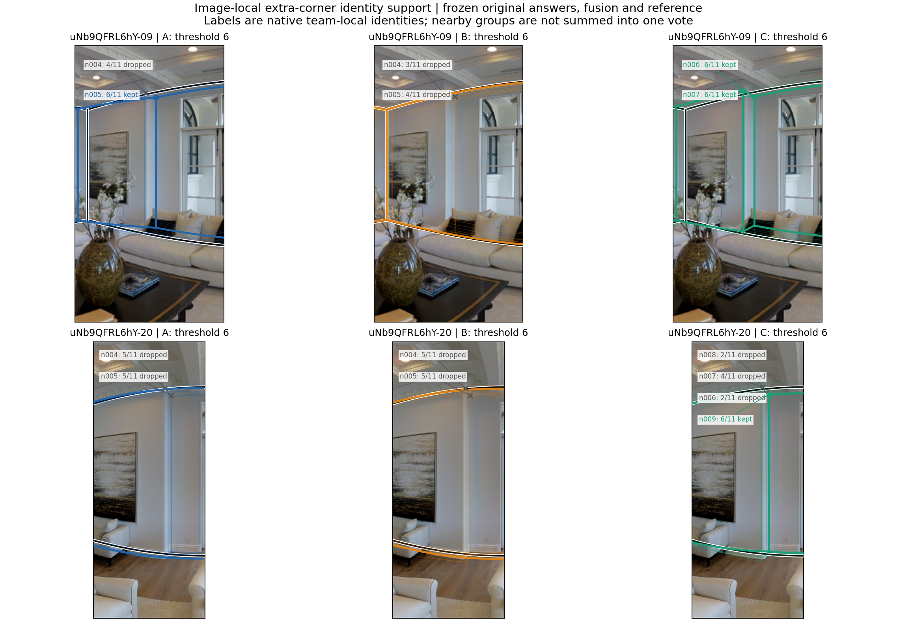
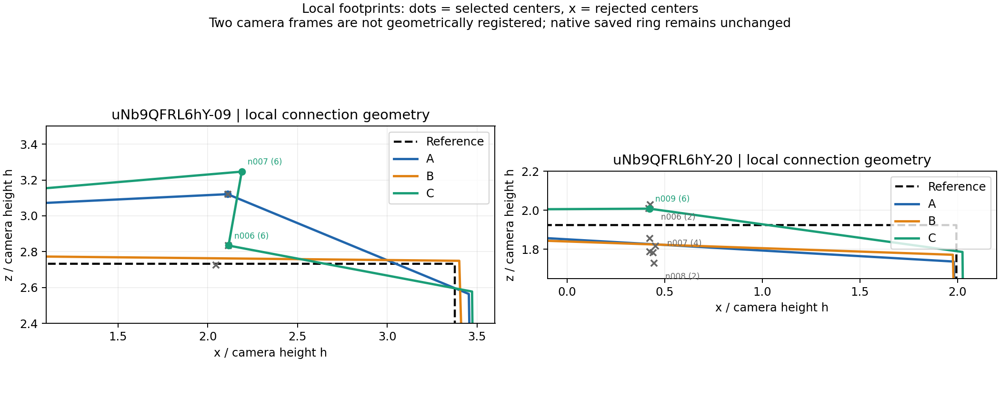

# G172：同一替换块两边都多一转折，Q 却一升一降

**本例支持“类别表达方向可以重复，具体质量作用仍由原队状态、身份支持与局部几何共同决定”。** 常规转折类换入较多转折类，同一批实际成员在 uNb-09 与 uNb-20 都增加一个实际转折，但 C−A 的 B8L2 分别为 **+12.966、−3.860**。这不是一边没反应：两端都有非零结构变化和超过 2 分的质量作用。两边的同类换人 B 都比 A、C 更好，说明“相对哪一个具体原队”影响对换类收益的解释。[六队表](tables/SIX_TEAMS_READABLE.csv)、[逐视角差值](tables/CONTRASTS_BY_VIEW.csv)

本例读取已计算的六个本轮新严格 ABC 端点，**没有新增融合、拟类或改评分/参考**。输入 commit 为 `e92abe8631d7f01dc192ee796b46f295ece37a6d`；设计版本 `same_room_strict_abc_rebuilt_20261023_v1`。它不是遗失的 111,054 端点原件恢复。

## 1. 房间、类别与精确成员

- 用户既有直接关系 G172，普通 Manual，两个视角均为简单图、范围可比；建筑 `uNb9QFRL6hY` 仅作为建筑身份，不重新定义房间。
- 事件 `ABC_0e2d9ba183c4f886c588`；n=11、m=6，替换比例 54.545%，固定背景 D=5 人，是有背景的混合团队。
- 当前 Manual 结构分类 `V3_BEHAVIOR`，目标建筑外的 TURN 三粗类。本折 M2=常规转折、M3=较多转折；完整折键及名单见 [类别原表](FROZEN_CLASS_ROLES_AND_MEMBERS.csv)。只对本折使用 M2/M3，不把编号跨折拼接。

| 块 | 实际人员 | 角色／用途 |
|---|---|---|
| D | W029、W031、W032、W034、W112 | 固定背景：较少转折 2、常规转折 1、较多转折 2 |
| X | W033、W110、W113、W117、W125、W128 | 原块，6 名常规转折成员 |
| Y | W104、W106、W114、W116、W119、W131 | 同类替代块，6 名常规转折成员 |
| Z | W001、W012、W015、W017、W028、W115 | 跨类替代块，6 名较多转折成员 |

A=D∪X、B=D∪Y、C=D∪Z；四块互不重叠，两个视角使用完全相同成员。A/B 构成为 2 较少＋7 常规＋2 较多；C 为 2 较少＋1 常规＋8 较多。联合使用 23 名具体成员，共同正式池为 26 人。[逐人角色](tables/MEMBER_BLOCKS_AND_ROLES.csv)、[原答与个人质量](tables/ACTUAL_MEMBERS_BY_VIEW.csv)

本例三块楼外历史相对 Q 为 X −1.963、Y −1.821、Z −0.877，最大差 **1.085 分**，且各块历史 Q 都已知。这是选例后发现的相近历史条件，未把它加入 selector，也不据此推算历史 Q 解释总体差异的比例。[历史小表](tables/BLOCK_HISTORY.csv)

## 2. 六个端点：参考都是四角，增角不等于补齐参考

| 视角 | 队 | B8L2 | D10 | 实际转折 | 短转折边 | 底点角距° | 自身正交方向残差° |
|---|---|---:|---:|---:|---:|---:|---:|
| uNb-09 | A | 61.248 | 67.407 | 5 | 0 | 0.768 | 6.689 |
| uNb-09 | B | 96.134 | 96.336 | 4 | 0 | 0.289 | 0.854 |
| uNb-09 | C | 74.215 | 79.348 | 6 | 1 | 0.672 | 4.136 |
| uNb-20 | A | 90.672 | 91.888 | 4 | 0 | 0.574 | 1.757 |
| uNb-20 | B | 94.780 | 95.437 | 4 | 0 | 0.388 | 1.229 |
| uNb-20 | C | 86.812 | 89.909 | 5 | 0 | 0.560 | 2.517 |

六队近共线冗余计数均为 0，全部形成完整可评候选，失败为 **0/6 尝试**。原 `ring_confirmed=False` 与源建议环序状态保留；它不被补成人工确认，也不等于这里的不可评分失败。AB 在 -20 同为四角，对应底点平均位移为 0.0767h、最大 0.1463h；其它五个队对均异数，对应角点距离保持不可计算，未补零。[原生几何比较](SIX_GEOMETRY_COMPARISONS.csv.gz)

| 调整 | uNb-09 的 ΔQ | uNb-20 的 ΔQ | 实际转折变化（09／20） |
|---|---:|---:|---|
| 同类 B−A | +34.886 | +4.108 | −1／0 |
| 跨类 C−A | +12.966 | −3.860 | +1／+1 |
| 跨类 C−B | −21.919 | −7.968 | +2／+1 |

C−A 的 D10 为 +11.941／−1.979，同样一升一降；-20 的 D10 幅度略低于 2 分，因此“双端超过 2”指主指标 B8L2。B 的高分不能用于事前挑选本事件，它是同一严格匹配设计的已观察对照。

两张 Release 原图都已实际查看。原图右侧可见窗旁窄墙折面；当前冻结 GT 均为四角轮廓，未单列该局部。故“多一个转折”在此是**更多局部表达**，不能直接命名为必要结构召回或 GT 错误。固定 GT 和评分不变。


## 3. 门槛与身份票：相同成员怎样产生不同局部响应

11 人队的节点保留门槛为 **6**。六队都有四个 11 票的主要身份组；差异集中在窗旁窄墙区域。[完整48组票账](tables/IDENTITY_GROUPS.csv)、[局部14组](tables/LOCAL_IDENTITY_EVIDENCE.csv)

| 视角 | A 的局部身份组 | B 的局部身份组 | C 的局部身份组 |
|---|---|---|---|
| uNb-09 | 4 票不保留；6 票保留 | 3、4 票均不保留 | 6、6 票均保留 |
| uNb-20 | 5、5 票均不保留 | 5、5 票均不保留 | 一侧分成 2、4、2 票三个组，均未过线；另一组 6 票保留 |

在 -09，C 的 `node_006` 由 W001/W012/W028 与 D 中 W029/W031/W032 支持；`node_007` 由 W012/W028 与 D 中 W029/W031/W032/W034 支持。它们都恰好过线。A 只有一个局部组过线，B 两个都不过线。

在 -20，C 保留的 `node_009` 由 W015/W017/W028 与 D 中 W029/W031/W034 支持。另一邻近区域的三个原生身份组支持为 2、4、2，涉及 8 名不同人员；**这不是同一身份组 8 票**。其中心顶点在 1024×512 坐标的 v 约 174.88、169.42、162.01，底点位置也有差别。原答、匹配身份与位置差异共同进入冻结过程；未把视觉上邻近的组手工合票。



保存的连接也不只是角点数：-09 的 C 在两个额外节点间只有 **5 票直接／投影连接支持**，仍按冻结的完整源环建议连接；-20 的 C 从主要角点到额外节点为 **1 票直接、6 票投影连接**。节点门槛与边支持不是同一量。完整 28 条保存环边及参与成员见 [RING_EDGES](tables/RING_EDGES.csv)。所有 192 个坐标分量均与对应身份成员坐标中位数一致，具体中位数两端人员见 [MEDIAN_BRACKETS](tables/MEDIAN_BRACKETS.csv)；这里不把总体变化归功于某一名成员。



## 4. 为什么质量反向：表达数量相同，形成的墙向不同

- **uNb-09：** A 已保留一个额外点，形成明显折斜边；C 保留两个局部点后形成短折返。C 的自身正交方向残差由 6.689° 降至 4.136°，但仍比 B 的四角轮廓差。C 的底面 IoU 和高度项没有同步改善，不能将升质解释成全面几何改善。
- **uNb-20：** A 原是四角；C 只有一个局部额外身份组过线，在保存连接中形成单个折点。C 的底点角距和底面 IoU 改善，但方向残差由 1.757° 增到 2.517°，高度局部项也变差，因此总 Q 下降。

这可以直接用冻结 B8 公式的损失块解释，而不改变评分：令 F=1/IoU−1+底点角距²/32，D=1.5×dir²/(dir²+8²)，几何块为 √(F²+D²)，再加两个冻结高度项。

| C−A 分项 | uNb-09 | uNb-20 |
|---|---:|---:|
| 底面忠实度块 F | 0.129894→0.130639，略差 | 0.074199→0.063312，改善 |
| 方向块 D | 0.617200→0.316358，改善 | 0.069001→0.135078，变差 |
| L2 合并几何损失 | 0.630720→0.342270 | 0.101324→0.149179 |
| 全局＋局部高度损失 | 0.001978→0.005174 | 0.001550→0.002730 |

因此，-09 的 Q 增益在固定公式中由方向项改善驱动，另外两个合并块均未改善；-20 的地面项改善被方向及高度项恶化抵消。[固定公式分项](tables/B8_FROZEN_DIAGNOSTIC_COMPONENTS.csv)重表达与保存 Q 的误差小于 1e−8。它不是因果贡献百分比，也没有把原生通用 `direction_loss` 字段直接改名为 B8 分项。

这是一例**结构响应在数量上重复、质量作用对视角敏感**的机制：相同类别比例和实际成员，并不保证身份组支持、过线节点、位置中位数及连接几何完全复制。历史类别有表达用途；它不能代替目标视角的具体局部证据。另一方面，本例 C−B 两端都负，不能只选择 C−A 的正端宣称换类成功。

## 5. 时间、选择来源及采用范围

六队的完整劳动时间均不可用：每个视角 A 仅 6/11 人、B 7/11 人、C 2/11 人有来源时间；队内又包含旧审计与新报告两种语义。`recorded_time_eligible=False`，部分已知秒数仅留作记录，**本例不比较总劳动或推断省时**。历史相对 T 另在历史表中，不能填补目标劳动缺失。

本例依照预先保存的 selector 从 **29,543 个普通、可比 Manual 结构事件**中进行探索性机制选择。CA 满足“两边相同非零转折变化、B8L2 反向且双端绝对变化>2”的候选为 182 个事件、20 个物理图对、4 栋；按类别方向／难度组合／比例段／转折变化选图对支持最多的单元，再取最小 event_id。本例单元为常规→较多、简单／简单、超过半队替换、两边 +1，含 10 事件、4 图对、1 栋。未改 selector 追求 G236 或最大升质。[选择记录](CASE_SELECTION.json)、[全部候选与搜索数](EXPLORATORY_CASE_CANDIDATES.csv.gz)

这些是同一结果集上的探索性例证，不是新外部验证；事件、背景和两视角也不被当作独立人员重复。本例可进入论文的机制图，说明“同量结构变化≠同向质量作用”，总体发生比例与方向规律应引用本轮全量分层汇总。本例已完成，不再扩展团队或案例。

## 6. 文件闭合、重绘及研究台连接

本目录保留 `STRICT_ABC_EVENT.csv.gz` 精确设计、六行原生标量、六行完整原生几何状态（逐行原字节复制）、两池原答与参考、完整票账、逐人和分项小表、两张实际 Release 原图及六张 PNG/PDF 图。原始池含 70 份正式作答，本事件实际使用 46 份（23 人×2视角）。`SOURCE_STATE_INDEX.csv` 保存每队原分片、原行号和 SHA；`EXTRACTION_RECEIPT.json` 保存设计、冻结池及结果依赖。

主键沿用 `event_id → team_key/pool_id → object_id`；`reference_id` 为原 GT 路径键。`feature_id` 只在一个团队内有效。新增局部键 `LOCAL_a_NARROW_WALL`、`LOCAL_b_NARROW_WALL` 是图像窗口，不是新增物理墙角跨视角裁定。ERP 使用三维墙边采样后逆投影为曲线；BEV 单位为相机高度 h，不是米，两视角没有强制刚性配准。

从本轮专题根目录重绘，不需要全量原生环境：

```bash
python cases/code/render_exact_case.py --case cases/structure_mechanism --originals cases/structure_mechanism/originals
python cases/code/describe_structure_case.py --case cases/structure_mechanism
python cases/code/verify_saved_case.py --case cases/structure_mechanism
```

依赖 Python 3.12、NumPy、Pandas、Matplotlib、Pillow。若需重新提取六队，再按 `../code/README_ZH.md` 从全量结果、原生分片和冻结池提取；那是读取既有端点，不是重新融合。原图下载定位与 CRC/SHA 记录在 `originals/extraction_manifest.json`，Release 原索引没有逐图 SHA 列，因此“索引 SHA 已校验”保留为 false；实际文件 SHA 已独立保存。`PACKAGE_FILES.csv` 只列实际文件，`CASE_READ_RECEIPT.json` 记录 CSV/gzip/JSONL 和图像的完整读取结果。
