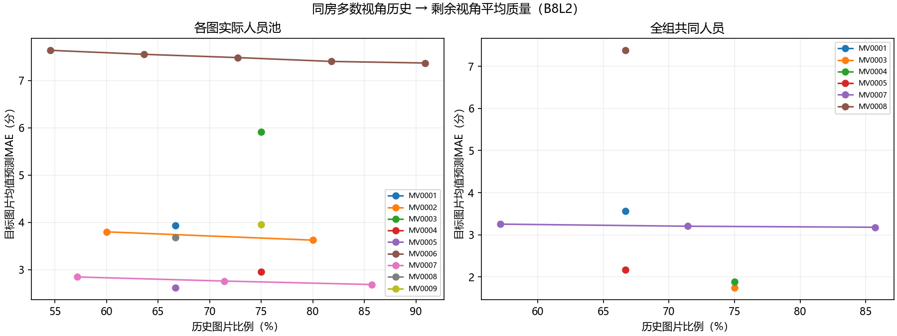
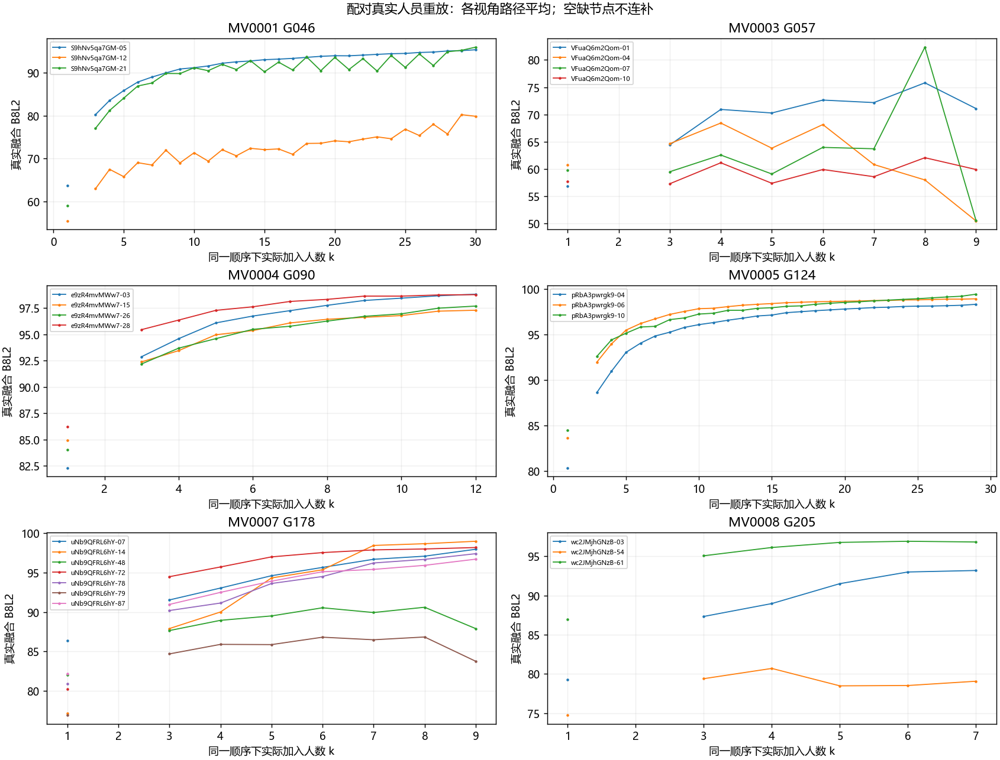

# 同房多视角历史与真实人员重放（v2）

执行日期：2026-10-20。按[独立计划](../../../docs/thesis_main/topics/same_room/同房预测研究计划_多视角历史与人员重放_20261019.md)推进。平均质量迁移、个人Q预测和真实融合曲线重放均已完成；下文及附表记录最终覆盖和结果。

当前结论：同房源图能提供可迁移的平均质量及个人Q信息；多数历史比随机单张历史更准确。真实融合中也存在共同上升的趋势，但同房并不保证终点相近或每一步都改善。下面同时保留支持案例和反例。

2026-10-20接续：[结构迁移与回落解释](structure_transfer/README.md)。已定位G057末步门槛跨级、G046必要窄转折的支持不足、G178节点齐全但定位偏移，并补充个人结构表达预测及同图局部叠加。用户已确认G046-12两个窄转折应标且易遗漏；原参考已表达，未修改评分。逐份资料改由当前v2证据包读取，全部非OOS作为研究清单起点；全局索引由统筹同步。

## 数据与研究对象

普通manual、当前参考可用、原池至少3名有效真人，每图每项指标至少3名可评价人员；排除OOS，门洞单列。B8L2主指标、D10匹配敏感性；耗时按来源分开，在log(1+秒数)上计算。未接人员类型。

原组、声明子组、明确合并证据均核对；只采用每对已有直接、无冲突、范围可比关系的声明集合，不做关系传递。普通质量包含9个声明组、44张图、7栋建筑，历史比例严格超过50%，所有满足条件的历史组合全部枚举。各图先算均值，历史图片等权，避免人员多的图片获得更多权重。

每个历史张数m先平均同一目标的划分误差，再处理组来源与目标图，最后建筑等权。重复组合不是独立房间；“最高历史”指N−1张。N=3、4时严格多数只允许一个m，最少／最多历史相同。真正能比较增加历史的整组有5、7、11图三个组。

## 已完成：平均质量迁移

合并人员、各图实际人员池的B8L2 MAE：

|基线或历史量|建筑等权MAE（分）|
|---|---:|
|其它建筑训练历史图均值|10.15|
|单张同房源图的平均预测误差|4.80|
|最低严格多数历史|4.11|
|最高历史（N−1）|4.06|

固定全组共同人员面板有6组、24图、6栋建筑，对应单源4.21、多数历史3.33、最高历史3.32。两种面板分别回答实际覆盖与控制人员组成的问题，不直接互相排名。

七图组G178的4／5／6张历史，平均质量预测MAE依次2.85／2.76／2.69；十一图组G172的6／7／8／9／10张历史为7.64／7.56／7.49／7.41／7.37。更多历史有增益，但不能消除视角差异，且已过半后的边际收益较小。

枚举对称划分后整体带符号误差接近零是设计的代数性质，不是新图片预测无偏的证据。多源平均相对随机单源的误差下降也部分来自平均作用；必须结合绝对误差、建筑方向和匹配预算背景对照解释。



### 同建筑背景对照

在能提供相同历史图片数量的6栋建筑中，同房历史MAE为3.78分，同建筑其它候选历史为10.54分，6栋均是同房更好。新增人员对应2.98与11.46分。这里重新限定了两种方法都有支持的目标，不能与上表全覆盖的4.11直接相减。对照排除了已有同房证据的邻图，但剩余关系是“未知”，不是确认异房；也未同时匹配人员组成与难度。因此这是同建筑、相同图片预算下的迁移优势，尚不能单独归因于房间结构。

### T：同房耗时是否也相近

源报告耗时在log(1+秒)尺度上，新增人员7栋46图的楼外基线／单源／多数历史MAE为0.473／0.467／0.408；旧人员5栋18图为0.535／0.525／0.449。新增人员固定共同池的多数历史误差为0.270，与楼外基线0.269基本持平：时间相似性没有质量迁移那么一致。旧人员目标匹配耗时只有1栋3图，多数历史0.285，只作局部描述。各来源保持分开，不用耗时推断认真程度；本轮沿用已整理的时间字段，没有重新审计原始日志。

## 已完成：个人Q预测

同样多数历史设定，逐人先平均划分误差，再平均目标人员／图片／建筑，比较各m时固定可支持的目标人员。本人只在部分历史图作答时按已知作答平均，并记录source_n；未作答不填零。

|人员来源|楼外人员历史基线|仅校准历史基线|多图本人Q直接平均|多源拟合预测|
|---|---:|---:|---:|---:|
|合并|15.40|15.11|12.49|12.77|
|新增|15.18|15.14|12.64|13.10|
|旧人员|15.12|14.59|11.90|12.26|

简单多图平均已提供明显信息，本轮拟合模型没有优于直接平均。各组覆盖不同，不依据表格给新旧人员排优劣；原单源实验另见[首轮报告](../same_room_v2_prediction_20261019/README.md)，不与本轮换面板数字直接相减。

模型外层留建筑；训练行的人员基线同时排除外层建筑和该训练行自身建筑，原holdout及其它训练障碍继续排除。源图Q按条件输入允许已知，目标图Q只用于训练折标签或外层评价。40个B8L2/D10×来源×建筑模型折均有至少3栋训练建筑；完整参数见individual_folds.csv。

## 曲线定义与计算安排

先做6个全组共同池，随后对全组交集不足的3组，按人员作答覆盖生成组内支持子集。只保留覆盖集合中不被其它支持集合包含的集合，至少3图、3名共同人员；不按Q或曲线效果挑选。局部子集与全组结果分开，不能拼成同一个全组大池。

每池最多256条固定种子真实排列；小池排列总数更少时全部枚举。相同人员前缀在各视角实际重新融合，k=1到全池均计算，不借未来人员或GT选择融合结果。每个前缀采用既有MV50／中位数／连接实现和现用评分，N1未启用。

每张历史曲线逐k等权平均，预测同一路径的留出曲线。逐路径误差与路径均值分别保留。主曲线比较要求该组所有视角在相同路径、同k都完整且可评分，以固定所有历史比例的评价支持；其它节点保留覆盖表和原结果，不补零。

GT质量水平、减去自身k=1的增益形状、相邻人数回落、相对全员参考终点的差距分别记录。目标图自身起点／终点仅用于事后描述，不作预测输入。全员参考终点不是真正上限。k=2沿用既有延后评分政策，图中保留空缺。

## 实际融合重放结果

全组共同池6组及覆盖子集14组共43张图，固定随机种子重放2,766条人员顺序、124,924个真实前缀。每个前缀都重新融合；请求与结果逐一对应，成员顺序核对通过，异常为0。111,999个节点有可用质量分，12,925个缺失节点保留为缺失；k=2按既有政策单列。完整覆盖见`VALIDATION.json`、`REPLAY_CHECKS.json`和`curve_coverage.csv`。

缺失中11,636个是k=2节点，另1,289个是其它人数下不可评分节点；“运行异常为0”不等于全部可评价。

曲线绝对质量预测中，B8L2全组面板（6栋、24图）MAE为7.71–7.73分；覆盖子集（3栋、19图）为8.90–8.99分。对应随机单源基线分别为8.87和10.76分。形状误差另见`curve_shape_summary.csv`，不可与绝对质量水平误差混为一谈。覆盖子集与全组面板的建筑和人员支持不同，不直接排名；这是已探索图像上的留历史评估，不是无GT部署验证。

全组面板减去各自单人起点后的逐路径形状MAE为11.75–11.79分。它与绝对水平误差回答不同问题，也显示“平均曲线看起来相近”不等于每条人员顺序的增益都接近。下图展示各视角的路径平均；缺失人数节点不补齐，各子图纵轴范围不同。



|组|观察到的趋势与终点|对原假设的含义|
|---|---|---|
|G090，4图|单人均值82.31–86.25，全员97.29–98.81|共同上升且终点接近|
|G124，3图|单人均值80.37–84.49，全员98.29–99.40|共同上升且终点接近|
|G046，3图|都明显上升；两图终点95.42、96.02，另一图79.89|上升趋势可以相似，质量水平仍不同|
|G178，7图|都高于单人均值；五图终点96.72–98.99，两图87.91、83.76|主要趋势相近，部分视角保留较大差距并有末端回落|
|G205，3图|全员93.20、79.07、96.84|平台水平不同，不能统一预期终点|
|G057，4图|两图从单人均值60.82、59.77降到全员50.51、50.62；其余两图终点高于起点|增加人员不保证各视角改善，是需要解释的真实反例|

全组24图中22图的全员质量高于单人路径均值，但这不是22条单调上升曲线。全员点相对自身终点的差距必然为零，也不构成接近GT的独立证据。终点差距、逐步回落及高于终点的路径比例保存在`replay_behavior.csv`；实际节点保存在`replay_nodes.csv.gz`。

## 门洞、核验与接续

门洞未混入上述普通图面板。`doorway_pairs_reference.csv`保留首轮6对门洞的描述结果供单独查看，本轮没有新增门洞多视角融合重放。人员类别仍暂缓。

9项相关测试通过；核对124,924个请求与真实有序人员前缀，1,441份入池记录的原始点位、点对顺序和环序保持一致。另从输出随机抽取20个曲线预测点，直接从逐路径节点独立复算绝对误差与形状误差，均一致。图表已人工查看排版，未进行原图语义重判。

下一步优先解释G057的回落与G046/G178的低平台视角：核对新增人员触发的墙线保留／连接变化、可见范围及GT参照，先定位机制，再判断是否需要人工审图。当前没有必须人工裁决才能交付的阻塞项；若出现同房范围或参考语义不能由现有证据确定的情况，再提供具体图片与待判断问题。人员分类完成后，可在相同历史划分与真实人员前缀框架中接入类别比较。

## 复现入口

```powershell
python -m tools.thesis_main.analysis.same_room_multiview_20261020 analyze
python -m tools.thesis_main.analysis.same_room_multiview_20261020 fit
python -m tools.thesis_main.analysis.same_room_multiview_20261020 controls
python -m tools.thesis_main.analysis.same_room_multiview_20261020 register
python -m tools.thesis_main.analysis.same_room_multiview_20261020 replay --jobs 3
python -m tools.thesis_main.analysis.same_room_multiview_20261020 curves
python -m tools.thesis_main.analysis.same_room_multiview_20261020 figures
python -m tools.thesis_main.analysis.same_room_multiview_20261020 finalize
python -m pytest tests/test_same_room_multiview_20261020.py tests/test_same_room_v2_prediction_20261019.py -q
```

原始输入、现用评分、规范合同、旧结果和人员类别未改。完整逐次记录压缩保存；runtime为可复算的本地融合缓存，不作为公开发布内容。尚不将同建筑未知关系对照称为确认异房，研究结论也不等于无GT部署验证。
