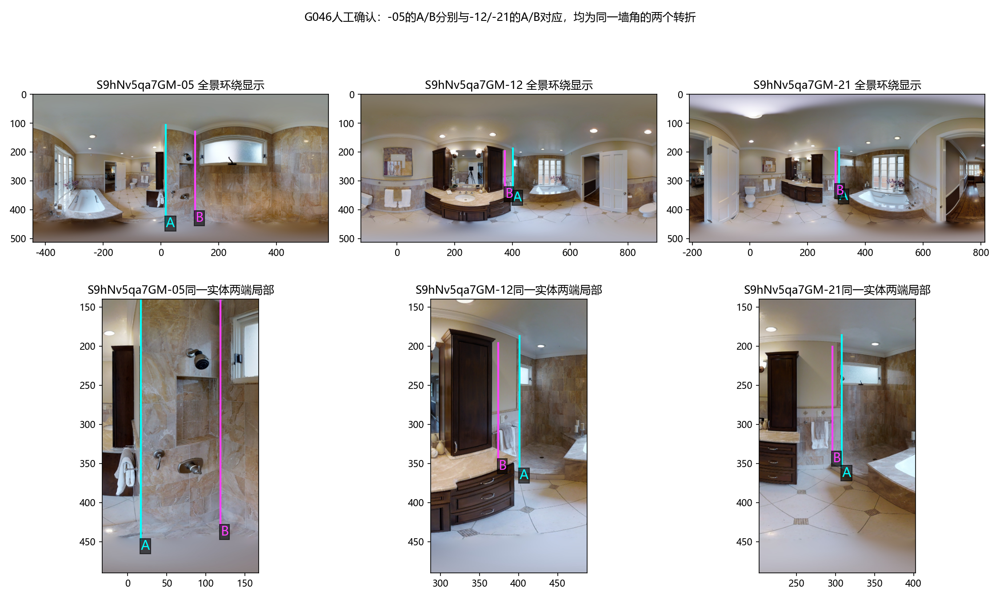
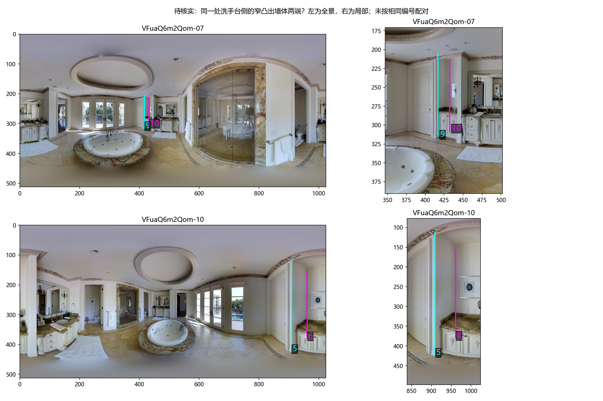
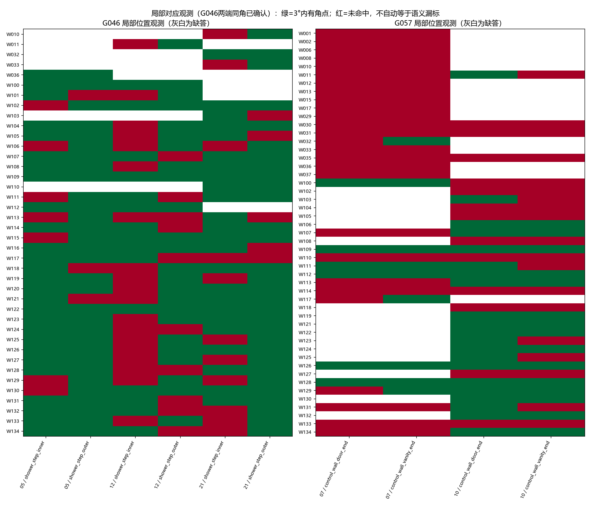

# 同房局部结构对应：人工查看交付

2026-10-21。**现有局部实验已整理、运行和出图；G046两端跨视角对应已获用户确认，其余实体对应研究尚未全部完成。** 本包只涉及G046三图、G057两图，每组两个局部端点，不扩展全房角点，不重跑融合。人员分类未接入。

## 先看这两张图

1. [G046三个视角与局部放大](G046_local_correspondence.png)：用户本轮确认-05的A/B分别对应-12/-21的A/B，两个都是同一墙角的转折。原先的4↔4、5↔5绑定未改；此确认只覆盖图中局部端点，不自动延伸到全房其余角点。
2. [G057两个视角与局部放大](G057_correspondence_review.png)：-07参考9/10与-10参考5/6，由同一扇门、墙控和台柜位置支持局部对应。已由Codex看图采用，尚无人工作同角裁决。图标题“待核实”为初稿状态，保留供审查，不表示已获用户确认。

## 已有发现及适用边界

**G057同一局部结构的表达强烈随视角改变，同时存在可重复的人员行为。** 按参考方位3°内的一对一角点观测计算，门侧端在-07为6/33人、-10为21/34人命中；台柜侧端分别9/33与15/34。W112、W126在两图两端均命中；W107在-07两端均未命中、-10两端均命中；W114两图两端均未命中。这里“未命中”可能是省略或定位偏离，不能自动等同语义漏标。

同一9人保存融合池中，-07两端各有3人命中，低于5票，终点均未命中；-10为7/9和5/9，终点均命中。这把视角差异连接到了局部支持与最终结构。**这两个3票局部不是上一报告中4→5门槛跨级的节点证据**，不能拿它们解释全部末步回落。原人数过程另见[既有G057过程图](../structure_transfer/MV0003_geometry_process.png)。

**本人历史并不直接等于可靠的局部预测概率。** 以下比较使用完全相同目标、同样可用源图，目标作答不进入历史，其他人员基线排除本人。误差为Brier（预测概率与0/1观测差的平方），越低越好；先特征×目标图等权，各房间分报。

|局部面板，3°|目标人员×图×端点记录|本人其它视角|同源其它人员|两者各半固定平均|恒定0.5|他人向0.5收缩一半|
|---|---:|---:|---:|---:|---:|---:|
|G057，图像支持对应|72|0.3333|0.3175|0.2603|0.2500|0.2728|
|G046，现已人工确认对应的原绑定试算|192|0.2997|0.2064|0.2292|0.2500|0.2115|

统筹指出初稿遗漏了简单概率基线，本轮直接从已有逐目标预测补齐全阈值对照：恒定预测0.5，以及他人概率p收缩为0.5p+0.25；均不训练、不使用目标标签选择参数。

G057各半平均虽比他人基线降低约18.0%，也优于收缩他人概率，但**仍不及恒定0.5的Brier=0.25**。6°/9°各半为0.2608、他人为0.3186、收缩他人为0.2735，仍未胜过0.25。简单收缩本身已改善他人基线，故各半改善不能单独证明本人历史带来可用预测优势，更不能把它称为已验证模型。原有具体视角、人员行为和局部投票发现保留。

G046三个阈值下各半结果均劣于他人及收缩他人基线；3°分别0.2292、0.2064、0.2115。跨视角同角身份现已人工确认，因此这组原绑定试算可按这两个实体端点解释；它仍不支持本人历史带来额外预测增益。两个端点的回顾结果不足以认证新类别或普适模型。所有阈值结果见[PREDICTION_SUMMARY.csv](PREDICTION_SUMMARY.csv)。

**位置邻近与融合身份组支持不是一回事。** G046-12共同30人中，A附近3°原答命中20人，但附近有4个融合身份组，最大支持14；B命中13人、附近组支持13。两端最终均未保留。不能把20次邻近观测直接算成同一实体的20票，也不能把A的丢失完全解释为没有人画；需要区分近邻不同结构与对应分组。该单图诊断不依赖跨视角候选是否成立，未修改原14/13票结论或融合规则。

## 对应状态与可见性

|状态|本包如何处理|
|---|---|
|人工已确认|本机原始回执确认G046-12两个转折应标；公开摘要见[结构迁移说明](../structure_transfer/README.md)。2026-10-21用户又确认G046三视角A↔A、B↔B是同一墙角的两个转折。|
|图像支持、非人工确认|G057的9↔5、10↔6，两端各自绑定；不延伸到其余角点。|
|局部身份范围|G046三视角4↔4、5↔5已确认；其它墙角未由这次反馈确定。|
|自动观测候选|每张图内部按方位角一对一匹配，3°为主、6°/9°敏感性；不是自动跨相机配准。|
|不可见/遮挡|墙体竖边与底部可见性分开。部分底点被台柜、器具或全景拼接区域遮挡；没有逐作答可见性裁决，不把未命中编码为不可见。|
|范围不同|本包只选直接关系、范围可比且无冲突的图对；未纳入范围不同的局部例子，不声明全房所有视角范围一致。|
|未知|G057其它重复台柜细节、G178实体角点身份，以及未作答位置均未知；空白不是0。|

## 逐人查看与字段

5图原库存175份，符合独立投票及几何要求的Manual为170份（34/34/35/33/34）；每份两个端点、三个角阈值，共1020行局部观测。不是1020个独立作答。预测只保留本人有其它视角历史且同源他人基线可用的记录；192/72是端点重复记录，不是人数。全员观测池与保存融合共同池（G046为30人、G057为9人）分别报告。

- [FEATURE_MAP.json](FEATURE_MAP.json)：局部键、各视角参考角点编号（1起始）、直接关系采用版本、状态与依据。
- [LOCAL_BEHAVIOR.csv](LOCAL_BEHAVIOR.csv)：逐人、逐图、逐端点、逐阈值的hit、横向dx与底部bottom_dy；有object_id可回查原份资料。source_pair_index为处理后点对序列索引（0起始），不是原始导出编号。未命中时位置值为空。
- [LOCAL_PREDICTIONS.csv](LOCAL_PREDICTIONS.csv)：目标及历史图片数、五种预测、实际观测与误差；两条新基线与其他方法使用相同目标，未增加独立样本。
- [VIEW_RATES.csv](VIEW_RATES.csv)：各图局部观测人数与比例；[CONDITION_COVERAGE.csv](CONDITION_COVERAGE.csv)保留库存和资格分母。
- [FUSION_FEATURE_LINK.csv](FUSION_FEATURE_LINK.csv)：保存融合的共同人员、局部观测、附近身份组支持和终点命中。nearby组仅按中心方位筛选，可包含不同结构；geometry_pointer相对上一级研究包定位既有case_states.json中的image，不是可直接点击的JSON选择器。
- [FIELD_CONTRACT.json](FIELD_CONTRACT.json)：列清单与用途。原始输入为v2逐份证据包，点位、参考、资格与评分均保持不变。

本包只有普通Manual，无Semi或门洞局部对应实例；两个端点之间相关，不作为独立房间扩大样本。原参考图集[G046](G046_reference_atlas.png)、[G057](G057_reference_atlas.png)作为初稿辅助材料保留。

## 本轮人工反馈

用户回答：**两个都对应同一个墙角，都是两个转折。** 这对应图中的A↔A、B↔B；原局部绑定无需调整。

这次确认解决了本包G046两端的跨视角身份疑点，不代表逐份原答、可见性或全房角点已获人工裁定。G057继续保留图像支持、非人工确认状态。

复现：`python -m tools.thesis_main.analysis.same_room_local_features_20261021`。本轮修复热图列名重复，脚本完整运行，2项定向测试通过。此命令重建数表、G046对应图和人员热图；早期参考图集与G057审查图作为已存审查材料保留，不由此命令再生成。
