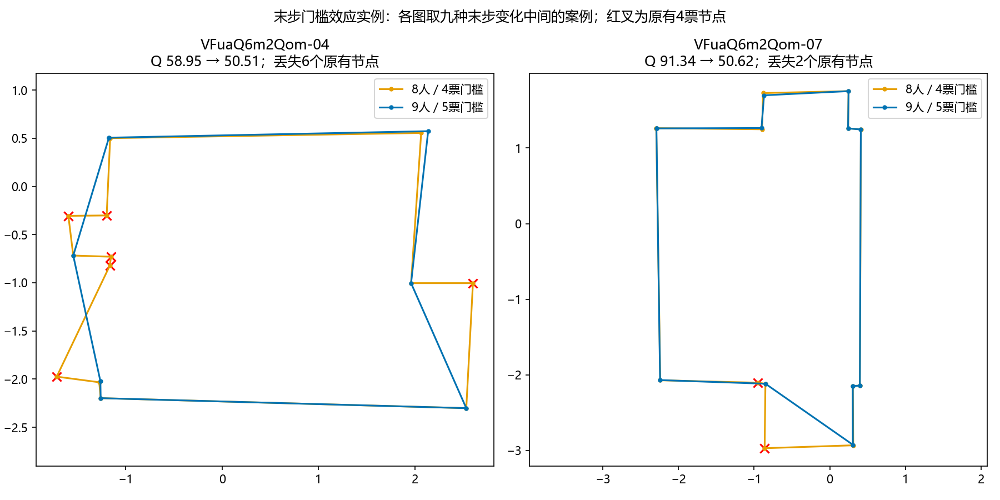
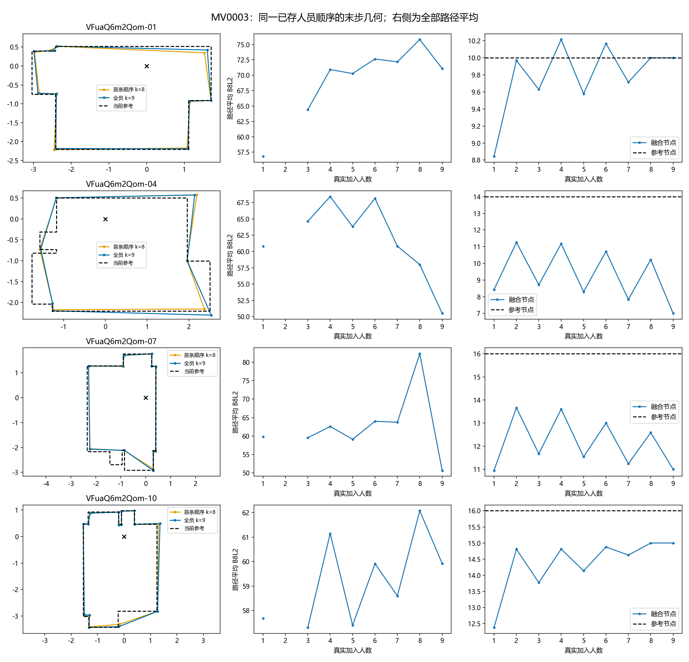
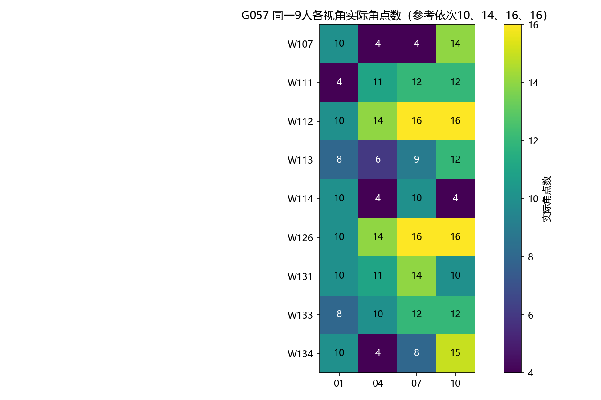
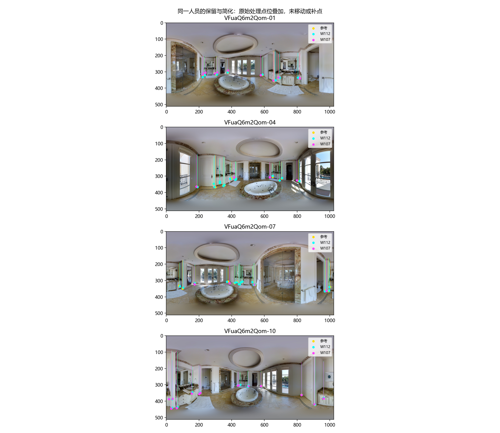
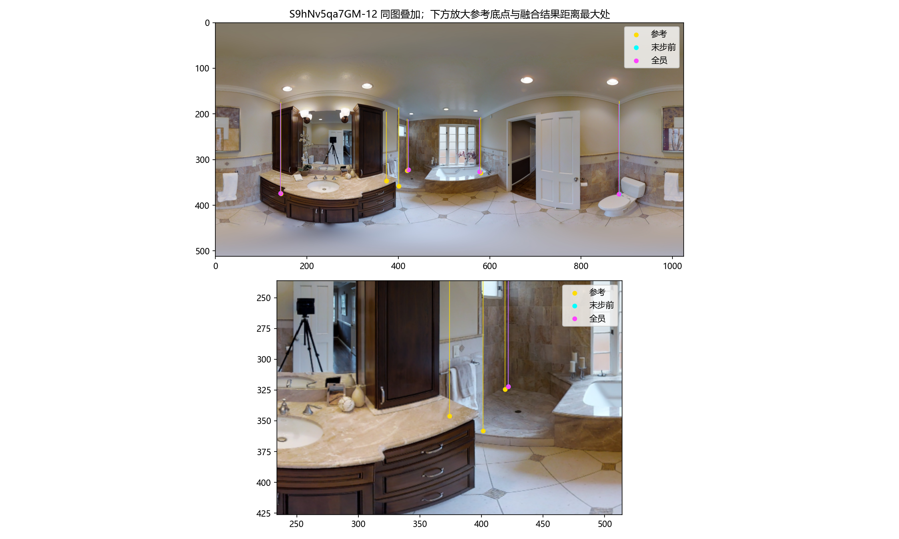
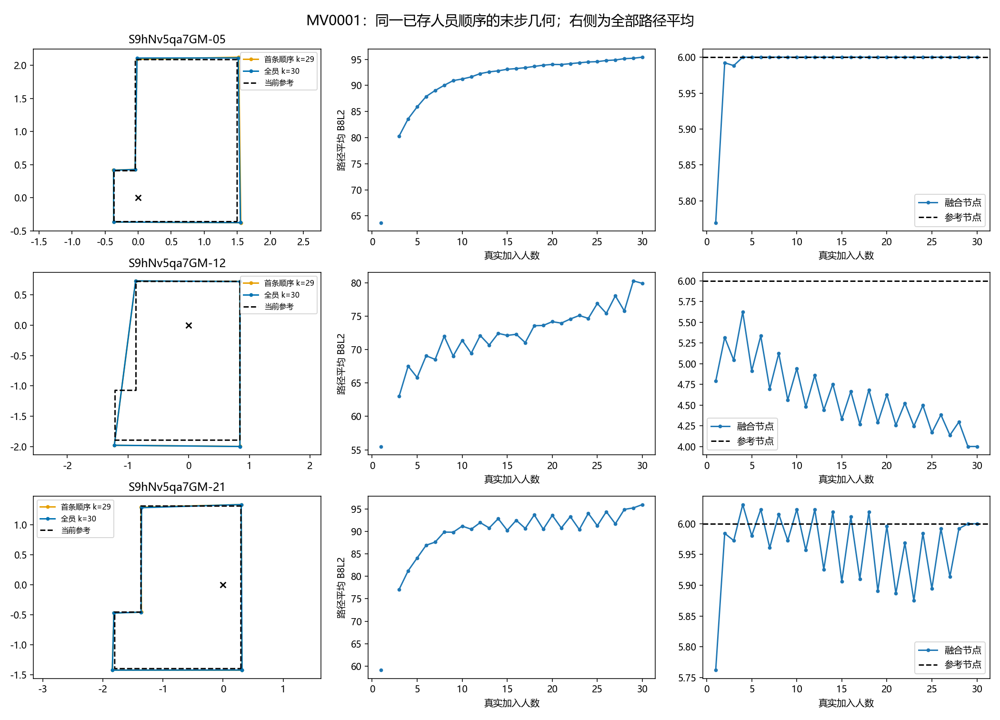
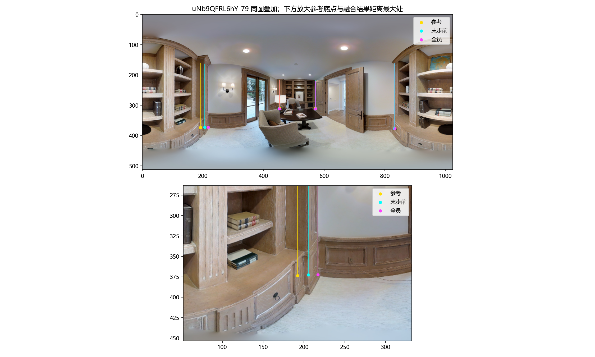
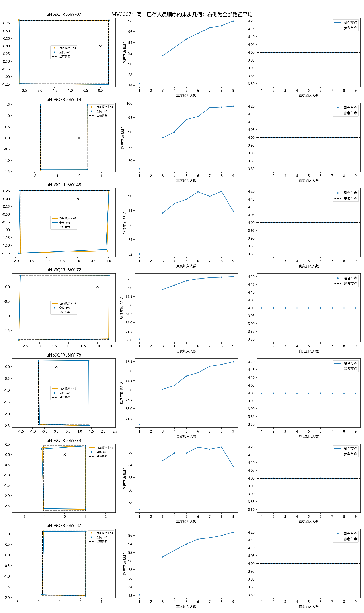

# 同房结构迁移与融合回落解释

2026-10-20。本轮从v2逐份证据出发，复用已完成的真实人员前缀，解释G057、G046、G178，并以G090/G124作对照。原预测基线、处理点位、参考和融合参数均保持不变。

**主要发现：结构简化程度有跨视角信息，角点位置偏移却强烈依赖视角。融合低平台至少有两种机制：必要转折得不到足够支持，以及节点齐全但位置一致偏离参考。G057还出现人数增加使保留门槛跨级、原有节点被删除的明确过程。**

## 1. G057增人回落不是偶然的一条人员顺序

固定9名共同人员，把每一人分别留到最后加入，共9种不同的8→9团队变化。这里每个不同八人团队等权，不按256条随机顺序的重复次数加权，因而与主报告的路径均值略有不同。

|视角|八人团队平均Q → 九人Q|平均节点 → 九人节点|九种末步变化|
|---|---:|---:|---|
|-01|76.63 → 71.10|10 → 10|有升有降，平均−5.53|
|-04|57.79 → 50.51|10.33 → 7|9/9下降，平均−7.28|
|-07|82.81 → 50.62|12.56 → 11|9/9下降，平均−32.19|
|-10|62.14 → 59.92|15 → 15|有升有降，平均−2.22|

机制可由保存的节点身份直接追溯：**八人保留门槛4票，九人变为5票**。-04有7/9种末步安排出现原有节点出局，累计30个节点事件；-07为8/9种、累计14个事件。这些丢失均是保留原观测身份的一对一节点，支持未越过新门槛，不是节点重新配组造成的数量变化。同一个物理节点会在不同团队中重复计入，30和14不能当作独立墙角数。

-07的方向误差由3.23°增至10.61°，底部误差由0.46°增至0.62°，高度比保持约0.974。主要回落伴随结构删除、连接方向改变，不能归因于高度突然变坏。门槛解释了删除；它没有单独解释每一分损失，例如没有丢节点的末步安排也会因位置变化降分。

上图各取九种末步变化中的中位案例，红叉表示支持人数仍是4、却因门槛升到5而出局的原有节点。-04丢6个，-07丢2个；对应原始团队及观测身份见`G057_gate_examples.json`。此图用于解释机制，整体效应仍以上表全部九种变化为准。

左列固定使用第一条已存顺序的末步前／后几何，右两列使用所有路径平均；未选最好或最差顺序。底面坐标以相机高度归一，不是实测米数。

## 2. 同一个人会重复简化，但也会随视角改变

G057共同9人的实际角点数如下。参考四视角依次为10、14、16、16。

- W112、W126在四视角均保留与参考相同的角点数。已有历史标法参照中，两人相对同行的角点数差分别约+0.682、+0.643，少于同行的历史比例均为0；本组表达较细与该参照一致。**点数相同不等于每个点都正确。**
- W113为8／6／9／12，呈重复简化，但简化程度随视角变化。
- W107为10／4／4／14：在-01、-10保留较多结构，在-04、-07明显压缩。不能只给此人贴“总是少画”的标签。
- W114为10／4／10／4，也不是统一按固定比例省略。

青色W112、品红W107、黄色参考。全景可见台柜、窄墙面转折和遮挡，复杂局部不是均匀分布。不同视角的节点编号没有直接对应关系，本轮没有把相近像素位置或相同编号称为同一实体墙角。该图提供同一人的表达对照，精确的跨相机墙面身份仍需空间对应。

## 3. G046的低平台是容易忽略的必要结构被少数化

同一30人，在-05和-21各有23人画出至少6个角点，在-12只有8人。全员融合的三个视角分别为6、4、6个节点，参考均为6个，质量终点分别95.42、79.89、96.02。

在-12洗手台右侧、淋浴区左侧，两个窄转折对应的现用身份组支持分别为14/30、13/30，均未达到15票。其余主要节点被保留。这说明低平台不是人数不够多，而是**这个视角的必要细节没有获得多数支持**；现用融合会稳定地省略它们。

用户本轮确认：“正常来说应该要标，但是这里比较容易被忽略。”已核对当前GT确实画了这两个转折，并记录在[人工判断回执](USER_REVIEW.json)。参考、原答和评分均未修改。该判断只针对这里的两个必要转折，不推广到所有台柜或家具。

## 4. G178的低平台是定位问题，不能套用“少画结构”的解释

G178的7个视角全员均为4节点，参考也是4节点；其中-48、-79质量仅87.91、83.76，另外五图为96.72–98.99。

|视角|局部偏移，1024×512坐标|末步与范围表现|
|---|---|---|
|-48|参考角点1的底点y从329.31到335.98，向下6.67像素；另一个角点x偏−4.39像素|9种末步全部降分，平均−2.54；全员参考范围遗漏约7.2%|
|-79|参考角点3的x从192.09到217.19，横移25.10像素；其底点y仅偏−0.83像素，另外三点y约+1.71至+2.17|末步平均−2.81；全员参考范围遗漏约7.4%|

正的bottom-y偏移在共同相机高度的投影中把底点拉近，可能缩小重建范围；但-79的最大问题实际是横向位置，不应把它统称为bottom-y误差。书柜与墙面交接处的局部叠图显示，融合中心落在不同的边界位置。这里仍按原参考作几何评价，尚未把装饰边、柜体边、真实墙角的关系重新裁定。

这与G090、G124形成对照：两组各视角都保留4/4节点，全员方向误差分别约0.22–0.76°、0.08–0.38°，质量达到97.29–99.40。结构支持稳定时，增加人员主要改善位置；如果多数原答在某个视角选择了相近但有偏的边界，人数增加不会自动消除偏移。

[G090几何与人数过程](MV0004_geometry_process.png) · [G124几何与人数过程](MV0005_geometry_process.png)

## 5. 本人其它视角能预测什么

保留简单平均：用本人已作答的其它同房视角预测留出视角；比较本人其它建筑历史，以及同样源图上的其他人员均值。三个方法在相同目标记录上比较，先目标图等权、再建筑等权。没有使用目标作答拟合，没有新增复杂模型。

|预测对象|本人楼外历史MAE|本人同房历史MAE|同房源图其他人员MAE|判断|
|---|---:|---:|---:|---|
|相对参考角点数差，个|1.072|0.617|0.713|同房明显有用；本人额外优势并非每栋一致|
|9°内未匹配参考角点比例，百分点|10.93|6.22|7.32|本人历史还能补充角点保留信息|
|12°敏感性，百分点|10.54|5.89|6.93|放宽匹配阈值后方向保持|
|相对同图其他人员的点数差，个|0.747|0.639|0.646|优于楼外，但本人身份额外收益很小|
|匹配底点y的带符号偏移，像素|1.889|2.358|1.951|本人同房历史反而更差|
|参考范围遗漏比例，百分点|5.91|5.47|5.25|房间信息略有用，本人不胜其他源图人员|
|作答超出参考的面积比例，百分点|5.59|5.18|4.99|同上|
|作答／参考面积比的对数|0.0905|0.1044|0.0896|本人同房历史更差|

参考指标覆盖44图、7栋、55人、1,385个目标图×人员记录；GT无关点数差为1,458个。本人可用历史为1–9张，GT无关项最高10张。这里使用全部可观测其它视角，是原多视角方案的N−1历史扩展；某人在源图缺答时不填零、不虚构作答。该补充没有再次枚举每一种历史张数。

相对楼外基线，角点数差和9°未匹配比例均在6/7栋改善；相对同房其他人员，分别仅3/7栋、5/7栋改善。bottom-y及面积对数比在7栋全部更差。**目前较能迁移的是结构简化／保留倾向；定位与范围量受到视角影响，不能直接照搬。** 这些指标描述错误类型或表达程度，尚不能准确指出新视角里“具体哪一面墙会漏掉”。

角点匹配采用同图底部射线的一对一角距离分配，报告9°及12°。它是诊断对应，不是新的评分或跨视角墙角身份。范围指标是与未改参考的几何差，不等于人员主观选择了另一空间；有参考问题的记录不进入这些正确性预测。

## 6. 覆盖、资料与下一步判断

研究清单从逐份证据中的全部非OOS开始：**9,217份、233图，其中门洞17图单列**。9,114份能提取点位特征，内含1,812份非正式质量记录，保留用于标法研究及诊断，未因不可评分删除。库存和几何特征保留历史非采用记录；独立人员比较使用既定独立作答资格，避免把重复或未采用作答当作额外人员。当前数值预测与重点机制实验使用已有普通同房面板；门洞未混入，也未冒称233图全部完成同房推断。

主要输入：

- `research/statistics/v2_evidence_audit_20261019/records.json.gz`：本轮逐份输入、点位、参考、场景及资格。
- 上一级`runtime/pools/*/states.json.gz`及`replay_nodes.csv.gz`：真实融合状态及人数过程，不重新合成或修改旧结果。
- `research/workers/personnel_composition_study_20261019/analysis/reverse/historical_roles.csv.gz`：既有人员标法参照，只作解释，不当作独立留出验证或新类别。

数表分别见`record_features.csv.gz`、`transfer_summary.csv`、`transfer_buildings.csv`、`common_worker_patterns.csv`、`last_entrant_transitions.csv.gz`、`last_entrant_summary.csv`、`endpoint_corner_offsets.csv`；列定义及用途见`FIELD_CONTRACT.json`。几何案例状态保存于`case_states.json`，可回溯原节点观测和支持。

下一步判断：

1. G046已具备“必要细节被多数省略”的人工与几何证据。接续可以研究保留该细节的人员在其它视角是否也稳定保留它，而不以总Q替代局部结构能力。
2. G057优先研究4票边缘节点及支持它们的具体人员。原规则下增人回落已经确认；是否另设结构保留策略需要另做与原融合并列的实验，不能直接改基线。
3. G178应研究相同真实边界在不同视角的可见性和定位偏差。只加人员数量或按简化程度分组，未必能解决这类低平台。
4. 新类别返回后，先接入现有共同人员表与已确认局部结构机会，检验类别是否解释这些差异；保留本轮简单预测，只有能解释新规律才增加模型复杂度。

复现：`python -m tools.thesis_main.analysis.same_room_structure_transfer_20261020`。仅生成本子目录结果；不重跑融合、不改旧评分。11项相关测试通过（含2项新增几何测试），324份共同人员原处理点位与当前v2证据一致；已查看叠图和关键过程图。全局索引按用户要求留给统筹，本主题入口同步。
