# HOHONET同房多视角：平均质量、个人不确定性与组合决策

**综合研究报告 · 2026-10-21**

实际读取的 GitHub main：`561584c8f64d5349d497ec1c6e91f1aeb4bbd7c9`。房间关系采用 `same_room_user_working_classification_20261016_v2`；人员采用当前校正 Markdown、CSV、`CORRECTION_RECEIPT.json` 及楼外标签，不使用旧 HTML/PDF 中受影响数字。Dot PR #19 在本轮取得时仍未合并，另行读取固定头 `e83286b7814afc614253aa392050e9a3851ae058`。

**交付身份：上一轮47.1 MiB压缩包原件未找回。本报告把可由固定输入重建的成果、新增实验和未复核旧陈述分开保存；没有把旧回复中的数字补写成原始实验表。**

## 一、最值得保留的结论

本轮应继续保留“同房迁移”，但其主要解释需要更准确：**同房首先提供任务公共质量水平，楼外画像提供稳定人员差异；额外的个人同房信息总体较弱，却在排序、部分房间和具体结构贡献上仍有用途。** 平均质量接近、某个人表现接近、两队融合接近是三个不同问题。

|问题|本轮研究判断|最直接的实证|
|---|---|---|
|同房平均质量是否相似？|成立，值得作为主要结果保留；既有两视角组同样有价值|全量64图单源均值预测MAE5.081，楼外图片均值9.303；匹配难度、参考结构和三图相同人员后，同房仍比关系未知背景接近2.239分|
|同一个人是否反复相对好/差？|存在，但大部分重复来自稳定人员水平与公共任务水平|绝对Q相关0.405；减去同行公共水平后0.239；再减楼外个人相对水平后0.031；稳定优与持续翻转的具体人员均可找到|
|个人同房信息增加什么？|平均Q预测不宜直接照搬本人源Q；本人剩余项可用于排序与条件解释|最高历史：本人源Q MAE12.364，公共源水平＋楼外个人水平11.145；再加半份本人项11.166，但排序相关0.398→0.432|
|类别是否带来独立Q预测优势？|总体新增很小；不作为Q或风险预测必需项|强基线上类别收缩仅改善0.067分；低尾概率模型加入类别未改善；跨类换人的平均收益受历史Q差异明显影响|
|结构、局部票账与精确换人是否仍值得保留？|值得；它们解释了均值模型遗漏的具体互补和失败|G117完全相同两人替换在两个视角都补回结构；G015同一替换收益反向；G205同一7人全票、相同角数仍相差17.76分|
|如何选队、省时？|楼外连续Q是强基线，Q/T约束省时有实用平均收益，但坏尾不可忽略|5人同支持：楼外Q/T方案劳动比0.787、质量变化−0.221分，损失>5分的比例8.57%；本人源Q选队弱于楼外Q|
|如何选人数？|已有同房源曲线时有价值；从零建立多数源历史不一定合算|源曲线容差2分规则平均7.357人、Q87.764；固定7加几何补收平均7.029人、Q86.958；源历史从零取得后，四个可计时组均未比直接固定7省劳动|
|无需目标GT的在线几何稳定能否直接停？|本轮规则不采用为主策略|G046-21连续小变化、6角齐全时停在Q70.07，后续同人数过程可达到96.02；稳定可能是定位偏斜的平台|

这些判断来自本轮实际计算与原图/原答检查。所有留出仍是同一库存上的内部检查；没有把反复探索称为新的外部验证。

## 二、实际采用的房间、人员与证据范围

房间来自用户原有声明与直接采用关系，保留重叠，既不把建筑当房间，也不通过传递闭包补建关系。物理同房、范围可比、质量资格分别读取。主描述不被“至少3视角”限制；只有多历史实验要求足够视角。

|分析层|实际支持|如何使用|
|---|---|---|
|普通Manual、范围可比直接图对|123个无向图对、64图、12栋；19个原声明组，其中10个为两视角组|平均与个人相似性、扩大单源留出；每对至少4名共同正式人员|
|个人直接证据|2,581个人图对、57人|一对缺合法楼外历史，剩余项保持缺失，相关残差支持为2,580|
|平均多历史主实验|9组、44图、7栋|单源及全部实际 `m>N/2` 历史子集；最高历史为N−1|
|个人多历史主实验|44图、1,385份目标原答、55人、7栋|同目标、同本人可观察源图比较信息增量|
|完整全组共同人员曲线|6个支持池、24图、6栋|主停止比较；共同人数分别30、9、12、29、9、7，不是每图固定16人|
|同语义时间的停止比较|4组、14图、4栋|全新人员且全部所需活动时间已知；不混合旧时间语义|
|普通Manual范围不同|26个图对，25对有至少4名共同人员|条件表保留，不并入主结论|
|门洞相关|6个图对、4栋，均涉及范围不相容|独立展示，不能把全部差异归因于门洞|
|Semi|仅1个有共同正式支持的两视角对、4名共同人员，范围不同|保留终稿条件证据；不足以形成与Manual同等的预测模型|

G172占55个主图对，G178占21个；它们不是76个独立房间。主要新比较采用“同目标内先平均→图像→建筑等权”；直接描述另保留图对等权便于与旧表连接。所有表记录分母、完整/可评分状态，不把失败补成0分。

正式Q、B8L2/D10、参考绑定、处理后坐标、环序和融合均沿用冻结输入。筛除和GT暂停作答仍可作行为证据，未恢复其正式Q或投票。M01·pRb-12继续暂停；G046既有转折对应裁定与G015壁炉/简化GT解释沿用。本轮没有提出需要重复人工裁定的问题。

## 三、同房平均质量：接近多少，为什么接近，哪些组不同

### 3.1 旧7.24分的准确含义，以及人员池影响

旧均值差7.24实际是**两图固定共同人员后，各图均值的绝对差，123图对等权**。本轮逐对重建与旧表相符，但实际人员池是另一个量：

|计权|实际人员池均值绝对差|固定共同人员均值绝对差|
|---|---:|---:|
|123图对等权|6.810|7.238|
|每栋先平均、12栋等权|4.919|5.559|

人员组成造成的变化并不总同向。两种均值差之间的绝对变化中位数为1.74分，14个图对超过5分；建筑等权后，实际池总体把视角差异压小约0.64分。因此，既不能默认同房均值接近纯由共同难度造成，也不能把组成校正机械视为总会缩小差异。

完整组图谱见 [逐组图谱](room_similarity/GROUP_ATLAS_ZH.md)，逐图均值、Q分布、参考键、人数与直接关系见 `room_similarity/tables/declared_group_views.csv` 和 `direct_pair_similarity.csv`。

### 3.2 不只是“同建筑背景更差”：难度解释一部分，同房仍有额外信息

固定锚点A，比较采用关系A–B与同建筑但**关系未知**的A–X。没有把未知当作确认异房，也没有按Q挑背景。在相同209个有支持方向、9栋中，依次匹配背景条件：

|相同目标支持上的背景条件|同房均值差|关系未知背景均值差|同房额外接近|
|---|---:|---:|---:|
|同建筑、未匹配难度|4.076|11.938|7.862|
|匹配既有难度类别|4.076|6.400|2.324|
|再匹配参考有效转折数与几何自遮挡转折数H|4.076|6.423|2.347|

难度构成解释了未匹配优势中的较大部分。再限定A/B/X为同一批至少4名人员，108对、205方向、1,206个背景候选、9栋中，同房差4.104，未知背景差6.344，仍有**2.239分额外接近**；建筑bootstrap区间[1.147,3.457]，8/9栋为正，wc2为−0.008，实际近于持平。D10额外接近2.183分。

这里的参考结构匹配是回顾性解释条件，并非部署时免费可知的目标GT信息。它回答的是“相似性是否只是人员与粗难度组成”，而不是一条无GT选源策略。

### 3.3 应直接保留的组内模式与例外

|原组与视角|可读结果|对人员不确定性的含义|
|---|---|---|
|G078·Z6-02/08|实际均值63.27/63.38；共同21人均值差1.87，逐人绝对差18.04|群体均值几乎一样，不代表同一个人的结果一样|
|G090四视角、G124三视角|共同池逐对均值差分别3.16、2.64|是公共质量水平可重复的正例，仍需查看人员身份|
|G130·pa4-42/44|共同34人均值77.10/74.53，差2.58；分布Wasserstein距离3.40；逐人绝对差19.37，排序相关0.190|相近分布可以由不同人员承担高分和低分|
|G057·-01/-07|实际池差10.86；同一14人只差0.69|人员构成放大了表面视角差异|
|G202·wc2-26/53|实际22/35人均值41.61/49.62，差8.01；共同12人29.53/51.02，差21.50|人员构成反而掩盖了明显视角差异；共同人员中11人升分|
|G117·jtc-26/28|实际均值45.35/61.36；共同28人差16.51；均为困难图|同房且粗难度相同，仍可能有很大公共视角差异|
|G172十一视角|均值极差22.16，共同池逐对差9.86|不能把一个较大房间声明内的视角都视为等难任务|

G202的-26使用既有整空间确定性参考，-53使用原GT，版本各自保留。原图和原答显示：W123在-26的范围伸向长走廊，并简化部分浴室结构；-53则表达更多局部点。这里同时存在范围/表达与定位问题，不应把全部低分归为一种稳定人员能力。

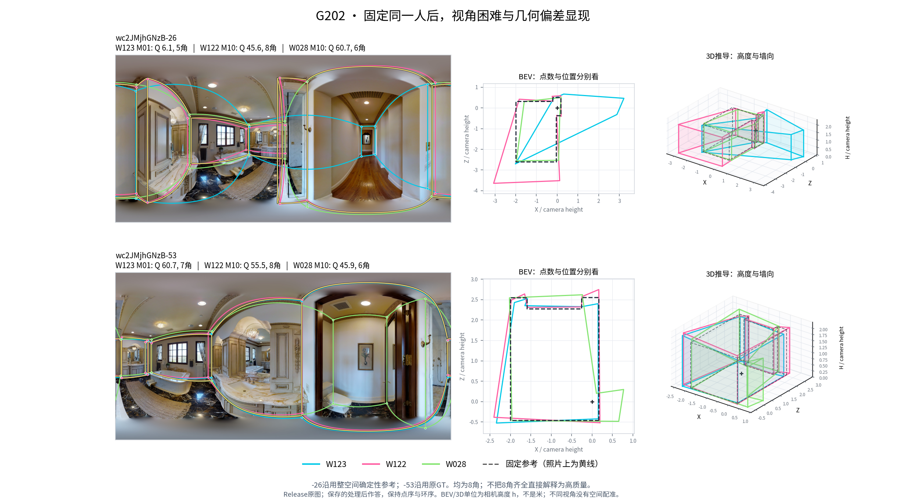

### 3.4 留出用途：均值层面，同房源均值已经很强

全64图、123直接图对的246个方向中，按目标先平均来源再按建筑计权：简单同房源均值MAE为**5.081**，楼外图片均值9.303，楼外人员相对Q构成模型9.570，同房加相对Q组成校正5.131。两视角组并未被排除在这个结论之外。

原9组多历史支持上的结果如下。每种方法均评价同一目标支持，历史预算分开，不把大量子集混成大样本：

|平均Q预测，B8L2 MAE|单源|最低严格多数|最高历史N−1|
|---|---:|---:|---:|
|楼外图片均值|10.146|10.146|10.146|
|楼外人员相对Q＋校准|9.790|9.790|9.790|
|**简单同房源均值**|**4.804**|**4.110**|**4.062**|
|同房＋相对Q构成校正|4.873|4.090|4.036|
|同房＋相对Q＋楼外线性校准|4.776|4.076|4.017|
|同房＋全局难度差校正|6.151|5.053|5.013|

最强连续校准在最低多数只比简单源均值改善0.033分，而误差>10分比例从2.92%增至3.90%。固定全组共同人员的24图中，源均值MAE为4.208/3.335/3.322；额外校准反而变差。**采用简单同房源均值作为平均质量主预测器。** 这不是预先偏爱简单，而是实际增量与尾部都不支持升级。

单源到最低多数有0.695分改善，最低多数到最多历史只再改善0.048分；各实际m另表保存。G172的m=6…10仍由7.641缓降到7.373；G178的m=4…6由2.848降到2.688。不能把“增加历史”描述成毫无价值，但多数之后的平均边际收益很小。

全局难度加减分的反例是G057-01：实际51.96，源均值57.36；按楼外中等/困难差机械加分后预测75.55，误差从5.40增到23.59。难度标签适合解释条件，不适合作为统一Q补偿常数。

## 四、同一个人的质量：公共水平、稳定个人差异与剩余信息

### 4.1 相似性分解及其正确解释

对同一人w、图片i，描述性相对量为该人Q减去**同图其他人员**均Q；楼外个人水平θ是其目标建筑之外、沿用训练许可的普通Manual历史相对Q，历史同行也限训练许可。同行基准始终排除本人。按建筑→图对→共同人员等权，对称汇总得到：

|描述量|跨视角相关|
|---|---:|
|绝对Q|0.405|
|减去同图同行公共水平|0.239|
|再减楼外稳定个人相对水平|0.031|

前两项相关支持为2,581个人图对；剩余相关支持为2,580，W022一对缺合法楼外历史，未补零。相对同行好/差两端同号率59.06%，按两图边际好/差比例独立配对的参照是50.35%；再扣楼外水平后约51.04%。旧逐人绝对差16.384与排序相关中位数0.261得以重现，但现在可以进一步判断：**大部分可重复关系并非一个普遍而强的“个人对这间房有特殊适应性”。**

上述分解使用目标结果作描述，不是预测输入，也不是因果方差比例。另一种“逐图对内相关后再平均”的估计为0.273，扣楼外水平后0.062；它与对称合并相关不是同一估计量，不在报告中互换。

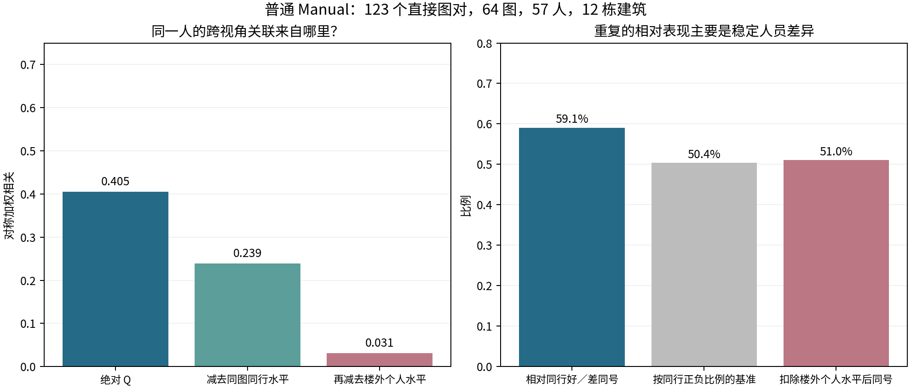

完整共同人员矩阵还显示：G057、G090的人员×视角双中心剩余平方和份额分别54.2%、51.4%，虽然两组均值接近；G178为27.7%，人员持续差异较突出；G202有明显公共视角变化。剩余项也包含测量与偶发失误，不能全部命名为心理特征。两视角的人员均值部分同样会吸收噪声，故采用判断以相关和留出证据共同支撑。

下图让同一人的各视角变化可直接比较。热图为固定共同池的Q减视角均值，仅用于共同矩阵展示；相关分解和预测中的同行基准仍按上述定义排除本人。

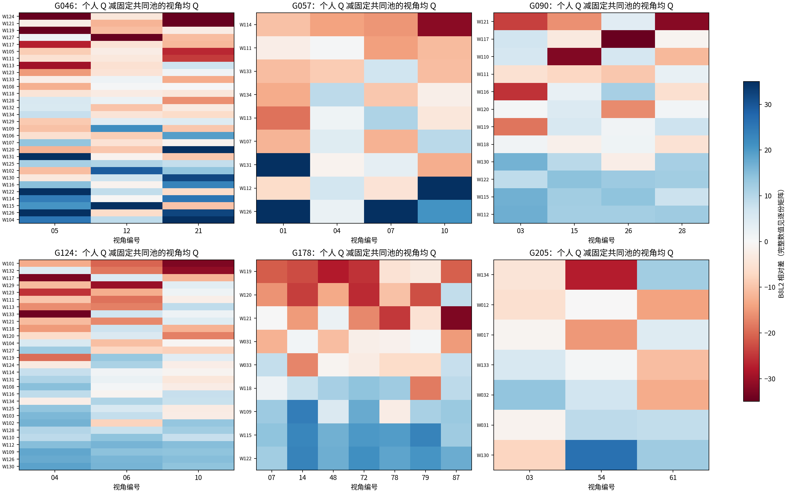

### 4.2 哪些人稳定，哪些人反复变化

|人员|同房支持|相对同行同号率，建筑等权|逐次排除一栋后的范围|
|---|---|---:|---:|
|W115|43图、9栋、62图对|90.4%|89.2%–95.5%|
|W126|35图、9栋、46图对|90.1%|88.9%–97.2%|
|W123|41图、11栋、36图对|34.1%|27.5%–37.5%|
|W132|45图、10栋、46图对|43.1%|36.8%–47.9%|

前两人通常稳定较好，楼外Q也高；W115扣楼外水平后的同号率约50.7%，不应重新命名为房间专长。后两人的变化不是一栋楼单独造成。逐人表同时保留正式Q低尾、支持图数、来源与外部画像，不把GT暂停当个人失误。

G130是特别有解释力的类内反例，两图参考和下列原答均为4角：

|人员／楼外细类|pa4-42 Q|pa4-44 Q|相对同行变化|
|---|---:|---:|---|
|W102／M10|99.04|99.01|+22.79→+24.87|
|W103／M01|35.58|80.90|−42.54→+6.23|
|W132／M01|80.35|38.37|+3.55→−37.56|
|W126／M11|94.58|96.39|+18.20→+22.17|

W103在-42的底点与高度偏差更明显，`S_bottom_deg`由4.30降到0.51；W132则在-44出现明显的平面定位/墙向问题，内在方向偏差从2.90°升至20.19°。两个同为M01的人向相反方向变化，证明结构类无法替代具体视角上的定位表现。

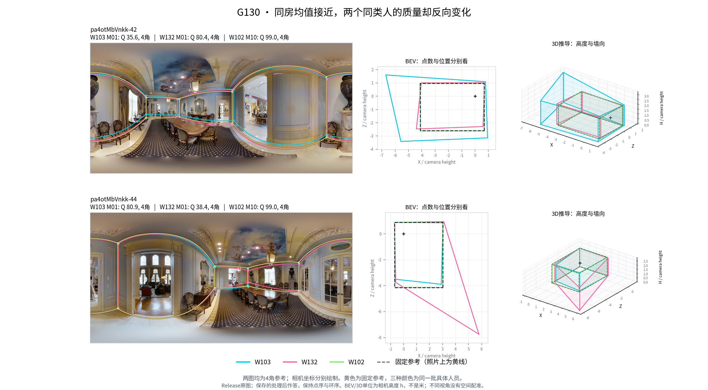

G202的W122是另一种情况：两图均8角，绝对Q仅45.64/55.52，相对同行却均为正（+4.22/+6.08）。低绝对Q不必等于此人相对表现差；公共视角困难与个人稳定优势可以同时存在。

### 4.3 同目标留出：哪些信息真正增加了预测能力

定义源图公共水平P：在本人确有作答的所选源图上，先逐图计算排除本人的正式同行均Q，再在这些源图间等权平均；θ为楼外稳定个人相对Q。个人源剩余为 `本人源均Q−P−θ`。主规则 `clip(P+θ,0,100)` 不需要读目标Q。各方法使用同一目标、同一本人源图支持；没有让类别或公共均值多借本人未作答的源图。

|个人Q预测，B8L2 MAE|同目标单源|最低严格多数|最高历史|
|---|---:|---:|---:|
|楼外个人绝对Q|15.402|15.402|15.402|
|本人源Q均值|14.018|12.495|12.364|
|**P＋θ**|**11.360**|**11.170**|**11.145**|
|P＋θ＋半份本人剩余|11.776|11.218|11.166|
|P＋θ＋半份同类剩余|11.328|11.104|11.078|

完整直接图对的单源面板有64图、1,825份同支持目标原答：P＋θ为12.579，本人源Q15.808，楼外个人绝对Q15.292；本人/类别剩余分别13.297/12.655，仍未超过强基线。

本轮还比较了固定Ridge、丰富连续画像、连续邻近与浅树绝对误差模型。拟合按整栋建筑留出，训练人员历史同时排除外层目标楼与该训练行楼；17个B8L2预测器的定义、参数及分折完整保存。最高历史拟合P/θ系数的Ridge为11.382，丰富连续＋本人浅树11.646，均未超过11.145。把丰富Ridge12.202→加类别12.138的改善当作“类别胜出”会忽略真正强的基线。

固定同类收缩在强基线上确有0.067分改善，7栋中4栋改善；幅度不足以作为必需项。旧回复“类别优势0.303”没有按原始请求库恢复，本轮不延续该数字为主结论。

### 4.4 平均误差很小的增量，仍可能改变排序与特定房间

最高历史加半份本人剩余，整体MAE略坏0.022分，却把每次实际历史内人员排序相关由0.398提高到0.432，大幅高估>20分由9.98%降到8.79%。D10的MAE则由10.402微降到10.396，排序从0.407提高到0.447；这支持“平均误差增量很小，排序仍有用途”，不把B8L2的微小损失解释为稳定大负效应。真实Q<50目标上的误差由25.72降到24.37；这是一项事后尾部诊断，不能据目标已知低Q选择模型。

|房间／历史|P＋θ MAE|加半份本人项|判断|
|---|---:|---:|---|
|G178，4/7源图|10.770|10.240|有条件增量|
|G178，5/7源图|10.746|10.118|增量延续|
|G178，6/7源图|10.725|10.015|改善0.710；排序0.444→0.529|
|G057，最高历史|10.373|9.549|改善0.824|
|G046，最高历史|13.811|14.796|反例，恶化0.985|
|G205，最高历史|10.870|11.682|反例，恶化0.812|

G178也不是每个视角都受益：07/14/48/78改善，72/79/87略坏。该组表是机制解释与下一次外部检验的依据，还不是已验证的“识别房间后切换模型”策略。

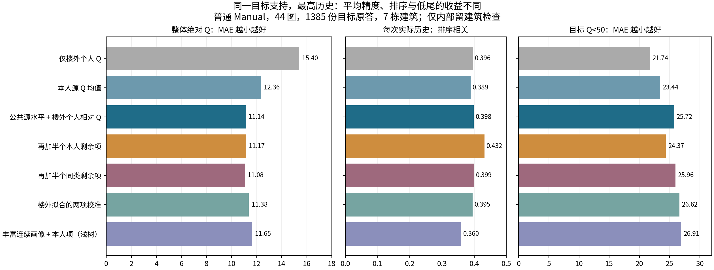

### 4.5 低尾事件：保留风险关联，不夸大额外个人或类别信息

源Q<50时目标Q<50的加权率30.93%，源Q≥90时5.75%；源低分是风险信号，但大多数源低分者在目标并未再次低于50。检验信息增量后，最高历史简单P/θ概率模型Brier为0.09906，加本人项0.09882，仅改善0.00024；直接单源0.11772→0.11775。加类别在最高历史变成0.09959，单源0.12361，均未改善。

丰富风险模型加类别从0.12769降至0.11271是真实结果，但仍差于强简单基线。该公平基线补算的时序保存在 `LOWTAIL_EXTENSION.json`，没有冒称预注册。**风险预测主方案保留P/θ；本轮结束此项模型扩展。**

## 五、类别、原答与融合：相似性为何不能只用一个Q代表

Manual既有M0表示常规或较少转折表达，M1表示较多短转折表达。它们是跨图工作分类，不是永久能力等级。本轮不重新分型。所有正式目标选人和替换使用目标楼排除标签，类别内差异与来源限制保留。

### 5.1 类别提供结构信息，却不保证同类原答位置更近

在同图、5人换1人、相同背景、来源匹配的精确块对照中，把A换成同类B或异类C。普通可比主层中，同角数率覆盖全部尝试；原答与融合距离分别在各自两种比较均可计算的共同子集计算：

|锚定粗类|同类原答同角数率|跨类原答同角数率|同类/跨类原答BEV距离，h|同类/跨类融合BEV距离，h|
|---|---:|---:|---:|---:|
|M0|74.89%|82.66%|0.380 / 0.222|0.065 / 0.054|
|M1|97.05%|72.96%|0.336 / 0.332|0.062 / 0.070|

原答距离共同有效支持约70.5%/71.0%；距离只在同角数、唯一环对应、有效几何上计算。异数与失败另列，没有填0。M1内的角数一致性更高，但不普遍意味着位置更近；固定核心能把原答差异显著缓冲成较小的融合位移。类别结构相似、完整原答几何相似、融合相似必须分别报告。

G236的原图对照也显示结构机会的作用：同一批人在yq-01的8角目标与yq-06的4角目标上差异很大。W122 Q48.2→98.2，W11594.4→99.1，W12743.1→87.5。这里是各视角目标表达和可见线索不同，不能宣称物理墙角消失或重新划房间。

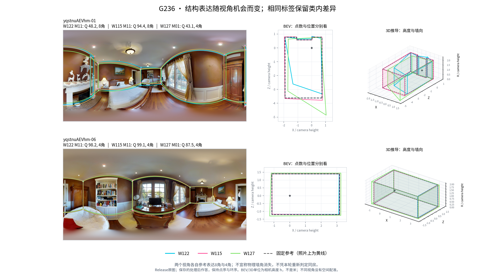

### 5.2 跨类换人的平均收益，必须拆开历史Q差异

本轮新增精确请求库：相同实际A/B/C块在两个声明视角重放，来源匹配、固定核心、保持人数和替换规模；覆盖n=3/5/6/7/9/13、m=1，以及n=5/6/9、m=2和细类对照。另在楼外Q差≤3的交叠区构造匹配块，未用目标评分挑人。

|普通可比、n=5换1人|跨类C−同类B块楼外相对Q差|融合B8L2变化C−B|D10变化|尝试支持|
|---|---:|---:|---:|---|
|容量内随机，M0→M1|+16.36|+4.993|+4.503|236视角事件、61图、11栋|
|容量内随机，M1→M0|−14.05|−4.686|−4.363|234事件、61图、11栋|
|楼外Q匹配，M0→M1|+0.37|−2.339|−1.927|376事件、36图、7栋|
|楼外Q匹配，M1→M0|约相近|+0.504|−0.169|364事件、36图、7栋|

四行用于净Q的双侧可评分事件分别234/236、233/234、373/376、362/364；第一行有效图为60/61，其余均保留所有尝试图。对应双侧可评分率按图/建筑计权为96.97%、99.24%、95.71%、96.67%，与原始事件比例不是一个量。完整分子、分母及单臂失败在 `native_teams/REVIEW_DENOMINATORS.csv`。

Q匹配M0→M1在n=9时为+0.415，优势并未稳定延续。匹配组位于低端M1与高端M0的Q交叠区，不能解释为“全体M1有害”的因果结论；方向间核心也不同，不要求反向效应反对称。但它足以修正“跨类收益本身证明类别额外质量优势”的解释。

在同一467个有Q差和完整结果的n=5事件、61图11栋中，整栋留出的效应预测MAE：历史Q差6.767；加类别6.898；再加类别×难度6.909。**历史Q是解释平均收益的主变量；类别的独立价值应落在局部结构机制，而非泛化质量加分。**

固定同一嵌套请求支持57图11栋、196个视角事件，M0→M1换同一人时，n=3/5/6/7/9/13的效应依次为+7.67/+4.40/+3.64/+3.43/+3.12/+1.83。背景扩大后单人的影响整体减小；偶数n=6共同可评分率95.12%，低于n=5的97.73%、n=7的98.67%，不能把曲线仅理解为平滑人数效应。完整状态、票门槛与不可评分保留在逐事件表。

### 5.3 “同向率约八成”依赖筛选条件，不能直接迁移效应大小

本轮请求库与旧未恢复库不同，不能把以下82.8%称为旧80.3%的精确重现。它提供了相同问题的可追溯检验：

|M0→M1、n=5同一实际替换跨视角|同向率|方向/图/栋|
|---|---:|---|
|两端可评分的所有事件|66.45%|232 / 59 / 11|
|仅要求源视角绝对效应≥2|77.50%|126 / 51 / 10|
|源与目标绝对效应都≥2|82.80%|78 / 42 / 8|

最后一行使用了目标效果筛选，只能作描述；第二行才对应看到源效果后筛选的场景。直接照搬源效应大小也不好：所有事件复制源效应的MAE8.564，预测零效应为7.114；源≥2子集复制源为9.885，零为6.239。源效应方向有条件重复，不意味着效应大小可直接复制。

源图选B/C也未超过“在本对照中选更多M1”的简单选择：M0→M1方向平均−0.151，反向−1.034。该类别选择仍混有历史Q作用，不应升级为独立类别政策。

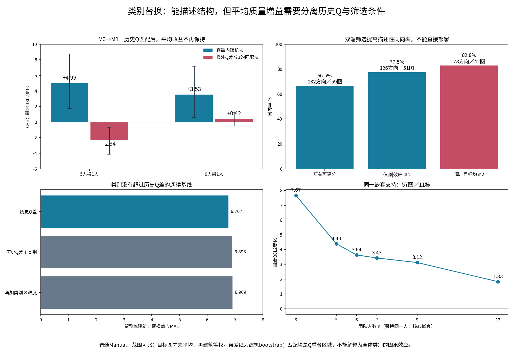

### 5.4 精确机制正例：G117，两视角相同成员替换补回结构

固定核心W109/W121/W132/W133，把W110/W113换为W102/W126，始终6人、门槛3票。jtc-26的B8L2由60.75→93.38，jtc-28由69.44→92.57，两图均6角→8角。

这不是只靠Q描述的互补：jtc-26一端局部身份组从2票（W109/W133）变4票（再有W102/W126）；另一端从1票（W109）变3票。jtc-28两处局部从2票（W109/W132）变4票。新增人员提供的表达，只有与具体核心合计越过门槛才进入融合。

各视角局部键分别保存，未新增跨视角物理角点对应事实；也没有把原答附近命中直接当成同一身份组票数。

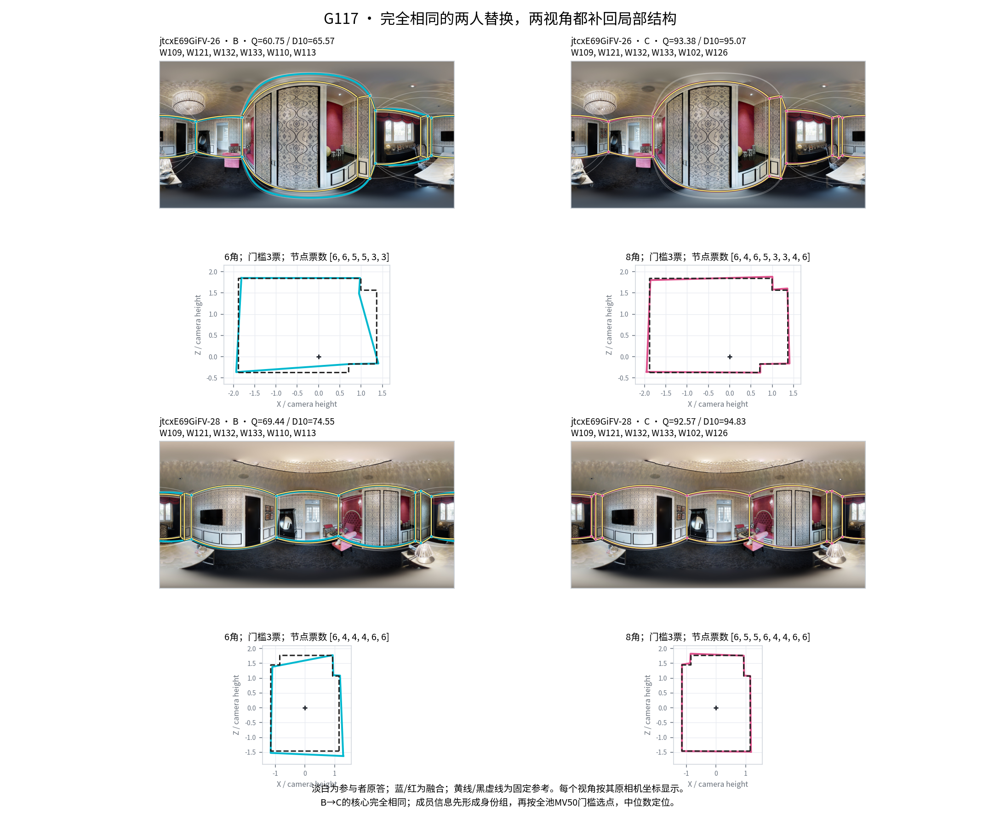

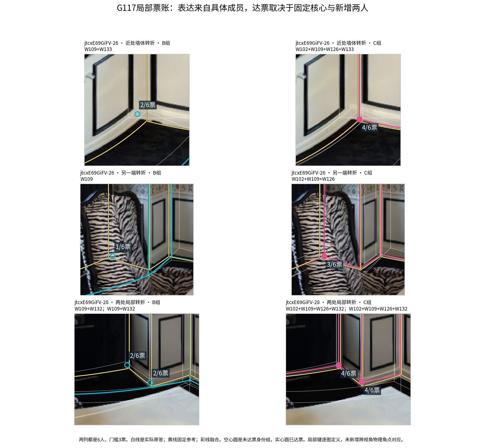

### 5.5 反例仍然有研究价值：目标与定位决定转移边界

**G015：** 核心W100/W110，将W128换W122。-19补回结构，7→8角，Q64.58→95.65；-11两队都是4角，定位变化使Q94.75→84.47。按用户既有解释，-11真实壁炉细节被固定GT简化；此处同时保留物理解释与固定评分，没有改GT来消除反向结果。

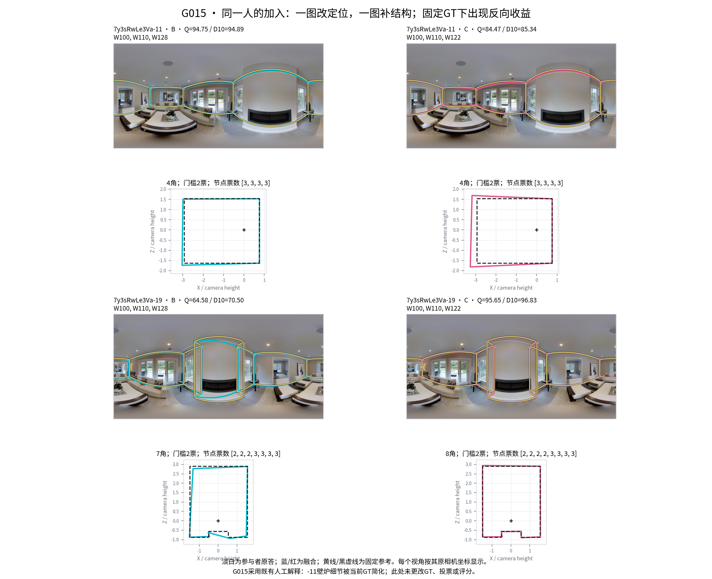

**G205：** W012/W017/W031/W032/W130/W133/W134同一7人，在-03/-54/-61均形成4角、各节点7票，Q分别93.20/79.07/96.84。全票只说明身份组支持强，不校准位置；因此源视角人员结构相似，目标融合仍可能有明显质量差。参考中的近共线分段不自动算必要角点遗漏。

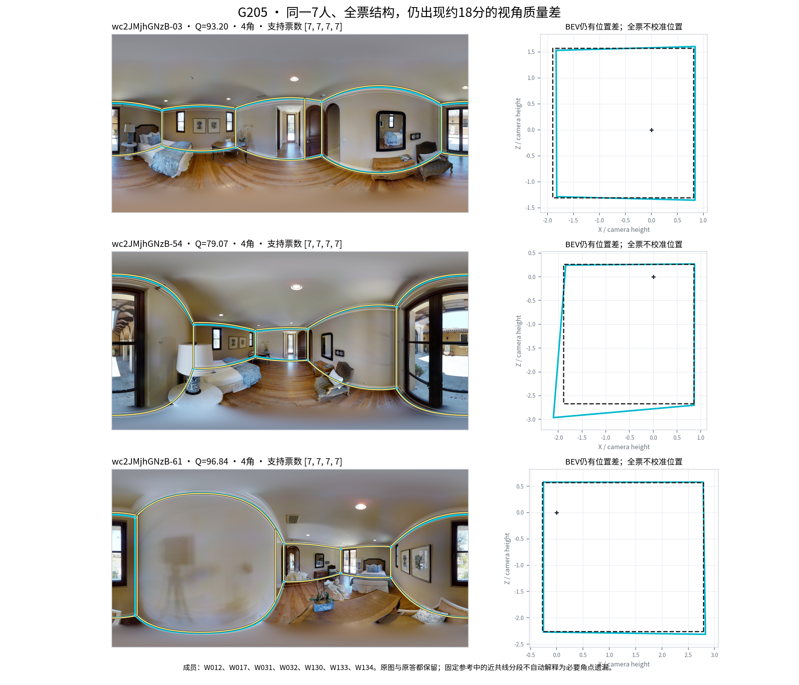

## 六、选队与成本：什么信息值得用于实际决策

### 6.1 同支持比较，楼外Q胜过直接本人源Q

候选人员是同一源/目标都实际有作答且楼外历史至少8图3栋的人员。目标可用名单已知；选队不读取目标Q、目标耗时或目标几何。各人数均实际融合；主表以5人为可读截面，其他n保留。

普通可比、全来源同支持242个源→目标情境、64图12栋：楼外Q团队B8L2为92.958；本人源Q89.280；半份楼外Q＋半份源Q91.798；再要求尽可能至少半数M1且不损失超过2分历史混合均Q为92.222；随机84.688。随机每情境3队，共726次尝试、721次可评分；其图像/建筑加权完整率98.38%，其它主要规则此层各242/242完整；配对质量变化另按共同可评分计。

结构构成规则比半份混合Q改善0.424分，建筑bootstrap区间[0.015,1.042]，但约85.7%的团队根本没变，且仍低于强楼外Q团队。**这是结构构成的小幅条件收益，不足以把类别配比作为默认主选人规则。**

个人预测中的排序改善不能直接推出融合选队改善：个体Q可加性与融合的身份组、门槛、位置中位数并不等价。本轮实际融合结果支持楼外Q主基线。

### 6.2 连续Q/T能减少劳动，但需明确其风险

只用同语义新数据，并要求楼外Q/T历史与源活动时间均有支持，使两种速度规则评价同一候选池。以楼外Q最高的n人为起点，逐次用更快候选替换，在团队楼外平均Q最多下降2分的约束下减少预测劳动。分别用楼外任务调整T和本人的单源活动时间作为速度依据。

5人、240事件、62图11栋：

|规则|B8L2|D10|相对楼外Q变化|劳动时间比¹|损失>5分|完整率|
|---|---:|---:|---:|---:|---:|---:|
|楼外Q|93.691|94.451|0|1.000|0|100%|
|楼外Q＋楼外T省时|93.471|94.344|−0.221|0.787|8.57%|100%|
|楼外Q＋源图T省时|92.845|93.668|−0.847|0.817|7.69%|100%|
|本人源Q|89.401|90.543|−4.386²|0.927|26.63%|99.24%|
|半份混合Q＋结构构成|91.602|92.521|−2.089|0.939|17.36%|100%|

¹先取同目标团队时间比的对数，再图像/建筑等权，报告几何平均；不是将所有时间简单相加后的比。²配对可评分差与边际均值差在有失败时略有区别。

楼外Q/T省时平均节省21.27%，质量变化的建筑bootstrap区间为[−0.784,+0.304]；劳动比区间[0.738,0.840]。同时节省≥20%且损失≤2分的加权比例38.35%。楼外T比源图T平均Q高0.626，但坏尾略高，不能称全面支配。

人数改变时效应并非单调：n=3/7也有较小平均损失；n=4/9损失约1.30/1.26分且坏尾约15.6%/16.5%；n=13支持缩至51图10栋。表中保留实际支持，不据这些探索结果宣称一个普适最优人数。

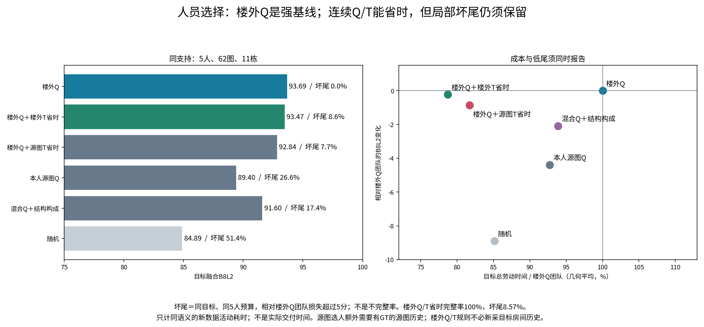

### 6.3 一次节省41.7%但损失28.77分的实际机制

G172·uNb-43，5人楼外Q队为W112/W114/W115/W130/W131，快速队替换成W108/W112/W115/W130/W134。目标劳动1,012.35→590.45秒，Q99.190→70.421，D10仍由99.206降至76.970。

两队均6角，局部短边的两组支持由5/5变为4/5，未丢节点；位置中位数却改变了短墙方向。推导BEV中该短边两端对90°的偏离由约2.3°/2.4°增至51.2°/45.6°，全轮廓内在方向量由0.296°增至4.984°。固定评分诊断中，仅将内在方向损失置零会回升27.946分；这是一项分量消融解释，不是修改正式Q或因果归因。

原图、原答、各成员身份组和几何都保存。该例说明低尾不必来自缺角；短边的微小端点变化可放大墙向损失。它也解释了为什么结构类、节点数和平均历史Q都不能完全管理省时风险。

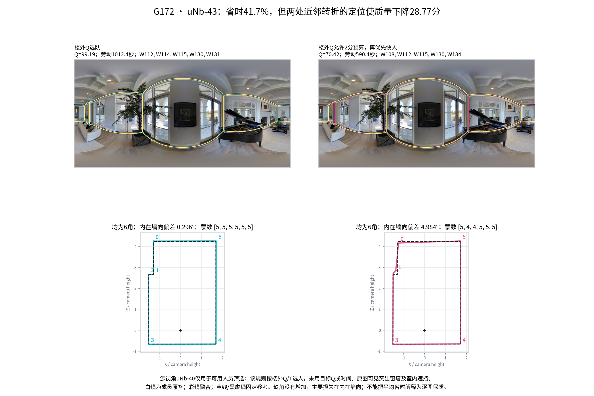

### 6.4 成本口径

以上时间是独立作答的**总活动劳动**。没有排队、开始时刻和实际交付记录，不能把它直接当交付时长；也未换算为钱。楼外Q/T规则在已有外部人员历史时不必新建目标房间源图；本人源Q或源图T规则需要相应源图作答，源Q还要求可用参考评估。历史取得成本在停止部分单独实算，不被隐含视为免费。

## 七、人数与停止：保留已有成果，拆开三种策略

### 7.1 三种信息条件

1. **源曲线选人数：** 其他视角的完整原答与参考Q曲线已知，按同一实际人员顺序选择最早进入源最大Q容差带的人数。主规则容差2分，另保留1分与源Q−人数等规则；源缺失不插值。
2. **目标几何补收：** 到预算后若几何无效、未连接或不足4角，继续收下一份直到完整。这一步只看已到达目标几何，不看目标参考Q。
3. **无需源Q的在线几何停止：** k≥5、最近四次输出完整且同角数、三次相邻绑定环角距≤2°才停，否则到共同池上限。固定规则，无阈值搜索。

本轮重建了已有124,924前缀上的规则评价，保留全量实际历史m；另为第三种策略新增1,678次原生几何重放，60条固定哈希路径，2,094个前缀引用。大量路径只用于估计同图选择分布，不当作独立图片。

### 7.2 已有源历史时，人数决策有实用价值

最大历史、6个全组共同池、24图6栋；下列规则均加目标几何补收，实际完整率100%：

|规则|平均实际人数|平均B8L2|各目标路径P10的平均|相对全共同池损失>5分|
|---|---:|---:|---:|---:|
|固定5|5.027|85.540|77.600|27.52%|
|固定7|7.029|86.958|81.148|18.04%|
|源Q−人数|5.324|86.736|78.321|23.68%|
|源曲线容差2分|7.357|87.764|80.958|15.71%|
|源曲线容差1分|8.898|88.450|82.851|11.00%|
|全共同池|16.000|88.268|88.268|0%|

源容差2分比固定7平均提高0.805分，坏尾少2.33个百分点，但P10略低0.190；不能只报均值说“全面更稳”。绝对Q<80为23.40%，固定7为26.58%，全共同池27.78%；Q<50为1.25%，全共同池0。相对全员损失、绝对低Q、不完整是不同风险。

源曲线使用相同实际人员顺序很重要。先把源不同人员顺序曲线平均再选容差2分，平均9.587人、Q87.283；同顺序源曲线7.357人、Q87.764。其价值包含“哪些具体人员已经进入前缀”，不只是房间平均人数曲线。与相同最终k随机前缀相比约+1.148分，但后者完整率98%；随机按相同请求k再补收、两者完整时差约+1.215，最终k可能不同。两种对照分开保留。

单源/最低多数/最高历史容差2分分别为Q86.991/87.739/87.764，人数6.746/7.350/7.357，坏尾19.52%/15.92%/15.71%。多历史有用，过半后额外历史的平均收益已很小。

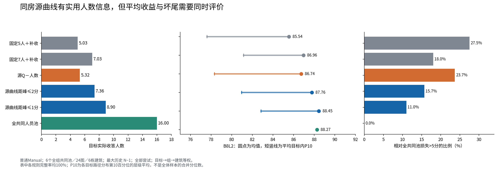

### 7.3 逐组结果：不应抹平有意义的条件差异

|组|容差2分人数|Q|相对固定7|相对全共同池|损失>5尾率|
|---|---:|---:|---:|---:|---:|
|G046|15.177|85.050|+3.306|−5.395|35.81%|
|G057|5.726|65.534|+2.288|+7.498|13.18%|
|G090|5.365|96.255|−0.553|−1.885|12.01%|
|G124|8.240|96.310|+0.508|−2.553|15.49%|
|G178|5.304|95.076|+0.628|+0.654|4.63%|
|G205|4.332|88.358|−1.346|−1.346|13.15%|

G046需要较多人但坏尾仍高；G057的全员融合并非最佳，小前缀可以减少后续稀释；G178较少人数已够，G205也可节省人数但会丢质量。不能用“人数越多越好”或单一固定停止口号替代这些机制。

### 7.4 省时与建立历史成本

4个可计时全新人员组、14图4栋，最大历史：源Q−人数规则的目标劳动约为固定7的0.807，平均Q84.250，固定7为84.399；相对全员损失>5分别30.40%和24.97%。**旧30.40%/24.97%是两规则各自对全员的风险，不是前者对固定7的风险。** 源Q−人数相对固定7直接损失>5为16.03%。

容差2分规则在这套时间支持上目标Q85.787，固定7为84.399，但目标劳动反而为固定7的1.235。它主要相对全员省劳动，而不是对所有合理固定预算都更省。

把多数源图完整历史从零采集计入，容差2分的目标劳动/全员仅约0.475，**整组源＋剩余目标劳动/所有视角全员**为0.843，而相对所有视角固定7为**2.395**。四组各自对固定7比值为G0463.708、G0571.159、G0901.479、G1243.234，没有一组在当前剩余视角数内回本。源Q−人数整组/固定7仍为2.251。

源图原答只按实际采集一次计劳动，不按256条重放顺序重复收费。参考建立及评分劳动未记录，保持未知。因此采用场景应是**已有同房评估历史的后续任务**；专门为少数剩余视角新建多数完整历史，不推荐为省时方案。

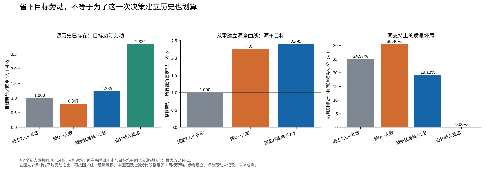

### 7.5 几何稳定后停止：清楚的机制性负结果

新增在线分支在同一24图、72条实际路径上比较：固定7补收Q85.988，平均7.019人；在线几何Q85.573、7.034人；源容差2分Q88.537、7.253人。在线相对全员损失>5为16.67%，固定7为21.30%；它有尾部改善，却没有平均Q优势。不能用小样本结果宣称全面失败，也不应采用为主规则。

G046-21、MV0001/replay136给出具体原因。前六人为W105/W134/W131/W111/W102/W123，k=3…6均6角，三次相邻变化1.559°/1.558°/1.415°，规则在6人停。此时Q70.069；源曲线选19人Q92.025；全30人仍6角，Q96.025。原图局部底点与BEV显示，早期两个端点向相反方向偏移，形成斜墙；后续位置纠正并不需要增加角点。

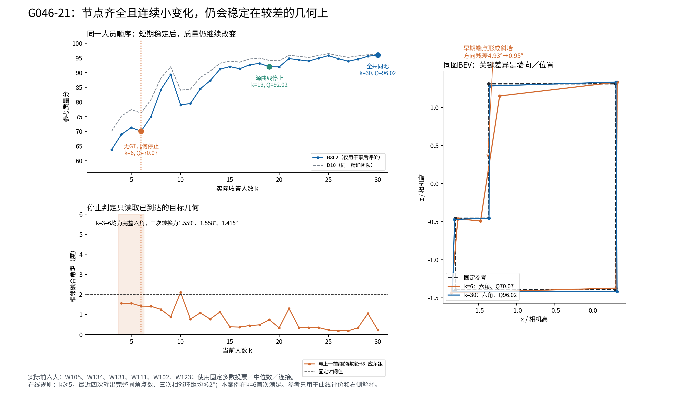

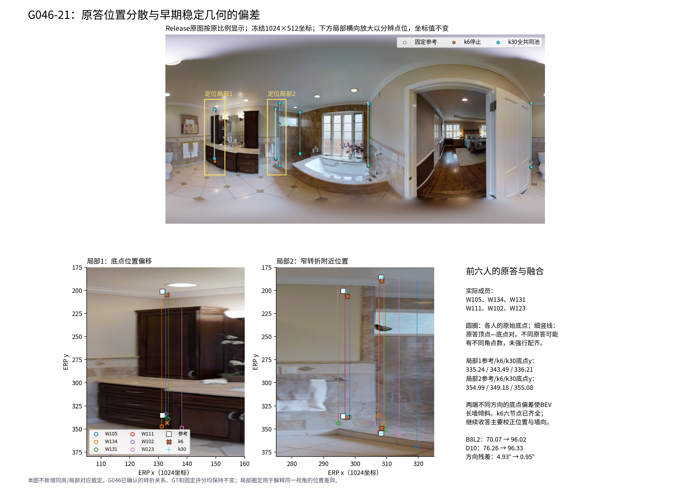

这与G205和G172的定位反例一致：**结构支持齐全、连续变化小，不代表位置已经正确。** 下一轮值得检验已到达几何的墙向残差或短边端点一致性，但本轮不在看过该反例后调阈值，再把改善称为新验证。

### 7.6 Dot与本轮数字为何不同

Dot固定PR采用可选k=1、跳过k=2、无目标补收的规则；旧Pro口径为k≥3并补收。共同支持上，从前者到后者，人数6.718→7.357、Q87.548→87.764，完整率98.44%→100%。只加k≥3不补收时7.325人、Q87.908；补收只增加约0.033人，主要人数差来自最小k，而非补收本身。Dot另有1160/1536共同完整路径子集，继续作为诊断保留，不拿该子集替代全部尝试。

个人预测也按信息预算对齐：本轮P＋θ最高历史11.144709与Dot匹配本人可观察源图的结果一致；Dot额外允许本人未作答源图的11.125810属另一个预算，不强行统一。

## 八、对“人员方面的不确定性”的新增认识

本轮形成四层可分开的解释。

**第一层是公共任务水平。** 同房源均值比楼外人员构成更能预测目标平均Q，且控制人员、难度、参考结构后仍有约2.24分额外接近。人员质量不能只由固定人员画像决定；同一人的绝对Q需要放回当前房间/视角水平。

**第二层是稳定个人差异。** W115/W126的稳定优与P＋θ的留出优势说明楼外画像不可被单个同房源表现替代。直接按源Q选队会被该视角偶发好坏误导。

**第三层是人员与视角的具体相互作用。** G130的反向变化、G202的范围/难度变化、G178的条件增量说明它真实存在。但扣掉前两层后总体剩余相关很弱，尚不支持一个普遍的“房间专长”分数。画像应保留结构倾向、定位失误、低尾与支持数，避免再压成一个标签。

**第四层是融合将人员信息变成结果的过程。** 局部身份组和门槛决定结构能否进入；中位数及连接决定进入后的位置。G117是补票，G015涉及目标表达，G205是全票仍有偏位，G172是短边方向放大，G046是稳定错位平台。它们说明“原答相似”“质量相似”“融合相似”不能互相替代。

因此，主模型建议保留**公共房间质量＋稳定个人画像＋局部表达/融合过程**三种证据入口。暂不采用全局个人房间专长分数、机械难度Q补偿、单源Q直接选人或几何稳定即停；保留条件性本人信息、连续Q/T省时与已有源历史下的人数策略。

## 九、计算、恢复与交付账本

### 9.1 本轮实际计算了什么

|内容|实际执行与来源|
|---|---|
|平均相似性与留出|新增全123对、背景匹配、固定人员比较、全部直接单源与原多数历史预算；未重算原答Q|
|个人相似性与预测|新增个人残差分解、逐人稳定性、17个B8L2与13个D10预测器、强低尾基线及直接类别增量；原多历史划分复用|
|新团队请求库|7,032替换视角事件、41,194策略行、45,552唯一精确团队；其中45,551本轮原生融合并评分，1队精确复用既存保存结果|
|机制重建|G117、G015、G205精确团队重新执行，保存全身份组状态；G172另外重放2次已有团队仅补全状态，新增唯一团队为0|
|人数规则|读取既有124,924真实前缀，重建19条规则及所有实际历史预算；不把旧前缀数称为本轮新融合数|
|在线几何分支|1,678次新原生几何调用，0次重评分，60条哈希固定路径、2,094前缀引用|
|原图|按Release ZIP范围读取并实际查看15张相关原图/叠图；保存成员路径、CRC、字节SHA与局部框，交付只包含必要案例图，不含原图全集|
|采用的旧成果|人员校正分类、画像、既有结构/曲线接口与Dot固定PR；引用与重建分别标记|

### 9.2 上轮包的恢复状态

本线程当前工作区、可取得main与固定PR、可搜索文件中，未找到原47.1 MiB ZIP及其完整原始请求库。Dot PR自己也明确它是独立补算而非原包恢复。本轮恢复的是**固定仓库证据的可复用连接**，以及可按固定输入重建的精确案例、停止规则。

上一轮全量新团队库、所有逐事件表和旧“80.3%”“类别0.303”等具体请求级来源仍不能原样复核，不伪造原件。本轮另行建立并交付45,552队请求库与逐事件结果，解释相同研究问题；其数字与旧全局实验不要求相同。新旧清单逐条注明“仓库原始证据引用／本轮重建／本轮新增／原件未恢复”。

### 9.3 文件、研究台键与复现

综合报告、关键CSV和脚本均单独提供，另按代码/统计证据、精确团队、图像案例拆包，避免唯一大ZIP入口。

|入口|主要用途|
|---|---|
|`room_similarity/`|逐组/图对、固定人员、背景匹配、平均留出；含全组图谱|
|`personal_similarity/`|逐人残差、稳定性、共同面板、历史设计与主要预测宽表、低尾比较|
|`native_teams/`|精确请求、实际团队、替换块、成员/参考键、几何与Q/T策略结果|
|`prior_integration/`|Dot桥、全部人数规则、逐m与逐目标、源历史成本、在线几何|
|`case_evidence/`|案例原答/参考/融合坐标、精确成员标签、身份组票账、局部特征键|
|`INPUT_INDEX.csv`、`INTEGRATION.json`、`FIELD_CONTRACT.md`|输入commit/SHA、字段连接和计算身份|
|`RECOVERY_AND_CHANGELOG.csv`|新旧成果对照与未恢复内容|
|`REPRODUCE.md`、`requirements.txt`|固定输入、依赖、可选择的最小复算命令|

连接沿用 `object_id`、`image_id/image_code`、`reference_id/reference_version`、`pool_id/team_key`；人员类别必须带 `heldout_building/label_version`。本轮增加 `path_id/event_id` 表示精确替换，`row_id` 连接个人预测的历史划分，`local_feature_key` 定位具体图内局部结构。图中不同视角各自使用相机坐标，BEV与推导3D以相机高h为单位，不冒充米制或人工配准。

所有主要结果有必要精确表和代码。原答全集、原图全集、虚拟环境、重复运行缓存不打包。大训练缓存可以由固定输入重算；主要方法逐历史预测、全部实际m、关键精确团队与案例几何均保留。

## 十、采用决定与下一步

1. **把同房平均质量与P＋θ纳入研究主线。** 这是本轮最有分量、可复核且覆盖两视角组的结论。研究台同时展示实际池和共同池，避免把组成变化误认为视角变化。
2. **人员卡片增加“跨视角稳定性”证据，不新增一个未经验证的房间专长总分。** 展示绝对Q、相对同行、楼外剩余、支持图数和翻转实例；W115/W126与W123/W132是正反对照。
3. **Q/T省时作为条件性候选采用，默认以楼外Q为质量基线。** 平均约21%劳动节省有实际价值；同时明确8.57%的>5分损失风险，并把G172短边定位机制纳入后续观测。不能仅因角点齐全就免复查。
4. **源曲线策略用于已有历史的房间。** 容差2分是本轮保留主规则；1分与Q−人数的质量/劳动取舍并列。为少数目标专门建多数完整历史，当前不推荐用于节省劳动。
5. **下一次独立检查集中于短边位置/墙向和条件性本人增量。** 候选观测来自本轮G172/G046机制，参数应先固定再到未参与本轮选择的任务检验；G178/G057的个人增量亦如此。本轮不继续为正结果调参。
6. **无需新增人工裁定才能支持本报告主结论。** G046、G015、pRb既有解释保持；G117局部键只在单图内使用。若未来要把局部票账发展成跨视角物理角点预测，才需对具体尚未配准的G117局部做独立对应标记，而非重复已确认问题。

---

### 固定来源

- [实际main提交](https://github.com/Sparkling-Flames/3D_Manhattan_label/tree/561584c8f64d5349d497ec1c6e91f1aeb4bbd7c9)
- [采用的房间关系](https://github.com/Sparkling-Flames/3D_Manhattan_label/tree/561584c8f64d5349d497ec1c6e91f1aeb4bbd7c9/research/same_room/relation_adoption_20261016)
- [逐份证据](https://github.com/Sparkling-Flames/3D_Manhattan_label/tree/561584c8f64d5349d497ec1c6e91f1aeb4bbd7c9/research/statistics/v2_evidence_audit_20261019)
- [当前人员分类及校正凭据](https://github.com/Sparkling-Flames/3D_Manhattan_label/tree/561584c8f64d5349d497ec1c6e91f1aeb4bbd7c9/research/workers/personnel_taxonomy_20261021)
- [人员画像与组合接口](https://github.com/Sparkling-Flames/3D_Manhattan_label/tree/561584c8f64d5349d497ec1c6e91f1aeb4bbd7c9/research/workers/personnel_profiles_composition_20261020)
- [原多视角重放与结构研究](https://github.com/Sparkling-Flames/3D_Manhattan_label/tree/561584c8f64d5349d497ec1c6e91f1aeb4bbd7c9/research/same_room/same_room_multiview_20261020)
- [Dot PR #19](https://github.com/Sparkling-Flames/3D_Manhattan_label/pull/19)；[实际读取固定头](https://github.com/Sparkling-Flames/3D_Manhattan_label/tree/e83286b7814afc614253aa392050e9a3851ae058/research/same_room/same_room_independent_followup_20261021)
- [原图Release](https://github.com/Sparkling-Flames/3D_Manhattan_label/releases/tag/quality-original-images-20261015)
