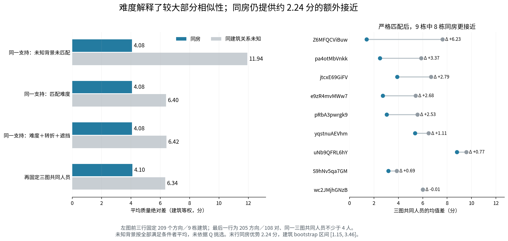
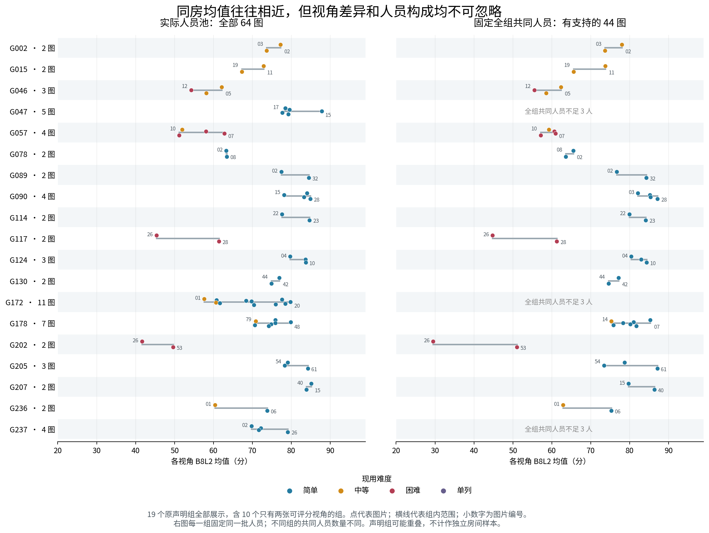
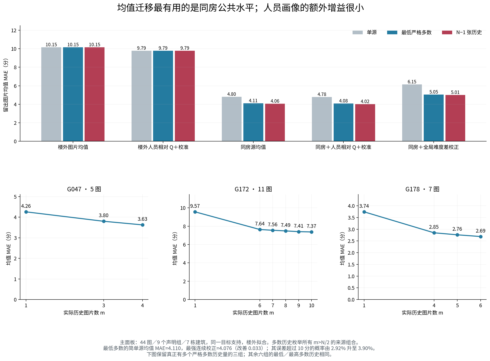

# 同房平均质量相似性与留出用途：本轮实算

**采用判断：保留同房平均质量迁移。它提供了楼外人员历史很难替代的公共质量水平；对平均质量本身，进一步加人员连续画像的增益很小。与此同时，平均相近不能解释成同一人的好坏身份稳定。** 本轮把用户原有房间分类扩展到全部有支持的直接图对和声明组，既包含两张图的组，也包含既有多历史实验。以下只对普通 Manual 作主判断；Semi、门洞、范围变化分别列示。

本轮固定 main：`561584c8f64d5349d497ec1c6e91f1aeb4bbd7c9`；房间版本：`same_room_user_working_classification_20261016_v2`。所有新表从该提交的实际逐份记录重算。此前工作区原件没有作为本分支输入，旧值的重现标为“本轮重建”，新增对照与模型标为“本轮新增”。没有重定义房间，也没有重算或改动融合、参考和评分。

## 1. 首要新发现：同房平均确实更接近，难度解释了较大部分，但不是全部

在普通、范围可比、每对至少 4 名共同有效人员的 **123 个直接图对、64 图、12 栋建筑** 上，双方实际人员池的平均质量绝对差是 **6.81 分（图对等权）／4.92 分（建筑等权）**；固定共同人员后是 **7.24／5.56 分**。历史 7.24 原来就是共同人员均值差，不能把它当作“所有人员实际均值差”。G172 一组贡献 55 对，G178 贡献 21 对，因此图对等权与建筑等权回答的样本构成不同。当前主解释使用建筑等权，同时保留全部图对。[数值口径与复算凭据](INPUTS_AND_RECEIPT.json)；[逐对结果](tables/direct_pair_similarity.csv)；[分层汇总](tables/pair_summary.csv)。

比“均值差是否小”更有解释力的，是在相同锚点、信息预算和条件下对照关系未知的同建筑图片。令 A–B 是已采用同房关系，候选 X 与 A 在冻结关系表中没有任何关系记录。每次都比较 A–B 与 A–X，源图仍是同一张 A；所有符合条件的 X 都保留，不按 Q 挑选。未知仅表示未知，不称为确认异房。

固定严格匹配可支持的 **209 个方向、9 栋建筑**，实际人员池上得到：

|关系未知背景如何选|同房均值差|未知背景均值差|同房额外接近|
|---|---:|---:|---:|
|同建筑，未匹配图片条件|4.08|11.94|7.86|
|再匹配已有难度类别|4.08|6.40|2.32|
|再精确匹配参考转折数 N_turn、几何遮挡转折 H|4.08|6.42|2.35|

这不是把 12 栋与 9 栋的不同支持硬相减：前三行的 A–B 方向完全相同。难度构成确实解释了未匹配差距中的较大部分；在当前支持上，进一步匹配转折数与遮挡数没有继续明显缩小差距。[同支持桥接表](tables/matched_control_support_bridge.csv)。

再在每个 A/B/X 三元组上固定**完全相同的人**，要求三图共同人员不少于 4 名，保留 **108 个无向同房对、205 个方向、9 栋、1,206 个匹配候选**：同房差 **4.104 分**，未知背景差 **6.344 分**，额外接近 **2.239 分**，9 栋中 8 栋方向为正。建筑 bootstrap 的 95% 区间为 **[1.147, 3.457]**。D10 对应优势 **2.183 分**。唯一非正建筑 wc2JMjhGNzB 为 −0.008 分，实际上接近相同，而不是同房显著更差。[逐建筑结果](tables/matched_unknown_buildings.csv)；[方向结果](tables/matched_unknown_directions.csv)；[全部候选与精确人员](tables/matched_unknown_candidates.csv.gz)。

**研究判断：同房信息值得保留为公共质量水平的来源。** 这个效应在控制明显图片条件和实际人员后仍存在；不能将它完全归结为“同房图碰巧都简单”或“恰好是同一批好人员”。另一方面，未匹配的近 8 分优势不能全部称为房间独立贡献。匹配参考几何属于机制分析中的已知条件对照，不等于部署时可以无成本知道目标图参考结构。

## 2. 哪些原声明组相似，哪些视角不同

普通、范围可比支持包含 **19 个原声明组**：既有 9 个至少三视角组之外，还有 **10 个只有两张可评分图的组**。这 19 行共同覆盖 64 图；保留原组身份，不重新聚类。完整可读索引另列普通范围不同、门洞及 Semi，见 [逐组图谱](GROUP_ATLAS_ZH.md)。

左图使用各视角实际人员池，右图固定每组所有视角都出现的人。G047、G172、G237 全组共同人员不足 3 人，因此右图保持缺失；它们仍有充分的逐对共同人员支持。两种面板不可直接混为一个总体。

|组／视角|实际池表现|固定人员后的证据|应保留的解释|
|---|---|---|---|
|G078 · Z6MFQCViBuw-02/08|63.27／63.38，几乎一样|21 名共同人员均值差 1.87|同房平均水平确实接近，但个人绝对变化仍达 18.04 分|
|G090 · 4 图|实际池逐对平均差 3.50|逐对共同池差 3.16|多视角平均质量较稳定；与既有高融合终点结果相容|
|G124 · 3 图|实际池逐对差 2.66|共同池差 2.64|人员构成影响很小，是稳定公共水平的例子|
|G130 · pa4otMbVnkk-42/44|76.90／74.85|34 人共同池 77.10／74.53|分布和均值稳定，身份好坏仍可明显互换，详见下节|
|G117 · jtcxE69GiFV-26/28|45.35／61.36|28 名共同人员仍差 16.51|两图都标为困难，仍有显著视角差异；单一难度标签不能抹去视角作用|
|G172 · 11 图|均值跨度 22.16；逐对差 9.57|逐对共同池差 9.86|不是主要由人员构成制造；增加源视角平均可缓和，不能消除异质性|
|G202 · wc2JMjhGNzB-26/53|41.61／49.62|12 名共同人员为 29.53／51.02|人员构成抵消了真实的共同人员视角差异|
|G057 · 4 图|实际池逐对差 6.83|逐对共同池差 2.58|与 G202 相反，人员构成放大了表面的视角差异|

这些结论有逐组全部视角而非只选成功例。全体 123 对中，共同池均值差超过 10 分有 **30 对**，超过 15 分有 **17 对**；它们没有从总体中删除。G172 的 55 对占比很大，不能把这 30 对理解为 30 个独立房间失败。[逐组小表](tables/declared_group_similarity.csv)；[逐组逐图分布](tables/declared_group_views.csv)。

## 3. 人员构成如何影响“同房均值相似”的判断

本轮使用可逐对核验的算术量：

`构成变化 = (B实际池均值 − A实际池均值) − (B共同池均值 − A共同池均值)`。

它只描述换到相同人员后差值如何改变，不称为随机换人因果效应。123 对中，构成变化的绝对值中位数 **1.74 分**，有 **14 对超过 5 分**；建筑等权绝对变化 **2.19 分**。平均而言，实际池比共同池的绝对视角差小 **0.64 分**，但方向远非一致。

**G202 是实际用途最明确的反例。** -26 有 22 人，-53 有 35 人，共同 12 人。只看实际池会认为两视角相差约 8 分；固定 12 人后，-26 平均 29.53、-53 平均 51.02，相差 **21.50 分**。共同人员在 -26 上 Q<50 的比例是 10/12，在 -53 上是 6/12。另一批作答人员对 -26 的实际池均值有明显抬升，所以“均值还算接近”掩盖了这批相同人的困难。此处不把人员来源差异命名为人员能力的因果差异。

**G057 展示反方向。** -01 与 -07 实际池均值相差 10.86；对 14 名共同人员仅差 0.69。组内原答结构、身份组支持与融合门槛的差异，应结合既有局部票账解释；不能把一个最终融合结构不同的例子简单归为“人员平均质量差很多”。

**G130 最直接说明平均与个人不确定性的区别。** 两图 35／35 人，34 名共同人员；共同池均值只差 **2.58 分**，分布 Wasserstein 距离 **3.40 分**，同一个人的绝对 Q 变化平均却有 **19.37 分**，排序相关仅 **0.190**。W102 从 99.04 到 99.01，表现稳定；W103 从 35.58 到 80.90；W100 从 79.58 到 55.17；W101 从 82.01 到 53.17。变化在不同人之间相互抵消，因而总体分布仍相近。原图与原答几何实例由综合报告的 G130/G202 图版连接；本分支提供完整对象、人员、参考和分数键。[案例逐份小表](tables/G130_G202_record_cases.csv)。

**对人员不确定性增加的认识：** 同房信息首先约束“这一任务大致处在什么公共质量水平”；它本身并没有把“哪些人会在这一视角失误”同时确定下来。均值预测好、个人身份重排、融合因局部投票而分叉可以同时发生，必须分别观察。

## 4. 留出用途：简单同房源均值是应保留的主基线

两视角组无需等待第三张图才有留出用途。本轮先在全部 **123 对、64 图、12 栋**上把每个直接关系展开为两个方向，以源图均值预测另一端。每个目标先平均可用来源，再在建筑内平均目标、最后建筑等权，得到简单同房源均值 **MAE 5.081**，楼外图片均值 **9.303**，楼外人员绝对 Q 名单均值 **9.711**，楼外人员相对 Q 名单均值 **9.570**；源均值作相对 Q 构成校正为 **5.131**。因此同房用途不是只在旧 9 组中成立。这项单源留出先按目标计权，与前文逐对后建筑等权的 4.919 使用不同权重，不把两个值强行统一。[完整单源留出](tables/direct_mean_summary.csv)；[精确来源及预测](tables/direct_mean_prediction_values.csv.gz)。

多历史主分析复用冻结 9 组、44 图、7 栋的声明集合。除完整保留每个 `m>N/2` 的实际历史量和全部历史子集外，本轮另显式枚举 `m=1`。目标 Q 只用于评价；源 Q 在这个任务设定下已通过既有参考评分可知。人员历史与拟合参数均排除目标建筑，训练行人员历史另排除其自身建筑。旧 holdout／训练障碍继续从拟合标签与人员历史中排除。

每图实际池 B8L2 均值的结果如下；每一列比较同一批目标。先平均同一目标的来源组合，再平均组来源、目标图、建筑，避免大组产生的数千条组合变成伪样本。

|方法|单源 MAE|最低严格多数 MAE|N−1 张历史 MAE|
|---|---:|---:|---:|
|楼外图片均值|10.146|10.146|10.146|
|楼外人员绝对 Q 的目标名单均值|10.399|10.399|10.399|
|楼外人员相对 Q＋截距校准|9.790|9.790|9.790|
|**同房源图均值**|**4.804**|**4.110**|**4.062**|
|同房源均值＋人员相对 Q 构成校正|4.873|4.090|4.036|
|同房＋人员相对 Q＋楼外线性校准|4.776|4.076|4.017|
|同房＋按全局难度类别差加减分|6.151|5.053|5.013|

同房＋人员连续校准的最低多数结果只比简单源均值改善 **0.033 分**，同时预测误差超过 10 分的概率从 **2.92% 增至 3.90%**；只作相对 Q 构成校正为 6.69%。绝对 Q 构成校正更差，MAE 4.153、误差超过 10 分率 8.41%。因此没有理由为了平均质量预测默认采用更复杂的人员校正。这个负结果并不推翻画像在个人预测、选队、局部结构互补上的用途。

固定全组共同人员的 6 组、24 图、6 栋上，简单源均值的单源／最低多数／最高历史 MAE 是 **4.208／3.335／3.322**。同一组名单固定后，无拟合的人员构成校正在代数上等于简单源均值；额外校准反而使最低多数升至约 3.53–3.57。它与 44 图实际池面板分别回答问题，不能互相排名。D10 的 44 图简单源均值为 **4.587／3.935／3.896**，结论方向相同。[全部方法与支持](tables/mean_holdout_summary.csv)；[逐组每个 m](tables/mean_holdout_groups.csv)；[逐目标](tables/mean_holdout_targets.csv)。

### 4.1 更多历史的边际价值在哪里

只有 G047（5 图）、G172（11 图）、G178（7 图）能比较多个严格多数历史量。G172 的 m=6/7/8/9/10 对应 MAE **7.641/7.556/7.487/7.406/7.373**；G178 的 m=4/5/6 为 **2.848/2.762/2.688**；G047 的 m=3/4 为 **3.802/3.627**。全部中间 m 已保留，未把曲线平滑成没有算过的点。

从单源到最低多数，44 图均值误差降低 0.695 分；从最低多数到最高历史只再降低 **0.048 分**。平均作用能缓和某张源图的特殊性，但不能消除 G172 这样的目标视角跨度。G172 最低多数的预测误差超过 15 分概率为 1.56%，最高历史为 0；这说明少数坏尾改善也应单列，而不是只说均值收益小。

这些源均值需要参考可评分的历史原答。按相同建筑等权支持，单源、最低多数、最高历史平均使用 **32.74、97.30、115.44 份**源图原答；这是历史资料规模，不是每次预测必须重新支付的劳动量，历史可以复用。本分支没有将来源不同的时间字段混合成成本，也没有把这类参考已知的历史迁移称为完全无 GT 的在线策略。

### 4.2 为什么机械难度校正失败

全局难度类别能改善匹配对照，并不意味着它有可直接加到每个房间上的固定分值。最清楚的失败是 G057-01：实际池均值 **51.96**，其余三视角均值预测 **57.36**。依据楼外“中等比困难平均高多少”进行加分后，预测升到 **75.55**，误差从 5.40 扩大到 **23.59 分**。同组几何结构、可见线索与实际标法改变了难度类别对应的评分水平。

因此采用难度作为条件解释、匹配背景或限定策略适用域；本轮不采用一条全局难度差直接修正同房均值的规则。这不是因支持不足而回避判断，而是它在留建筑同支持上实际恶化，且有明确失败视角。

## 5. 范围变化、门洞与 Semi

正式 Q 有支持的全部物理同房记录还包括：普通 Manual 范围不可比 **26 对**，其中 25 对共同人员不少于 4；含门洞的 Manual **6 对**，全部范围不可比；Semi 仅 **1 对**，同样范围不可比。没有把它们放入普通范围可比主结果。

在至少 4 人支持上，普通范围不可比的共同池均值差为 **10.12 分（8 栋建筑等权）**；门洞相关 6 对为 **44.95 分（4 栋）**。门洞对包含跨普通／门洞视角与范围差异，所以不能把 44.95 全归为门洞难度。它表明物理同房身份不足以保证当前目标质量水平相近。

Semi 唯一图对共同人员 4 人，实际池均值差 **14.75**、共同池 **11.72**、排序相关约 **0.816**。这只是一个范围不同条件的局部观察，没有普通范围可比或多数历史支持可供本轮验证。同房分类中的其余声明与未知、缺失状态都保留在关系覆盖表，没有补成零或借 Manual 结论代替。[全部关系覆盖](tables/relation_coverage.csv)；[分层小表](tables/pair_summary.csv)。

## 6. 复算、连接与实际新增内容

- **本轮重建：** 旧 123 对 7.24／16.38／排序 0.261 的分母及数值；9 组全部多数历史和单源的均值迁移。当前值与旧共同池均值差逐对最大偏差为浮点量级，`3.2e-14`。
- **本轮新增：** 实际池／共同池构成分解；全部原声明组可读图谱；同建筑未知背景的条件与三图共同人员精确匹配；同支持桥接；含两视角组的完整单源留出；均值留出的外楼绝对／相对人员画像基线、校准、难度差条件方法、坏尾与实际历史记录量。
- **本分支未新增：** 融合几何或投票计算、人员分型搜索、scope/筛除的重新裁定、GT恢复；这些由综合报告连接其它分支及既有冻结产物。

本轮预测留出仍属于已探索库存上的内部留出检验，不重新命名为外部验证。方法候选在本轮探索中形成：绝对 Q 校正之后追加留一同行相对 Q，是为了给人员信息一个更有竞争力的基线；没有重调人员分类，也没有网格寻找有利超参数。本报告不宣称这些候选预先注册。9854 条“指标×面板×目标×历史”记录包含 B8L2/D10 和重复历史组合；真正的普通主支持仍是 44 图／7 栋，全部直接关系支持是 64 图／12 栋。全部方法预测保存为宽表以减少体积，误差可由 `预测−actual` 精确复算。[预测宽表](tables/mean_prediction_values.csv.gz)；[输入特征及历史索引](tables/mean_feature_index.csv.gz)；[拟合参数](tables/mean_calibration_folds.csv)。

具体运行与字段见 [README](README.md) 和 [FIELD_CONTRACT](FIELD_CONTRACT.md)。当前所有重要解释都可继续向原答 `object_id`、`image_id`、`worker_id`、冻结参考和房间关系追溯；没有提出重复人工确认问题。
