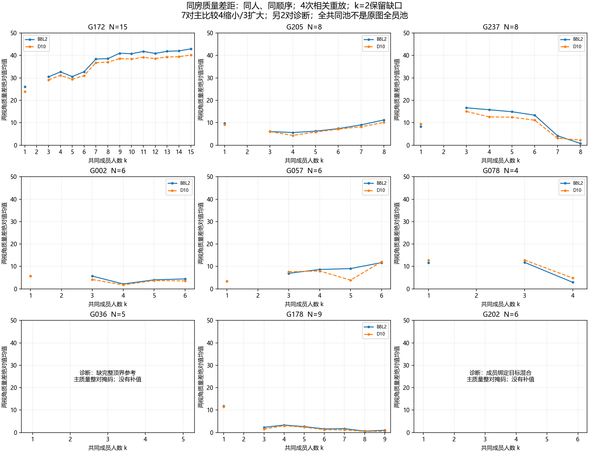
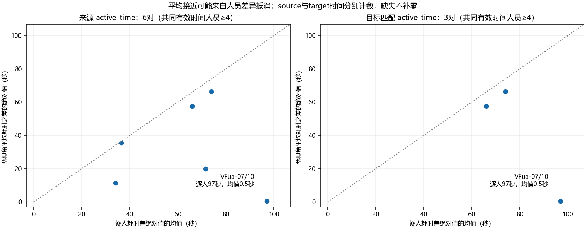

# 同房 v1：Q/T 原回答与真实人数过程

本轮已完成 9 对、7 栋建筑、9 个用户关系组的配对过程核对，共收到并验证 536 条单侧前缀记录。当前证据支持“部分同房关系有相似表现”，尚不支持“同房普遍接近或普遍更可预测”。跨视角质量差距既会缩小也会扩大；同相机内几何趋稳也不等于正确。

按用户最新要求，本模块只研究 Q/T 连续量，暂不建立人员类型，不接入 S/B 等其余变量。本包 Q 指逐份作答及融合结果的固定参考质量，**没有重训人员画像**。分母须区分：此前四变量报告的 931 条现用 Q、959 条旧绑定对照和 716 条时间训练，是该历史版本的面板；当前[人员 v1 模块](../../workers/worker_v1_composition_20261017/README.md)普通 Q 训练为 **1048 份/24人/87图/19建筑**，来源 T 训练727份、同目标 T 训练418份。本包不覆盖历史结果，也未重训1048份；这里的1911条合格逐份评分（含门洞等用途）不能当作上述任一人员训练分母。T 保留来源与绑定，不能解释为认真程度。

## 审查后的计划

**修改（Modify）**原先仅凭同房均值接近推断规律的方案。

- 有效性：同时检查同一批人的均值差、逐人差和排序，以及相同人员顺序下的真实融合过程。均值差可能被正负人员差抵消，不能独立证明可迁移。
- 简洁性：复用已冻结关系、共享评分、已有投影及融合产物；只新增配对设计和比较消费者，不另写融合算法或人员分类器。
- 后果：同房关系、视角和重放均存在依赖；按建筑和用户关系组平衡，并保留全部留一建筑结果。重放不是独立样本，不以 536 条记录扩大推断样本量。

执行顺序为冻结输入与成员 → 覆盖优先选面板 → 同序配对请求 → 核对真实产物 → 分开报告原回答、过程稳定性、参考质量和共同池终点。尚未做新预测器的训练或楼外验证，不将描述性差异写成预测提升。

## 原回答 Q/T

数据为 **data v1**，输入修订 `annotation_batch_98_20261017_v1`。评分版本 `quality_b8l2_d10_20261017_v2` 中的 v2 是评分包版本，不是 data v2。B8L2 为主；D10 固定答案、参考、资格及成员，仅改变方向尺度 8°→10°。

采用全部既有用户同房分类，没有重设 `explicit_confirmed` 门槛、传递合并房间或把同建筑当同房。原回答可比 manual 质量共有 83 对，其中共同有效人员至少 4 人为 78 对，覆盖 8 栋、10 个关系组；另外 14 对 manual、1 对 semi 的不同范围质量单列。

| 至少 4 名共同有效人员 | 配对数 | 配对等权均值差绝对值 | 建筑内关系组等权、再建筑等权 |
|---|---:|---:|---:|
| B8L2 | 78 | 9.408 分 | 6.500 分 |
| D10 | 78 | 9.320 分 | 6.427 分 |
| source active time | 6 | 31.861 秒 | 32.500 秒 |
| target matched time | 3 | 41.444 秒 | 45.458 秒 |

Q 的 78 对中，逐人 B8L2 差绝对值平均 **14.843 分**，高于配对均值差 9.408 分；人员排序相关的中位数为 **0.277**，范围 −0.800～0.893，57/78 对为正。只能说部分排序有延续，不能认证稳定人员类型。不同关系多次使用同一人、同一视角，这些统计是描述性的。

已有同建筑非已知同房对照只覆盖 3 栋，并非确认异房。建筑等权 B8L2 的同房来源误差为 5.407，对照为 8.186，但仅 1/3 栋方向有利；去掉 yq 后分别为 8.083、7.485，优势反转。D10 同样反转。该对照不能证明普遍可预测性。

T 的全量不同分母另见 `endpoint_pairs.csv`：source time 可比关系 36 对，而 target matched time 仅 4 对。上表只取共同有效时间人员至少 4 人的子集。VFua-07/10 的 4 人均值只差 0.5 秒，逐人差绝对值平均却为 97 秒，是均值抵消的直接反例。没有用 lead_time 或零补缺失。

## 真实过程的设计与完整性

可执行请求见 [PAIR_PROCESS_REQUESTS.json](PAIR_PROCESS_REQUESTS.json)。优先跨建筑覆盖，再增加不同关系组；依据完整参考是否可用、共同源人员数和稳定代码排序，不看质量高低选对。两侧人员及进入顺序完全相同，各 4 次均匀排列抽样；重复排列仍保留抽样频次。初始过程要求至少 3 名共同成员，只是过程窗口条件，不是新增图片资格门槛；更小窗口仍在候选表中。

融合由 `research/fusion/wall_consensus_v1_process_20261017/` 产生，本包只读实际保存几何。逐条检查请求与生产者输入坐标、预处理记录、参考值、成员/别名、完整排列、前缀和累计 source time；检查前缀身份组没有未来成员。

| 层级 | 计划/收到 | 完整几何 | 共同主质量可用 |
|---|---:|---:|---:|
| 单侧前缀 | 536/536 | 460 | 分侧见完整率表 |
| 双侧配对前缀 | 268/268 | 双侧均完整 228 | 196 |

72 条单侧 k=2 为 `two_person_sorting_deferred`；另 4 条 k=4 为缺可覆盖选定节点的源环序、需人工顺序。它们已执行并留有状态，属于暂缓/不完整，不能当零分、未运行或被静默删除。没有插值跨过 k=2。

G036（B6-33/37，5 人）缺完整顶界参考，G202（wc2-26/53，6 人）存在不同已采用目标混合，因此整对固定在诊断层；即使某些前缀被生产者标为可评分，也不升为本包主比较。G202 保留 W035，不为取得较好资格删成 5 人。7 对主比较、2 对诊断均保留真实几何。原 holdout、独立真人及既有准入屏障保持；候选和逐人原因分别落盘。

## 实际发现

下表的 k=1 是四次重放中**配对质量差绝对值的均值**，全共同池是该对全部共同成员的唯一集合，均为 B8L2。它不是该图片原始全员池，也不是四个独立终点。

| 关系组 | 共同人数 | k=1 差距 | 全共同池差距 | 方向 |
|---|---:|---:|---:|---|
| G172 uNb-01/45 | 15 | 26.022 | 42.949 | 扩大 |
| G205 wc2-03/54 | 8 | 9.682 | 11.245 | 扩大 |
| G237 yq-02/05 | 8 | 8.287 | 0.770 | 缩小 |
| G002 2t7-02/03 | 6 | 5.664 | 4.433 | 缩小 |
| G057 VFua-04/07 | 6 | 3.482 | 11.698 | 扩大 |
| G078 Z6-02/08 | 4 | 11.603 | 2.924 | 缩小 |
| G178 uNb-48/72 | 9 | 11.828 | 1.015 | 缩小 |

B8L2 与 D10 均为 4 对缩小、3 对扩大。G172 两侧全共同池质量分别约 49.055、92.004；同一批人的两视角融合质量可以明显分离。参考质量可能随人数下降：可评价的相邻一步质量变化共 280 个，154 个上升、126 个下降；这些相关重复观测不用于显著性推断。

几何稳定性只在**同一相机**内部比较不同重放：804 个同人数比较中，687 个有可用底面；464 个相邻人数比较中，312 个有可用底面。共同旧观测身份关系变化在 5 个相邻步骤出现，旧身份投票丢失在 25 个步骤出现，说明不能只用坐标平均解释全部变化。

多数选定视角的人数增加后几何波动较小，但不单调且有例外。G172 两侧平均同人数底面差（1−IoU）从 k=1 的 0.0898，到 k=3 的 0.0979，再到 k=14 的 0.0030，同时跨视角质量差距扩大。G036 则从 k=1 的 0.0097 上升至 k=3 的 0.1183，且 k=4 有排序不完整。不能用全部面板随 k 变化的均值作为收敛曲线，因为可用人数覆盖会变化。k=N 时四次重放成员集合相同，零波动是集合相同的机械结果。

T 的前缀累计成本仅 source time **205/536** 条完整已知，target matched time **72/536** 条完整已知。任何成员缺时间则完整累计值保持缺失；重放不代表重新付出标注工时。现有覆盖不足以验证普遍的同房时间预测规律。

## 产物与复现

- `INPUTS.json`：冻结来源、评分和关系版本；`FIELD_CONTRACT.json`：每张表的列及解释。
- `endpoint_pairs/people/explanation.csv`：原回答均值、逐人差、排序、缺失及抵消；`balanced_endpoint_summary.csv`、覆盖与留一建筑表：平衡和对照敏感性。
- `process_candidate_coverage.csv`、`process_member_audit.csv`：未选候选与逐人资格；`planned_prefixes.csv`：全部计划，包括 k=1、2。
- `original_response_disagreement*.csv`：原回答在各自相机内的两两 1−IoU，跨视角仅比较标量模式。它与生产者按整源池并集归一的 `R_union_normalized` 定义不同，不能混用。
- `process_trace_validated.csv`：真实逐步记录、输入核对与主质量掩码；生产者原分数保留，`comparison_*` 才是本包主比较值。
- `process_paired_curves.csv`：两视角、两指标共同成功重放交集上的条件均值，完整率单列；不是把失败计零的总体期望。
- `process_same_k_*`、`process_adjacent_changes.csv`：同相机稳定性；`common_pool_full_endpoints.csv`：共同池终点。
- `PROCESS_RESULTS.json`、`SUMMARY.json`：机器状态；[HANDOFF.md](HANDOFF.md)：验证及待协调登记。

在仓库根目录依次执行：

```powershell
python -m tools.thesis_main.analysis.same_room_v1_process_20261017
python -m tools.thesis_main.analysis.same_room_v1_process_compare_20261017
python -m pytest tests/test_same_room_v1_process_20261017.py tests/test_same_room_v1_process_compare_20261017.py tests/test_same_room_update_20261017.py tests/test_same_room_relation_adoption_20261016.py -q
```

第一步只生成设计及原回答分析；第二步依赖融合模块已经保存的 `MANIFEST.json`、输入快照、轨迹和各池 `DONE.json`/`states.json.gz`，不触发融合。最终 14 项测试通过，另有全部 536 条实际记录的运行期身份、参考、坐标及时间核对。未跑全仓库测试；未改共享评分、发布包、协议、目录或公共索引。

下一步只推进 Q/T：先扩大时间绑定覆盖；若做预测比较，须另行固定楼外划分及同房可用信息，以现有同建筑对照作为基线。当前结果不能充当该预测实验。

## 统计消费与图形接口（本轮补交）

机器入口为 [CONSUMER_INTERFACE.json](CONSUMER_INTERFACE.json)，schema=`same_room_process_consumer_20261017_a1`，状态为 **ready_for_statistics**。已按统筹通知同步融合 `CURRENT.json` 的实际来源修订 `v1_complete_measurement_cache_main_panel_r2_20261017`；比较入口和导出入口均核对CURRENT、MANIFEST与实际验证记录的修订身份一致。重建前后536条窄接口的全部字段逐值完全一致，392条主质量可用及两对诊断掩码不变。本次仅同步来源与重建既有导出，没有扩展分析；记录见 [UPSTREAM_SYNC_CHECKS.json](UPSTREAM_SYNC_CHECKS.json)，本轮4项消费者定向测试通过。统计可直接按以下键消费：

|表|行数/主键|用途|
|---|---|---|
|[consumer_prefixes.csv](consumer_prefixes.csv)|536；request_id/replay_id/side/k|窄逐侧接口；同时保留 pool_id/path_id/subset/k 以连接融合|
|[consumer_pair_summary.csv](consumer_pair_summary.csv)|9；request_id|逐对覆盖、诊断原因、质量差距方向、完整率、时间缺失与图文件|
|[process_paired_curves.csv](process_paired_curves.csv)|67；request_id/k|同一成功交集的双指标曲线及全机会分母|
|[consumer_original_time_pairs.csv](consumer_original_time_pairs.csv)|全部已有时间关系；image_a/image_b/condition/metric|原回答抵消和缺失，不与重放累计工时相加|

`primary_design_eligible` 是整对门；`primary_quality_eligible` 还要求实际收到且通过生产者主门；`primary_quality_available` 进一步要求两指标均有数值。**主质量只能用 `comparison_B8L2`/`comparison_D10`，不能把通过门但缺数值的记录补零。** `primary_mask_reason` 优先保留整对诊断，因此536条分为392条主质量可用、56条主设计中的二人排序暂缓、40条缺完整参考诊断、48条混目标诊断。诊断计数包含它们自己的排序缺口，不与72条排序暂缓重复加总。

这9对过程全部为 `ordinary`。门洞 G145 两对、G149 一对属于原回答的其它范围关系，不是门洞同房过程；本轮不伪造门洞配对曲线。符合既有评分规则的门洞在原回答分析中仍保留，门洞过程由相应融合/统计模块单列。



逐对四联图同时显示两视角Q、同相机稳定性、计划/完整/主质量分母和逐条时间。A、B分别对应请求的code_a、code_b；实线B8L2、虚线D10；时间面板实线source、虚线target，仅画完整已知前缀，不跨缺失补线。

|方向/诊断|逐对图|阅读重点|
|---|---|---|
|反例|[G172 uNb-01/45](figures/G172.png)|几何渐稳，跨视角质量差扩大至42.949分|
|反例|[G205 wc2-03/54](figures/G205.png)|中段先缩小，终点又扩大；不单调|
|正例|[G237 yq-02/05](figures/G237.png)|终点质量差缩小至0.770分；中段仍有差异|
|有限正例|[G002 2t7-02/03](figures/G002.png)|整体差距略缩小，不能推广至其它房间|
|反例|[G057 VFua-04/07](figures/G057.png)|全共同池差距反而扩大|
|正例|[G078 Z6-02/08](figures/G078.png)|四人共同池差距缩小；支持人数有限|
|诊断|[G036 B6-33/37](figures/G036.png)|缺完整顶界参考；k=4有排序不完整，Q整对留空|
|正例|[G178 uNb-48/72](figures/G178.png)|另一uNb关系组差距缩小，不能用楼级结论替代逐对结果|
|诊断|[G202 wc2-26/53](figures/G202.png)|成员目标混合；Q整对留空，保留真实几何与时间|



图为结果工件，已检查总览、主比较、两个诊断和时间图的排版；没有生成检查截图。没有新增必须由用户先审批的条件。需要人工裁决的真实阻塞案例：**无**；缺顶界、混目标及排序暂缓按现有边界即可继续分析，不要求用户补GT或改范围。

补交接口/图形可在前述两步后运行：

```powershell
python -m tools.thesis_main.analysis.same_room_v1_process_export_20261017
python -m pytest tests/test_same_room_v1_process_20261017.py tests/test_same_room_v1_process_compare_20261017.py tests/test_same_room_v1_process_export_20261017.py tests/test_same_room_update_20261017.py tests/test_same_room_relation_adoption_20261016.py -q
```

完整复现顺序为设计 → 真实产物核对 → 接口/绘图；后两步不重新生成融合几何。新增两项测试检查整对诊断覆盖有利前缀、资格与数值可用分开、真实零值不当缺失以及未收到记录与失败分开。最终五个定向测试文件共 **16 passed**；另逐键对账窄接口与双侧表的主质量掩码、536/268分母及完整率。
