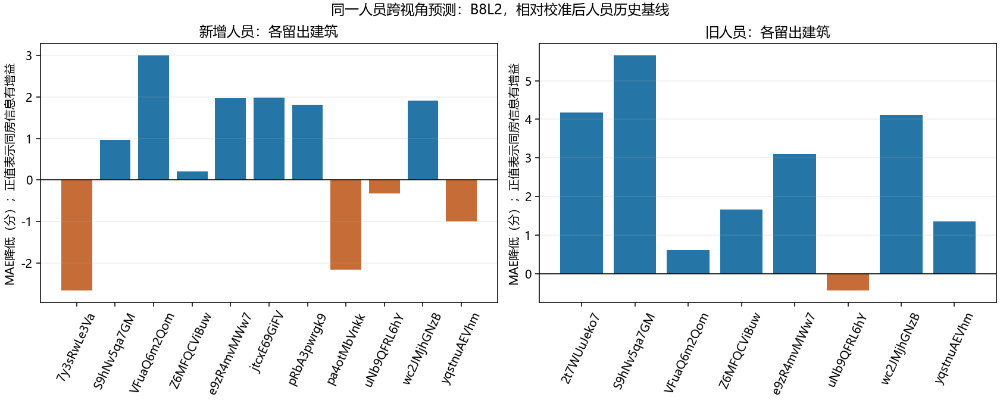
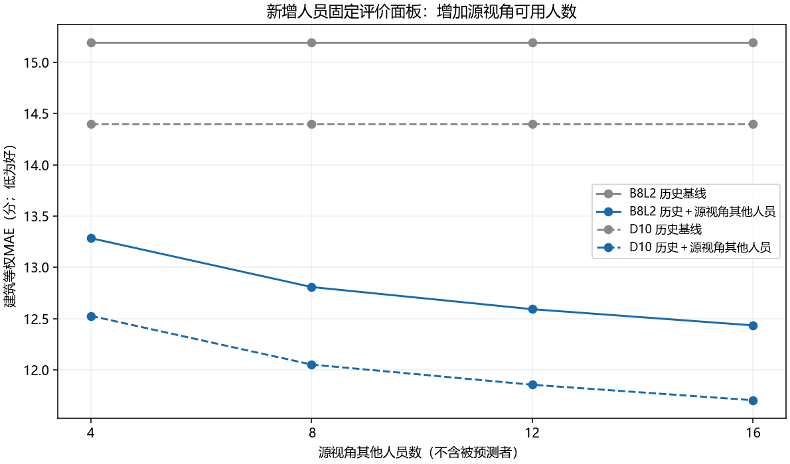

# v2 同房间 Q/T 预测首轮结果

2026-10-19；探索性完成。采用当前 v2 B8L2，D10 作敏感性比较。**排除 OOS，门洞交界单列，人员分类暂缓。**

研究问题是：同一物理房间的不同视角，是否保留可用于预测的标注质量和耗时规律；人员覆盖增加后，能否利用更多已知作答改善另一视角的预测。预期的相似性是待检验假设。

## 主要结果

普通场景质量面板有 **123 对直接同房关系、64 张图、12 栋建筑**，每对共同有效人员中位数 **23 人**。旧人员子面板为 78 对、中位数 10 人；新增人员为 122 对、中位数 14 人。旧人员图对仍保留，合并覆盖增加 45 对。图对、双向预测、重复人员和重复抽样均不代表独立房间样本。

图对等权的平均质量均值差为 **7.24 分**，平均个人绝对差为 **16.38 分**，人员排序相关的中位数为 **0.261**。因此，整体均值接近可能掩盖人员差异，不能直接解释为每个人跨视角都稳定。

以下为留一建筑验证的 B8L2 平均绝对误差（MAE，低为好）；先在每个有向图对内平均，再在建筑内平均，最后建筑等权。各方法使用相同的可预测人员行。

|人员来源|建筑数|校准后人员历史基线|直接复制本人源视角 Q|历史＋本人源视角 Q|相对校准基线改善|改善的建筑|
|---|---:|---:|---:|---:|---:|---:|
|新增人员|11|15.39|16.90|14.87|3.37%|7/11|
|旧人员|8|13.95|12.17|11.42|18.13%|7/8|

新增人员结果支持存在有限可迁移信息，但增益较小、建筑间不一致。旧人员增益更强，不能据此认定新增人员较差：两组图片覆盖、历史资料和纳入结构不同。D10 同方向，新增人员 14.61→14.10，旧人员 13.51→11.01。



## 更多人员能否帮助预测

固定新增人员评价面板为 **30 对关系、39 张图、10 栋建筑、35 人**。只增加源视角其他已知人员数，排除被预测者本人；所有 k 使用相同目标人员、图对和建筑。每个目标用 3 次固定种子的嵌套抽样，重复抽样不是新增独立证据。

|源视角其他人员数|B8L2 MAE|D10 MAE|
|---:|---:|---:|
|4|13.29|12.53|
|8|12.81|12.05|
|12|12.59|11.86|
|16|12.44|11.71|

B8L2 校准历史基线为 15.19，16 人时相对改善约 18.15%；4→16 人误差再下降约 6.39%。16 人时 7/10 栋建筑改善。此结果支持利用更充分的源视角信息，但不能保证每栋建筑受益。它与上一节使用不同评价面板，不能直接横向比较两个模型谁更好。



## T 与门洞

源报告耗时有 133 对、72 图、14 栋建筑可作配对描述。预测按人员来源分开，在 log(1+秒数) 上评价：新增人员的校准基线 0.5098→0.4883（13 栋中 7 栋改善），旧人员 0.5689→0.4606（仅 4 栋中 3 栋改善）。这是耗时规律，不能替代认真程度。新增源报告耗时未在本任务重新审计原始日志。

严格目标匹配耗时仅 3 对、5 图、2 栋建筑，无法满足每折至少 3 栋训练建筑，未形成可报告的学习预测结果。旧人员“其他源视角人员”实验也因训练建筑不足，没有可比较的学习曲线。共 14 个不支持的模型折保留在 fold_models.csv，缺失不填零；8 条冷启动基线/复制预测行不进入主方法配对比较。

门洞单列见 [doorway_separate.csv](doorway_separate.csv)：有 6 对 B8L2 共同人员至少 4 人的关系，但均不满足本次范围可比主分析条件。保留描述，不混入普通场景预测。门洞同时属于 OOS 时按 OOS 排除。

## 方法与解释边界

1. 使用已有直接物理同房关系；主分析要求范围可比且无实质冲突，不通过关系传递补造同房事实。采用原有池准入、manual、当前评价目标和现用质量可用规则；每组每指标至少 4 名共同有效人员。
2. 人员历史基线是合格作答均值，不是新认证人员类型。每个外层测试建筑从历史计算和模型训练中排除；校准训练行的历史还排除其自身建筑。旧训练 holdout、人员与情境障碍继续排除训练，保留可用评价记录。
3. 用加权线性回归估计“目标 Q 减历史基线”与“源 Q 减历史基线”的关系。另设仅校准截距的历史基线，区分校准收益与源视角信息增益。无超参数搜索。T 使用 log1p 变换。
4. 本次假设源视角 Q 已有评价参考。结果是已知源评价下的条件预测，不是无 GT 部署验证。目标视角 Q 只用于训练折标签和测试评价，不用于测试特征。
5. 尚未与确认异房、难度相近的图对作匹配对照。因此不能把改善全部归因于“同房”，也不能声称已证明同房特异性。没有因果结论或显著性结论；按建筑汇总缓解重复计权，但不使重叠关系独立。

下一步优先补充有直接证据的异房匹配对照，并检查新增人员中负增益建筑的视角与范围差异。人员类型研究待分类验收后再接入；暂不扩展 S/B 或重新计算融合。

## 数据、复现与验证

- [机器接口](CONSUMER_INTERFACE.json)、[预先固定设计](PLAN.json)、[字段合同](FIELD_CONTRACT.json)、[核验结果](VALIDATION.json)。
- 输入：`research/statistics/v2_integrated_analysis_20261019/`；现用评分：`research/quality/quality_workers_v2_20261019/`；旧训练准入：`research/workers/worker_b8l2_d10_20261017/admission_snapshot.json`。
- 7302 条现用评分身份与 B8L2/D10 数值核对通过；预测无 OOS/门洞、旧训练限制、留建筑隔离、固定人数评价面板、双评分评价成员一致性均已检查。
- 5 项定向测试通过；2 张图已目视检查。未运行全库测试或重新审计几何。

仓库根目录复现：

```powershell
python -m tools.thesis_main.analysis.same_room_v2_prediction_20261019
python -m pytest tests/test_same_room_v2_prediction_20261019.py -q
```

逐图对描述见 pair_descriptive.csv；逐人双向记录见 directed_observations.csv；逐次预测见 predictions.csv；模型折见 fold_models.csv；建筑结果和汇总见 prediction_by_building.csv、prediction_summary.csv、prediction_gains.csv。审计表保留未进入主分析的关系，不应把整张审计表当作合格样本。
