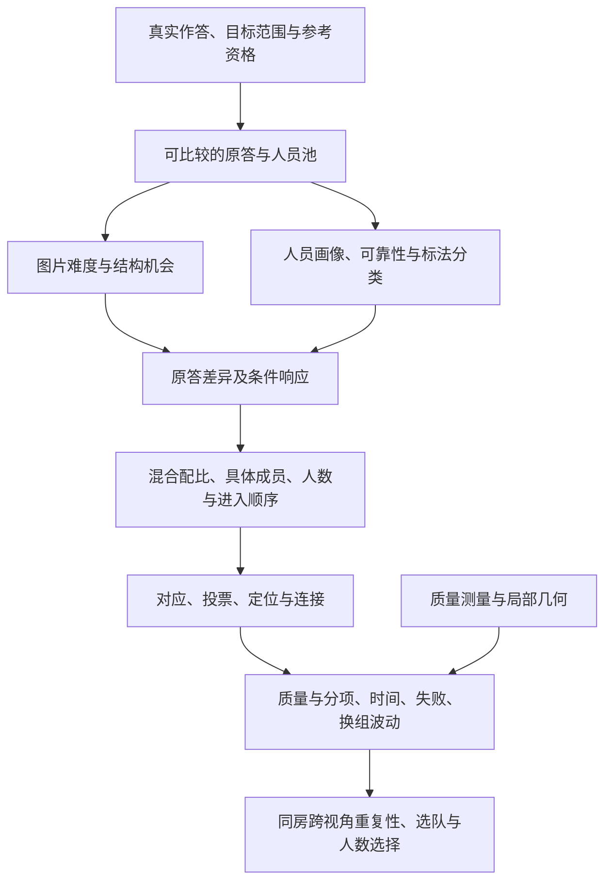

# 全研究结论主线：问题、证据、最初预期与新发现

更新：2026-10-26。**先读本文了解完整研究，再按问题进入专题。** [统一模型](../../../docs/thesis_main/研究模型_人员图片与融合不确定性_20261006.md)解释对象与方法，[当前进度](../../../docs/thesis_main/四线程成果与论文主线核对_20261015.md)只维护完成状态，[术语](../../../docs/thesis_main/CONTEXT.md)解释指标，[资料目录](../../catalog/INDEX.md)定位原件。当前先完整展示已有研究，论文取舍另定。

**快速查看：** 研究线路与结论总览图保留在本机，不随仓库推送；详细证据仍见本文及原专题。[当前Word提纲具体修改细则](../../../docs/thesis_main/构成方差与DSTRUCT衔接_提纲同步_20261026.md)提供逐节替换文字与图表安排。

**2026-10-25 展示要求：研究台承载全部已完成研究，不按预期论文篇幅删减。** 各专题先呈现问题、主要发现及支持范围，再提供完整表格、正反案例、方法和历史来源；尚未决定入文的结果同样可查看。原始复核评论留在研究档案，不作为展示正文。人数过程必须同时呈现低人数早段和20／30／35人至实际满员的后段；分段比较使用明确的固定图集，不把不同容量或可评分范围的均值拼成一条无条件趋势。Manual为主，Semi保留为次要分析。

**总判断：当前真实v2范围内，人员分类与混合构成、人数过程、同房均值与个人相似性的核心问题已经回答；质量测量、难度、画像可靠性及共识方法有可采用结果。新提出的OOS独立描述专题也已完成；其受约束GT不作为人员正确性的依据。** 不需要为追求人人、每图均成立而重开一轮全量人员实验。

本次由三条审查线回读旧研究，并对影响解释的原答、逐成员、逐图/楼及前缀记录定向重算。详见[人员再审查](PERSONNEL_REASSESSMENT_20261024.md)、[图片条件与融合再审查](CONDITIONS_FUSION_REASSESSMENT_20261024.md)、[同房再审查](SAME_ROOM_REASSESSMENT_20261024.md)。这是旧证据的再核验与解释修正；随后完成D10形成链重拟合与固定融合共同面板的独立验收，详见第4.2节。没有新增人员或重跑全库融合。

## 1. 一句话总问题

**同一布局任务中，不同人会怎样表达；图片条件、人员组成和人数经过共识方法后，怎样改变最终结构、参考质量、劳动量与结果波动？**

质量测量与完整布局共识是两项方法基础；图片条件与人员差异解释原答，重组真实人群研究不确定性，同房关系检验视角间重复性。图中箭头表示分析关系，不是已经分离的因果贡献。融合不读取目标GT/Q来选择输出；同一作答在许多团队中复用，事件数不等于独立样本量。

### 1.1 现在统一怎样采用发现

- **多数支持**写明单位：多少人、多少固定人员对、多少图片或建筑；不将正均值自动写成多数。
- **平均幅度、中位数和反向尾部**同时保留。多数微弱正向与平均反向可以并存；反过来也可以。
- **条件规律**本身是成果。简单/困难、Manual/Semi、某种换类方向或人数范围不同，可以有不同结果。
- **反例用于解释适用条件和机制。** 一个反例可以推翻“全部成立”，但不能单独推翻已由多数对象支持的趋势；总体趋势也不能代替某个案例的实际证据。
- **没有数据、平均接近零、未胜过某个基线**分别表述。类别有解释和组织价值，不以普遍升质或胜过连续Q/T作为唯一验收标准。

## 2. 各项研究怎样接起来、已经发现什么

|研究部分|已得到的主要发现|证据入口与适用范围|
|---|---|---|
|数据、scope与资格|真人v2库存10,439份、261图、62个来源人员ID；正式质量7,302份、196图、60人。目标可比、参考完整、个人接纳和可评分是不同条件。|[逐份证据](../v2_evidence_audit_20261019/README.md)、[综合统计](../v2_integrated_analysis_20261019/README.md)。旧v1及历史评分快照保留身份。|
|质量测量及3D IoU对比|B8L2工作分、D10敏感性与同参考均高棱柱3D IoU并列；控制示例和真人同图差异说明两者保留不同信息。相同点数、近似总分仍可对应不同形状；详见第2.3节。|[质量结果](../../quality/v2_profile_combo_quality_20261021/PAPER_RESULTS.md)、[参考与分项收尾](../../quality/v2_profile_combo_quality_20261021/CLOSEOUT_20261022.md)。指标不等同全部语义正确率。|
|图片难度与结构机会|几何初分经视觉辅助与研究者修订形成三档；后续固定6个参考转折的33图中，三种结构条件简化率10.7%／29.8%／55.7%；两项同人比较各支持47人，32人在短边条件更简化、36人在几何自遮挡条件更简化。|[难度形成过程](../../../docs/thesis_main/topics/difficulty/图片难度全量复核与分层标准_20261010.md#现行难度分层的实际形成过程2026-10-26整理)与[条件结果](../../difficulty/difficulty_mechanisms_v2_20261020/RESULTS_SYNTHESIS.md)分开。三种结构条件不对应三档难度；5°／4%不是原人工分层规则，不由Q反定义等级。|
|原答标法与空间候选|整份作答簇、墙角身份组、人员类是三种对象。旧R5六人均有较多表达倾向，主要多短转折而非简单堆近共线点；同范围也可有不同细节表达。|[标法研究](../../workers/personnel_marking_patterns_20261020/README.md)、[原答分簇](../cluster_review_20261018/README.md)。8图191份原答、24种配置是有限方法对照；几何簇不自动成为语义类型或不同真实房间。|
|人员画像与可靠性|182格画像覆盖62个来源ID，保留Q/低尾、T、难度表现、筛除、scope和错误初始化未改。高终稿Q与未纠正已知错误可以在同一人上并存。|[画像定稿](../../workers/personnel_profiles_composition_20261020/PROFILE_FINDINGS.md)。确认错误156机会/25未改、报告错误284机会/45未改分列；不推断心理动机。|
|人员分类与混合构成|此前四套用于完整配比、人数与同房研究；当前新增DSTRUCT等7方法的名单及同图大块对照，分别保留标签身份。336个有限面板分别完整覆盖12选6的924队，形成13,406配比格；配比趋势与同配比内成员波动同时存在。|[人员主报告](../../../docs/thesis_main/人员分类与构成不确定性_研究组织与比较清单_20261022.md)。完整的是声明有限面板，不是所有全池成员、背景和顺序。|
|普通图换人、换类及规模|Manual结构n20/m4同/改配比Q幅度4.858/5.014，23/38图、14/22楼后者更大；m6为7.223/7.623，17/23图支持。联合类时间变化幅度24/27图、18/19楼改配比更大。定向常规→多转折净Q+1.789，反向−1.363；升降都构成差异证据。|[普通配对结果](../../workers/personnel_mixture_comparison_20261022/exchanges/finite_pair_comparison/FINITE_PAIR_SELECTED_ZH.csv)、[18项方向](../../workers/personnel_mixture_comparison_20261022/integration/有效换类条件表.csv)。有限配对与严格ABC幅度定义不同；m4/m6支持域不同，不相减作增人效应。同配比内部仍有明显波动。|
|同房跨视角扩展|同房Manual结构类严格混合大块：同类Q幅度6.869、跨类8.829，61/78图对、9/9楼跨类更大；换少于半队仍高1.251分，50/73图对支持。|[大块独立核验](../same_room_rebuilt_audit_20261023/README.md)。整套设计m5—8、n5—24，m8仅2图对/1楼；本行混合结果只取D非空（n>m）。进一步研究另一视角能否重复，不代替普通图片配比研究。|
|快慢与难度响应|固定同类、近历史Q且有简单/困难共同支持的63对快慢人员中，42对在困难图增加慢者的转折表达优势，44对增加短边优势。|[原答难度](../../workers/personnel_mixture_comparison_20261022/difficulty/README.md)。63对共享35人；这是多数配对的条件规律，增加表达不自动等于正确补画或升质。|
|共识方法与机制|墙线对应→全池MV50投票→全来源中位定位→环连接构成当前工作路线；Lee区域路线保留方法身份。补票、门槛失选、对应拆分、定位改变和连接失败均有实例。|[融合收尾](../../fusion/fusion_paper_closeout_20261022/README.md)、[机制](../../fusion/fusion_mechanism_followup_20261021/RESULTS.md)。全票不保证定位正确，算法归组与人员是否画出分开。|
|人数与进入顺序|追加独立路径后，普通Manual3→6有165/168图升质；困难20→30平均Q+0.016，P10+4.153、SD−4.439，各24/27图改善。门洞后段多数降质、满员仍失败；详见第2.2节。|[自然曲线](../pro_return_review_20261023/README.md)、[路径重抽与同源时间](../../workers/personnel_population_curves_v2_20261023/stability_rebuilt_20261023/README.md)。稳定与接近参考分别判断。|
|同房均值与个人相似性|123直接图对/64图/12楼，同房源均值预测MAE5.081，对比楼外9.303，9/12楼改善；105/123图对个人Q排序正相关，42/57人相对同行好/差在同房重复超过一半。|[同房用途](../../same_room/same_room_acceptance_20261022/USES_CLOSEOUT.md)、[本次重建](SAME_ROOM_REASSESSMENT_20261024.md)。既有房间关系不替换成同建筑；重复方向不是精确预测准确率。|
|选队与人数选择|楼外历史Q更适合具体质量选队；同源时间域Q/T选队在11/11楼节约劳动，平均劳动比0.7873，但有质量损失尾部。已有历史可辅助人数选择，从零获取历史在当前4组未对固定7人方案回本。|[用途收尾](../../same_room/same_room_acceptance_20261022/USES_CLOSEOUT.md)。同房公共信息、个人预测、选队和停止分别检验。|
|OOS独立专题|28图、1,222份、61人、10楼；子类人工选择及28图视觉复核已完成。斜墙3图，斜顶、多层顶/地面等分开且可重叠。|[OOS复核](../../difficulty/difficulty_mechanisms_v2_20261020/scope_closeout_20261022/OOS_REVIEW_20261024.md)。子类表达、分歧、来源时间、scope响应与历史融合覆盖已完成，正式Q资格为0；详见专题收尾报告。|

### 2.1 人员分类：主要解释方法与不同用途

**2026-10-25同图大块研究已独立核验并接入。** DSTRUCT_K3困难结构三类作为主要解释，RFUSE_GEOM_K2与RFUSE_GEOMQ_K3作为核心融合响应对照，Manual＋Semi＋scope、边界及Q/T方案分别解释联合行为、位置/尺度和劳动取舍。四个重点条件的同/跨Q幅度为3.438/6.386、3.642/6.492、1.828/5.642、4.611/7.246，分别有31/40、23/29、16/21、40/49图跨类更大。不同支持不能直接排名，幅度差与升降方向分开。完整采用结构、名单和边界见[人员主报告第1.0节](../../../docs/thesis_main/人员分类与构成不确定性_研究组织与比较清单_20261022.md)及[用途表](../../workers/personnel_classification_guide_20261025/README.md)。

**2026-10-26构成衔接：类别配比能够组织部分差异，相同配比内具体成员仍显著改变共识结果。** [231个普通Manual有限面板](../../workers/dstruct_composition_bridge_20261026/README.md)覆盖40图、22楼，各自完整12选6的924队，213,444条关联对应213,442个唯一端点。新旧分类使用同一实际团队和有效支持；K3 Q构成间／内占比为14.3627%／85.6373%。这是面板内按团队频率分解、跨图片和建筑聚合方差后的比例，不是全库解释率或预测准确率。完整配比分布与严格ABC固定背景下的替换幅度回答不同问题，后者的条件区分度与前者的高构成内波动可以并存。DSTRUCT主解释地位基于原答结构、难度响应及团队连接；K3与旧细层占比接近，不能以“方差占比最大”论证主用。页面并列呈现两种研究对象，缺失时间与常数输出分开，分位区间是成员分布。

**2026-10-26补齐比例与背景的呈现：** DSTRUCT固定7人块的10/14/20/21人路径覆盖70%/50%/35%/33.3%替换，合并阶段容量队列分别39/57、42/57、42/57、44/57图跨类Q幅度更大；与18/7重点40图分开。严格ABC控制共同背景成员，仍测量类别块与背景共同作用。背景人数不同于结构支持票；门槛、对应、中位位置与连接共同解释输出。研究台将此路径放在四重点条件前，保留完整配比、固定n扩大m、固定块加背景和固定团队门槛对照的不同身份。详见[已有结果与机制](../../workers/personnel_classification_guide_20261025/README.md#替换比例共同背景与投票门槛)，无需为本次解释新增融合。

新三类8/39/12人并非旧三类简单改名；下方四套仍是已有完整配比、人数策略与同房研究的标签。新结果不抹去旧方法价值，也不把旧结果自动转换为新分类的验证。

#### 此前四套分类各自做什么

**分类是当前研究用途下的工作分组，不以唯一、永久类型为目标。** 可以针对结构表达、质量—时间角色或采集条件采用不同分区；每轮具体组合实验固定分类规则和名单，再观察配比及具体成员如何改变结果。ALL展示名单与目标楼外标签分开展示，跨楼分类流程的结果不自动视为同一份固定ALL名单的验证。

1. **Manual结构三类**：明显简化6人、常规34人、较多转折19人，未知3人。用于解释“怎么标”、复杂结构表达和构成变化。
2. **Manual结构＋Q/T五类**：较快适度转折10人、常规时间略简化23人、明显简化6人、较慢常规9人、较高Q较多细节9人，未知5人。用于质量—时间—表达角色及组队取舍；不是三类的简单细分。
3. **Semi结构三粗四细**：偏简化6人、常规32人、近共线分段6人、较多转折15人，未知3人。区分终稿结构表达与同墙分段，按Semi自身效果采用。
4. **Semi自身结构＋Q/T五类**：5类人数6/12/9/8/19，未知8人。解释Semi终稿和劳动角色，效率用途与几何用途分开。

以上每套均含62个来源ID，是全历史ALL展示名单；实验使用对应目标建筑外的LOBO名单。类别由历史原答表达及相应历史Q/T形成，不是按当前团队是否升质临时分组。建类策略经过比较和内部楼外核验，不宣称四套是唯一自然类型。旧M、SP、A2、QTD、F01、Rnew2和Manual＋Semi历史联合方案仍在各专题保留；多条件历史允许联合建类，Manual/Semi效果始终分别评价。具体特征、选型、名单和未知支持见[分类依据](../../workers/personnel_main_figures_v2_20261023/notes/CLASSIFICATION_README.md)。

### 2.2 自然人数曲线与策略怎样看

**2026-10-25抽样精度补充已独立验收。** 普通Manual采用原24＋独立新24的统一48路径；53个重点池扩至96作精度检查。单人、缺一人、满员及小池使用精确有限组合边际。主展示标明每点来自随机48还是精确目录；同一次进入过程仍看配对路径。2人延期保留缺口，Semi沿用旧结果作为次要分析。来源、修正表与实际核验范围见[本地独立验收](../../workers/personnel_population_curves_v2_20261023/sampling_precision_20261025/LOCAL_ACCEPTANCE.md)。

**2026-10-26逐图精度复查：** 48指每图的随机进入顺序数。固定157图的总体平均Q在3／10／20／30人时，路径抽样标准误为0.128／0.090／0.070／0.047分；总体曲线已有较小的抽样误差。高噪声35图在96条顺序下仍有许多单图点未达到原精度目标，因此建议定向追加关键人数点。完成上一轮预算不等于逐图均值和P10都已估准，具体方案见上述验收文档的2026-10-26补充；尚未启动新融合。

以下是合48、固定图集的同图边际变化，图片等权。Q/P10/SD对可评分团队统计；失败对全部实际尝试统计，两者并列。

|固定范围与人数|平均Q差|低尾P10差|图内Q标准差差|失败率差|
|---|---:|---:|---:|---:|
|普通Manual 168图，3→6|+5.346；165图升、3图降|+8.540|−2.660|+1.612个百分点|
|困难Manual 29图，3→6|+7.321；28图升、1图降|+5.859|+0.631|+4.741个百分点|
|困难Manual 27图，20→30|+0.016；15图升、12图降|+4.153；24/27图升|−4.439；24/27图降|−0.540个百分点|
|门洞Manual 17图，10→20|−2.339；6图升、11图降|+1.547|−3.584|−2.941个百分点|

早段可评分平均质量通常提高；困难后段平均Q变化不明确，但低尾和成员选择稳定性继续改善。困难20→30的Q路径重抽范围为[−0.623,+0.676]，P10为[+2.423,+6.098]、SD为[−5.000,−3.714]。并非所有指标同步改善。普通固定157张N≥30图的V，在3→6、6→10、10→20、20→30分别有157/153/156/156图下降；合48四段均22/22楼平均下降。门洞满员仍6/17图失败；仅相应指标可用的唯一端点，其有限总体波动为零，失败端点不填零。

**进入策略已修正跨批次共同人数点：** 原8＋独立新8、固定157图的前半段，高Q优先Q+7.672（152升/5降），多转折+6.127（135/22），快类−1.742（53/104），人数最多结构类−1.944（31/126）。独立新8保持四个方向。它们沿用旧冻结角色，不是DSTRUCT/RFUSE策略验证。缺失人数点不再被自动跳过；总体最大修正0.023分、最大单图3.573分。路径重抽的可估次数和条件范围、建筑重抽分开报告。时间按各策略自己的合法共同域统计，不与157图质量拼成双赢；旧67图四策略共同时间结果保留原8路径身份。

**精确小组合补上了随机尾部的盲点：** wc2-46的28支缺一人团队中4支低分。96路径虽见过全部团队，但低分只出现7次，样本P10为97.387；完整目录正确等权后为52.406。主展示因此在小组合空间采用精确边际，而不是要求全库无限追加随机顺序。真实配对过程与精确边际分别解释。

原24路径、原8策略及先前30/35/满员延伸：历史结果与共同时间补充

下面数值保留旧抽样身份；当前自然主曲线与四策略点估计以上方合48/修正合16为准。旧发现并未删除，不将两批轻微数值差异当成研究相互否定。

下表固定普通Manual各层N≥20的图片；Q为成功可评分结果的逐图等权均值，失败另按全部尝试报告。门洞单列，不能直接并成普通困难。

|图片层|图数|3人Q|6人Q|10人Q|20人Q|3→6升质图|10→20升质图|
|---|---:|---:|---:|---:|---:|---:|---:|
|简单|110|85.46|89.67|91.72|93.28|109/110|104/110|
|中等|29|73.57|81.34|84.85|87.43|27/29|26/29|
|困难|29|54.02|61.99|61.24|61.03|29/29|15/29|
|门洞|17|35.35|41.42|43.12|40.06|15/17|6/17|

- 困难图10→20人：平均Q−0.216分，15图升14图降；标准差12.125→9.410、P10为48.513→51.634、V为0.128779→0.085633，27/29图V下降。**前段升质、后段缩波、持续存在参考偏差是三个同时成立的发现。**
- 门洞3→6人平均Q+6.072，15/17图提高；10→20人平均−3.066，11/17图下降；满员27—35人时仍6/17图不可评分。“加人不能普遍解决门洞”得到支持，也保留早期增人的实际价值。
- 同一最终人员池中，Manual高Q角色优先进入的前半段Q+7.710，152/157图改善；多转折优先+6.146，137/157图改善。Semi对应平均−0.875/−0.727，未复制Manual总体收益。满员同成员且相应指标可用时差值为零；共同不可评时仍缺失。
- **原8路径的四策略同源Q/T共同域为67图/18楼**：高Q优先Q+7.419、时间+2.57%；多转折优先+6.810、时间+9.75%；快角色优先Q−0.873、时间−22.40%，67/67图节时。前两者各65/67图升质。4,304个共同可评配对单位用于Q/T，4,613个时间合法尝试用于失败；旧88图混合时间语义结果不作当前联合结论。详细定义见[共同时间报告](../../workers/personnel_population_curves_v2_20261023/stability_rebuilt_20261023/FOUR_POLICY_TIME_COMMON_ZH.md)。

**2026-10-24人数延伸已完成：** 上表是旧固定N≥20范围。当前主图扩为固定N≥30的157图，另以N=35的92图比较到35人，再单列各图实际满员；未新增融合或评分。[逐图清单与结果](../../workers/personnel_population_curves_v2_20261023/late_population_20261024/README.md)已保留旧范围和全部失败。

**2026-10-25将同范围的早段比较补回：** 固定上述157图，3→6平均Q+5.184（155/157图提高），6→10为+1.728（139/157），10→20为+1.429（135/157）；对应V减少157/157、155/157、155/157图。困难27图3→6全部提高、平均+7.457，但不可评分率6.944%→12.654%；之后6→10与10→20平均Q为−0.891、−0.248，V仍在25/27、26/27图下降。早段与后段必须一起展示，不能只留下20人以后的微小增益。这里是同图边际Q，严格共同路径Q另列；27张困难图不与旧范围29图混用。

单人原答基线保留；2人按冻结合同暂停排序，以缺失和`policy_deferred`明确显示，既不当失败，也不声称全部成功。共识曲线从3人连续展示到各范围上限，再单列真实满员。

- 固定157图20→30人：平均Q+0.758，125/157图提高；156/157图V下降。简单/中等/困难的平均Q变化为+0.566/+1.979/+0.378，正向图数89/105、20/25、16/27。困难SD为9.596→5.454、V为0.08526→0.03919，P10为50.762→54.609；失败3.241%→2.160%。中等图Q提高，失败却由0.167%增至0.500%。同路径共同可评整体Q+0.776、困难+0.488，与上述边际比较分别保存。
- 固定92图30→35人：共同可评91图Q+0.227，63图提高、28图下降；全部92图失败0.725%→1.087%。困难满员1/8不可评。不能将30人92图均值与35人91图均值相减当同图提升。
- 固定157图30→实际满员（30—35人）：共同可评156图Q+0.294，98图提高、48图下降、10图不变；失败0.531%→0.637%，满员1/157失败。唯一满员端点的相应测量可用时，有限总体SD/V为0只说明所有顺序使用相同成员；不可用时缺失，不意味着准确或独立重复验证。

这使原先“困难后段主要缩波”的判断延伸到更大人数，并保留小幅升质及失败不单调的事实。Semi为次要分析；新人、新房间与其它融合算法的推广不作为当前收尾任务。

### 2.3 质量算法与3D IoU：独立的方法比较部分

这部分用于解释后续人员、难度和融合研究的质量量尺。当前采用B8L2工作分、D10方向尺度敏感性及同参考3D IoU对照；WQ、A10和其他候选保留历史身份。**评价它们怎样响应不同误差、保留什么信息；分数更高、更低或相关性高低均不能单独证明算法更好。**

|比较内容|已保存的结果与展示材料|可以得出的结论|
|---|---|---|
|测量对象|B8L2汇总底面区域、底边位置、方向规整性和高度；现用3D IoU由底面多边形及角点平均高度构成棱柱|两者衡量不同侧面。方向项是自身最佳正交轴残差，不是逐墙对GT夹角；均高棱柱也不是任意起伏顶面的真实体积。|
|固定底面，改变顶部形状|控制例（h为相机高度）：平顶高度3h与两侧2/4/4/2h的斜平顶，均高IoU均100%；后者明确平面实体IoU约84.62%。[控制说明与主图](../../quality/quality_iou_examples_20261014/README.md)|均高压缩会失去局部高度信息。这针对当前实现的表示假设，不否定一般三维体积IoU。|
|小结构遗漏与整体高度错误|凹口控制100%→98.75%；房高3h→6h的正对照100%→50%|IoU能识别整体尺度差异；小体积的局部结构可能贡献较小，需配合结构与位置诊断。|
|真人同图、同参考对照|普通Manual的92,438个作答对中，7,635对IoU3D100差<1分，其中438对B8L2差>20分，涉及123图/22楼；292对原角点数也相同。[散点与原答](../../quality/v2_structure_quality_interpretation_20261020/README.md)|指标分歧有实际覆盖；这些共享作答的对数不是独立样本量，也不证明所有分歧都应以B8L2为准。|
|解释分歧来自哪里|yq-24两份原答IoU代理90.96/91.68、B8L2为86.98/49.46；将方向输入置零后为88.36/90.24。S1/S2/S3另有遗漏、补回和去多余凹槽的团队对照|差异可定位到分项和具体几何。方向置零是既有归因控制，不是新正式评分；是否符合局部语义需另看原图。|

**当前采用结论：质量算法对比已有可用实证，应保留为完整研究的一部分。** B8L2提供可解释的多项响应，3D IoU提供体积接近度对照；单个总分都不足以涵盖所有局部结构和语义。当前并未证明B8L2在所有条件下全面优于3D IoU，也无需等到这种结论才展示已建立的差别。

人员换类、难度和人数过程应结合各自已有Q分项、几何及IoU结果解读；没有IoU共同端点对照的实验不冒称已经完成指标敏感性复算。上述数值来自保存的控制与v2比较包，本次整理回读其报告及来源，未重新执行全部评分。OOS及GT暂停记录不因指标可算而恢复正式质量用途。

**2026-10-24补充：** 逐列布局深度能响应局部高度，不能把“均高棱柱IoU遗漏局部高度”扩大成全部既有指标失效。25题人工意见中，QV001/QV013的明确偏好支持B8L2/D10而与IoU排序相反；QV006说明必要转折遗漏；QV015说明点数齐全不等于定位/高度正确；QV019近分低质量与QV021近分高质量分开展示。QV016人判接近而分差11.21需解释分项，但尚不能直接断定过度惩罚。12个“各有问题或无法判断”不能一律叫无法排序。详见[人工结果](../../quality/quality_independent_validation_20261024/human_review/REPORT_ZH.md)。

### 2.4 当前融合相对代表原答和Lee：同队比较

[固定共同面板](../../fusion/fusion_common_panel_20261024/README.md)覆盖48池、45图、19楼、138队，按输入场景/难度/容量选样，使用原随机路径draw0。medoid是团队中与其他原答平均底面距离最小的一份完整原答，不读目标GT或Q；Lee输出底面区域，顶部不适用。

|普通Manual人数|共同完整可评图|墙线−medoid B8L2均差|提高/下降图|
|---|---:|---:|---:|
|4|22|+7.11|16/6|
|8|22|−0.51|13/9|
|16|23|−5.54|8/15|

全部尝试中墙线完整可评130/138、有效底面131/138；medoid完整可评138/138、Lee有效底面138/138。三方底面共同域131队；普通Manual16人底面IoU为墙线0.865、medoid0.909、Lee0.914。门洞16人虽5/6共同图升质，均值仍−4.94；多数与平均必须同时显示。

当前方法具有完整结构对应、投票与几何输出的工作价值，质量优势有条件；这份面板不支持“人数越多越胜过选代表原答”。人员、人数及同房规律是在当前融合方法下的实证响应，不能全部归因于人的属性，也不因某基线占优就否定已观测到的构成差异或缩波。无需为得到正结果重选面板或回填算法。

### 2.5 共识失败本身的发现：普通图也存在

2026-10-25只读核对保存的自然前缀与全员端点：普通Manual177图中54图曾在k≥3的实际自然进入路径发生真实失败，分别为简单9/114、中等15/32、困难30/31；到实际满员，仍有困难图VFuaQ6m2Qom-04在35人时只保留3个上下点对。门洞满员6/17失败继续保留；次要Semi普通池32个中有1个满员3节点失败。普通7y-03还存在已有6—7节点但无法连接的团队。平均Q、几何波动及失败各自回答不同问题；形成共识困难是主研究结果，不因没有Q而从展示删除。

“任一路径曾失败”是图片发生范围，不是每个团队失败或具体失败概率。节点不足与连接问题需结合原答、对应组及票账解释；页面未加载、参考缺失、2人设计暂缓不算这类真实失败。详细分母、来源和M05已计算但页面未接入的区别见[融合专题的全池失败核对](../../fusion/fusion_paper_closeout_20261022/README.md)。术语、B8L2五输入与全部尺度参数统一见[术语说明](../../../docs/thesis_main/CONTEXT.md)。

### 2.6 同房哪些信息能重复：不要只剩一个总体相关系数

[既有结构迁移补算](../../same_room/same_room_independent_followup_20261021/structure/README.md)比较本人源视角与同一源图其他人员，而不只与楼外历史比较。44图、7楼、55人中，9°未匹配参考角点比例的预测MAE少1.099个百分点，5楼改善、1楼相同、1楼下降；删去任一楼仍为正。参考角点数差的MAE少0.096个，但只有3/7楼严格改善。与之相比，不依赖参考的同行点数差只少0.0066个，删楼可变号；底点偏移和面积对数误差则7/7楼都是本人源历史更差。

这说明**个人的某些结构表达特点可以重复，具体位置误差更受视角影响**，不能把“同房可预测”推广成全部几何都可迁移。未匹配角点也可能来自定位偏离，不直接称人工确认漏画。以上本次回读逐指标/逐楼汇总，未重跑旧预测。

[同预算个人质量校准](../../same_room/same_room_independent_followup_20261021/README.md)另报告MAE12.364→11.145、6/7楼改善，但目标Q<50的事后子集MAE为25.719，对照23.443，反而更差。平均预测有用与严重低质量高估可以并存；低质量子集是诊断，不是选人时已知的信息。该数值本次核对报告，未再次重聚合。

## 3. 最初预期目前实现了哪些

|最初希望回答什么|实现情况|现在应怎样表述|
|---|---|---|
|把不同人的标法特点解释清楚|**已实现**|结构、短边、近共线分段、质量/低尾、速度及可靠性有可读名单和证据；不把点多直接叫细致正确。|
|用Q、T、难度、scope、Semi等组合探索类别，而非只凭直觉|**已实施候选比较并形成工作分类**|方法域组合和反向关系路线都有记录；机会不足的变量保留画像用途，不要求五个因素必须进入同一分型。|
|质量算法与3D IoU比较，解释评价增加了什么信息|**已实现测量差异与机制对照**|控制例、真人共同参考对照及分项归因已具备；多项响应和体积接近度互补，未声称全面优越。|
|模拟混合类型人群，研究不确定性|**已实现**|固定类后比较配比格、格内成员、同D/m换人/换类、大块替换及进入顺序；包括升、降、快、慢、失败和近零响应。|
|同类换人通常较小，换类通常较大|**在明确条件下实现**|Manual结构大块有多数图对支持；联合类时间区分清楚。任意改配比的Q效果较弱，类别与方向/规模各自选择。|
|快者更简化，慢者在复杂结构上多表达|**有多数固定配对支持**|42/63转折、44/63短边的跨难度变化可采用；同批Q没有相应多数收益。短边质量损失也可能主要来自定位，不能全归于漏画。|
|简单图较快达到高质量，中等较慢，困难图加人后仍有限|**主要实现，并补充早段/后段区别**|简单/中等持续改善，困难早段同样明显受益，后段更主要降低成员波动。不是困难图从头就无效。|
|门洞大多不能单靠加人解决|**当前支持**|后段11/17图下降、满员6/17图失败；仍保留15/17图早段升质，不将可标门洞或早段收益抹去。|
|同房平均质量、个人相对表现有相似性|**已实现**|均值预测9/12楼改善；个人排序105/123图对正相关，42/57人相对表现多数重复。扣稳定个人水平后额外房间专长信号弱，限制的是增量预测。|
|用类别组织人员有实际用途|**已实现部分用途**|Manual联合选队Q+1.432、时间−5.419%，31图中23图同时改善；连续Q/T更适合具体成员取舍。类别不必成为最强预测器才有价值。|
|保留多套合理分类，用于不同研究问题|**已实现工作分类与用途比较**|不要求唯一或永久人员类型；每轮比较内部固定分类和名单，保留不同分区及其各自支持。|
|分离图片与人员不确定性的独立贡献、得到通用最优人数|**未建立，当前不作为必达目标**|已有条件关联、有限池响应和机制，尚非因果噪声分解、未来新人保证或普适停标规则。|

预期的实现程度依据实际比较判断，不以“有反例”判失败，也不因迎合预期删除反向条件。内部探索后选出有价值的方向可以采用，需保留候选比较及探索身份。

### 3.1 本次纠正了哪些偏弱或偏满的概括

|旧概括的问题|再审查后的结论|
|---|---|
|Manual联合n20/m4平均跨构成幅度较小，被读成分类没有区分价值|21/32图、13/21楼跨构成更大，逐图差中位数+0.075分；均值−0.179分。采用“微弱多数与平均反向并存”，时间幅度则24/27图、18/19楼更大。|
|只因快慢反例，就只写“部分人可能有差别”|固定63对中42对转折、44对短边的条件差向慢者增加，明确保留多数配对规律；人数、正确性与Q分别解释。|
|个人剩余相关0.031被读成个人跨视角没有相似性|原始相关0.405、扣公共水平后0.239，另有105/123图对排序及42/57人的重复支持；弱的是扣掉稳定差异后的额外信息。|
|困难后段均Q略降，被读成多数图加人变差|实际15图升、14图降；27/29图V降低。平均、比例、低尾及几何波动同时报告。|
|Semi细层平均幅度为正，被读成多数图支持|n20/m4同/改细配比Q幅度3.965/4.320，但仅3/10图、2/8楼跨类更大；保留平均现象，不能说多数支持。此处未固定父类向量，不是纯细分增量。|
|“分类没有胜过连续QT”被读成分类无用|实际分类组织与选择收益存在，连续QT是更强数值基线；解释角色、比较配比和精确选人各有用途。|

### 3.2 新发现及能把研究讲通的实例

1. **复杂机会使标法差异显现。** 同为6参考转折，b8c-07与jtc-13共同33人分别全为6转折、23人4个/2人5个/8人6个；不是同房或单变量实验，但能说明为何需要条件解释。
2. **高个人Q并不保证某方向的团队收益。** 历史较低Q且更快角色在困难图内部探索净Q+8.590、6/9图升，在简单图−1.247、0/11图升；几何变化主要涉及方向和定位，不是统一的补结构。
3. **同分、同角数与全票也可存在明显位置差。** 质量S09近分异形；wc2-56三队均四角全票，Q仍88.28/94.09/98.60；G130同角数案例进一步连接位置、分项与换类。
4. **加入背景会改变门槛和对照，而不只是稀释目标类。** zs-16从20到21人，门槛10→11，B失去一个角而C保留；比较优势有时来自对照恶化。背景已有更多同类表达时，额外换类的边际收益通常减弱，但不是“≤4人”的硬界限。
5. **跨类可更容易改变质量，却不保证实际形状位移更大。** 同房共同几何域Q额外幅度为正，底面位移额外幅度略负；指标回答不同问题。G172两视角增加转折却Q反向，是这种区别的机制实例。
6. **同房构成趋势比具体成员收益更易重复，记录劳动方向又比精确Q方向更稳。** 不能从一个视角挑中的块直接保证另一个视角获益；也不能据此否定多数条件下的类别配比关系。
7. **可靠性与平均质量是不同维度。** W109/W112总体Q接近但记录耗时差明显；W006/W011高Semi终稿Q与确认错误初始化未改并存。scope、被排除作答和低尾因此仍有独立价值。

### 3.3 门洞交界：拍摄点位造成的表示冲突（2026-10-26澄清）

本研究所说门洞交界，是相机在门框正下方或两区域交界处拍摄。相邻房间本身可以满足Manhattan约束，但若相机位于所选单室的封口边界，就不能同时满足真实几何与“拍摄点位严格位于闭合布局内部”的表示要求。移动封口、合并两室或忽略门楣／顶底高度差，可以得到规定格式的输出，却可能改变目标或近似真实结构。GT存在与输出完整均不自动证明严格可标。

这与[Bi-Layout](https://liagm.github.io/Bi_Layout/pdf/3739.pdf)的enclosed／extended范围政策不同：后者区分在开口处停止或延伸到可见区域，本研究明确追问交界点位下标准单室表示能否成立。OOS侧重斜墙、斜顶、多标高等场景结构超出标注标准；门洞交界侧重点位，两者独立记录并保留实际交集。[完整定义](../../../docs/thesis_main/CONTEXT.md)统一术语。

已有门洞结果观察人员面对这种条件怎样标注、怎样形成共识：当前合48路径中10→20人11/17图Q下降，满员仍6/17图失败，表明加人不能普遍解决这一场景层的问题，同时保留早段改善。这里的场景层统计不是对每张图几何不相容的逐图证明；节点不足、连接失败与固定参考差异仍按实际记录解释，不能全部归因于点位或人员能力。历史可标案例、参考、资格和原始统计保持原口径。

## 4. 完成到哪里、接下来还做什么

|状态|内容|
|---|---|
|**核心研究已完成**|质量/参考解释、难度/结构条件、连续画像/可靠性、人员分类、混合配比及格内波动、换人换类、自然人数曲线、进入策略、同房均值/个人相似性、选队和停止用途。|
|**定向补充已完成**|同房新大块62,676个ABC、311,333端点、35,603规模/背景路径，逐楼/关键成员敏感性，人数路径/建筑重抽和同源时间；原04C已恢复。不重发已执行任务。|
|**已有研究台展示**|[整体导览](../research_explorer_v1_r2_20261017/index.html#release=v2&module=overview)与[人员六步](../research_explorer_v1_r2_20261017/index.html#release=v2&module=personnel_main)已有六组18图、四套名单及68项提示。2026-10-25补齐分类用途、全部配比格、普通换人/换类条件及成员表；同房扩展单列。接入保存结果，不重新拟合、融合或评分。|
|**OOS描述专题已完成**|28图因素、原答表达/分歧、来源时间/scope和历史融合覆盖已整理。OOS不符合标注标准，其GT可能为满足约束而偏离真实结构，不据此评价人员正确性；统计和复核工作台保持独立；主研究台提供独立复核页链接，不并入普通统计。|
|**可选扩展，不阻塞现有结论**|扩大新scope完整参考、正式局部正确补画率、Semi困难或大块共同人员支持、未来新人/新房间外部验证。只有需要回答这些新问题才新增研究。|

当前无需新增人工确认即可采用本轮整体结论。已有G046同角对应、pRb-12木饰误作天花板的GT暂停、G015固定GT评价及OOS三项最新用户选择均沿用。若下一步要修GT或将局部表达升级为正确补画率，再集中提供具体原图/参考供用户裁定。

### 4.1 OOS独立统计：已完成的描述研究

以逐份证据`is_oos=true`为口径：1,222份、28图、61来源人员ID、10楼；实际条件Manual 980、Semi 8、历史condition=oos 234。1,136份有来源时间，正式质量资格0，缺Q不记成0分。明确门洞交集为2图/70份，另有q9-24疑似1图/35份；“明确＋疑似”不当作全部已确认门洞。

用户导出记录及28图视觉复核见[OOS专题](../../difficulty/difficulty_mechanisms_v2_20261020/scope_closeout_20261022/OOS_REVIEW_20261024.md)。当前采用因素允许重叠：斜墙3、多层地面8、斜顶4、多标高天花板7、曲面/连续折面玻璃5、未定1、严重遮挡1；合计29个因素分配对应28图，不能相加作互斥类别比例。

最新明确：x8-01/09为同一房间G231的斜墙视角，角度未定；b8-19也采用斜墙，共3图/2房间。b8-04采用多层地面，uNb-69同时采用地面高差与天花板多标高。画面可见楼梯与实际选了跨层目标分别记录。

[OOS独立统计](../../difficulty/difficulty_mechanisms_v2_20261020/scope_closeout_20261022/oos_statistics_20261024/README.md)已完成。**OOS单列是场景不符合标注标准；GT可能为了满足曼哈顿约束而偏离真实结构。** 本专题用原答之间的比较研究近似表达，不据参考分数认定人员对错。

新Manual804份覆盖28图，其中703份/24图有既有几何分析资格。三张斜顶图的80份新作答均为四个底面角点，底面分歧较小；这保留“某方面可一致”的发现，不恢复完整场景适用性。曲线玻璃五视角的角点数不一致比例按图平均61.8%；多高度天花板类的较高分歧主要来自两个跨门口视角。新Manual选择不可标327/804次，只有6/28图为多数人如此选择；这描述任务响应，不是OOS识别正确率。

既有融合覆盖22/28图，均保留旧人员池/方法身份；当前v2人数实验没有纳入OOS。旧墙线随机路径全员19/21池能生成完整结构，不代表真实场景被正确表达。q9-24原因未定和b8-04等既有参考暂停继续保留，无阻塞当前描述收尾的人工问题。若要扩大正式参考或评价具体近似的正确性，再看具体原图、GT和人员标注。

### 4.2 定向收尾：已有证据、补充问题与分工（2026-10-24）

本轮有限补充已完成独立验收，记录见[补充实验验收](../../workers/personnel_supplement_20261024/INDEPENDENT_ACCEPTANCE.md)。[准备补充实验](codex://threads/01a169ce-22e4-7741-8558-e5d94433b402)负责计算与修补，统筹线程独立复算并接回主文。验收期间补齐原有向换类×难度、四策略完整前段和zs-16路径三处覆盖，并统一多指标比较的实际事件/路径支持。没有新增正式分类或更改评分、参考、资格、融合合同；OOS保持独立。

|问题|核验后的发现|采用方式|
|---|---|---|
|分类是否比随意分组更能组织差异|旧四套分类细层在来源/容量匹配的固定面板参照下，Manual结构与联合类Q的平均解释方差比增量为0.0497、0.0674，18/22与19/21楼为正；联合类时间增量0.3511，20/21楼为正|支持固定池构成组织价值；η²增量不是Q分数增量，不是跨图预测或永久类型证明|
|Semi分类是否有用|结构类Q增量−0.0031、6/10楼为正；联合类Q增量−0.0257、3/9楼为正；联合类时间增量0.3067、8/9楼为正|保留具体结构/效率角色与条件实验；平均质量区分没有超过匹配随机，不要求各套分类在所有指标上都有效|
|分类形成链能否复现|四套ALL与四套7y楼外折：4,712个特征值、16个粗细分区独立重算一致；选中模型132条内层损失重放一致|形成依据获得实核；覆盖8个拟合，不称全部楼外嵌套搜索独立重做|
|跨类差异是否只由方向评分造成|同房结构类固定六端点可评的25,472个混合事件/78图对，额外Q幅度+1.960、61/78图对正；方向置零仍+1.177、58/78正；底面IoU与三维代理也为正|保留跨类变化幅度发现；幅度更大不等于质量更好，分类不是纯标法的因果效应|
|原换类×难度反转依赖什么|同一有向条件简单11图Q−1.247、困难9图+8.590；方向置零后分别−0.873、+0.800，困难仅3/9图正|平均困难收益很依赖方向评分块；保留条件差异，同时明确多数支持会随评价方式改变，不称低历史Q人员普遍更好|
|优先进入和困难人数过程是否跨指标成立|原157图完整前段，高Q/较多转折优先Q+7.710/+6.146，152/157与137/157图正；底面IoU、三维代理和方向置零均保留正均值。困难29图3→6共同可评路径Q+7.596、28/29正；10→20为−0.532，既有波动下降仍保留|前段构成有作用、困难后段以缩波为主；原边际29/29与配对28/29是不同分母，均保留并注明|
|门洞失败/突变是否只是门槛问题|17个固定满员池下调一票，3个失败恢复可评分但Q仅14.678/13.179/31.718；另3个仍失败。zs-16固定n21的B队从11降至10票，Q45.844→92.467、5→6节点，C队不变|门槛可造成个别强突变，却不能普遍解决门洞；未选组是否对应语义必要角点不能仅凭票账断定|

随机参照按面板再按建筑等权，同一人可在不同面板获得不同随机标签，只回答固定池的分组价值。[分类专题](../../workers/personnel_supplement_20261024/README.md)、[多指标专题](../../quality/personnel_metric_dependence_20261024/README.md)和[门槛专题](../../fusion/doorway_vote_sensitivity_20261024/README.md)保留完整正、负、近零、失败与支持表。IoU3D100是同参考均高棱柱代理；方向置零是固定几何的非正式诊断，不据此计算因果贡献比例。

**D10形成链敏感性已验收（2026-10-24）：** Manual全历史分区稳定，楼外重选平均ARI0.722；Semi粗/细0.571/0.612，类别更依赖Q刻度。高Q类选队改变Manual11/179、Semi粗21/32、细19/32；同D10计分均差约−0.006、−0.308、−1.153分，Semi仅28面板共同可评，净增失败2/1次。292个固定结构类面板的高Q角色与团队未变。保留四套工作分类，具体成员和语义绑定实际评分/训练折；不因刻度变化改主评分。常数Semi面板η²舍入问题已修，42个已知面板中41个有可解释质量波动。详见[独立验收](METHOD_SUPPLEMENT_ACCEPTANCE_20261024.md)。

**方法共同面板与人工意见已接回（2026-10-24）：** [融合共同面板](../../fusion/fusion_common_panel_20261024/README.md)的138队medoid重选、Lee底面重建及268份完整几何重评分通过，当前墙线没有普遍胜过代表原答，分人数结果见第2.4节。[质量人工材料](../../quality/quality_independent_validation_20261024/human_review/REPORT_ZH.md)已收到25题/13条comment，原选择与指标回连已核；新Manual5个明确偏好B8L2/D10同向5、IoU3D同向3，Semi1题反向。支持具体取舍与机制，不将定向单人评阅写成全库胜率。无需重复等待人工答案。

**本轮四套方案的收尾判断：** 此前四套工作分类可按不同用途保留，人员、构成、人数、同房核心研究及本轮有限补充均可收束。已有逐楼/成员删除、历史Q匹配、规模/背景、路径/建筑重抽与同源时间结果继续采用，无需再以扩大参数搜索作为结束条件。已采用结论没有阻塞人工项；上述新授权方法补充已验收，后续重点是研究台同步与展示。若将来要裁定具体角点语义、新人外推或改变正式Q定义，再设相应研究问题。

### 4.3 数学化复审：解释修正与已有结果复用（2026-10-26）

**采用决定为修改后采用，主要实证结论未改变。** 任务／团队抽取／输出状态、具体Q和融合流程、人员形成链、ABC幅度及人数统计对象已并入[统一模型](../../../docs/thesis_main/研究模型_人员图片与融合不确定性_20261006.md#25-当前任务团队分布与状态的统一定义2026-10-26)，术语同步更新。恒等式和局部门槛推导用于解释已有发现，不另称新真人实验。

- **修正的定义：** 不可评分不等于融合失败。缺合法参考、方法不提供测量、未执行和合同暂缓各自记录；失败率使用声明输出适用且已执行的尝试。唯一满员端点相应测量可用时，有限总体方差／V为0；不可用时仍缺失。
- **同房CA／CB核对：** 普通Manual旧结构类混合团队、25,472个六端点共同可评事件中，图对内条件化再对78图对等权，CA双端同向73.01%、源端触发后目标同向53.83%；CB为74.05%、55.64%。现有人员主报告原先已正确写CA，错配位于Pro新数学建议，原研究数据无需改动。
- **避免重复研究：** 旧四套分类的方差和匹配随机参照保留10月24日身份；DSTRUCT已用各自楼外标签完成同一批231个Manual面板的重聚合并与旧结构类同支持比较，没有改名继承旧结论。RFUSE及Semi的新配比分解未扩展，不能套用本轮数字。
- **展示接入：** 已核方差、全部配比分布与具体成员波动接入[独立方差页](../research_explorer_v1_r2_20261017/composition-variance.html)，[本轮提纲同步](../../../docs/thesis_main/构成方差与DSTRUCT衔接_提纲同步_20261026.md)保留具体Q/F方法及ABC机制。统一模型、CA／CB区分、替换比例与门槛说明均保留本地修订，并接入本轮衔接。无需追加全库融合、重新选类或重复人工复核；长推导进补充材料，可选新分析不作为本次验收条件。

本轮检查了方差保存字段及计算权重、同房逐事件响应和满员缺失逻辑，未运行原生融合、全套分类拟合或bootstrap；没有修改合同、GT、资格、B8L2/D10或MV50。

## 5. 文档职责与核验范围

|需要查什么|固定入口|
|---|---|
|整个研究的问题、变量和方法关系|[统一模型](../../../docs/thesis_main/研究模型_人员图片与融合不确定性_20261006.md)|
|所有发现、最初预期和新发现|本文；当前结论只在这里跨专题汇总|
|完成状态、剩余任务|[当前进度](../../../docs/thesis_main/四线程成果与论文主线核对_20261015.md)|
|分类依据、名单、全部配比和替换条件|[人员主报告](../../../docs/thesis_main/人员分类与构成不确定性_研究组织与比较清单_20261022.md)|
|各专题结果与讨论用哪些典型案例|[展示案例索引](../../workers/personnel_main_figures_v2_20261023/notes/TERMS_AND_STORY.md#跨专题展示案例索引2026-10-24)：主例、对照、具体素材、总体支持及人工判断边界；OOS保持独立展示|
|指标、术语和提示文字|[CONTEXT](../../../docs/thesis_main/CONTEXT.md)|
|原表、代码、来源及旧方案|本文专题链接与[资料目录](../../catalog/INDEX.md)；原件不因整合删除|
|研究台接入与展示范围|[接入记录](../../../docs/thesis_main/v2数据研究台与Pro推进_20261019.md)|

本次实际检查覆盖：248行分类名单、关键有限配对逐图/楼幅度、63固定快慢对、122选队面板、12图F01、182画像/440错误机会、404,082前缀再聚合、同源策略时间、14机制端点、从原答重建2,581个人同房对及既有大块主结果。三份再审查报告保留精确来源和分母；没有声称每份历史研究都从原始数据重跑。

原03/04、R00—R06来源及历史核验各保留实际深度。本次不改变GT、资格、正式算法或采集合同；已定向完成D10最终标签重拟合，未重跑全库融合、全部内层选型或全量语义人审。旧数值及研究演变折叠保存如下；其中“当前、待办、未接入”仅指原记录日期。

### 5.1 近一个月资料与遗漏盘点（2026-10-25）

按2026-09-25—2026-10-25的目录日期/路径日期检索，当前673项登记中有383项落在范围内；同范围本地相关Git历史253条。这些是资料/提交数，不是独立实验数。本次检查目录、来源归档、关键报告及研究台表格声明，并定向查实现；没有声称逐行重算所有历史实验。

- 数据预处理/共享x、范围与多参考、质量沿革及控制、Lee与完整结构融合、难度机会、人员可靠性、分类/构成/替换、人数策略、同房校准与人数选择、OOS均有现存来源和主线入口。未发现这些主题有整套成果从当前仓库失踪。
- 四个看似未独立登记的专题实际通过目录relationships或上层归档覆盖；同房独立补算13表、旧可互换性3表已进入研究台。不能把没有独立current_path登记认定为研究丢失。
- 真正需要补讲的是第2.6节的结构/位置迁移差别与低质量校准反例；已纳入本文，并交研究台补结论解释。旧融合方法与候选质量模型保留历史身份，不与当前共同面板混成一次比较。
- 已修正目录Hm/Hc单位（均为无量纲相对误差）、人员图数16→18、旧交接“当前入口”和OOS“未接入”等过期描述。此前四套标签与最新7方法已明确分开，不能把旧完整配比和D10全链核验冠在DSTRUCT/RFUSE上。
- 月度回查曾指出：旧24条路径bootstrap和30/35后段重聚合，尚不能替代新增随机路径的精度验证。该缺口随后已由本轮独立新24、重点96和精确有限边际补齐，策略共同k问题也已修正；当前采用见第2.2节。
- 原04C已恢复；旧111,054端点大块实验原件未恢复，新311,333端点属于后续独立实验。旧孤立图corner_continuous_004.png与19项未定位历史计数差仍保留在恢复说明，不据此否定当前已存核心结果，也不虚称全部历史字节齐全。仅缺Downloads ZIP但仓库已有归档，不作为新下载需求。

本次没有新建汇总文档或移动源包，以免再次分散入口。以上是内容、来源及呈现覆盖审查；研究台正在修改的页面仍由展示线程另行验收。

---

此前人员、同房与融合统一采用记录（保留阶段数值及来源）

# 人员、同房与融合机制：统一采用结论

本次按用户三步要求整理已有 Pro 返回和仓库基线，不新增正式分类、投票资格、GT 或评分参数。定稿指本轮成果及采用边界归档，不意味着所有研究问题已解决。

## 当前采用范围（2026-10-22文档更新）

下方人员数值保留前轮53条件研究身份。后续closure和adoption已经返回，完整端点与Manual两条主方向已复核；不再处于等待Pro状态。最新[混合构成独立核验](../../workers/personnel_mixture_audit_20261022/README.md)又接回四套分类的构成内/间方差、共同域连续对照、F01全部配比及QTD方向。分类的意义包括结构、质量、时间、失败和难度条件差异，升质只是用途之一。实际状态见[人员当前记录](../../../docs/thesis_main/人员标法分类与换类研究_总体进度_20261020.md)。

随机重排人员后的平均前缀曲线继续作为整体研究问题。先复用v1广图和v2同房/嵌套前缀，再接当前难度、范围与类别；稳定性、接近GT程度及改善速度分别观察，门洞可标性独立保留。具体比较见[统一组织第6节](../../../docs/thesis_main/人员分类与构成不确定性_研究组织与比较清单_20261022.md)。

各专题最新解释入口：[人员画像与可靠性](../../workers/personnel_profiles_composition_20261020/PROFILE_FINDINGS.md)、[难度与范围](../../difficulty/difficulty_mechanisms_v2_20261020/scope_closeout_20261022/README.md)、[质量分项](../../quality/v2_profile_combo_quality_20261021/CLOSEOUT_20261022.md)、[融合与人数](../../fusion/fusion_paper_closeout_20261022/README.md)、[同房用途](../../same_room/same_room_acceptance_20261022/USES_CLOSEOUT.md)。

## 一、人员结果链
[53条件统一表](../../workers/personnel_effective_exchange_conditions_20261022/audit/PERSONNEL_UNIFIED_RESULT_ZH.csv)逐项连接形成依据、人员、标法、替换条件和结果；[目标楼成员表](../../workers/personnel_effective_exchange_conditions_20261022/audit/PERSONNEL_TARGET_CLASS_MEMBERS_ZH.csv)避免跨折类号拼接。

- 新Manual结构常规→较多转折 n10/m7：96图16楼，报告平均Q+5.91，75/96图、13/16楼向好。面板到正式汇总本次实核通过；不是每个原端点重融通过。
- A2主要用于识别更大的跨类变化和质量下降风险，不称为正收益方案。
- 旧M父内 m5扩大后不支持整体跨类变幅优势，m6有较弱多数支持；两者仍可解释简化与结构遗漏，不能把失去一种用途写成分类完全无效。
- Manual原联合类的旧选队 Q+1.432/时间−5.419% 与本轮纯块净Q+5.691/时间−3.632%是两种设计，不叠加。后者64事件中62共同可评分、2个C失败。
- Semi28事件省时−8.544%、净Q+0.153支持效率方向，不证明非劣或普遍升质。
- 真正Manual+Semi联合标签排除目标楼两条件，评价仍分条件。当时未完成的新ABC连续QT对照已由后续具体选人实验补充；19,896锚点类别约束QT10与纯QT10选人相同，仍不支持离散新类额外胜过连续QT。

## 二、同房核心问题与保留成果
[同房验收表](../../same_room/same_room_acceptance_20261022/SAME_ROOM_ACCEPTANCE.csv)与[说明](../../same_room/same_room_acceptance_20261022/SAME_ROOM_ACCEPTANCE.md)。本次找到的仍是此前04:17 UTC五包，不冒称新批次，不重复上传原件。

- 按用户已有房间关系，123对、64图、12楼；同房源均值预测MAE5.081，楼外基线9.303。同房平均质量有迁移价值，建筑仅用于留出与计权，不替代房间。
- 个人原始质量相关0.405，扣同行公共水平后0.239，再扣楼外稳定个人水平后0.031。个人有绝对相似性，但不能泛化为强烈的个人房间专长；相关衰减不是因果方差占比。
- 选队的楼外Q/T劳动比0.787与损失坏尾并存；劳动是记录人秒比，不是并行历时。
- 已有源历史与从零获取历史分开：四个可计时组从零建立历史劳动比约2.395，不能把停止策略一律称省成本。
- 结构迁移节点数同向82.60%中76.79个百分点为双零；同点数不等于同结构正确、全票稳定不等于定位正确。保留原结构与停止研究，不让新人员结论覆盖这些边界。

## 三、两条线如何联系
人员类别提供可解释的成员组成方向；同房信息提供公共任务背景和迁移线索。现有证据不能直接推出“在一个视角有效的换类，另一视角必然有效”。共同背景的加入可改变投票门槛，具体定位也会改变输出。研究台须同时展示形成条件、评价条件、n/m、成员/背景、失败分母、记录时间来源和核验等级。

G015-11继续采用用户裁定：理论上应保留细节，但质量评价以现GT作为正确参考，不更改GT或把语义争议变为评分修订。

## 四、研究台与复现范围
[离线研究收束页](../research_explorer_v1_r2_20261017/research-closeout.html)接统一结果表及来源链，既有模块全部保留。页面只读数据，不运行研究计算，不更换研究台原冻结数据。全部扩大统计的面板到汇总已核；未重跑部分明确保留原作者身份。现有收束页随PR #23已进入main；本轮研究台新开发暂缓，浏览器视觉验收仍未完成。

