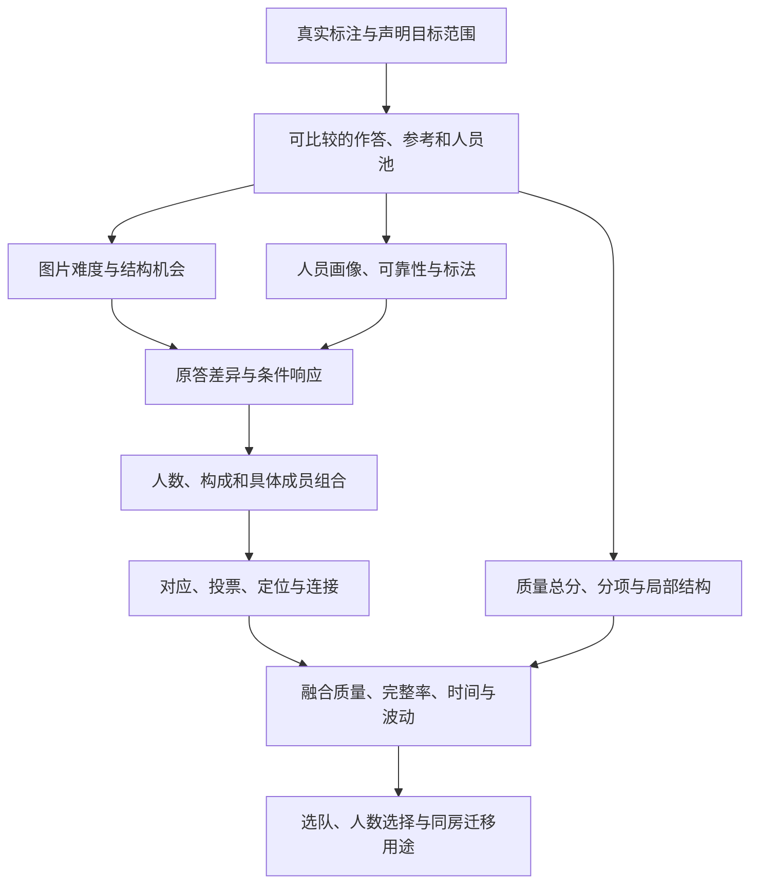

# 全研究结论主线：从任务与测量到人员、共识及用途

更新：2026-10-23。本文是面向论文与导师汇报的**跨专题结果入口**；整体问题与方法边界由[统一模型](../../../docs/thesis_main/研究模型_人员图片与融合不确定性_20261006.md)负责，全部资料由[目录](../../catalog/INDEX.md)定位，人员分类细节统一读[人员主报告](../../../docs/thesis_main/人员分类与构成不确定性_研究组织与比较清单_20261022.md)。本次核对各专题当前说明、字段/消费入口和阶段记录，整理已有证据，没有新增实验或宣称逐文件复算整个research目录。

## 1. 一句话总问题

**同一布局任务中，不同人会怎样表达；图片条件、人员组成和人数经过共识方法后，怎样改变最终结构、参考质量、劳动量与结果波动？**

研究有两项方法基础：质量测量回答“结果哪些方面接近参考”，完整布局共识回答“怎样把多份独立表达组合起来”；实证部分研究图片条件、人员差异与人数/构成，已有同房关系提供跨视角的补充证据。人员分类是其中一条重要线，不替代质量、融合和难度本身的贡献。

图表示分析关系，不是已识别的因果分解。参考用于评价，现用融合不读取目标GT/Q来决定输出；同一人员同一作答在多种组合中复用，组合数不是独立样本量。

## 2. 汇报顺序、已有发现与证据

|问题|当前可以讲什么|直接证据与本次接入状态|
|---|---|---|
|研究对象有多少、哪些可以评分？|真人v2库存10,439份、261图、62个来源人员ID；正式质量7,302份、196图、60人。库存、正式质量、画像和团队各用自己的分母。|[综合统计](../v2_integrated_analysis_20261019/README.md)、[逐份证据](../v2_evidence_audit_20261019/README.md)；可接入|
|怎样评价一份结果？|B8L2综合固定参考下的底面/边界、输出自身方向和高度；D10检查方向尺度敏感性。总分相近仍可能局部形状不同，节点数相同也可能定位不同。|[质量论文结果](../../quality/v2_profile_combo_quality_20261021/PAPER_RESULTS.md)、[分项与参考收尾](../../quality/v2_profile_combo_quality_20261021/CLOSEOUT_20261022.md)；可接入|
|什么条件下更容易简化表达？|固定6参考转折的33图，三类结构条件的图等权简化率为10.7%、29.8%、55.7%；同人比较32/47、36/47人分别在短边/自遮挡条件更简化。|[难度定稿](../../difficulty/difficulty_mechanisms_v2_20261020/RESULTS_SYNTHESIS.md)、[范围与多数分母](../../difficulty/difficulty_mechanisms_v2_20261020/scope_closeout_20261022/README.md)；可接入|
|人之间哪些差别值得保留？|182格画像区分质量水平/低尾、记录时间、困难条件、筛除、scope和错误初始化未改。相近均Q的人可能速度或低尾不同；高终稿Q不能替代纠错证据。|[画像定稿](../../workers/personnel_profiles_composition_20261020/PROFILE_FINDINGS.md)；连续画像和可靠性可接入，新增分类展示进入准备|
|共识怎样形成，为什么变化？|对应关系、局部票数、门槛、坐标中位数与连接共同决定输出。全票时位置仍可改变；门槛变化可能丢角；配套结构只过一角可能经连接形成失败。|[融合定稿](../../fusion/fusion_paper_closeout_20261022/README.md)、[机制实例](../../fusion/fusion_mechanism_followup_20261021/RESULTS.md)；可接入|
|加人是否更稳、更准？|v1固定8→16普通Manual共同面板27图：26图换组差异V下降，18图Q提高，平均Q仅+0.273。稳定性与参考质量有不同响应；Semi和门洞单列。|[分条件人数表](../../fusion/fusion_paper_closeout_20261022/COUNT_PANEL_BY_CONDITION.csv)及原过程；按v1历史接入，不能改标当前v2|
|同房是否有相似性，有何用途？|用户既有同房关系中，普通Manual123对/64图/12楼的源均值预测MAE5.081，对应楼外基线9.303；个人绝对相关0.405，调整公共/稳定人员水平后相关减弱。|[同房验收](../../same_room/same_room_acceptance_20261022/SAME_ROOM_ACCEPTANCE.md)、[用途收尾](../../same_room/same_room_acceptance_20261022/USES_CLOSEOUT.md)；接入已有结果，已有同房结果采用，当前只补大块匹配|
|这些知识怎样帮助组织标注？|已有历史下，Q/T选队在11/11楼节约记录劳动，但有质量损失尾部；停止策略复用已有历史有用途，从零建立历史在现有4组并未对固定7人方案回本。|[用途收尾](../../same_room/same_room_acceptance_20261022/USES_CLOSEOUT.md)；选队和停止分别展示，避免把个人预测性能当团队性能|
|混合不同类型人会怎样？|完整有限配比和成员变化已补齐；联合类对时间幅度区分较清楚，任意改配比的Q幅度优势弱，具体方向随难度/背景而变。|[人员主报告](../../../docs/thesis_main/人员分类与构成不确定性_研究组织与比较清单_20261022.md)；四包已验收并修复旧n20失败统计；分类研究在所列支持内收尾，新展示资料已准备|

## 3. 能串起各条线的几个实际例子

1. **同分/同点数并不代表同样的布局。** 质量S09展示近分异形；wc2-56三队都四角且全票，Q仍为88.28、94.09、98.60。先看原图和叠线，再看位置及分项，说明为何需要总分之外的解释。
2. **同一结构负担下，人的响应仍受条件影响。** b8c-07与jtc-13同为6参考转折；同33人从前图全部保留6转折，到后图23人表达4个、2人5个、8人6个。用于讲条件与表达，不能冒称同房或只改变一个变量的实验。
3. **增人可改变票门槛，比较优势也可能来自对照变差。** zs-16从20到21人仅加同一背景成员，关键角门槛10→11；B从6角变5角，C仍6角。展示支持/门槛和几何即可解释，不要求导师先理解类别编号。
4. **多人支持不等于结构必然正确。** B6-47配套两角支持不均，保留一角后投影连接与中位位置共同导致自交；失败保留为一个实际结果。
5. **高平均质量不能概括人的全部用途。** W109/W112共同99图总体Q接近、记录耗时差异明显；困难与中等条件方向不同。W006/W011高Semi终稿Q与确认错误初始化未改并存。画像与可靠性可独立于分类展示。

相关几何、图像和逐对象路径均沿上表专题链接进入。使用人员分类研究中的保存团队作质量/融合机制例时，仅讲可核对的分项与票账，分类采用范围统一以人员主报告为准。

## 4. 完成到哪里、接下来还做什么

|状态|具体内容与入口|
|---|---|
|**已完成、可用于论文和导师汇报**|难度/范围在固定目标和参考下解释短边与几何自遮挡；质量保留B8L2、D10、五分项与近分异形；Lee底面及墙线完整布局的机制与v1历史人数分开；连续画像与筛除、scope、Semi确认/报告错误各按机会分母；已有同房均值、个人相似、选队和停止按各自支持采用。[研究台六步导览](../research_explorer_v1_r2_20261017/index.html#release=v2&module=overview)现连接保存图、明细与几何，不产生新评分或融合。|
|**两轮新Pro已返回，核心独立核验通过**|v2自然人数过程支持简单图较早达到高质量、困难图后段主要缩波；Manual高Q/多转折优先有多数前段收益，Semi不同。当前分类同房配比有条件重复，具体成员Q优势不宜照搬。已补现成端点的大块AC/类内诊断，并恢复原04C缺失4,078行；方法小修及完整记录见[两轮返回核验](../pro_return_review_20261023/README.md)。用户已安排较大块严格ABC定向补充，任务书已更新、待用户推送后交给Pro；现有结果可以先采用。|
|**需要人工确认**|当前上述专题没有新增必须重审的图/GT/房间关系清单；G046跨视角对应和既有范围/GT裁定沿用已确认结果。若新 Pro 出现新的具体歧义，再按图号、目标和参考版本提出局部复核。|

人员分类及混合构成的本轮有限结果已完成，四包、13,406配比格与旧n20失败修正以[人员主报告](../../../docs/thesis_main/人员分类与构成不确定性_研究组织与比较清单_20261022.md)为准；研究台新展示已经获得授权，六组主文图表及接入来源见[人员主报告第8节](../../../docs/thesis_main/人员分类与构成不确定性_研究组织与比较清单_20261022.md#8-论文图表与研究台推进2026-10-23)；目前完成资料准备，旧分类页面不能冒充新展示。最新来源已归档，Pro只补同房大块匹配，不阻塞既有结果呈现。

“阶段完成”指上述范围的结果、来源和解释已经可以采用，不等于所有未来问题结束。本文不是全量代码/原始数据复算回执，逐项核验深度以来源包为准。

## 5. 文档职责与研究台交接

[整体模型](../../../docs/thesis_main/研究模型_人员图片与融合不确定性_20261006.md)负责问题；本文负责跨专题发现；[当前进度](../../../docs/thesis_main/四线程成果与论文主线核对_20261015.md)负责状态；[术语](../../../docs/thesis_main/CONTEXT.md)负责名词；[研究台接入任务](../../../docs/thesis_main/v2数据研究台与Pro推进_20261019.md)负责来源映射、呈现和验收。原报告/来源保留历史，不在各入口复制全套最新结论。

---

此前人员、同房与融合统一采用记录（保留阶段数值及来源）

# 人员、同房与融合机制：统一采用结论

本次按用户三步要求整理已有 Pro 返回和仓库基线，不新增正式分类、投票资格、GT 或评分参数。定稿指本轮成果及采用边界归档，不意味着所有研究问题已解决。

## 当前采用范围（2026-10-22文档更新）

下方人员数值保留前轮53条件研究身份。后续closure和adoption已经返回，完整端点与Manual两条主方向已复核；不再处于等待Pro状态。最新[混合构成独立核验](../../workers/personnel_mixture_audit_20261022/README.md)又接回四套分类的构成内/间方差、共同域连续对照、F01全部配比及QTD方向。分类的意义包括结构、质量、时间、失败和难度条件差异，升质只是用途之一。实际状态见[人员当前记录](../../../docs/thesis_main/人员标法分类与换类研究_总体进度_20261020.md)。

随机重排人员后的平均前缀曲线继续作为整体研究问题。先复用v1广图和v2同房/嵌套前缀，再接当前难度、范围与类别；稳定性、接近GT程度及改善速度分别观察，门洞可标性独立保留。具体比较见[统一组织第6节](../../../docs/thesis_main/人员分类与构成不确定性_研究组织与比较清单_20261022.md)。

各专题最新解释入口：[人员画像与可靠性](../../workers/personnel_profiles_composition_20261020/PROFILE_FINDINGS.md)、[难度与范围](../../difficulty/difficulty_mechanisms_v2_20261020/scope_closeout_20261022/README.md)、[质量分项](../../quality/v2_profile_combo_quality_20261021/CLOSEOUT_20261022.md)、[融合与人数](../../fusion/fusion_paper_closeout_20261022/README.md)、[同房用途](../../same_room/same_room_acceptance_20261022/USES_CLOSEOUT.md)。

## 一、人员结果链
[53条件统一表](../../workers/personnel_effective_exchange_conditions_20261022/audit/PERSONNEL_UNIFIED_RESULT_ZH.csv)逐项连接形成依据、人员、标法、替换条件和结果；[目标楼成员表](../../workers/personnel_effective_exchange_conditions_20261022/audit/PERSONNEL_TARGET_CLASS_MEMBERS_ZH.csv)避免跨折类号拼接。

- 新Manual结构常规→较多转折 n10/m7：96图16楼，报告平均Q+5.91，75/96图、13/16楼向好。面板到正式汇总本次实核通过；不是每个原端点重融通过。
- A2主要用于识别更大的跨类变化和质量下降风险，不称为正收益方案。
- 旧M父内 m5扩大后不支持整体跨类变幅优势，m6有较弱多数支持；两者仍可解释简化与结构遗漏，不能把失去一种用途写成分类完全无效。
- Manual原联合类的旧选队 Q+1.432/时间−5.419% 与本轮纯块净Q+5.691/时间−3.632%是两种设计，不叠加。后者64事件中62共同可评分、2个C失败。
- Semi28事件省时−8.544%、净Q+0.153支持效率方向，不证明非劣或普遍升质。
- 真正Manual+Semi联合标签排除目标楼两条件，评价仍分条件。当时未完成的新ABC连续QT对照已由后续具体选人实验补充；19,896锚点类别约束QT10与纯QT10选人相同，仍不支持离散新类额外胜过连续QT。

## 二、同房核心问题与保留成果
[同房验收表](../../same_room/same_room_acceptance_20261022/SAME_ROOM_ACCEPTANCE.csv)与[说明](../../same_room/same_room_acceptance_20261022/SAME_ROOM_ACCEPTANCE.md)。本次找到的仍是此前04:17 UTC五包，不冒称新批次，不重复上传原件。

- 按用户已有房间关系，123对、64图、12楼；同房源均值预测MAE5.081，楼外基线9.303。同房平均质量有迁移价值，建筑仅用于留出与计权，不替代房间。
- 个人原始质量相关0.405，扣同行公共水平后0.239，再扣楼外稳定个人水平后0.031。个人有绝对相似性，但不能泛化为强烈的个人房间专长；相关衰减不是因果方差占比。
- 选队的楼外Q/T劳动比0.787与损失坏尾并存；劳动是记录人秒比，不是并行历时。
- 已有源历史与从零获取历史分开：四个可计时组从零建立历史劳动比约2.395，不能把停止策略一律称省成本。
- 结构迁移节点数同向82.60%中76.79个百分点为双零；同点数不等于同结构正确、全票稳定不等于定位正确。保留原结构与停止研究，不让新人员结论覆盖这些边界。

## 三、两条线如何联系
人员类别提供可解释的成员组成方向；同房信息提供公共任务背景和迁移线索。现有证据不能直接推出“在一个视角有效的换类，另一视角必然有效”。共同背景的加入可改变投票门槛，具体定位也会改变输出。研究台须同时展示形成条件、评价条件、n/m、成员/背景、失败分母、记录时间来源和核验等级。

G015-11继续采用用户裁定：理论上应保留细节，但质量评价以现GT作为正确参考，不更改GT或把语义争议变为评分修订。

## 四、研究台与复现范围
[离线研究收束页](../research_explorer_v1_r2_20261017/research-closeout.html)接统一结果表及来源链，既有模块全部保留。页面只读数据，不运行研究计算，不更换研究台原冻结数据。全部扩大统计的面板到汇总已核；未重跑部分明确保留原作者身份。现有收束页随PR #23已进入main；本轮研究台新开发暂缓，浏览器视觉验收仍未完成。

