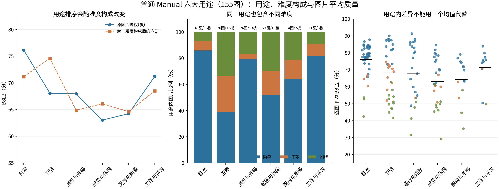
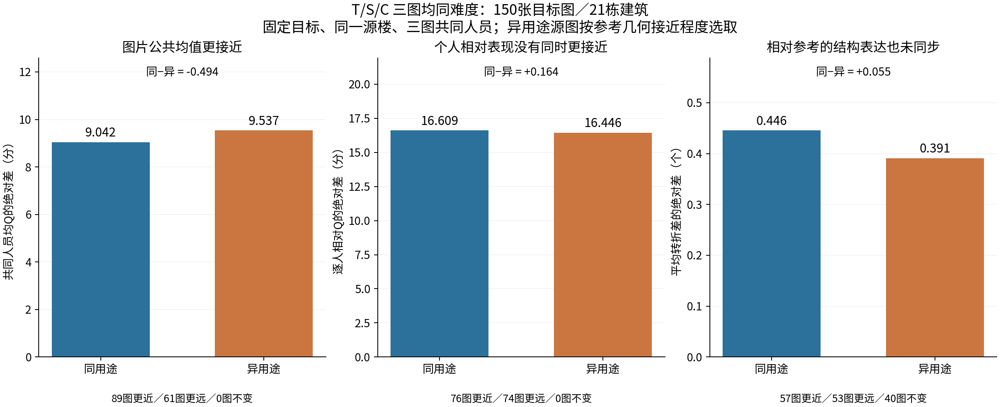
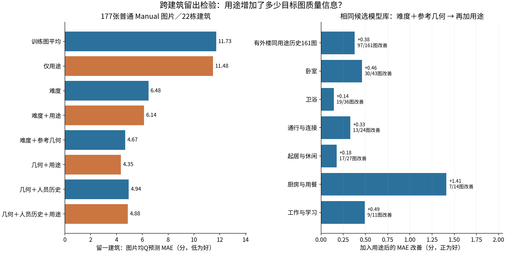
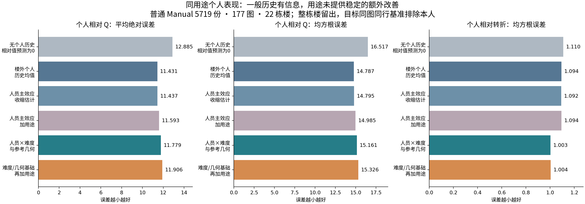
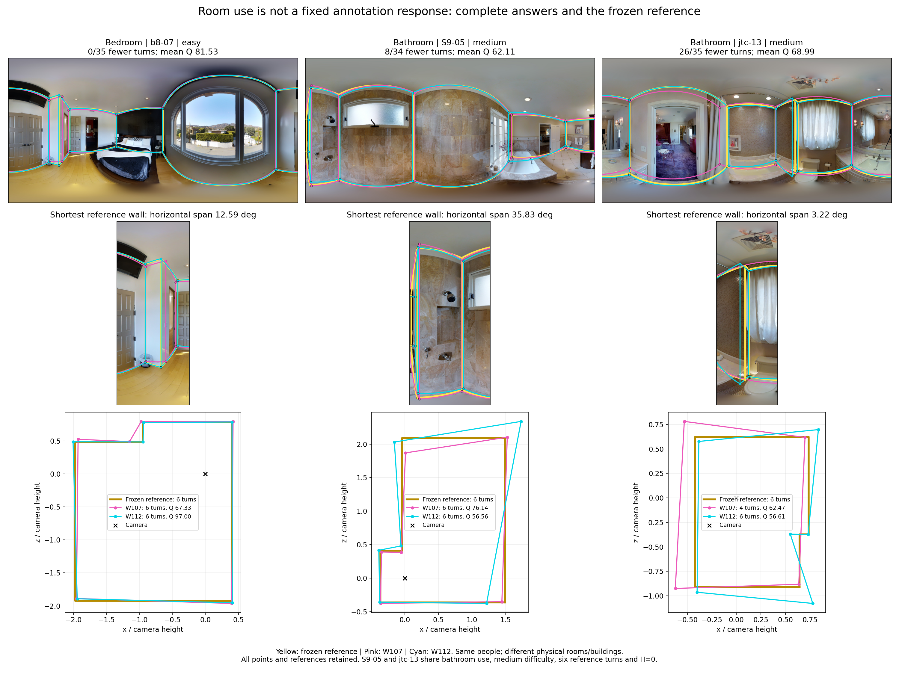

# 同用途的不同房间：质量、个人表现与结构表达能否重复？

**真人v2实证研究｜2026-10-27｜正式接续入口**  
采用GitHub main：[`b2b0898b90bd631df37f1f2e75e8380800a43cf8`](https://github.com/Sparkling-Flames/3D_Manhattan_label/tree/b2b0898b90bd631df37f1f2e75e8380800a43cf8)。  
主对象：普通Manual的原始独立作答。**本轮新增融合0、重新评分0、新人员分类0。**

## 1. 先回答三个研究问题

**同用途有小幅、条件性的图片公共水平相似，但不足以决定某个具体人的相对好坏。个人一般水平的跨房间重复性，明显强于粗用途专长的额外信息。**

| 研究问题 | 本轮判断 | 最有解释力的证据 |
|---|---|---|
| 不同物理房间，只要用途相同，图片平均质量是否相似？ | 在难度相同等条件下有小幅相似；跨难度直接套用同用途均值不可靠。 | 严格三图且三图同难度：同用途均Q距离9.042分、异用途9.537分，89/150图、15/21楼更近。跨全部难度的更强匹配中没有清楚优势。 |
| 个人相对表现是否重复？ | 一般个人水平重复；用途专属偏差没有稳定的额外留出用途。 | 161图：一般历史MAE11.449，零基线12.872；保护一般历史后的用途修正为11.450，21/22留楼折选择完全不加用途。 |
| 已知人员历史、难度与几何后，用途还有信息吗？ | 对图片均Q有少量条件信息；对个体相对Q及相对转折，额外信息很弱。 | 同候选模型的图片预测4.567→4.188分，97/161图、19/21楼改善。带人员池历史的模型也有小用途增量，但整体弱于几何＋用途；个人模型没有相应收益。 |

这三点不冲突。用途可以标记未完全被五个几何特征覆盖的任务背景，帮助校准整张图的平均水平；它并不保证同一批人员的排序、误差幅度或局部表达在该用途下固定。我们保留有范围的正例，也保留平均接近而个人响应很不相同的情况。

**建议进入论文主文的内容**：难度构成造成原始用途均值排序反转；已知结构条件下用途对图片均Q的小增量；一般个人水平可迁移而粗用途专长增量近零；完整原答案例揭示“同用途、同难度、同转折数”仍可能有不同结构机会与定位误差。用途特化选人不作为本轮推荐。

## 2. 实际输入、范围与既有用途标签

### 2.1 采用版本与可取得性

开始计算时main为 `b9bcec809fbaec8ab055931a1abb7baa5db44dac`；收到仓库更新后采用上列 `b2b0898…`。五个核心输入的Git blob完全一致。本轮输入与新上传scoping表的209个普通图片×条件单元逐一一致：Q最大浮点差小于3×10⁻¹⁴，D10小于5×10⁻¹⁴；261个用途标签无差异。因此没有把仓库更新伪称为另一批新数据，也没有为复制某个摘要数值更改样本。

`research/data/releases/v2/analysis_input/data.json.gz` 未作为公开仓库文件取得。实际使用公开 `v2_evidence_audit_20261019/records.json.gz` 中的v2用途、原答与正式质量，结合既有冻结难度/几何底表；旧processed input仅补标签来源说明，不覆盖v2质量或几何。最新scoping README说明并核对了这一公开真源，故主分析不受该私有入口阻塞。详见 [SOURCE_DEPENDENCIES.json](SOURCE_DEPENDENCIES.json)、[输入回执](inputs/INPUT_RECEIPT.json) 和 [新main对照](source/NEW_MAIN_SCOPING_COMPARISON.json)。

### 2.2 库存与主支持

输入保留10,439份作答、313个图片×条件单元和261个图片用途标签。正式质量按原资格取用：

- 普通Manual：**5,719份、177图、60人、22栋建筑**。
- 有外楼同用途支持的记录用途：**5,236份、161图、60人、21楼**，即六大用途加储藏与家务辅助。它是预测共同支持主读数；全177图的结果同时保留。
- 普通Semi：**901份、32图、59人、12楼**，独立建模，不与Manual合并。
- Manual门洞交界：**571份正式质量、17图、9楼**，单列描述；特殊层及OOS保留各自状态。OOS不进入普通质量分析。

| 用途 | 图片 | 建筑 | 人员 | 正式作答 | 图片等权均Q | 简单 | 中等 | 困难 |
| --- | --- | --- | --- | --- | --- | --- | --- | --- |
| 卧室 | 43 | 16 | 60 | 1421 | 76.158 | 37 | 3 | 3 |
| 卫浴 | 36 | 13 | 59 | 1111 | 68.073 | 14 | 10 | 12 |
| 通行与连接 | 24 | 13 | 59 | 807 | 67.957 | 19 | 1 | 4 |
| 起居与休闲 | 27 | 10 | 59 | 883 | 63.035 | 14 | 5 | 8 |
| 厨房与用餐 | 14 | 7 | 55 | 454 | 64.237 | 9 | 2 | 3 |
| 工作与学习 | 11 | 3 | 58 | 377 | 71.233 | 9 | 1 | 1 |
| 储藏与家务辅助 | 6 | 5 | 58 | 183 | 79.725 | 4 | 2 | 0 |
| 开放复合空间 | 3 | 1 | 45 | 97 | 64.507 | 0 | 3 | 0 |
| 特殊用途 | 2 | 1 | 44 | 70 | 69.416 | 1 | 1 | 0 |
| 无法判断 | 1 | 1 | 28 | 28 | 64.567 | 0 | 1 | 0 |
| 缺失（保留） | 10 | 6 | 59 | 288 | 78.667 | 7 | 3 | 0 |

表中均Q为图片等权，每张图先对正式可评作答求均值。用途缺失、“无法判断”、开放复合空间和特殊用途没有按Q补标签，也没有为了整齐强行合并。工作与学习只有3栋楼；开放复合空间只有1栋楼，不能把其数张图片当跨房间独立复制。

**本轮的跨房间定义**：主要比较与预测全部跨建筑。不同建筑中的同用途图片一定来自不同物理房间；本轮不把建筑当房间，也不把同楼未知关系当异房事实。整栋目标楼留出，同时隔离了该物理房间的其他视角。来源建筑内多视角仍有相关性，故描述先在来源楼内平均、再跨来源楼平均，并给出建筑层汇总。该设计回答跨建筑迁移，不宣称穷尽所有同楼异房关系。

## 3. 图片平均质量：用途差异有多少，为什么不能直接排序？

### 3.1 卧室高于卫浴的原始排序主要混入了难度构成

图片等权原始均值为卧室76.158、卫浴68.073，差8.085分。卧室43图中37图简单；卫浴36图中只有14图简单、12图困难。仅看简单图，卧室79.305、卫浴83.353，方向已反转。

将六大用途的简单/中等/困难构成统一到同一组图片比例后，卧室标准化均Q为**71.177**、卫浴**74.592**，差为**−3.415分**。整栋楼重抽2,000次，其中1,864次两个用途所有难度层都有支持，差值经验95%区间为 **[−6.977, −0.623]**；缺层的136次保持不可估，不补零。原始建筑等权均值差也只有约1.546分。这里的排序变化反映库存构成和条件关联，不是把房间用途作为可干预原因的因果结论。

证据：[难度标准化表](results/image/DIFFICULTY_STANDARDIZED_PURPOSE.csv)、[建筑重抽](results/image/BEDROOM_BATHROOM_BOOTSTRAP_INTERVALS.csv)。

### 3.2 固定共同人员后，均值相似性仍是条件性的

先做较宽的跨楼成对描述。每一目标图分别寻找同用途与异用途源图，图对两端用完全相同的共同人员计算质量，先来源建筑等权、再目标图片等权：

| 比较条件 | 目标图/楼 | 同用途共同人员均Q绝对差 | 异用途绝对差 | 同用途更近的目标图 |
|---|---:|---:|---:|---:|
| 所有难度 | 161/21 | 16.421 | 16.737 | 77/161 |
| 难度相同 | 158/21 | 8.736 | 9.723 | 105/158 |
| 难度与参考有效转折数均相同 | 128/21 | 8.324 | 9.703 | 87/128 |

实际人员池均值也呈相同条件变化，但共同人员比较更直接地排除了“恰好换了一批人”。这些行的支持不同，不能用行与行的均值之差估计难度或转折数的净效果。全部物理图对及双向目标汇总保存在 [CROSS_BUILDING_IMAGE_PAIRS.csv.gz](results/image/CROSS_BUILDING_IMAGE_PAIRS.csv.gz)、[PAIR_CONTRAST_SUMMARY.csv](results/image/PAIR_CONTRAST_SUMMARY.csv)。大量图对不作为大量独立样本。

人与人分歧的规模也有一点条件相似：在难度与参考转折均相同的128图支持上，共同人员Q标准差的图间差为同用途4.116、异用途4.699，88/128图同用途更近。但个人排序相关几乎相同：0.259与0.257。**一张图上人员分歧总体有多大，与究竟谁高谁低，是不同问题。**

### 3.3 更严格的三图匹配：保留均值小优势，不扩写为个人或结构优势

进一步固定目标图T，选一个外楼同用途源图S；异用途对照C必须来自**S所在的同一栋楼**。S/C难度相同，并在可行C中按五项冻结参考几何选最近者；T/S/C用同一人员交集，至少3人。选择不利用Q。严格几何匹配共有2,832个事件、161目标图/21楼，三图共同人数中位13。

这一全难度支持上，同用途均Q距离15.909、异用途15.630，同用途并不更近；对目标及来源建筑同时重抽的差值区间为[−1.139, 1.462]。这说明较宽成对结果中的用途相似性，不能脱离来源楼、几何和难度条件使用。

再仅重汇总已存在事件中**T/S/C三图都同难度**的部分：1,638事件、150目标图/21楼，共同人数中位15。没有因此新增模型或挑选有利Q。结果如下：

| 同一严格支持中的量 | 同用途 | 异用途 | 同用途−异用途 | 支持方向 |
|---|---:|---:|---:|---|
| 共同人员均Q绝对差，分 | 9.042 | 9.537 | −0.494 | 89/150图、15/21楼更近 |
| 共同人员均D10绝对差，分 | 8.815 | 9.194 | −0.378 | 87/150图、15/21楼更近 |
| 逐人相对Q绝对差，分 | 16.609 | 16.446 | +0.164 | 76图更近、74图更远；幅度无改善 |
| 人员Q排序相关 | 0.262 | 0.225 | +0.037 | 83图较高、66图较低、1图近零 |
| 平均有效转折数绝对差，个 | 0.726 | 0.716 | +0.010 | 45图更近、71更远、34近零 |
| 相对参考转折差的绝对差，个 | 0.446 | 0.391 | +0.055 | 57图更近、53更远、40近零 |
| 底点匹配偏差均值的图间差，标注像素 | 1.571 | 1.387 | +0.184 | 没有同步改善 |
| 原答自身正交方向误差的图间差，度 | 1.843 | 1.945 | −0.102 | 90/150图更近 |

相关略高与绝对误差不改善可以同时出现：前者只反映次序，不能代替质量差距。转折、方向与底点变化也不等价。**采用的是“同难度条件下公共平均水平小幅更近”，不是“同用途下所有标法都更接近”。**

按用途拆开，卧室41图中32图更近，Q距离减少1.312分、15/16楼方向相同；卫浴35图中22图更近，减少1.289分、9/12楼相同。起居27图平均仅减少0.409分，13图更近、14图更远；通行21图平均减少0.433分，但图等权与楼等权方向不同。厨房13图平均反而增加2.048分，虽然7图更近；工作9图/2楼增加2.066分。这些差别说明少数大幅视角/任务差异可改变均值，不以一个比例概括全部用途。

证据：[严格三图分用途表](results/image/MATCHED_ALL_THREE_SAME_DIFFICULTY_SUMMARY.csv)、[逐事件精确人员](results/image/MATCHED_THREE_IMAGE_EVENTS.csv.gz)、[所有条件支持](results/image/MATCHING_COVERAGE.csv)。全161支持的重抽区间没有套用到150图子域。

## 4. 用途能否帮助预测另一栋楼的图片均Q？

### 4.1 强基线比较：主要信息来自难度和几何，用途提供少量补充

全部方法在同一177图库存做22折整楼留出；主表重汇总到161张具有外楼同用途历史的目标图，训练与预测没有因该重汇总重新选择。Q与D10使用相同记录。每一目标图的Q只用于最终评价。

| 方法 | Q MAE | Q RMSE | 建筑等权MAE |
| --- | --- | --- | --- |
| 训练图片均值 | 12.019 | 14.272 | 12.466 |
| 仅用途 | 11.918 | 14.215 | 12.298 |
| 难度 | 6.556 | 8.619 | 6.758 |
| 难度＋用途 | 6.201 | 8.396 | 6.028 |
| 难度＋参考几何（丰富候选） | 4.567 | 5.976 | 4.628 |
| 同模型候选＋用途 | 4.188 | 5.532 | 4.346 |
| 几何＋人员池历史 | 4.845 | 6.409 | 4.697 |
| 几何＋人员池历史＋用途 | 4.634 | 6.235 | 4.603 |

这里“参考几何”包括既有有效转折、几何自遮挡、短边、最小角跨度和相机归一化半径的固定变换；使用已审核参考结构。**这是已知难度与结构条件下的预测/解释检验，不是无需参考的原图自动预测器。**用途、目标人员名单可以预先已知；目标原答Q及其结构表达没有进入输入。

主比较的几何模型与几何＋用途模型共享同一有限候选模型库（线性岭、二阶岭、小型梯度提升）和内层按楼分组的选择方法。用途使161图的Q MAE由**4.567降到4.188，改善0.379分**；RMSE由5.976降到5.532。改善97图、变差64图；建筑均值改善19/21楼。建筑等权改善0.282分。按建筑重抽的图片等权改善区间为[0.152, 0.667]；删去一个目标建筑后重新汇总固定OOF预测，改善仍为0.274—0.428分。该敏感性是重汇总，不是每次删除后重训全部模型。

D10 MAE由4.387降到4.218，改善0.168分，89/161图、16/21楼改善；建筑重抽区间[−0.026, 0.362]。因此用途的小增量以B8L2更清楚，不能写成各质量量都有同等强度。

### 4.2 哪些用途贡献了这个增量？

| 用途 | 图/楼 | Q MAE改善 | 改善图 | 改善楼 | D10 MAE改善 |
|---|---:|---:|---:|---:|---:|
| 卧室 | 43/16 | +0.461 | 30/43 | 11/16 | +0.446 |
| 卫浴 | 36/13 | +0.143 | 19/36 | 6/13 | −0.001 |
| 通行与连接 | 24/13 | +0.328 | 13/24 | 6/13 | +0.277 |
| 起居与休闲 | 27/10 | +0.175 | 17/27 | 6/10 | −0.094 |
| 厨房与用餐 | 14/7 | +1.412 | 7/14 | 3/7 | −0.148 |
| 工作与学习 | 11/3 | +0.492 | 9/11 | 2/3 | +0.685 |
| 储藏与家务辅助 | 6/5 | −0.289 | 2/6 | 1/5 | −0.272 |

卧室是较有范围、且Q/D10相符的用途补充信息。厨房的Q平均改善最大，但只有一半图片、3/7楼改善，D10反向；不采用“厨房普遍更可预测”的解释。工作与学习只有3楼，保存描述。卫浴、通行在不同计权/分项下不完全一致，适合作条件说明。

### 4.3 已知人员历史之后，用途还剩什么？

同一候选模型库内，加入人员池楼外一般历史后，图片Q MAE为4.845，再加用途为4.634，改善0.211分；76图改善、68图变差、17图相同。但这两个模型整体仍弱于4.567的纯几何强基线和4.188的几何＋用途模型。不能拿较弱模型的用途增量，宣称比最强方案更有用。

这不是因为所有图片用了同一批人：177图有160种实际正式人员集合，图对成员Jaccard中位0.468。只是每图池平均的一般相对历史水平标准差约0.487分，而图片均Q标准差13.841分；此种聚合个人历史特征提供的变化较小，新增拟合代价也可能抵消信息。它不否定后文个体历史的价值，也不证明任何更丰富人员信息都无用。

本轮先跑10个固定方法，再增加2个同候选库的几何对照，目的是把函数形式的灵活性与个人历史输入区分开；所有尝试及OOF都保留。这是有限的内部方法比较和跨楼留出检验，未包装成独立新数据外验。

证据：[161图模型读数](key_tables/K02_IMAGE_PREDICTION_161.csv)、[分用途增量](results/image/RICH_GEOMETRY_PURPOSE_MAIN_READOUT.csv)、[逐图OOF](results/image/LOBO_IMAGE_PREDICTIONS.csv.gz)、[历史特征分布](results/image/POOL_HISTORY_FEATURE_DISTRIBUTION.csv)。图左为全177图、图右为各用途支持；主表统一161图，不能混减。

## 5. 同一个人：一般水平重复，用途专长增量近零

### 5.1 相对表现的定义与可重复部分

个人目标定义为 **本人的Q减去同图其他正式可评人员的平均Q**；本人不进入同行基准。正值表示同一任务上相对同行较好，不能等同绝对Q高。所有历史都排除目标整栋建筑。模型预测再按预先已知的目标名单中心化，不读取目标Q。

在至少有两栋其他建筑同用途历史的记录上，目标图片等权的描述性相关如下：

| 用途 | 图/楼/人 | 同用途历史与目标相对Q相关 | 一般历史相关 | 去一般历史后的用途偏差相关 |
|---|---:|---:|---:|---:|
| 卧室 | 43/16/58 | 0.446 | 0.469 | 0.025 |
| 卫浴 | 36/13/59 | 0.317 | 0.379 | 0.022 |
| 通行与连接 | 24/13/59 | 0.358 | 0.434 | −0.088 |
| 起居与休闲 | 27/10/48 | 0.413 | 0.501 | −0.018 |
| 厨房与用餐 | 14/7/42 | 0.401 | 0.447 | 0.065 |
| 工作与学习 | 11/3/20 | 0.110 | 0.379 | −0.111 |

所以，“同用途历史正相关”是真实描述，但不能直接命名为用途专长：同一个人本来就常标得更好，已经能产生这种相关。去除一般历史后，剩余相关小得多且有正有负。此分解共享图片与人员，是描述而非因果方差归因；实用增量用留出预测判断。

### 5.2 同一目标支持上的留出比较

下表均为161图、5,236作答、60人的相同目标支持。每图先平均作答误差，再图片等权。

| 方法 | Q MAE | Q RMSE |
| --- | --- | --- |
| 无个人历史，相对差预测为0 | 12.872 | 16.534 |
| 一般个人历史 | 11.449 | 14.824 |
| 仅同用途历史（不足回退） | 12.107 | 15.796 |
| 人员主效应收缩 | 11.450 | 14.828 |
| 人员主效应＋用途 | 11.591 | 15.005 |
| 人员×难度/几何 | 11.794 | 15.202 |
| 人员×难度/几何＋用途 | 11.898 | 15.349 |

一般历史把MAE从12.872降到11.449。与其很接近的人员主效应收缩模型改善143/161图、20/21楼。**一般个人水平值得保留。**只取同用途历史反而为12.107，比一般历史多0.658分误差，仅40/161图改善；窄历史并未自动带来更有针对性的信息。

共同正则模型中加入用途变差，可能同时含有新参数估计与正则参数干扰。因此另做一次有限、明确的“保护基线”比较：固定一般历史，添加“本人同用途历史偏差 × b/(b+λ)”，b为楼外同用途历史建筑数，λ在{0,1,4,16,64,∞}中由内层按楼验证选择；∞表示不加用途。

**22个外楼折中21折选∞，1折选64。**161图上Q MAE **11.448920→11.449812**，D10 **11.066344→11.066987**；149图完全不变、4图改善、8图变差。因此最终采用措辞是“用途额外个人信息收缩到近零”，不是“用途对人有害”。这是看到共同正则问题后追加的内部比较，全部设计、参数和结果已保存。

旧216份历史holdout不作训练、也从训练同行基准排除的敏感性仍相同：全177图一般历史MAE11.445，几何11.807，几何＋用途11.910。没有因本轮分析而恢复旧训练资格；主检验使用当前正式质量做新的整楼内部留出，二者身份分开。

图展示全177图共同正则方法；主采用的保护基线结果另见 [K10](key_tables/K10_PROTECTED_PURPOSE_SUMMARY.csv)。证据：[个人方法表](results/personal/main161/METHOD_SUMMARY.csv)、[逐人OOF](results/personal/OOF_Q.csv.gz)、[保护基线设计与结果](results/personal_protected_purpose/)、[重复性表](results/personal/REPEATABILITY_WEIGHTED.csv)。

### 5.3 仍保留哪些具体人员例子？

| 人员×用途 | 支持 | 实际相对Q | 相对本人一般历史 | 解释 |
|---|---:|---:|---:|---|
| W028·卧室 | 13图/7楼 | +2.436 | +7.027 | 6/7楼在几何基线上方；用途模型比一般历史MAE改善1.039，有限范围正例。 |
| W130·起居 | 22图/10楼 | +23.539 | +8.222 | 9/10楼高于几何基线，但用途模型比一般历史只改善0.406，不能夸大增量。 |
| W115·卫浴 | 21图/11楼 | +6.917 | −9.713 | 仍高于同图同行，只是比本人通常水平低；不能叫“卫浴低质量人员”。 |
| W122·卧室 | 33图/14楼 | +13.319 | −2.235 | 一般质量较高，但加入用途相对几何模型MAE增加2.465，是修正无用的反例。 |

这是分析完成后挑出的解释卡片，不是预先划出的外部验证组。所有人员×用途卡片与逐楼方向都在[K08](key_tables/K08_PERSON_PURPOSE_CARDS.csv)，便于看到例子之外的分布；不据此生成永久人员类别。

还有均值接近、个人变动大的具体图对：卧室简单图 `q9vSo1VnCiC-15 ↔ wc2JMjhGNzB-54` 有23名共同人员，共同均Q仅差0.715分，逐人相对Q绝对差却为22.415分，排序相关−0.045。该对按“共同人≥20、均值差<2”事后选作解释，不用它估计总体出现率。

## 6. 结构表达和定位：用途不是局部任务的替代品

### 6.1 结构预测的收益来自哪里？

177图中**97图的正式人员有效转折数完全相同**，只有80图存在可定义的人员转折排序。以同图其他人员为基准的相对转折预测：

| 方法 | MAE（个转折） | RMSE（个转折） |
|---|---:|---:|
| 相对差预测为0 | 0.488 | 1.110 |
| 人员主效应 | 0.580 | 1.092 |
| 人员×难度/五项参考几何 | 0.494 | 1.003 |
| 上述模型再加用途 | 0.495 | 1.004 |

几何相对人员主效应的改善覆盖152/177图、21/22楼，但其MAE仍未胜过零基线。RMSE下降表明它主要帮助解释结构差异和大误差更明显的任务。不能把它写成每张图的结构预测全面改善；用途没有在几何之上带来进一步收益。

### 6.2 已实际查看原图的三图对照

从Release取回并检查2048×1024原图；完整展示原答、参考、全景、局部放大和BEV。三张图均为参考6个有效转折、无冻结几何自遮挡；它们不是新增融合案例。

| 图片 | 用途/难度 | 正式作答 | 均Q | 简化作答 | 参考短边角跨度 |
|---|---|---:|---:|---:|---:|
| b8cTxDM8gDG-07 | 卧室/简单 | 35 | 81.53 | 0/35 | 12.59° |
| S9hNv5qa7GM-05 | 卫浴/中等 | 34 | 62.11 | 8/34 | 35.83° |
| jtcxE69GiFV-13 | 卫浴/中等 | 35 | 68.99 | 26/35 | 3.22° |

两个卫浴来自不同建筑、同一难度层、同一参考转折数，但jtc-13的必要局部转折在全景中角跨度很小。31名共同人员上，均Q为62.27与68.10，差5.83分；逐人绝对Q差18.35分、排序相关约−0.002。jtc-13相对S9-05有21人表达更少转折、9人相同、1人更多。**同用途与粗难度不能替代局部结构机会。**

W112在两个卫浴均保留6转折，Q却分别仅56.558与56.608；完整BEV可见范围/墙向/位置仍有偏差。其原答自身正交误差约7.81°与7.58°；转折齐全不等于定位好。W107在S9-05保留6转折、Q76.144；到jtc-13只有4转折、Q62.468。后者Q仍高于W112的6转折答案，说明总质量不是转折计数的单调函数。案例表同时给出D10、地面IoU、底点与高度分项，不凭用途名称猜误差。

完整支持为104份正式作答和104份几何，6份突出展示；旧b8/jtc对照33名共同人员与本轮单图35人分母分开。原图来源、对象ID、参考版本、完整坐标和重新作图代码都在 [cases_history/](cases_history/)。选例用于解释已观察机制，不估计总体比例。

## 7. 合法记录时间、Semi与门洞

### 7.1 时间：一般个人速度可以重复，粗用途修正没有收益

仅用正式质量记录中的合法正耗时，按记录来源分别分析；同图同来源至少3人。目标为本人log耗时减去同来源其他人的平均log耗时。历史同样排除目标楼。

| 时间来源 | 可比作答/图/人 | 零基线MAE | 一般历史MAE | 再加用途MAE |
|---|---:|---:|---:|---:|
| 旧来源已核耗时 | 756/84/23 | 0.814 | 0.570 | 0.577 |
| 新来源用户整理报告耗时 | 4424/175/35 | 0.465 | 0.261 | 0.261 |

这里是对数相对误差，不能直接当秒或成本百分比。新来源用途修正全部收缩为零；旧来源平均略变差0.00677，21图改善、34图变差、29图相同。实际秒数按用途/难度/来源另存 [TIME_PURPOSE_DIFFICULTY.csv](results/time_secondary/TIME_PURPOSE_DIFFICULTY.csv)。旧非法时长、未冻结人工调整、前导耗时等不替换、不混合。该有限时间分析支持一般速度信息，没有建立按用途提速的策略。

### 7.2 次要条件保持自己的结果

Semi独立留楼：一般个人历史Q MAE13.584，优于同用途历史14.549和零基线15.548；几何15.382，再加用途15.362。后两者的小改善不能代替与一般历史强基线比较。缺初始化不阻塞这项终稿质量分析，但本轮没有新增“盲信”机会或错误率推断。

门洞17图保留用途、难度、均Q、几何及人数支持描述；没有把门洞合并进普通用途的模型结论。OOS、GT暂停和质量不可用记录保留原状态；缺质量不填零，也不一概计作个人失败。用户既有M01、G046、G015裁定不重新提问或恢复资格。

## 8. 这对“人员与图片条件共同影响不确定性”增加了什么认识？

第一，图片公共水平与人员差异的身份需要分开。某用途的任务可有接近的平均水平或分歧规模，但不是每个人都沿相同幅度变化；排序相关、相对Q绝对差和结构差分别回答不同问题。

第二，一般个人水平是更可复用的历史信息。粗用途缩小了历史数据范围，却没有带来稳定增益。对于本库存，不推荐仅按“卧室专长”“卫浴专长”挑人；继续采用楼外一般Q/T、低尾和已验证结构倾向作为人员信息，同时看目标局部结构。

第三，用途仍值得留在图片条件层。它在已知几何的均Q预测中有小幅补充，尤其卧室的Q/D10和多楼支持较一致。这是一种校准变量的用途，不等同把用途当成难度或把房间类型变成人员类型。

第四，完整结构不保证高Q，简化也不能仅由用途解释。两个同为中等卫浴的六转折任务，通过短边可见角跨度和实际位置/方向误差呈现很不同的人员响应。历史结构类别应解释为倾向；具体任务的结构机会决定其如何实现。

## 9. 与既有研究的采用关系

| 既有材料 | 本轮怎样使用 | 采用边界 |
|---|---|---|
| 2026-10-15旧描述统计 | 保留其3152份/27人的旧版身份；解释研究问题演进。 | 不把旧均值当当前v2分母。 |
| 既有同物理房间研究 | 比较“公共水平可迁移、个人响应可变化”的概念。 | 本轮是跨建筑同用途；不重定义物理同房关系，不覆盖原同房成果。 |
| 既有用途×团队构成 | 读取已保存分层表作历史连接。旧H1纯高Q与纯低Q n=9对照：卧室5图/4楼Q差+12.23，卫浴8图/5楼+1.40，通行8图/5楼+6.73，均为原建筑等权口径。 | 支持不相同，不能相减得出净用途效应；不是本轮新增团队。 |
| 人员分类、画像及严格ABC | 保留已验收分类和正式替换结果；本轮补充任务条件解释。 | 不重新调类别，不用自然曲线或本轮相关替代严格替换实验。 |
| Manual 256人数自然曲线 | 最新main已归档，保留既有结果。 | 本轮未新增路径或融合；Semi未扩量，历史四策略是32条配对且沿用历史V3标签。 |
| scope讨论附件 | 采用“几何适用性、可观测性、范围裁定分开”的解释提醒。 | 未修改资格/GT/scope；附件文献说法不作为本轮未验证的事实引用。 |

历史精确来源和分母见 [HISTORY_CONNECTIONS_ZH.csv](cases_history/HISTORY_CONNECTIONS_ZH.csv) 及连接表。本轮不把个人预测弱外推为既有选队/停止无用，也不把图片均Q小收益外推为用途定向融合一定升质。

## 10. 方法、统计单位与实际完成内容

### 10.1 统计单位和留出

描述先在同一来源建筑内平均，再对来源楼平均，最终图片等权；建筑等权另列。严格三图先对同一T/S锚点的合法C平均，再来源楼平均。两种计权回答不同问题，没有选出唯一“正确”均值。图对、三图事件和同一个人的重复作答不当独立房间。

图片预测按整栋目标楼留出，内层5个建筑组选择有限参数；来源个人历史在内外层均重算，不读取目标/内层验证楼。图片内层按5折损失等权，个人内层按验证图片等权，均在代码中保留；最终评价统一图片等权并给建筑等权。未知用途用原缺失指示，不依据目标Q补标签。

楼重抽区间是已观察建筑支持上的重抽敏感性，不是随机招募新建筑的外部验证保证；所有尝试仍属于同一库存上的一次有限内部研究。没有根据显著性延长模型搜索。

### 10.2 实际完成清单

- 从冻结v2公开证据形成可复算小输入：10,439条标量/资格与几何关联，261标签，313图片×条件单元。
- 全部跨楼普通Manual原答图对；44,694个严格/较宽三图匹配事件，其中最近几何严格主事件2,832，三图同难度重汇总1,638。
- 图片均Q/D10：12种方法、177目标图、22个外楼折，共4,248条OOF预测，528个外层方法拟合记录；保留内层选择和输入历史。
- 个人Q/D10/转折：7种主方法、5,719个共同目标，每种结果40,033条OOF，共120,099条；另保存保护一般历史、旧训练口径、Semi的完整结果。
- 时间两来源单独留楼；三个Release原图、104完整原答/参考几何；所有选例有实际对象键。
- 复用既有正式Q/D10、难度与几何特征；本轮**零新增融合、零评分重算、零分类训练**。既有团队与人数研究仅按原归档引用，未把它们计为本轮新实验。

## 11. 采用判断与结束点

1. **保留**用途作为图片条件，用于已知结构下的小幅均Q校准和描述分层；模型必须同时保留难度/几何强基线。
2. **保留**一般个人相对Q/T的楼外历史；本轮用途专属个人修正不作部署或选人建议。
3. **保留**条件性局部例子与逐人卡片，但不将其重命名为新的永久人员类别。
4. **修正**“用途相同所以人员整体响应类似”的宽泛解释。均值相似、分歧规模、人员次序、误差幅度和结构表达必须分别报告。
5. **不再扩展**粗用途的模型搜索或无针对性的融合计算。本轮的负增量已有强基线和保护基线解释；没有为了得到正结果继续调类或调参。若将来需要纯原图应用，先解决目标难度/几何如何在无参考时取得，这是不同应用信息条件。

目前没有会改变主结论、且必须等待人工判断的图像问题。工作与学习、复合及特殊用途保留当前支持，不为凑齐用途采集或补造标签。

## 12. 可下载交付与复现

最小阅读入口为本报告、[CLAIM_INDEX_ZH.csv](CLAIM_INDEX_ZH.csv)、[NEW_OLD_CONCLUSIONS.csv](NEW_OLD_CONCLUSIONS.csv)、`key_tables/`。完整代码、固定输入、逐对象预测、精确三图人员、参考与坐标分别装入01—04包，统一解压到 `research/statistics/room_type_similarity_20261027/`。具体运行见 [REPRODUCE.md](REPRODUCE.md)，关联见 [FIELD_CONTRACT.md](FIELD_CONTRACT.md)。

报告代码小包可独立阅读，并包含标量输入以重跑本轮模型；案例包提供3张按需原图而非原图全集。已有仓库的大表通过固定commit/路径/SHA引用，不复制虚拟环境、缓存、旧端点全集或无效中间输出。最新有效文件和取回核对结果见 `CURRENT_VALID_FILES.md` 与 `delivery/`。每个交付ZIP均实际取回，内部CSV/gzip/JSONL读到末尾并核对键，检查对象为压缩包内文件。
