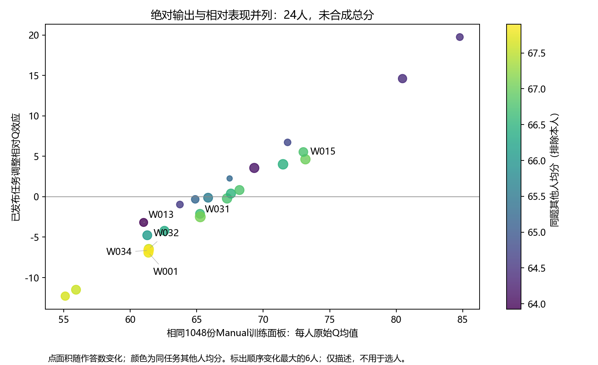
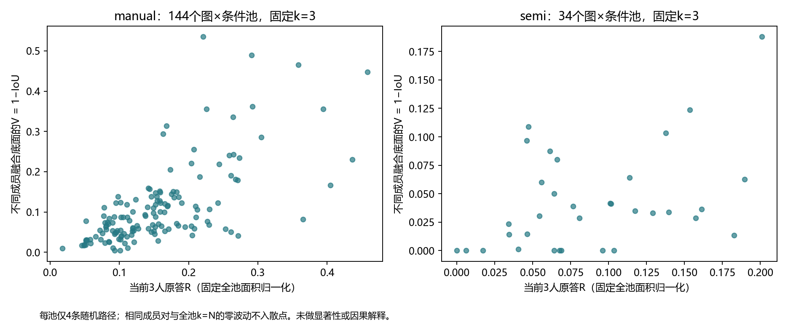
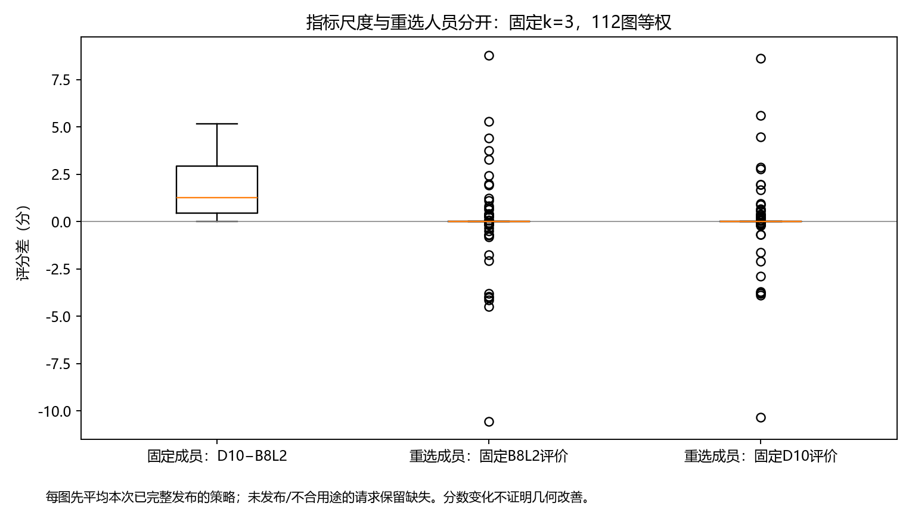

# 数据v1统计整合：质量、人员组成与共识过程

2026-10-17，分析修订 `v1_integrated_analysis_20261017_r1`。数据仍为v1；共同评分包中的v2、难度中的v6都不是数据v2。本包只读评分、画像、证据和已存真实融合，不改空间归属、难度、GT排除、资格、参数或release，不更新补人记录。

## 1. 当前分母仍成立，但“库存／来源／质量／训练”不能替换

3222份、261图、27源身份；独立票保留2991，来源分析合格2880，质量可用1911（普通1699、门洞188、其它24）。2774完整计算、298仅底面、122输入不可计算、28待绑定相加覆盖全库存；完整计算包含诊断，不能当质量分母。原始清洗retained=2993仍含2份非独立等限制，不等于2991独立票。

|条件|用途|库存数|质量数|质量图数|B8作答均分|B8图等权均分|D10作答均分|
|---|---|---|---|---|---|---|---|
|manual|doorway_quality|188|188|15|37.68|34.16|39.08|
|manual|not_qualified|968|0|0|—|—|—|
|manual|ordinary_primary|1258|1258|103|67.44|66.96|69.07|
|oos|not_qualified|234|0|0|—|—|—|
|semi|not_qualified|109|0|0|—|—|—|
|semi|ordinary_primary|441|441|29|79.39|79.83|80.37|
|semi|special_conditional_only|24|24|1|84.19|84.19|85.06|

以上保留Manual/Semi及用途层的作答等权、图等权；不能把总体Manual−Semi均分差叫辅助收益。OOS仅诊断。来源active time有2019份，既有target-matched有440份；两种时间各自按真实非空交集使用，新增5205秒没有伪造成同目标耗时。详见 `inventory_flow.csv`、`coverage_axes.csv`，复用旧统计的完整record_lookup及原因/时间缺失表，未重复另造全167列台账。

## 2. 哪些原均分受任务组成影响

只在人员线程同一1048份普通Manual训练面板比较，24人、87图；原分与已发布任务调整相对Q并列。相对Q不是只减三个难度均值，也未在本包重拟合。下表按原始顺序与相对效应顺序变化幅度机械取6人，顺序仅为描述；不把绝对与相对Q再加成总分。

|人员|作答数|图数|原均分|相对Q效应|原均分顺序|调整后顺序|同题其他人均分|
|---|---|---|---|---|---|---|---|
|W013|38|38|61.01|-3.18|22.00|17.00|63.93|
|W031|58|58|65.27|-2.49|13.00|16.00|67.07|
|W001|48|48|61.37|-6.92|20.00|22.00|67.76|
|W015|52|52|73.17|4.63|3.00|5.00|67.00|
|W034|55|55|61.38|-6.64|19.00|21.00|67.90|
|W032|50|50|61.39|-6.47|18.00|20.00|67.51|

例如W013原均分约61.01，原始顺序22而任务调整后17，仍为负相对效应；W018原始顺序5、调整后3，不能仅因均分不是最高便判断相对一般。同任务其他人均分是排除本人后的组成线索，仍会受其他人的组成影响，不是纯因果难度。此面板每人每图只有一条，所以个人的图等权和作答等权相同；总体图等权仍可不同。

`worker_mix_adjustment.csv`、`peer_task_evidence.csv`给出所有人而非仅上述例子。`worker_context_relative_effects.csv`复用各难度/门洞的现有相对效应与支持数；`within_worker_contrasts.csv`和原房间组低尾表保留同一人跨条件差异、独立图数、q10和缺失。不同层通常不是同任务，差值不当因果能力变化。q10只是经验低尾，少量记录的分位不稳；不是错误/可接受阈值。

## 3. 清洗后高Q与偶发错误可以并存

人员模块逐事件证据已接入。574份Semi初始链均为计划导入与运行预览匹配；不是精确模型检查点或实际观看事件证明。466份有当前坐标审查，100未改、366修改，其余108未检查；105条定向线索不是574份总体随机审核。旧order-sensitive相等与当前坐标多重集不等同，链表保留两轴，不静默合并。

已登记288个已知错误初始化机会，确认错误仍在39份，其余249份没有因此自动算作修复成功；不能用“1−未改率”造纠错率。已知残留占已知机会的下限为13.5%，审核选择偏向异常，不外推完整Semi总体。人员线程另有10份明确文字支持的个人错误剔除，分布和审核分母见 `reliability_worker_summary.csv`；全部3222提交作分母是已知错误下限，按明确规则可判断的1009份是另一分母。85份审核排除、133历史未接纳不能全改名个人严重错误；GT、OOS、借点、整人历史排除和来源不明各保留。

`quality_and_reliability_side_by_side.csv`把当前输出Q与已知失误/覆盖并列，没把剔除填0，也没做新的综合分。`reliability_event_links.csv`按object_id保持残留与剔除重叠，不能相加扣两次。当前B8L2/D10的初始化分仍未发布，因此净改善未计算；历史OSPA30收益只作历史列。本次同人员、同图、同目标且双条件都质量可用的Manual/Semi最终配对为0，不存在可用它替代初始化净收益的依据。

例如W036普通Manual训练原均分73.02、相对效应+5.53，同时有1份明确个人错误剔除、2份确认Semi错误残留。其Semi保留质量20份均分88.30，不会消除这两份纠错线索；反过来也不能拿少量定向事件把其全部输出归零。这正是质量均值与可靠性覆盖需要并列的原因。

## 4. 同k构成与具体成员：只用真实已存输出

旧642个真实团队继续作为单独面板，普通合格尝试399、完整374，25个无完整输出保留；4076替换对重叠，不能当4076个独立样本。`fixed_team_bridge.csv`附目标建筑外的Q二分和Q×T构成，固定成员同时评价B8L2/D10；`team_composition_summary.csv`区分同k构成与同构成不同成员的输出分布。旧团队的参考和用途掩码不因当前单人绑定而自动放宽。

更广过程本次固定读取41323个已完整发布路径节点、3512条路径；原4随机路径基线覆盖233池/208图，保留1个整池输入失败，不删坏成员凑成功。额外人员策略只采用实际已发布完整路径。本包保存消费快照并默认重放，源STATUS与CSV发布时的计数若短暂错位在FUSION_INPUT_SNAPSHOT中原样记录，不以计划数冒充完成数。当前人员策略覆盖见 `reselection_coverage.csv`，未发布输出仍缺失。

## 5. 原答R、融合V、完整率与参考Q是不同结果

R来自融合线程保存的当前成员原答平均两两底面对称差，归一化分母是固定全池并集；k=1没有R，有效/可能人对数保留。V来自已有同k两个实际融合结果的1−IoU；相同成员与全员k=N的零波动单列，不当正确性证明。四随机路径的重复子集按原路径频次保留，另报唯一集合数。`process_image_k.csv`把R/V、完整路径数、质量数和Q接在同一池×k；`process_composition_stability.csv`进一步区分同Q构成、不同构成、分类不充分及实际成员是否相同。

仅4条随机路径基线、普通Manual且前后均有主用途质量的池×相邻k单元中，有388/850个单元的路径均值B8L2下降。策略路径在底表另按path_kind分层，没有混进随机基线。它们重复使用图片，不是850个独立实验；下降也不自动证明融合无效。缺完整几何和缺参照Q的分母另报，不能只画成功均分讲“增人必然更接近GT”。独立难度模块固定104图的k=3/4/6面板已接入来源：困难组原答R与换组V均值较高，但完整性随k也可能下降；该观察不是难度标签独立验证，不能据此调整标签或推出所有困难图必然不一致。

## 6. 固定成员的指标敏感性与重选成员分开

`metric_reselection_contrasts.csv`保留全部12174个计划比较，其中两端已发布12030个、双端主用途可比7105个。144个比较因rPc-22整池输入失败没有输出，另有0个尚未发布，归因分列，失败不叫排队。固定成员D10−B8L2只改尺度；另用固定B8L2或固定D10评价重选成员后的差，恒等式逐行核验。不能把重选收益归因于公式，也不能把D10上涨说成几何更准确。`strategy_vs_matched_random.csv`另与原请求配对随机前缀比较，保留策略支持不足、缺输出和失败；不重算融合。

策略名称表示“该类先进入”，不保证人数k时全是该类；`focus_available_n/focus_covers_k`明确该类能否填满前缀，不能把人数不足后补其它人的前缀叫纯高Q或纯快者组合。

在同k=3、两策略类别都足够填满3人、两端均通过主用途资格的共同图片上，另做成对描述，避免直接比较覆盖不同的两列均值：

|selection_metric|left_policy|right_policy|n_eligible_left|n_eligible_right|n_common_images|B8L2_left_minus_right_median|B8L2_positive_images|B8L2_negative_images|
|---|---|---|---|---|---|---|---|---|
|B8L2|Q_higher_first|Q_lower_first|72|92|66|2.47|46|20|
|B8L2|QT_higher_faster_first|QT_higher_slower_first|15|56|15|-0.71|6|9|
|B8L2|QT_lower_faster_first|QT_lower_slower_first|58|63|46|-0.63|21|25|
|D10|Q_higher_first|Q_lower_first|76|87|67|2.84|46|21|
|D10|QT_higher_faster_first|QT_higher_slower_first|22|56|21|0.96|12|9|
|D10|QT_lower_faster_first|QT_lower_slower_first|52|63|44|-0.63|21|23|

这里“正/负”是共同图片上的真实策略差，不是独立重复试验；Q×T分组也不要求每个终点都优胜。同类人员仍可能产生不同几何，低尾、失败和具体成员效应见底表。

## 7. 房间按已有分类接入，关系不当独立样本

原260组/259工作组及777直接关系登记沿用；房间低尾和人员×房间表可重叠，不跨组相加、不以建筑代房间或传递关系。最新同房模块有83个范围可比Manual端点图对、8建筑、11人工组；不等于83个独立房间。仅换权重就会改变平均端点差：

|指标|最低共同人数|图对数|建筑数|人工组数|图对等权差|组等权差|建筑与组等权差|
|---|---|---|---|---|---|---|---|
|B8L2|1|83|8|11|9.41|8.48|7.74|
|B8L2|4|78|8|10|9.41|7.32|6.50|

`same_room_endpoint_integration.csv`保留217个范围可比Manual候选图对，其中83对有共同质量人员，`has_common_quality`明确其余空支持；并列两指标差与已选9对中的原答R。平均差小也可能掩盖相反方向的个人差。新同房已提出9对、4次重放、536个两侧前缀，其中7对参考主资格，但完整成对几何过程仍等待融合结果。本包不从独立随机路径拼造“同一共同人员序列”的同房迁移结论。

## 复算、底表与未完成

运行 `python -m tools.thesis_main.analysis.v1_integrated_analysis_20261017`。SOURCE_INPUTS记录v1与分析修订；FIELD_CONTRACT说明每表、分母、低尾与时间口径；DEPENDENCIES记录已采用和仍待输出。输入快照默认重放，不静默跟随上游滚动扩大本次面板。已有逐人逐图/房间宽表及原因/时间缺失表复用原路径，本包只补低尾、组成与跨模块连接。

关键图：

未完成：当前指标下的可信初始化净改善；同房请求的完整成对真实人数过程。rPc-22的整池输入失败及其对应144个重选比较保留，不靠删人“修好”；本次已接全部2580条获准人员策略路径，不能把已拒绝15条叫尚未运行。没有新拟合综合人员分、没有重新算融合几何，没有启动数据v2。各过程、视角及替换对共享人和图，当前是阶段描述而非大量独立实验或因果结论。检查与全局登记需求见HANDOFF。
