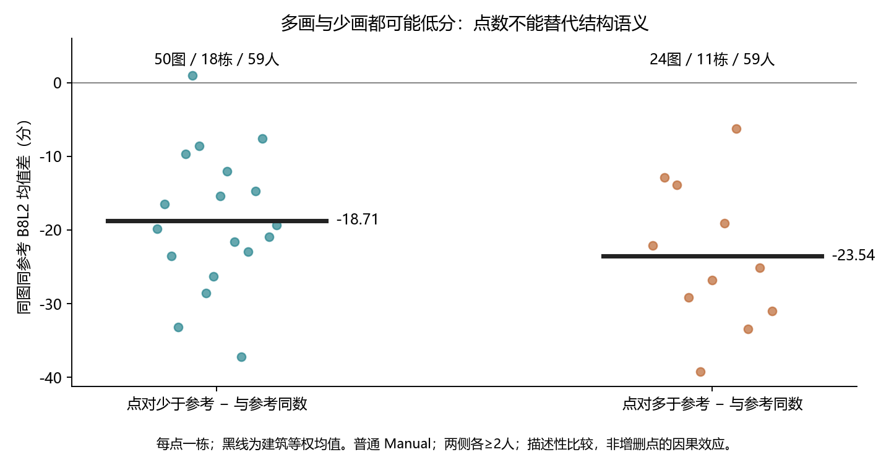
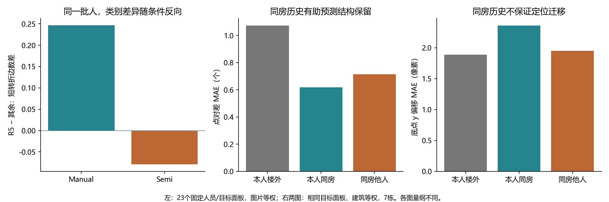

# v2：均值掩盖了哪些标法与融合差异

2026-10-20。一页发现摘要。库存起点为全部非 OOS **9217份、233图**，其中门洞17图单列；GT暂停图继续用于标法解释。下列数字各有自己的适用面板，不相加为独立样本。

|发现|适用图片、人员与实际效应|研究判断|
|---|---|---|
|**表达更细不等于任意多画都好**（本轮补充）|普通 Manual、同图同参考、两组各≥2人。少于参考点对数组：50图/18栋/59人，相对同数组 B8L2 **−18.71**；多于参考组：24图/11栋/59人，**−23.54**，D10方向相同。少画组17/18栋、多画组11/11栋为负。|已有R5六人多表达短转折（192图平均+0.329条），而不是普遍多共线点。应区分必要转折、共线分段、额外凹凸及范围，不能把类别优势压缩成“点越多越好”。两组图片不同、人员能力未控制，不作增删点的因果解释。|
|**同一批人的类别差异随条件反向**（复用）|固定同人、同图、同参考：23图/11栋/36人、479个跨条件配对。R5−其余的点对差由Manual **+0.418**变为Semi **−0.099**；短转折边差由 **+0.247**变为 **−0.079**。|Manual标法不能直接当作Semi中的固定个人属性。已有初始化实例中，编辑既可能删结构，也可能只重定位；新批缺初始化，不能补造操作原因。|
|**类别替换有效，但容量条件改变效应大小**（复用）|35名新批Rnew2候选类。在同一29图/6栋、13人团队中，以5名C01换5名C02，建筑等权 **+6.652**，24/29图改善、六栋方向均正；换2人仅 **+0.623**。持续支持n5–21的14图/5栋子集，n13换5人仅 **+1.045**。|支持类别构成与替换规模有作用，也表明总体均值不能迁移到每种容量面板。不要把29图与14图的差异解释成人数本身的因果效应。M03/S07已有局部转折恢复的连接证据，但尚未分解全部收益。|
|**同房能迁移结构信息，定位偏差却未必迁移**（复用）|44图/7栋/55人、1385个可评分目标图×人员记录：本人同房历史将相对参考点对差MAE从 **1.072降至0.617**；底点y偏移MAE却由 **1.889升至2.358像素**，七栋均更差。GT无关点数残差另有1458记录，本人同房仅略优于同房他人（0.639/0.646）。|结构保留与位置选择是不同轴。G046同一30人只有一个视角的必要转折支持不足；G178节点齐全却偏位。G057共同9人中，最后增人使门槛4→5票，两个视角9/9末步均降分。按机制选人比统一称“难图/低质量人”更有解释力。|

**下一步判断：**优先接通“类别成员→具体必要结构支持→现有融合节点”。先用G046已确认的两个必要转折、M03/S07的恢复正例与G057门槛反例，比较类别是否补充了总Q以外的信息。G178另查边界定位，不套用结构简化解释。分类结果接入后，在固定图片、人数和替换规模内统一比较类别画像、实际标法与构成效应，保留反例，不扩大标签搜索。

同图叠加与局部放大直接复用：[标法实例页](../../workers/personnel_marking_patterns_20261020/index.html)、[G046必要转折](../../same_room/same_room_multiview_20261020/structure_transfer/S9hNv5qa7GM-12_overlay.png)、[G178定位](../../same_room/same_room_multiview_20261020/structure_transfer/uNb9QFRL6hY-79_overlay.png)。无需用户批量逐对审核。来源、方法与限制见[主题说明](README.md)。
