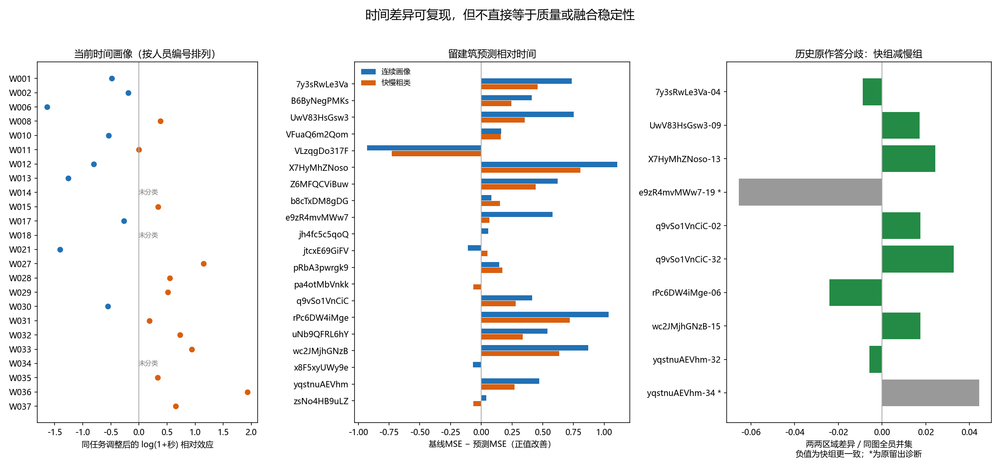

# 人员分类当前画像与时间粗类实证

2026-10-15交接补充：WQ已可作为有版本的工作指标，不再以“唯一最终Q尚未确定”阻塞下一轮。实际接入仍由本模块线程完成；本目录保留原实证结果，最新两版研究与接口见[跨模块交接](../../docs/thesis_main/现有数据收尾与模块接入交接_20261015.md)。

2026-10-14。人员分类服务于“不同真实人员构成如何改变标注结果和不确定性”。本轮已接通来源与扩展条件画像，并完成独立于最终主Q的时间粗类实验：**相对快慢有可复现的行为信号，但在当前八图上没有统一的组内标注一致性优势。** 这支持将时间保留为候选行为轴，尚不足以确定最终人员类别。

## 用户原意与本轮范围

本线程用户明确修订：“具体人群子类能收敛才最理想”属于较旧看法；当前主要寻找可解释、合理的分类，研究不同人员组合产生的变化和不确定性，并希望组合差异明显。原话及分析前定义见[本轮定义](DESIGN.md)。

粗类指少量可解释分组，细类可描述其内部进一步差异；当前没有用户直接要求固定二分/三分、等人数或必须层次分类。ABCD/AABC是不同真人的类别构成，同类两名成员必须是两个不同人。连续画像作对照，不替用户取消分类。导师文件末尾是用户回忆，并明确“人员分类这块，忘记讨论了”；它没有否定本线程较新的分类目标。

此前助手提出的Q/T/S/B、遗漏/外扩、2/3类、4/8人仍是候选建议。此次选择T作有限实算，是因为它已有可追溯资料且不依赖尚未确定的主Q。没有调节hill_global08或读取其总分建立排行。

## 当前资料与人员覆盖

当前loader逐份对照10月13日用途账本，全3152份保留：2344 manual、574 semi、234 oos。普通manual开发候选1304份；本模块沿用现有用途及独立票状态，没有恢复排除人员或原留出。

| 条件视图 | 作答 | 人员 | 图片 | 图片与参考单元 | 全24人共同单元 | 两人共同单元最少／中位数 |
|---|---:|---:|---:|---:|---:|---:|
| 当前底面可用manual | 1179 | 24 | 123 | 137 | 4 | 9／32 |
| 其中完整几何manual | 962 | 24 | 115 | 116 | 4 | 8／26 |

1179由962完整＋217仅底面组成，不包含另121份范围混杂的历史固定参考对照。全员交集小不意味着无法比较：当前276个人员对在完整视图中均有至少8个共同参考单元。全部六项的人员—参考单元连接图可识别，仍需按图片和参考条件比较，不能直接用不等覆盖的总均分排能力。

已整理IoU2D、底边角距、方向残差、整体高度差、局部高度差及高度比。六轴共有6423个数值单元、144个人员分项画像；底面三轴各1179条（1160条有同单元同伴），高度三轴各962条（943条有同伴）。单人单元不用于同任务人员效应估计，缺顶部不填零。

[逐份分项与参考来源](expanded_metric_inventory.csv)、[人员分项画像](metric_profiles.csv)、[两人共同覆盖](expanded_pair_coverage.csv)保存实际分母。`effect`是消除图片—参考单元截距后的条件相对差，`raw_mean`只作当前分配描述；它们不组成最终Q。合理范围、执行偏差与参考偏差仍需语义依据，不能从某个分项直接命名心理类型。

## 时间粗类的定义与结果

历史1885份无辅助时间表和574份Semi表均已按项目、任务、人员绑定到当前对象，再核对图片、建筑和日志人员。复用原time_ok及冻结active time，不重估日志、不补lead_time。当前manual开发层中716份合格时间来自23人、103图、21栋建筑、121个采集任务上下文；其中688份具有同任务同伴。

在每个训练折内消除任务截距，估计log(1+秒)的人员相对效应。训练支持沿用历史探索下限6个有效任务、3栋建筑。按训练池相对效应零线描述较快/较慢，不强制人数相等，也不扫描切点。这是分析者本轮固定的候选定义，不是绝对速度标准。

当前24人描述名单为9较快、12较慢、3未分类。W014没有进入本轮训练的合格时间；W018/W034支持不足，效应不作类型依据。名单和支持见[时间画像](time_profiles.csv)，所有目标建筑外名单见[逐折类别](time_assignments.csv)。

### 行为能否在其他建筑复现

每次排除整个目标建筑，重建画像与类别；在相同可评价人员集合内预测目标任务的相对log时间。零预测代表不区分人员。675份、21人、20栋建筑可评价；另一栋2t7的7份任务没有足够同任务可比较人员，明确保留无评价状态。

| 训练表达 | 合并平方误差下降 | 建筑等权MSE下降 | 改善建筑 |
|---|---:|---:|---:|
| 连续时间画像 | 62.32% | 50.49% | 16／20 |
| 固定快慢粗类 | 40.73% | 31.39% | 15／20 |

这些是**相对时间的预测误差变化**，不是质量改善、共识收益或分类正确率。粗类保留部分信息，连续值保留更多细节。VLzq建筑仅一任务两人，预测明显变差；逐建筑结果完整保留，不将总体正向写成所有场景有效。

50次互斥建筑两半校准，每半独立重估：1200个人员×划分机会中993可比，每次可比人员的快慢方向一致率中位数95%，范围85%—100%。它不是ARI、也不是独立人员重复采样。W011距零线很近：21个留楼折有15慢／6快，互斥两半仅2/50同向；W002、W017也有边界变化。总体重复性不能认证每个人的标签，细节见[逐人员两半结果](time_disjoint_halves.csv)。

### 时间类别与标注分歧的连接

共同24人十图的240份坐标、源点索引环序与当前loader全部一致；P别名通过记录ID连接W身份，不按编号猜对应。两张历史图e9z-19、yq-34共48份属于原留出，其诊断另标，不回流T校准。

用目标建筑外T名单重汇总历史两两范围差异。每图21人可分为快/慢、3人未分类；快快、慢慢、快慢和涉及未分类者的全部276个人员对保留。距离为两份底面区域对称差／该图全24人并集。

| 面板 | 快组更一致 | 快组更分散 | 快组减慢组的平均距离 | 快慢对差异高于两种同类对 |
|---|---:|---:|---:|---:|
| 历史完整十图 | 4／10 | 6／10 | +0.004965 | 2／10 |
| 当前可作开发比较的八图 | 3／8 | 5／8 | +0.008845 | 2／8 |

这里没有出现快组普遍更一致，也没有出现混合必然更分散。方向随图变化，不能用一个总体均值给速度类别贴好坏标签。各类人数不同，人员对也共享成员；这些是固定图片的描述，不能把人员对数当独立样本或将两两分歧当融合稳定性。完整对照见[逐图差异](time_common10_contrasts.csv)。

## 其他候选材料与已有组合结果

历史1013份scope记录已全部连接当前对象，其中779当前manual、234当前oos；原可标性裁决与人员选择原样保留。后续scope定义或裁决可能变化，因此本轮只整理覆盖，不把旧误收/误拒率认证为当前类别。S不是空间范围偏好。

574份Semi历史修改/净改善均有逐份记录与初始化证据字段，当前来源为288 trap、181未核实、64未改、41明确非trap且修改；最后41中39具有第二层条件用途。源分类与用途分别保存。历史B使用旧OSPA与旧处理视图，本次不把它当当前最终Q改善，也不将Manual修改量填零。数据见[source_inventory.csv](source_inventory.csv)。

既有Q上下半构成的同十图、8人、原GT、MV50对照已从CSV重新汇总：上半组9图参考差更小、7图原作答更一致、5图融合换组差更小，与报告一致。它仍是历史BEV/Lee及楼外IoU分组，不能成为新主Q或当前完整点融合的结论。纯类与混合可选择成员数不同，旧“混合波动较大”还受换人成分影响；不能认定为类别冲突。见[历史核对结果](historical_composition_recheck.json)。

## 后续人员研究的具体接入点

1. **T可以继续作行为候选和连续对照。** 名单边界与图间差异已可见；下一轮研究其构成作用时，应固定总人数，并比较相同基础团队下的同类替换、跨类替换。既有结果不能保证明显的融合差异，也没有理由因八图方向不统一就宣布T无效。
2. **主Q返回后接入当前扩展面板。** 用`record_id/object_id/worker_id`、采集条件、明确参考/候选范围、Q版本、完整/仅底面状态和用途连接。此时再形成质量画像及其粗类，检验质量与T是否提供不同解释，不把本轮时间类别变成选高Q名单。
3. **分项与范围倾向保留为待解释候选。** 当前分项表支持寻找“相近总体水平、不同误差形态”的候选，但尚未建立这种分类。尤其新范围参考与旧GT遗漏/外扩口径不同；必须先沿既有参考和范围记录解释，不直接套用上一轮助手建议的二/三类。
4. **细类需要额外可重复信息。** 若粗类内部仍有有来源的范围、结构或Semi行为差异，再研究细分；组数不由最漂亮的组合曲线决定。本轮没有启动所有Q/T/S/B组合搜索。

最终Q尚待Pro；完整点融合的人数/成员子组输出由融合模块提供。本轮未启动同房预测，也没有阻塞于Q等待。目前没有必须用户重新判断的问题；S/B后续若要形成当前类别，需要先完成新版来源与裁决口径接入，而非要求用户重答已知历史。

### 下一轮执行顺序与判断条件

先以当前覆盖表确定可比较人员和图片，在目标建筑外建立人员画像；Q接入后先检查版本、参考范围、完整/仅底面状态及缺失，暂不铺开多轴笛卡尔组合。首轮比较质量轴、时间轴及有语义证据的误差形态候选，同时保留连续画像对照。分类解释需要能追溯到实际作答行为，边界成员和支持不足者应明确报告。

随后固定图片、总人数、融合版本和评价参考，用真实不同人员构造同类与混合团队。优先采用相同基础团队的一人替换：同类换人衡量类内成员差异，跨类换人衡量改变类别构成后的差异；类别可选人数及团队覆盖必须一起报告，不能把较多的可选组合自动解释为较大不确定性。具体人数由共同覆盖和每类可用人数决定，不预先锁定4人或8人。

每项组合比较分别输出原作答分歧、融合结果相对参考的变化，以及固定人数下换人导致的融合变化；增人曲线随后单独研究。分析以同图配对比较为基础，报告逐图方向和效应大小，区分人员组成抽样波动与跨图片/建筑的变化。跨建筑推广的不确定性按建筑组织，不能将共享成员的团队或人员对当作独立样本扩充显著性。

是否保留某个分类，综合判断其行为解释、跨建筑重复性，以及对组合变化是否提供连续水平之外的有用描述。希望看到明显差异可以作为研究期待，但不能以“结果显著”为唯一保留条件：若效果只在某些图片条件出现，应检验交互解释；若分类反复不稳或只有回看结果后才有效，应降为探索或放弃。确定候选定义后再使用另行保留的资料验证，已经看过的八图不能改称独立验证集。

## 复现与交付

运行：`D:/anaconda/python.exe -B -m tools.thesis_main.analysis.worker_classification_progress_20261014`。

代码：[人员模块工具](../../tools/thesis_main/analysis/worker_classification_progress_20261014.py)；测试：[四项关键边界](../../tests/test_worker_classification_progress_20261014.py)。机器汇总见[SUMMARY.json](SUMMARY.json)，输入、单位和输出字段见[字段合同](FIELD_CONTRACT.json)，最终验证见[VERIFICATION.json](VERIFICATION.json)。

本模块新增工具、测试及本目录工件。正式资格、主Q参数、源作答、GT、历史结果和融合算法均未改。已检查项目地图与README；按统筹分工未写公共入口，建议统筹仅新增本README入口及工具/测试路径，并记录“分类合理性与组合不确定性为当前目标，子类收敛为历史目标”。机器合同中`worker_subtype_objective_20261003`仍保留旧阶段措辞，需统筹协调后作带日期解释，不能由本模块静默改写规范。

本轮不重跑原始日志审计、全量几何、质量调参或全仓测试；复用其明确冻结证据。图为本次分析交付图，不是检查截图，无临时截图遗留。不执行git add/commit/push。
